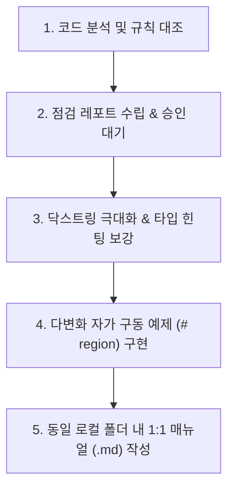

# 🛡️ 파이썬 코드 감사 및 로컬 매뉴얼 일괄 동기화 스킬 (Code Audit & Batch Sync)

이 스킬은 글로벌 파이썬 규칙(`PYTHON_CODE_AGENT.md`)에 따라 파이썬 프로젝트의 코드를 검수하고, 상세한 닥스트링과 예제를 내장시키며, 로컬 마크다운 매뉴얼을 수립한 뒤, 최종 완료 시점에 옵시디언 볼트로 일괄 배치 동기화하는 행동 메커니즘을 정의합니다.

---

## 📌 1. 실행 라이프사이클 (The 5-Step Execution Workflow)

에이전트는 사용자가 `"최종점검 진행하자"`, `"코드 점검해줘"`, `"매뉴얼 작성해줘"` 라고 요청할 때 아래 파이프라인을 엄격히 집행합니다.

### ① 단계 1: 코드 분석 및 글로벌 규칙 대조
* 수정 또는 검수할 대상 파이썬 모듈의 소스 코드를 읽어 들입니다.
* 글로벌 규칙 파일(`D:\00_obsidian\.agents\rules\PYTHON_CODE_AGENT.md`)을 읽어와서 아래 항목들을 전수 대조합니다:
  - 8대 동사 네이밍 헌장 및 단어형 소문자 인자 준수 여부
  - `plt.show()` 등의 프로세스 블로킹 코드 존재 여부
  - `save` 인자의 다형성 지원 유무
  - Type Hinting 적용도

### ② 단계 2: 점검 레포트 작성 및 사용자 승인 (Report-First)
* 치명적인 에러(문법 에러, 스트림 누수 등)는 즉시 수정하되, 구조적 개선 사항이나 리팩토링 요소는 **[점검 레포트]** 양식으로 요약하여 사용자에게 보고하고 승인을 득한 후 집행합니다.

### ③ 단계 3: 닥스트링 극대화 및 타입 힌팅 보강
* Google Style Docstring 규격을 100% 만족하도록 작성합니다.
* 특히 **`**kwargs`에 레거시 헝가리안 변수명 흡수 관계를 자세히 기술**하고, **`Examples` 구문을 필수로 삽입**합니다.

### ④ 단계 4: 다변화 자가 구동 검증 스위트 (# region) 구현
* 파일 하단 `if __name__ == "__main__":` 블록에 최소 3가지 이상의 다양한 실무 사용 시나리오(인자 변경, save 다형성, kwargs 흡수)를 자가 구동 함수 형태로 내장하여 회귀 테스트 환경을 보장합니다.

### ⑤ 단계 5: 동일 로컬 폴더에 1:1 마크다운 매뉴얼 생성 및 예외 규정
* 파이썬 파일(`.py`) 옆에 동명의 마크다운 파일(`.md`)을 생성하여 API 호출 규격과 실무 예제를 상세히 기록합니다.
* **🚨 예외 규정**: **`__init__.py` 및 임시/테스트 스크립트(`test_*.py`)는 1:1 마크다운 매뉴얼 생성 대상에서 명시적으로 제외합니다.** 이 파일들은 매번 동일한 이름으로 생성되어 중복과 폴더 비대화를 유발하므로 마크다운을 작성하지 않고, 패키지-레벨의 정보 노출 가이드는 해당 폴더의 **상위 모듈 대시보드(00_*_대시보드.md)**에 통합 수록합니다.
* **🚨 경고**: 이 단계에서는 절대 옵시디언 볼트로 실시간 복사/이중 수정을 가하지 않습니다. 오직 로컬 폴더 내에만 저장합니다.

---

## 🔄 2. 최종 완료 시점: 일괄 위키 승격 (Batch-Sync) 프로토콜

모든 개발 및 로컬 문서화가 완벽히 검증 종료된 후, 사용자가 `"위키 정리해줘"`, `"옵시디언에 작업 로그 남겨줘"`, `"데일리 회고 작성해줘"` 라고 명시적으로 지시할 때 비로소 아래의 동기화 작업을 일괄 집행합니다.

1. **수정 이력, 작업 현황, 버전 관리의 볼트 단일 기준 불변 원칙 (Vault Master Baseline Law)**:
   - **수정 이력(Changelog), 작업 진행 현황(Status), 공식 버전(Version Tag)의 절대적인 단일 판정 기준(SSOT)은 오직 옵시디언 볼트**입니다.
   - "현재 모듈이 몇 버전이고 어디까지 개발되었는가?"는 소스 코드 주석이나 로컬 파일 타임스탬프가 아닌, **오직 볼트 내 대시보드 상단의 `Changelog 타임테이블`에 적힌 기록만을 진실로 인정**합니다.
   - 에이전트는 작업 착수 시 가장 먼저 볼트의 대시보드를 읽어 현재 버전과 히스토리를 파악해야 하며, 작업 완료 시 버전 승격과 세부 내역 기록 역시 볼트 대시보드(`00_*_대시보드.md`) 상단 타임테이블에 최우선적으로 단독 기록합니다.
   - 파이썬 소스 코드 폴더(`unoUtil/`)에는 대시보드 파일을 절대 생성하거나 두지 않습니다. 크로스 디바이스 작업 환경에서 컴퓨터 간 버전 충돌을 방지하고 단일 타임라인 이력을 보존하기 위함입니다.
2. **1:1 매뉴얼 전용 볼트 마이그레이션**:
   - 파이썬 프로젝트 내부에서 성공적으로 생성된 개별 **1:1 `.md` 매뉴얼만** 옵시디언 볼트 내부의 해당 프로젝트 경로(`D:\00_obsidian\02_Projects\회사_업무\20_unoUtil_모듈개발\...`)로 복사 및 스마트 병합(Upsert)합니다.
3. **데일리 타임라인 반영**:
   - 당일 자 데일리 노트(`01_Daily/YYYY-MM-DD.md`)를 열어, 오늘 생성/수정된 위키 문서들을 `[[문서명]]` 링크로 걸고, 한 줄 핵심 체크리스트 요약으로 정갈하게 기록합니다.
4. **동기화 시 불필요 캐시 및 런타임 디렉터리 배제 필수화 (Exclude Cache Directories)**:
   - `robocopy` 혹은 파일 복제 기동 시, 파이썬 실행 바이트코드 폴더인 `__pycache__` 나 `.git`, `.pytest_cache` 등 연구 분석과 무관한 개발 임시 폴더들이 옵시디언 볼트로 복사 오버랩되는 현상을 방지하기 위해, 반드시 **`/XD __pycache__ .git .pytest_cache`** (Exclude Directories) 플래그를 결합하여 미러링해야 합니다.
5. **임시 작업상태 파일(`WORK_STATUS.md` 등) 생성 원천 금지 (No Standalone Status Files Law)**:
   - 작업 정리, 매뉴얼 작성, 위키 승격 시 로컬 소스 폴더나 옵시디언 볼트 내에 `WORK_STATUS.md`, `*_work_status.md`, `작업정리.md` 등의 임시 마크다운 파일을 **절대로 별도로 새로 생성하지 않습니다.**
   - 개발 진행 경과나 세부 변경 내역은 볼트 내 상위 모듈 대시보드(`00_*_대시보드.md`)의 **`## 📅 1. 프로젝트 주요 버전 이력 (Changelog 타임테이블)` 및 세부 섹션에 직접 업데이트(Upsert)**하여 문서 파편화를 방지합니다.
6. **단일 프로젝트 마스터 MOC 일원화 원칙 (Single Master MOC Law)**:
   - 프로젝트 하위 디렉토리에 서브 대시보드를 쪼개어 신설하지 않고, 프로젝트 루트의 **단일 마스터 대시보드 1곳**에서 전체 서브모듈을 관리합니다.
   - 신규 1:1 매뉴얼 승격 시, 마스터 대시보드 내 해당 도메인의 **접기형 콜아웃(`> [!NOTE]-`) 내부 3열 요약표**에 위키링크를 직접 인덱싱하여 단일 관제탑을 유지합니다.

---

## 🎯 3. unoUtil v2 개발 및 하위 호환성 단일 기준 불변 원칙 (Single Baseline Law)

1. **호환성의 유일한 기준은 'v1 (구버전 오리지널 레거시)'이다**:
   - 하위 호환성(Backward Compatibility)은 오직 사내에서 실제로 운영되던 v1 오리지널 레거시 코드(`unoUtil.vehicleTest.*`, `_AnalysisTestData_`, `_HndlTest_`, `_TEST_INFOR_RES_` 등)만을 대상으로 보장합니다.
2. **v2 과도기적 미완성 코드의 레거시 취급 및 별칭 양산 원천 금지**:
   - 현재 진행 중인 작업은 "아직 완성되지 않은 ver2를 정식 표준 규격으로 마무리(Finalize)하는 작업"입니다.
   - v2 개발 과정에서 임시로 생성되었거나 표준에 맞지 않던 과도기적 함수명, 변수명, 임시 파일들을 '보존해야 할 레거시'로 착각하여 불필요한 별칭(Alias), 브릿지 파일, 중복 래퍼를 계속 덧붙이는 행위를 엄격히 금지합니다. (작업의 무한 증식 방지)
3. **직교적이고 깔끔한 v2 단일 표준 완성**:
   - v2 내부의 모든 모듈, 클래스, 메서드, 파라미터는 최신 표준 규격(PascalCase, 8대 표준 동사, 비차단 시각화, 도메인 표준 변수명)에 맞추어 단일 진실 공급원(SSOT) 형태로 깨끗하고 직교적으로 정비합니다.

---

## 🏷️ 4. 클래스 역할 내포 시 메서드 접두사 중복 방지 원칙 (No Redundant Prefix Law)

1. **클래스명에 이미 역할/동사가 내포된 경우 접두사 중복 배제**:
   - `Plotter`, `PlotterTire`, `PlotterProject`, `Reader`, `Writer` 등 클래스명 자체에 이미 특정 동작/역할(동사적 의미)이 명확히 담겨 있는 전용 클래스는, 내부 메서드에 동일한 동작 접두사(`plot_`, `read_`, `save_` 등)를 강제로 덧붙이지 않습니다.
   - **사유**: `plotter.plot_accbrk()` 처럼 호출하면 클래스명과 메서드명이 불필요하게 중복되어(`plotter.plot_...`) 가독성과 객체지향적 자연스러움을 심각하게 해칩니다.
2. **자연스러운 메서드 명명 표준**:
   - 시각화 전담 클래스(`PlotterTire`, `PlotterProject` 등) 내부 메서드는 `plotter.accbrk()`, `plotter.acceleration()`, `plotter.compare_braking()` 처럼 **대상(목적어) 또는 차별화된 세부 행위만 명료하게 기술**합니다.
   - 분석 전담 클래스(`AnAcceleration`, `AnResponse` 등) 내부 메서드는 `analysis()` 등 도메인 고유의 정합된 호출 규격을 유지합니다.
3. **8대 동사 접두사 의무 대상**:
   - 일반 모듈 레벨 전역 함수(예: `calc_mfdd()`, `find_reference_tire()`) 및 다목적 서비스 클래스(예: `VehicleDynamic.align_coordinate()`, `VehicleDynamic.calc_side_slip_angle()`)에서는 8대 표준 동사를 엄격히 준수합니다.

