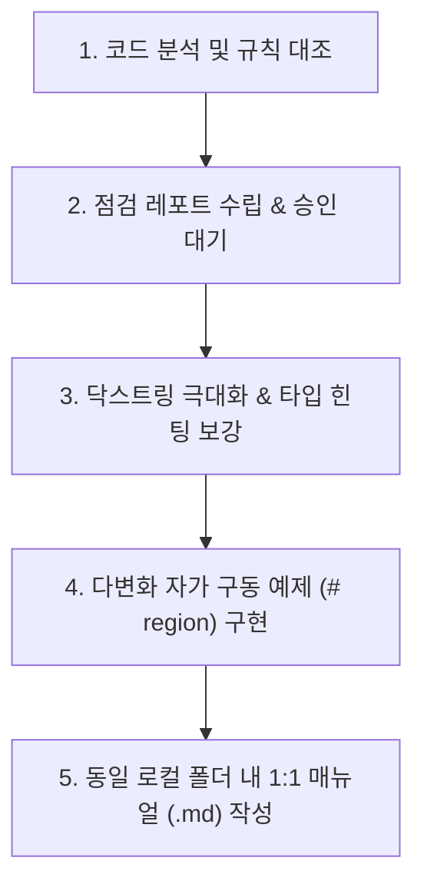

# 🛡️ 파이썬 코드 감사 및 로컬 매뉴얼 일괄 동기화 스킬 (Code Audit & Batch Sync)

이 스킬은 글로벌 파이썬 규칙(`PYTHON_CODE_AGENT.md`)에 따라 파이썬 프로젝트의 코드를 검수하고, 상세한 닥스트링과 예제를 내장시키며, 로컬 마크다운 매뉴얼을 수립한 뒤, 최종 완료 시점에 옵시디언 볼트로 일괄 배치 동기화하는 행동 메커니즘을 정의합니다.

---

## 📌 1. 실행 라이프사이클 (The 5-Step Execution Workflow)

에이전트는 사용자가 `"최종점검 진행하자"`, `"코드 점검해줘"`, `"매뉴얼 작성해줘"` 라고 요청할 때 아래 파이프라인을 엄격히 집행합니다.

### ① 단계 1: 코드 분석 및 글로벌 규칙 대조
* 수정 또는 검수할 대상 파이썬 모듈의 소스 코드를 읽어 들입니다.
* 글로벌 규칙 파일(`D:\00_obsidian\.agents\rules\PYTHON_CODE_AGENT.md`)을 읽어와서 아래 항목들을 전수 대조합니다:
  - 8대 동사 네이밍 헌장 및 단어형 소문자 인자 준수 여부
  - `plt.show()` 등의 프로세스 블로킹 코드 존재 여부
  - `save` 인자의 다형성 지원 유무
  - Type Hinting 적용도

### ② 단계 2: 점검 레포트 작성 및 사용자 승인 (Report-First)
* 치명적인 에러(문법 에러, 스트림 누수 등)는 즉시 수정하되, 구조적 개선 사항이나 리팩토링 요소는 **[점검 레포트]** 양식으로 요약하여 사용자에게 보고하고 승인을 득한 후 집행합니다.

### ③ 단계 3: 닥스트링 극대화 및 타입 힌팅 보강
* Google Style Docstring 규격을 100% 만족하도록 작성합니다.
* 특히 **`**kwargs`에 레거시 헝가리안 변수명 흡수 관계를 자세히 기술**하고, **`Examples` 구문을 필수로 삽입**합니다.

### ④ 단계 4: 다변화 자가 구동 검증 스위트 (# region) 구현
* 파일 하단 `if __name__ == "__main__":` 블록에 최소 3가지 이상의 다양한 실무 사용 시나리오(인자 변경, save 다형성, kwargs 흡수)를 자가 구동 함수 형태로 내장하여 회귀 테스트 환경을 보장합니다.

### ⑤ 단계 5: 동일 로컬 폴더에 1:1 마크다운 매뉴얼 생성 및 예외 규정
* 파이썬 파일(`.py`) 옆에 동명의 마크다운 파일(`.md`)을 생성하여 API 호출 규격과 실무 예제를 상세히 기록합니다.
* **🚨 예외 규정**: **`__init__.py` 및 임시/테스트 스크립트(`test_*.py`)는 1:1 마크다운 매뉴얼 생성 대상에서 명시적으로 제외합니다.** 이 파일들은 매번 동일한 이름으로 생성되어 중복과 폴더 비대화를 유발하므로 마크다운을 작성하지 않고, 패키지-레벨의 정보 노출 가이드는 해당 폴더의 **상위 모듈 대시보드(00_*_대시보드.md)**에 통합 수록합니다.
* **🚨 경고**: 이 단계에서는 절대 옵시디언 볼트로 실시간 복사/이중 수정을 가하지 않습니다. 오직 로컬 폴더 내에만 저장합니다.

---

## 🔄 2. 최종 완료 시점: 일괄 위키 승격 (Batch-Sync) 프로토콜

모든 개발 및 로컬 문서화가 완벽히 검증 종료된 후, 사용자가 `"위키 정리해줘"`, `"옵시디언에 작업 로그 남겨줘"`, `"데일리 회고 작성해줘"` 라고 명시적으로 지시할 때 비로소 아래의 동기화 작업을 일괄 집행합니다.

1. **볼트 마이그레이션**:
   - 로컬 프로젝트 내부에서 성공적으로 생성된 개별 `.md` 매뉴얼과 통합 모듈 대시보드를 옵시디언 볼트 내부의 해당 프로젝트 경로(`D:\00_obsidian\02_Projects\회사_업무\20_unoUtil_모듈개발\...`)로 복사 및 스마트 병합(Upsert)합니다.
2. **데일리 타임라인 반영**:
   - 당일 자 데일리 노트(`01_Daily/YYYY-MM-DD.md`)를 열어, 오늘 생성/수정된 위키 문서들을 `[[문서명]]` 링크로 걸고, 한 줄 핵심 체크리스트 요약으로 정갈하게 기록합니다.
3. **대시보드 작성 및 업데이트 시 초반부 타임테이블 관리 의무화**:
   - 일괄 동기화(Batch-Sync) 시, 대시보드를 **새로 작성하거나 업데이트할 때 문서의 초반부(상단부)에 반드시 작업 내용에 대한 타임테이블(Changelog)이 포함**되어야 하며, 이 테이블(`## 📅 1. 프로젝트 주요 버전 이력 (Changelog 타임테이블)`)을 통해 세션별 작업 내용과 진행 내역들의 히스토리를 정교하게 누적 관리하고 함께 동기화 배포해야 합니다. 이로써 대시보드 진입 즉시 전체 패키지의 수렴 방향과 진행 역사가 일목요연하게 파악되며, 다른 컴퓨터나 기기에서 작업을 이어서 하더라도 이력 정합성이 완벽하게 유지됩니다.
4. **동기화 시 불필요 캐시 및 런타임 디렉터리 배제 필수화 (Exclude Cache Directories)**:
   - `robocopy` 혹은 파일 복제 기동 시, 파이썬 실행 바이트코드 폴더인 `__pycache__` 나 `.git`, `.pytest_cache` 등 연구 분석과 무관한 개발 임시 폴더들이 옵시디언 볼트로 복사 오버랩되는 현상을 방지하기 위해, 반드시 **`/XD __pycache__ .git .pytest_cache`** (Exclude Directories) 플래그를 결합하여 미러링해야 합니다.
5. **임시 작업상태 파일(`WORK_STATUS.md` 등) 생성 원천 금지 (No Standalone Status Files Law)**:
   - 작업 정리, 매뉴얼 작성, 위키 승격 시 로컬 소스 폴더나 옵시디언 볼트 내에 `WORK_STATUS.md`, `*_work_status.md`, `작업정리.md` 등의 임시 마크다운 파일을 **절대로 별도로 새로 생성하지 않습니다.**
   - 개발 진행 경과나 세부 변경 내역은 상위 모듈 대시보드(`00_*_대시보드.md`)의 **`## 📅 1. 프로젝트 주요 버전 이력 (Changelog 타임테이블)` 및 세부 섹션에 직접 업데이트(Upsert)**하여 문서 파편화를 방지합니다.

