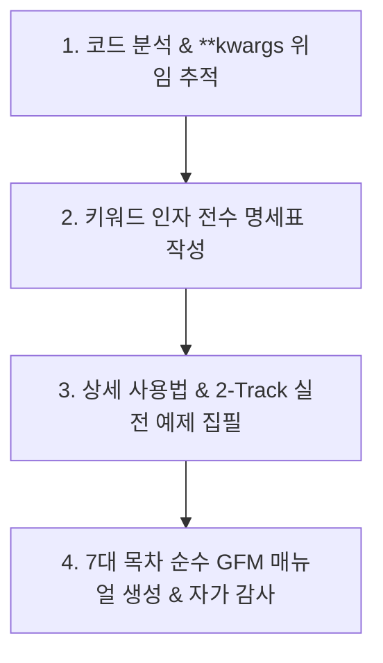

# 🛠️ code-manual-writer: 순수 1:1 파이썬 코드 기술 매뉴얼 작성 전문 스킬

본 스킬은 파이썬 모듈(`*.py`)과 1:1로 대응되는 **개발자 및 데이터 분석가용 순수 기술 매뉴얼(`*.md`)**을 집필 및 고도화하는 전문 엔지니어링 스킬입니다.
GitHub, VS Code, 일반 마크다운 뷰어 어디서든 즉시 렌더링될 수 있도록 **옵시디언 볼트와의 의존성을 100% 제거**하고, 실제 코드를 사용하는 엔지니어가 함수 내부 소스코드를 열어보지 않고도 모든 기능을 다룰 수 있도록 **키워드 인자(`**kwargs`) 전수 명세와 실무 예제**를 정밀하게 명세합니다.

---

## 📌 1. 실행 트리거 (When to Activate)
사용자가 다음과 같은 지시를 내릴 때 본 스킬을 즉시 가동합니다:
- *"xxx.py 매뉴얼 작성해줘 / 만들어줘"*
- *"xxx.md 매뉴얼 고도화해줘 / 업데이트해줘"*
- *"모듈 사용법 및 키워드 인자 매뉴얼 정리해줘"*
- *"코드 매뉴얼 순수 GFM 규격으로 다듬어줘"*

---

## 🚫 2. 3대 절대 가드레일 (Strict Guardrails)

1. **옵시디언 전용 문법 원천 배제 (No Obsidian Syntax)**:
   - 옵시디언 위키링크(`[[문서명]]`, `[[문서명|별칭]]`), 임베드(`![[...]]`) 사용을 엄격히 금지합니다.
   - 볼트 내부 전용 번호 체계(`20_...`), 볼트 대시보드 파일명(`00_*_대시보드.md`)을 일절 언급하지 않습니다.
   - 오직 **표준 GFM(GitHub Flavored Markdown)** 규격만 사용합니다.
2. **패키지 내부 문서 간 순수 상대 경로 링크만 허용 (Relative Links Only)**:
   - 동일 패키지 내 다른 코드 매뉴얼을 참조할 때는 반드시 **상대경로 마크다운 링크**만 허용합니다.  
     *(예: `[VBBReader 매뉴얼](./vbbTopython/VBBReader.md)`, `[BaseParser 매뉴얼](./parsers/base_parser.md)`)*
3. **영구 도메인 이론 및 작업 이력 분리 (Knowledge Isolation)**:
   - 수학적/학술적 심층 이론(이는 볼트 `04_Resources/`의 몫), 작업 이력 및 버전 타임테이블(이는 볼트 `00_*_대시보드.md`의 몫)은 매뉴얼에 작성하지 않고 옵시디언 볼트로 위임합니다.

---

## 🔄 3. 4단계 표준 작성 워크플로 (4-Step Workflow)



### [Step 1] 소스 코드 및 위임 체인 심층 분석 (kwargs Tracing)
1. 대상 모듈(`*.py`)의 모든 클래스, 메서드, 프로퍼티, 기본값, 타입 힌트를 분석합니다.
2. **`**kwargs` 위임 경로 전수 추적**:
   - 최상위 진입점(생성자 `__init__` 또는 엔트리 함수)이 `**kwargs`를 받아 내부로 포워딩할 경우,
   - **인자를 최종 소비하는 내부 서브 메서드 및 하위 파서 클래스까지 코드를 끝까지 추적**하여 전달 가능한 유효 키워드 인자 목록을 누락 없이 전수 발굴합니다.

### [Step 2] 키워드 인자 심층 명세표 수립
- 발굴된 모든 키워드 인자를 대상으로 **인자명, 허용 타입, 기본값, 위임 대상 내부 메서드, 핵심 역할**을 표(Table)로 완벽히 구조화합니다.

### [Step 3] 상세 사용법 및 2-Track 실전 예제 집필 ⭐
- **Track 1 (인자별 전수 예제)**: 모든 키워드 인자에 대해 허용 값 형태별 단독 코드와 데이터 변화(Before/After)를 기술합니다.
- **Track 2 (실무 조합 케이스)**: 실무 빈출 시나리오(골든 기본값, 순수 원본, 수동 오버라이드, 침묵 배치 등)별 완결된 실행 코드를 제공합니다.

### [Step 4] 7대 표준 목차 기반 매뉴얼 생성 및 자가 감사 (Self-Audit)
- 7대 표준 목차에 맞춰 마크다운을 작성한 뒤, 문서 내에 위키링크(`[[`, `]]`)나 볼트 대시보드 잔존 여부를 자가 점검합니다.

---

## 🎛️ 4. 키워드 인자 명세 및 2-Track 예제 작성 규정

### 4.1. 유효 키워드 인자 전수 명세표 (Table Specification)
단 하나도 누락 없이 모든 키워드 인자를 아래 표 형식으로 기재합니다:

| 인자명 (Argument) | 허용 타입 (Type) | 기본값 (Default) | 위임 대상 (Internal Target) | 핵심 역할 요약 |
| :--- | :--- | :--- | :--- | :--- |
| `chname` | `bool` | `True` | `apply_standard_channels()` | 표준 채널명 정규화 여부 |
| `date` | `str \| dict \| bool` | `'auto'` | `add_datetime()` | 기준 일자 설정 및 시계열 Datetime 생성 방식 |
| `inter` | `bool \| str` | `True` | `interpolate_nans()` | 결측치 보간 여부 및 알고리즘 지정 |

---

### 4.2. 💻 상세 사용법 및 실무 코드 예제 (2-Track 통합 가이드)

#### [Track 1] 키워드 인자별 심층 용법 및 전수 예제 (Parameter-by-Parameter)
존재하는 **모든 키워드 인자를 단 하나도 빠짐없이** 아래 형식으로 전수 구현합니다:

> ##### 📌 `인자명` (기본값: `기본값`)
> - **허용 타입 및 형식**:
>   - `값 형태 A`: 설명
>   - `값 형태 B`: 설명
> - **동작 메커니즘**: 이 인자를 설정했을 때 데이터/객체 내부에서 일어나는 상태 변화.
> - **단독 사용 코드 예시**:
>   ```python
>   # 값 형태 A 적용 시
>   reader = FileDataReader("data.vbo", param_name=ValueA)
>   # 값 형태 B 적용 시
>   reader = FileDataReader("data.vbo", param_name=ValueB)
>   ```
> - **주의사항/에러 조건**: 잘못된 값 입력 시 발생하는 예외(ValueError 등) 또는 상호 배타적 조건 안내.

#### [Track 2] 실무 시나리오별 종합 조합 케이스 (Real-World Combinations)
실무에서 즉시 복사해 사용할 수 있는 완결된 실행 코드를 시나리오별로 제시합니다:
- **[Case 1] 1줄 골든 기본값 (Zero-Config)**: 기본 권장 설정으로 초고속 로드.
- **[Case 2] 순수 원본 로드 (Raw Data)**: 전처리 미적용 및 파일 메타 속성 추출.
- **[Case 3] 특정 환경/조건 수동 오버라이드**: 해외 시험장(타임존 수동 강제), 특정 보간법 적용 등.
- **[Case 4] 고속 백그라운드 침묵 로드 (Silent/Batch)**: 로그/출력 억제 및 대량 처리.
- **[Case 5] 단계별 세부 제어 (Fluent API 체이닝)**: 메서드 체이닝을 통한 단계별 검증.

---

## 📋 5. 7대 표준 목차 템플릿 (Universal 7-Section Outline)

```markdown
# 🚀 [클래스명 또는 모듈명] 기술 매뉴얼

> **소속 패키지**: `unoUtil.[도메인]`  
> **소스 코드**: `[파일명].py`  
> **문서 상태**: 순수 1:1 기술 매뉴얼 (Active)

---

## 1. 📌 개요 및 핵심 목적
- 모듈의 역할, 해결하는 문제, 기존 레거시 대비 차별점 요약.

---

## 2. 🏛️ 시스템 아키텍처 및 처리 흐름
- Mermaid 다이어그램 (데이터 흐름, 클래스 관계, 파이프라인 시각화).

---

## 3. ⚙️ 상세 API 레퍼런스 (API Reference)
- 클래스 시그니처, 생성자 파라미터, 인스턴스 프로퍼티(Properties) 목록.
- 제공 메서드별 시그니처, 매개변수, 반환 타입(체이닝 지원 여부).

---

## 4. 🎛️ 키워드 인자(Kwargs) 전수 명세표
- [표] 유효 키워드 인자 전수 명세표 (인자명, 타입, 기본값, 위임 대상, 역할).

---

## 5. 💻 상세 사용법 및 실전 예제 (Usage & Cookbooks) ⭐
### 5.1. 키워드 인자별 심층 용법 및 전수 예제 (Track 1)
- 인자 1, 인자 2, ... 전수 예제 및 값 형태별 동작 차이.
### 5.2. 실무 시나리오별 종합 조합 케이스 (Track 2)
- Case 1 (기본 로드), Case 2 (원시 로드), Case 3 (수동 오버라이드), Case 4 (침묵 배치) 등.

---

## 6. 📊 성능 특성 및 예외 처리 (Performance & Troubleshooting)
- 벤치마크 처리 속도, 메모리 절감 효과, 주요 발생 예외(Exception)와 트러블슈팅.

---

## 7. 🔗 패키지 내부 관련 문서 (Related Manuals)
- [관련모듈1 매뉴얼](./relative_path_1.md)
- [관련모듈2 매뉴얼](./relative_path_2.md)
```

---

## 🧪 6. 자가 품질 감사 체크리스트 (Self-Audit Checklist)

문서 작성을 완료하기 전 에이전트는 다음 사항을 전수 검증합니다:
- [ ] `[[` 또는 `]]` 위키링크 문법이 0건인가? (표준 GFM 순수 마크다운 준수)
- [ ] `00_*_대시보드.md` 또는 볼트 전용 경로가 본문에 포함되어 있지 않은가?
- [ ] 소스 코드의 `**kwargs` 위임 인자가 누락 없이 명세표에 전수 등록되었는가?
- [ ] 모든 키워드 인자에 대해 허용 값별 개별 사용 예제가 빠짐없이 작성되었는가?
- [ ] 실무 시나리오별 조합 예제 코드가 실제 실행 가능한 문법인가?
