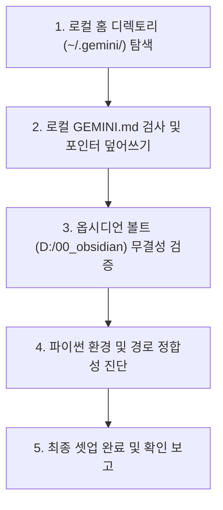

# 🖥️ 크로스 PC 에이전트 로컬 환경 셋업 스킬 (Cross-Device Agent Setup)

이 스킬은 사용자가 사무실, 재택, 노트북 등 다른 컴퓨터로 환경을 전환했을 때, 해당 PC의 로컬 에이전트 설정(`~/.gemini/GEMINI.md`)이 옵시디언 볼트(`D:\00_obsidian`)의 최신 규칙 및 스킬과 충돌하지 않도록 **단일 진실 공급원(SSOT) 위임 포인터를 원클릭으로 자동 설치 및 정합**해 주는 환경 초기화 전문 스킬입니다.

---

## 📌 1. 실행 트리거 키워드 (Trigger Prompts)
사용자가 아래와 같이 요청할 때 이 스킬이 즉시 기동됩니다:
* `"옵시디언과 동기화해줘"` / `"옵시디언과 동기화 해줘"`
* `"셋업 옵시디언과 동기화 해줘"`
* `"옵시디언 동기화해줘"` / `"옵시디언 셋업해줘"`
* `"컴퓨터 바뀌었어"` / `"컴퓨터 변경했어"`
* `"새 PC 에이전트 셋업해줘"` / `"로컬 규칙 포인터 동기화해줘"`

---

## ⚙️ 2. 자동 셋업 프로세스 (Execution Workflow)



### ① 단계 1: 로컬 홈 경로 및 디렉토리 확인
* 현재 컴퓨터의 사용자 홈 디렉토리(`$HOME\.gemini\` 또는 `%USERPROFILE%\.gemini\`)를 확인합니다.
* 디렉토리가 없으면 자동으로 생성합니다.

### ② 단계 2: 표준 SSOT 위임 포인터 `GEMINI.md` 배포
* 로컬 `~/.gemini/GEMINI.md` 파일을 아래의 **표준 SSOT 위임 포인터 템플릿**으로 안전하게 덮어씁니다.
* 이로써 해당 PC의 에이전트가 로컬에 잔류하던 과거 파편 규칙(`WORK_STATUS.md` 생성 등)을 맹목적으로 실행하는 사태를 원천 차단합니다.

#### 📋 표준 로컬 포인터 템플릿 규격:
```markdown
# 🧭 글로벌 포인터 (SSOT 옵시디언 볼트 단일 위임)

본 머신의 Antigravity 에이전트는 기기 간 동기화되는 **옵시디언 볼트(`D:\00_obsidian`)**의 규칙과 스킬을 단일 진실 공급원(SSOT)으로 전적으로 따릅니다.
로컬 머신에 세부 규칙을 분산 중복 관리하지 않으며, 모든 거버넌스 헌장과 전문 스킬은 볼트 내부 파일을 실시간 참조하여 집행합니다:

- 🏛️ **마스터 볼트 룰북**: `D:\00_obsidian\AGENTS.md`
- 🐍 **글로벌 파이썬 코딩 헌장**: `D:\00_obsidian\.agents\rules\PYTHON_CODE_AGENT.md`
- 🛠️ **전역 에이전트 전문 스킬 허브**: `D:\00_obsidian\.agents\skills\`
  - `code-audit-obsidian-docs` (코드 품질 감사 및 단일 대시보드 동기화)
  - `obsidian-inbox-processor` (인박스 정리 및 Inbox Zero 달성)
  - `obsidian-wiki-sync` (세션 지식 위키 스마트 병합)
  - `cross-device-agent-setup` (새 PC 환경 원클릭 로컬 포인터 셋업)

## 🔄 핵심 기본 행동 원칙
1. **임시 상태 파일 생성 원천 금지 (No Standalone Status Files Law)**:
   - `WORK_STATUS.md` 등의 임시 파일을 `00_Inbox`나 개별 프로젝트 폴더에 절대 생성하지 않습니다.
   - 모든 작업 내역과 변경점은 오직 해당 프로젝트의 마스터 대시보드(`00_*_대시보드.md`) 상단 타임테이블(Changelog)과 당일 데일리 노트에만 직접 기록(Upsert)합니다.
2. **코드 매뉴얼 격리 보존 (Code Manual Isolation Law)**:
   - 개별 모듈 1:1 매뉴얼(`.md`)은 소스 코드 저장소(`unoUtil/` 등) 내부에만 단독 보관하며, 옵시디언 볼트로 복사/미러링하지 않습니다.
```

### ③ 단계 3: 옵시디언 볼트 무결성 검사
* 옵시디언 루트(`D:\00_obsidian\AGENTS.md`) 접근 가능 여부
* 코딩 헌장(`D:\00_obsidian\.agents\rules\PYTHON_CODE_AGENT.md`) 접근 가능 여부
* 스킬 4종(`code-audit-obsidian-docs`, `obsidian-inbox-processor`, `obsidian-wiki-sync`, `cross-device-agent-setup`) 로드 상태 확인

### ④ 단계 4: 파이썬 실행 환경 확인
* 사내 표준 가상환경(`D:\uno\Python\envs\unoBase\python.exe` 또는 활성 venv) 경로 확인
* 소스 레포지토리(`D:\uno\Python\Projects\unoUtil`) 연결 상태 확인

### ⑤ 단계 5: 사용자 완료 보고
* 점검 결과를 간결하게 요약 보고하고, "이 컴퓨터에서도 옵시디언의 최신 규칙과 스킬이 100% 정상 가동됩니다"라고 안내합니다.
