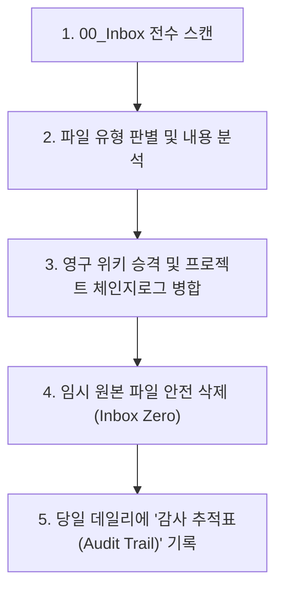

# 🧹 인박스 전수 정리 및 Inbox Zero 달성 스킬 (Obsidian Inbox Processor)

이 스킬은 분류되지 않은 임시 메모장인 `00_Inbox/` 하위의 모든 파일들을 전수 스캔하여 가치 있는 도메인 정보는 영구 지식 위키(`04_Resources`)로 승격시키고, 임시 작업일지는 관련 프로젝트 대시보드의 체인지로그 섹션으로 100% 병합 흡수(Merge)한 뒤, 인박스를 깨끗이 비워 최적의 생산성을 보장해 주는 정리 전문 스킬입니다.

---

## 📌 1. 실행 트리거 키워드 (Trigger Prompts)
사용자가 아래와 같이 요청할 때 이 스킬이 즉시 기동됩니다:
* `"인박스 정리해줘"`
* `"인박스 비워줘"`
* `"인박스 내용 위키에 업데이트해줘"`

---

## ⚙️ 2. 5단계 Inbox Zero 프로세스 (The 5-Step Processor)

### ① 단계 1: 00_Inbox 전수 스캔
* `D:\00_obsidian\00_Inbox\` 디렉터리 내에 존재하는 모든 마크다운 파일 및 바이너리(PDF, XLSX, 이미지 등)를 리스팅합니다.

### ② 단계 2: 파일 유형 판별 및 내용 분석
* **임시 작업 일지 / 날짜가 붙은 보고서 (예: `YYMMDD_*.md`)**: 임시 파일로 간주하고, 핵심 패치 내역과 테스트 결과를 분석합니다.
* **도메인 개념 / 이론 메모**: 영구 지식화가 필요한 핵심 정보를 추출합니다.
* **바이너리 첨부 파일**: 수집 경로와 매핑할 타겟 위키 문서를 분석합니다.

### ③ 단계 3: 영구 위키 승격 및 프로젝트 체인지로그 병합 (Zero-Clutter Law)
* **임시 보고서의 완전 병합 및 초반 타임테이블 최신화**: 낱개의 날짜별 임시 마크다운으로 영구 방치하지 않고, 관련 프로젝트 마스터 대시보드의 **초반부(상단부) 타임테이블(`## 📅 1. 프로젝트 주요 버전 이력 (Changelog 타임테이블)`) 및 관련 하위 매뉴얼**에 작업 히스토리 및 진행 이력 내용을 100% 통합 흡수(Merge)하여 누적 관리합니다.
* **🚫 신규 임시 상태 파일(`WORK_STATUS.md` 등) 생성 원천 차단**: 작업 정리나 위키 갱신 시 신규 임시 상태 파일(`WORK_STATUS.md` 등)을 일체 생성하지 않으며, 인박스나 각 폴더에서 발견된 기존 임시 보고서는 즉시 해당 대시보드 상단 타임테이블로 100% 통합 흡수한 뒤 완전히 영구 삭제(Purge)합니다.
* **이론 메모의 위키 승격**: `04_Resources/` 하위의 적절한 MOC 클러스터로 편입시키고 표준 Frontmatter를 부여하여 정식 위키로 업서트합니다.
* **바이너리 첨부 이관**: PDF, 엑셀, 이미지 등은 `_attachments/<카테고리>/` 폴더로 안전하게 물리 이동시키고, 관련 위키 본문에서 이 첨부파일을 참조하도록 마크다운 링크를 업데이트합니다.

### ④ 단계 4: 임시 원본 파일 안전 삭제
* 위키 승격 및 프로젝트 대시보드 병합이 100% 완료된 것이 검증된 임시 텍스트 파일들은 시스템 공간 정리를 위해 디스크에서 안전하게 물리 삭제하여 **Inbox Zero** 상태를 만듭니다.

### ⑤ 단계 5: 당일 데일리 노트에 '감사 추적표(Audit Trail)' 자동 작성
* 비록 임시 원본 파일은 깔끔하게 삭제되었지만, 나중에라도 사용자가 추적할 수 있도록 당일 자 데일리 노트(`01_Daily/YYYY-MM-DD.md`) 하단에 아래 양식의 마크다운 표를 필수적으로 자동 기록하여 안전망을 확보합니다.

| 원본 파일명 | 처리 유형 | 최종 보관 위치 (위키 링크) | 핵심 처리 요약 |
| :--- | :---: | :--- | :--- |
| `2026-09-19_임시작업일지.md` | 💼 프로젝트 통합 흡수 | `[[00_unoUtil_모듈개발_대시보드]]` | 리팩토링 및 검수 성과 대시보드 체인지로그에 100% 병합 후 원본 정리 |
| `타이어_RR_불확도_수식.md` | 📚 영구 지식 승격 | `[[11_타이어_RR_측정_불확도_평가_마스터_가이드_및_통계_핸드북]]` | GUM 3단계 평가 및 편미분 수학식 위키 고도화 업서트 완료 |
