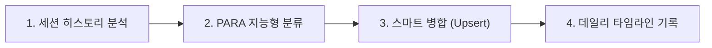

# 🔄 세션 지식 분석 및 옵시디언 위키 자동 동기화 스킬 (Obsidian Wiki Sync)

이 스킬은 사용자가 터미널에서 작업한 전체 대화 맥락, 도메인 질의응답(Q&A), 코드 리팩토링 변경 성과를 분석하여, 옵시디언 볼트의 올바른 PARA 폴더에 문서를 자동 생성하고 데일리 타임라인에 누적 갱신해 주는 세션 종료용 일괄 동기화 스킬입니다.

---

## 📌 1. 실행 트리거 키워드 (Trigger Prompts)
사용자가 세션 마지막에 아래와 같이 요청할 때 이 스킬이 기동됩니다:
* `"내가 이제까지 진행한거 정리해줘"`
* `"오늘 한 작업 옵시디언에 기록해줘"`
* `"방금 질문 답변한거 지식 위키에 업데이트해줘"`

---

## ⚙️ 2. 4단계 동기화 프로세스 (The 4-Step Sync Pipeline)



### ① 단계 1: 세션 히스토리 분석
* 현재 터미널 세션의 모든 대화 히스토리와 파일 변경 내역(Git diff, 수정 로그)을 전수 스캔하여 핵심 성과, 버그 해결책, 도메인 이론(수학, 동역학, 불확도 등)을 추출합니다.

### ② 단계 2: PARA 지능형 분류 (Classification Guide)
추출된 정보의 성격에 따라 최적의 저장 위치를 자동으로 결정합니다:
* **도메인 이론, Q&A, 개념 설명, 기술 백과** ➡️ `04_Resources/` (영구 지식 위키 해당 폴더)
* **모듈 개발 로그, 버그 해결 Rationale, 작업 Todo** ➡️ `02_Projects/회사_업무/` (해당 프로젝트 폴더)
* **나스닥 트레이딩 복기 및 파동 분석** ➡️ `03_Areas/트레이딩/20_2026_매매일지/`

### ③ 단계 3: 스마트 병합 및 Upsert 원칙 (No-Overwrite Rule)
* **기존 문서 존재 시**: 파일 내용을 완전히 덮어쓰지 않고, 기존 본문의 내용을 철저히 보존한 채 하단에 `### YYYY-MM-DD 업데이트` 섹션을 신설하여 누적 병합합니다.
* **신규 문서 생성 시**: `D:\00_obsidian\AGENTS.md`에 규정된 코어 Frontmatter 메타데이터(`id`, `title`, `type`, `category_main` 등)를 올바르게 생성하여 신규 마크다운을 배치합니다.
* **대시보드 작성 및 업데이트 표준**: 도메인/프로젝트 대시보드를 새로 작성하거나 업데이트할 때, 문서 초반부(상단부)에 반드시 작업 내용에 대한 타임테이블(Changelog)이 포함되어야 하며, 이 테이블(`## 📅 1. 프로젝트 주요 버전 이력 (Changelog 타임테이블)`)을 통해 세션별 작업 내용과 모든 진행 내역들의 히스토리를 정교하게 누적 관리해야 합니다.
* **🚫 폴더별 임시 작업상태 파일(WORK_STATUS.md 등) 생성 원천 금지 (No Standalone Status Files Law)**:
  - 사용자가 *"작업 정리해줘"*, *"위키 업데이트해줘"*, *"진행상황 요약해줘"* 라고 요청할 때, 각 프로젝트 폴더나 하위 디렉토리에 `WORK_STATUS.md`, `*_work_status.md`, `작업정리.md` 등의 임시 마크다운 파일을 **절대로 별도로 새로 생성하지 않습니다.**
  - 모든 작업 내역, 개발 진행 경과, 트러블슈팅 히스토리는 해당 프로젝트의 마스터 대시보드(`00_*_대시보드.md`) 최상단 타임테이블 및 관련 본문 섹션에 **직접 업데이트(Upsert)**하여 단일 진실 공급원(SSOT)을 유지합니다.
* **🚫 서브폴더별 서브 대시보드 난립 금지 및 단일 마스터 MOC 원칙 (Single Master MOC Law)**:
  - 프로젝트 하위 디렉토리(예: `models/`, `file_reader/`, `graphics/` 등)마다 개별 서브 대시보드(`00_*_대시보드.md`)를 쪼개어 생성하지 않습니다.
  - 프로젝트 루트의 **단일 마스터 대시보드 1곳**에서 전체 서브모듈을 통합 관리하며, 문서 비대화는 **접기 가능한 콜아웃(`> [!NOTE]- ...`)**과 **상단 퀵점프 바**를 통해 완벽히 해결합니다.


### ④ 단계 4: 데일리 노트 타임라인 체크리스트 기록 (Audit Trail)
* 당일 날짜의 데일리 노트(`01_Daily/YYYY-MM-DD.md`)에 접근합니다.
* **절대 긴 본문을 복사하여 붙여넣지 않고**, 새로 생성되거나 변경된 문서들을 `[[문서명]]` 위키링크로 연결하고 그날의 업무 핵심 성과를 **한 줄 요약 체크리스트**로 남겨 타임라인의 원천 고정 원칙을 완벽히 준수합니다.
  ```markdown
  - [x] **[개발/unoUtil]** models 도메인 신설 및 Pacejka Magic Formula SSOT 전면 통합 ([[00_unoUtil_모듈개발_대시보드]])
  - [x] **[지식/불확도]** ISO 28580 기반 타이어 RR 측정불확도 3대 독립 영역 모델 수립 ([[20_타이어_회전저항_RR_측정_불확도_산출_기술_보고서]])
  ```
