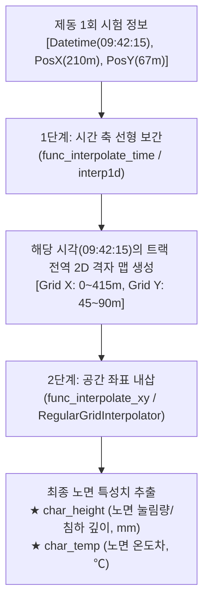
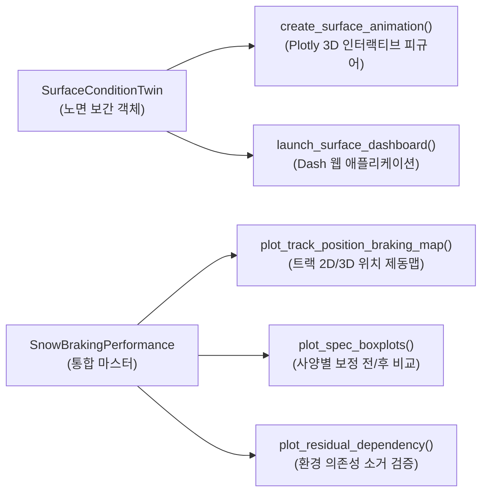

# ❄️ 스노우 노면 디지털 트윈 및 제동 성능 환경 보정 위키 (Snow Surface Twin & Braking Correction Wiki)

> [!info] **문서 개요**
> * **작성 일자:** 2026-09-15
> * **핵심 주제:** 스노우 노면 침하량·온도 4D 보간 원리, 제동 데이터 1:1 결합 메커니즘, 노면 영향 정규화(걷어내기)의 공학적 의의, Dash/Plotly 인터랙티브 대시보드
> * **관련 시스템/모듈:** `Snow_braking_relate_condition` (`SnowBrakingPerformance`, `SurfaceConditionTwin`, `SnowCorrectionEngine`, `surface_dashboard`)
> * **연계 문서:** [[20_SnowBrakingPerformance_통합모듈_매뉴얼]] | [[WORK_STATUS]]

---

## 🧭 1. 노면 보간 객체의 세션 분할 메커니즘 (Session-Based Twin)

### 1.1 왜 "일자별(Date) × 오전/오후(AM/PM)"로 분할하는가?
스노우 트랙 시험장(핀란드 UTAC Ivalo 등)에서 노면 상태를 하루 전체로 연속 보간하면 **치명적인 물리적 왜곡**이 발생합니다. 그 원인은 **트랙 정비 작업(Plowing & Grooming)**에 의한 물리적 불연속성에 있습니다.

* **새벽 정비 (06:00~08:00):** 신적설을 밀어내고 트랙터를 이용해 일정한 밀도로 압설·정비하여 **오전 시험(AM: 08:00~12:00)**을 개시합니다.
* **점심시간 트랙터 재정비 (12:00~13:00):** 오전 시험 동안 차량들의 수십 회 제동으로 반들반들 다져진 눈(빙판화)을 트랙터가 다시 갈아엎고 깎아서 평탄화합니다.
* **물리적 단절 (Discontinuity):** 오전 11:50에 다져진 단단한 노면과, 오후 13:00에 새로 깎여 부드러워진 노면 사이에는 **시간적 연속성이 존재하지 않습니다.**
* **세션 분할 관리:** 따라서 노면 보간 객체는 반드시 **`[(Date, 'am'), (Date, 'pm')]`**의 독립된 세션 단위로 분리되어 생성·관리되어야 합니다.

```
[08:00 AM] ──(차량 주행 다져짐)──> [12:00 AM] 
                     │
         [12:00 ~ 13:00 트랙터 그루밍 (물리적 리셋!)]
                     │
[13:00 PM] ──(차량 주행 다져짐)──> [18:00 PM]
※ AM과 PM은 서로 다른 물리적 상태이므로 절대 시간축을 이어서 보간하면 안 됨!
```

---

### 1.2 시공간 2단계 보간 메커니즘 (Spatiotemporal 2-Step Interpolation)

세션 내부에서는 노면 계측 차량이 트랙을 3~6회 반복 스윕(Sweep) 주행합니다. 제동 시험 1회가 발생한 찰나의 노면 상태는 아래 2단계로 계산됩니다.



1. **1단계 - 시간 축 선형 보간 (`interp1d`):**
   - 세션 내의 계측 스윕들(예: 08:40, 09:20, 10:15...) 사이에서 제동 발생 시각 $T$에 해당하는 2D 표면 격자 Z를 시간 축으로 선형 보간하여 생성.
2. **2단계 - 공간 좌표 내삽 (`RegularGridInterpolator`):**
   - 1단계에서 실시간 복원된 격자 맵 상에서 차량의 VBOX GPS 좌표 `[PosY, PosX]`에 대해 2차원 공간 내삽을 수행하여 단일 스칼라 값(`char_height`, `char_temp`)을 추출.

---

## 🔗 2. 제동 데이터와의 결합 구조 (1 Run = 1 Row Granularity)

### 2.1 왜 제동 1회(Run) 단위인가?
* 세트 평균값(Mean)을 사용하면, 같은 세트 안에서도 1회차 제동과 5회차 제동 사이의 **시간 경과(수 분~수십 분 차이)**와 **제동 진입 위치(트랙 X, Y 좌표 편차)**가 뭉개집니다.
* 차량이 실제로 눈을 밟고 지나간 정확한 위치의 침하 깊이와 온도를 매칭해야 하므로, **`1개 행 = 1회 제동(1 Run)`**의 데이터 단위가 필수적입니다.

### 2.2 결합 전 vs 결합 후 데이터 스키마

| 구분 | 주요 컬럼 | 데이터 의미 |
| :--- | :--- | :--- |
| **결합 전 (순수 제동)** | `Datetime`, `PosX`, `PosY`, `char_brk_dist`, `infor_TIRE_SET` | 제동거리와 위치는 있으나 당시 노면 다져짐/온도 상태는 모름 |
| **결합 후 (완성형)** | + **`char_height`** (눈 침하 깊이/눌림량, mm)<br>+ **`char_temp`** (노면 온도차, ℃)<br>+ **`cd_test_ah`** (실시간 절대습도, $g/m^3$) | **차량이 밟았던 찰나의 노면 다져짐 깊이와 기상이 1:1로 결합된 완전체 데이터** |

---

## 🧹 3. "노면 영향을 걷어낸다(Normalization / Decoupling)"의 공학적 원리

### 3.1 문제 제기: 노면 변화에 의한 성적 왜곡
실측 제동거리($D_{measured}$)는 순수 타이어 성능뿐만 아니라 환경 요인의 합으로 구성됩니다:

$$D_{measured} = D_{tire} + \Delta D_{surface} + \Delta D_{weather} + \epsilon$$

* **아침 08:30 (노면이 푹신할 때):** 타이어가 눈 속으로 깊게 파고들어(눌림량 10mm) 눈을 긁어모으며 **22.0m**에 정지.
* **오전 11:30 (수십 대 주행으로 노면이 압설/빙판화되었을 때):** 타이어가 파고들지 못하고(눌림량 3mm) 미끄러져 **25.0m**에 정지 (**노면 악화로 +3.0m 불이익**).
* **왜곡 발생:** 만약 개발 사양 B 타이어를 11시 30분에 시험했다면, 실제로는 더 우수한 타이어임에도 불구하고 **"미끄러운 시간대에 시험했다는 이유만으로"** 성적이 나쁘게 평가되는 왜곡이 발생합니다.

---

### 3.2 걷어내는 과정 (차분 머신러닝의 3단계 소거)

```
[측정된 제동거리 (25.0m)] = [타이어 순수 성능 (22.0m)] + [노면 다져짐 페널티 (+3.0m)]
                                                                    ▲
                                                차분법 머신러닝으로 계산하여 걷어냄(제거)
```

1. **학습 (차분법 머신러닝):**
   - 동일한 타이어의 반복 주행 데이터 간 차분을 통해, *"노면 눌림량이 1mm 얕아질 때마다(단단해질 때마다), 온도가 1℃ 오를 때마다 제동거리가 몇 미터 밀리는가?"*의 환경 전달함수 $f(\Delta Height, \Delta Temp, \Delta AH)$를 Random Forest / KNN 등으로 학습.
2. **외적 요인 역산:**
   - 임의의 제동 런에 대해, 표준 기준 노면(Reference Condition) 대비 당시 노면 상태가 유발한 **제동거리 가감분(+/- m)**을 정밀 역산.
3. **노이즈 소거 (걷어내기):**
   - 실측 제동거리에서 계산된 환경 손해분을 감산(Subtraction):
     $$D_{corrected} = D_{measured} - \hat{f}(\Delta Condition)$$
   - 결과적으로 **모든 타이어가 완벽히 동일한 가상의 표준 노면에서 주행한 것과 같은 공정한 제동거리(`char_brk_dist_corr`)**를 도출.

---

### 3.3 걷어내고 난 뒤의 3대 정량적 성과

1. **사양 내 반복 시험 산포(Variance) 대폭 축소:**
   - 동일 타이어를 아침/낮에 탔을 때 발생하던 불필요한 제동거리 편차가 소거되어 신뢰도 극대화.
2. **컴파운드 / 패턴 순위 역전(Rank Inversion) 방지:**
   - 시험 순서나 날씨 운(Luck) 때문에 타이어 서열이 뒤바뀌는 현상 방지.
3. **환경 인자 잔차 의존도 제로화 (Slope = 0):**
   - `plot_residual_dependency('char_height')` 확인 시, 보정 전 기울어져 있던 추세선이 **기울기 0(수평선)**으로 수렴하여 노면 의존성이 완전히 소거되었음을 검증.

---

## 📊 4. 노면 4D 인터랙티브 대시보드 및 시각화 제품군

신규 모듈 `surface_dashboard.py`와 `SnowBrakingPerformance`에 구현된 대시보드 제품군입니다.



1. **Dash 기반 웹 대시보드 (`launch_surface_dashboard`):**
   - 포트 `8050`으로 로컬 웹 서버 실행 및 브라우저 자동 팝업.
   - 드롭다운: **평가 일자(Date), 세션(AM/PM), 채널(눌림량/노면온도), 보간 간격(분), 애니메이션 재생 속도(ms)**.
   - CYBORG 다크 테마 UI를 적용하여 대형 화면에서 직관적인 노면 모니터링 가능.
2. **Plotly 3D 서피스 애니메이션 (`create_surface_animation`):**
   - 시간 축 슬라이더 조절, ▶ Play / ⏸ Pause 버튼 내장.
   - 사전 기상(Pre-Weather) 및 시험 기상(Test-Weather) 시계열 선 그래프와 현재 시각 마커 동기화.
3. **트랙 위치별 제동거리 맵 (`plot_track_position_braking_map`):**
   - 트랙 종/횡방향 좌표 `(PosX, PosY)` 상의 제동거리 2D 산점도 및 RF 기반 3D 표면 등고선 맵.

---

## 💻 5. 파이썬 통합 모듈 활용 가이드

### 5.1 엔드투엔드 파이프라인 (원클릭 자동 결합 및 보정)
```python
from Snow_braking_relate_condition import SnowBrakingPerformance

# 1. 통합 마스터 플랫폼 초기화
perf = SnowBrakingPerformance(name="Snow_2026_Validation")

# 2. 데이터 등록
perf.add_surface_data("D:/.../df_surface.pkl") # 또는 기존 6. df_sur_map_surclass.pkl
perf.add_braking_data("D:/.../df_result_test_acc_brk.pkl") # 1회 제동 단위 DF 또는 VT_ACCBRK_PROJECT
perf.set_weather_data("D:/.../df_weather.pkl")
perf.set_spec_data("D:/.../df_spec.pkl")

# 3. [핵심] 노면 시공간 보간 결합 실행 (Row-by-Row 1:1 결합)
df_combined = perf.match_performance_to_surface()

# 4. 웹 대시보드 구동 (브라우저 자동 실행)
perf.launch_surface_dashboard(port=8050)

# 5. 차분 머신러닝 학습 및 노면 영향 걷어내기 (보정)
perf.train_correction_model(model_type='Random Forest')
df_corrected = perf.correct_dataframe(out_col='char_brk_dist_corr')

# 6. 보정 효과 검증 시각화
perf.plot_spec_boxplots(spec_col='infor_CTB_COMPOUND')
perf.plot_residual_dependency(env_col='char_height')
```

### 5.2 보간 객체(`SurfaceConditionTwin`) 단독 질의
```python
from Snow_braking_relate_condition import SurfaceConditionTwin

twin = SurfaceConditionTwin()
twin.build_digital_twin(df_surface)

# 특정 제동 시험 시각 및 위치의 노면 상태 질의
target_time = "2026-01-15 10:15:30"
pos_x, pos_y = 210.0, 67.5

height_diff, temp_diff = twin.query_surface_condition(
    target_time=target_time,
    pos_x=pos_x,
    pos_y=pos_y,
    target_date="2026-01-15",
    target_period="am"
)

print(f"노면 침하 깊이: {height_diff:.2f} mm | 노면 온도차: {temp_diff:.2f} ℃")
```
