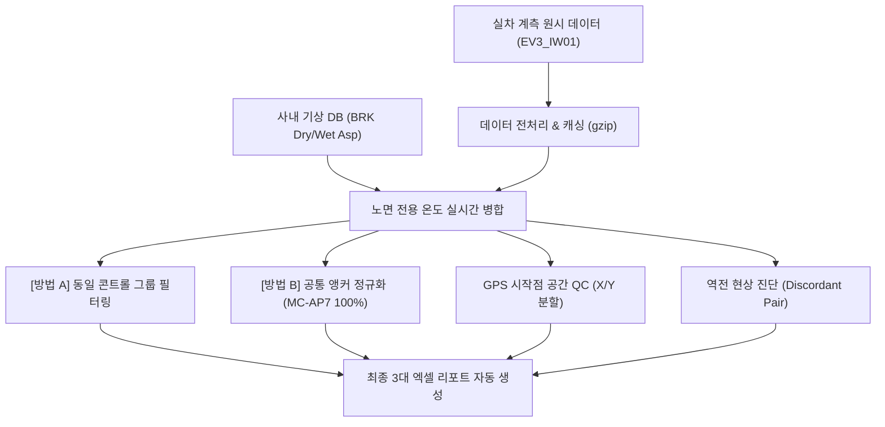

# 🏎️ 제동 성능 자동 분석 플랫폼 (Braking_AutoBuild) 마스터 대시보드

> [!ABSTRACT] 📌 프로젝트 개요 및 실시간 상태
> 본 프로젝트는 **`EV3_IW01` (Autobuild IW01_EV3)** 기아 EV3 실차 제동 계측 데이터의 전처리, 기상/노면 온도 결합 보정, GPS 공간 품질 관리(QC), 콘트롤 타이어 편차 구제(앵커 교정), 그리고 최종 엑셀 보고서 자동 연동 파이프라인을 구축하는 차세대 제동 데이터 엔지니어링 프로젝트입니다.  
> 
> * 🏢 **상위 대시보드**: [[02_Projects/00_프로젝트_통합_대시보드|02_Projects 프로젝트 통합 대시보드]]
> * 📑 **최신 공학 분석 마스터 리포트**: [[02_Projects/회사_업무/10_Braking_AutoBuild/EV3_IW01_Integrated_Braking_Analysis_Report|EV3 IW01 실차 제동 종합 공학 분석 마스터 리포트 (.md)]]
> * 📚 **연계 지식 위키**: [[04_Resources/21_제동/40_제동_성능_자동분석_및_기상_공간QC_보정_시스템|40_제동 성능 자동분석 및 기상·공간QC 보정 시스템 위키]]
> * 🛑 **기술 허브**: [[04_Resources/21_제동/00_제동_기술_통합_색인|00_제동 기술 통합 색인]]

---

## 🛠️ 1. 개발 인프라 및 보안 정비

* **GCP 환경 변수 및 ADC 영구 연동:**
  * Windows 시스템 사용자 환경 변수에 `GOOGLE_CLOUD_PROJECT="hankook-ai"`를 영구 등록하고 애플리케이션 기본 인증(ADC)을 세팅하여 터미널 초기화 시마다 재로그인해야 하는 연동 피로도를 완벽히 격파했습니다.
  * 새로운 PC 이전을 위한 **`GCP_SETUP_GUIDE.md`**를 프로젝트 루트에 가이드라인 파일로 별도 상주 보존했습니다.
* **파이참 Git 버전 관리(VCS) 정합성 복구:**
  * `.idea/vcs.xml`에 서브모듈 `unoUtil`의 Git 경로가 뒤섞여 버전 관리 및 깃 로그가 엉키던 문제를 원천 수정하여, 깃 로그를 상호 독립된 청정 상태로 격리 회복시켰습니다.

---

## 🧠 2. 핵심 공학 알고리즘 및 시각화 고도화 성과

### ① 실시간 기상/노면 전용 온도 결합 고도화 (`BRK Dry/Wet Asp`)
* **기존:** 단순 대기 기온 기반 보정으로 기온 변동 마진의 한계가 존재했습니다.
* **개선:** 실시간 기상 DB와 연동하여 마른 노면(`dry`) 평가 시 **`BRK Dry Asp` (마른 노면 온도)**, 젖은 노면(`wet`, `wetre`) 평가 시 **`BRK Wet Asp` (젖은 노면 온도)** 컬럼을 실시간 타겟 병합하여 물리적 독립 변수의 공학적 설명력을 비약적으로 향상시켰습니다.

### ② [방법 A] 동일 콘트롤 그룹 필터링 (Local Baseline Groups)
* **목표:** 서로 다른 세션의 타이어 간 기준선(콘트롤) 스펙 편차를 원천 차단하기 위해 동일한 콘트롤 제품을 쓴 프로젝트들끼리만 청정 묶음 대조하도록 그룹화했습니다.
  * **Group A (ex-MC-AP7 / EXT-2026-00147 수입 기준):** `26RE040025KF` & `26RE070033KF`
  * **Group B (KPKT1033338X00019 자체 기준):** `26RE080029KF`, `26RE080030KF` 및 **`26RE070057KF` (KP, MP 몰드 포함)**
  * 노면별 편차 그래프와 함께 **노면에 상관없는 전체 통합(Overall) 가로바 차트**를 새로 산출하여 종합적 거동 비교를 완비했습니다.

### ③ [방법 B] 공통 앵커 타이어 기반 전체 정규화 (Anchor Recalibration)
* **목표:** 기준 타이어가 달라 직접 대조가 불가능한 프로젝트들 전체를 통틀어, 교차 주행한 공통 타이어 **`ex-MC-AP7` (TestTireSpec: `EXT-2026-00147`)을 절대 기준(100.0%)**으로 삼아 전체 지수를 상대 리스케일링(Re-scale)해 수평 정렬했습니다.
* **TestTireSpec 브릿지 체인 확장:** 콘트롤 스펙 `KPKT1033338X00019`를 공유하는 `26RE080029KF`, `26RE080030KF`, **`26RE070057KF`**를 스펙 기반으로 연속 연결하여, 마킹 차이(`2nd` vs `KP`)로 인해 누락되었던 **KP 몰드(`X22`, `X23`) 및 MP 몰드(`X00`, `X01`)를 전 프로젝트 수평 비교선에 완벽 복원**했습니다.
* **성과:** 기준 타이어 오염이 사라지면서, 가혹 조건(노면온도 폭등) 하에서 억울하게 지수가 깎였던 고성능 타이어들을 동등 선상에서 완벽하게 대조하는 데 성공했습니다.
* **종합 장표 탑재:** 모든 노면을 총망라해 평균을 낸 **`MethodB_Overall (노면 독립적 종합 재보정 성능)` 그래프**를 최종 주조해 내어, 밸런스가 가장 우수한 최강 규격을 즉각 판단하는 핵심 장표를 탑재했습니다.

### ④ 실측 제동거리 vs 성능지수 역전 분포 진단 (Discordant Diagnosis)
* **개별 raw 주행 포인트 노출:** 중복 시험 결과를 강제로 평균내지 않고, 개별 주행 결과들을 엑셀과 그래프 상에 고스란히 다른 독립 포인트로 표출시켰습니다.
* **점-선 기하학적 정합 버그 해결:** 산점도 점과, 주황색 역전 연결선, 라벨 마커의 데이터 소스를 `df_lane_points`로 100% 완전 정합하여 연결선 끝자락이 허공에 둥둥 뜨거나 어긋나던 정렬 오차를 기하학적 정중앙에 자석 밀착시켰습니다.
* **글씨 겹침 버그 박멸:** 지수 밀집 구간에서 텍스트 라벨이 세로로 심하게 뭉개지던 현상을 **단일 라벨 라벨링(`Single-line`)** 및 **상하 충돌 방지 정렬 임계 마진(0.65)** 기법을 도입해 한 글자도 겹침 없이 사르륵 펼쳐 정렬시켰습니다.

### ⑤ 제동 진입 시작 위치 공간 QC (X, Y 축 분할)
* **기존:** 대각선 유클리드 편차만을 기준으로 한 단순 요약이었습니다.
* **개선:** 드라이버의 진입 앞뒤 밀림 오차인 **`X축 편차 (종방향)`**와 좌우 쏠림 오차인 **`Y축 편차 (횡방향)`**를 완벽하게 분할 연산(`abs().mean()`, `abs().max()`) 기재하도록 개조했습니다.
  * 예시를 통해 "드라이버가 핸들 횡(Y) 정렬은 44cm 미만으로 잘 지켰으나, 제동 타이밍 종(X) 오차는 ±1.53m 흔들렸음"을 정량적으로 증명할 수 있습니다.
  * 결과물 차트: `Braking_Spatial_Scatter_Analysis.png`, `Braking_Position_Deviation_Analysis.png`

### ⑥ 🔬 [NEW] 동일 스펙 교차 의뢰서 반복 시험 정밀 대조 (`EV3_IW01_cross_spec_compare.py`)
* **목표:** 서로 다른 의뢰서(`TestReqNo`)에 걸쳐 동일한 노면(`TestCond`)에서 중복/반복 평가된 **동일 타이어 스펙(`TestTireSpec`)**들을 전수 색출하여 시간 경과 및 계절 변화에 따른 물리 거동을 정밀 추적.
* **텍스트 레이블 가독성 극대화:** "의뢰번호, 마킹명, 시험 일자, 시각(Datetime)"을 X축에 15도 틸팅으로 표기하여 겹침 없이 명확화.
* **노면별 1:1 대조 차트 (4종):**
  * `Cross_Spec_Comparison_lane1.png`, `lane4.png`, `lane7.png`, `lane8.png`
* **주요 공학적 발견:**
  1. `IW01-X13 (KPKT1033338X00013)`: 4월 서늘한 봄(22.1°C) **31.90m** $\rightarrow$ 7월 혹서기(27.1°C~35.3°C) **36.34m, 35.78m**로 **+4.44m 밀림 현상** 정밀 포착.
  2. `ex-MC-AP7 (EXT-2026-00147)`: WET 수막 노면에서 4월(32.8m) $\rightarrow$ 6월(36.7m) $\rightarrow$ 7월(36.6m) $\rightarrow$ 8월(35.1m)로 실측 거리는 크게 변동했으나, Method B 재보정을 통해 전 세션 **100.0%**로 완벽하게 수평 정합됨.
  3. `IW01-X19 (KPKT1033338X00019)`: 57KF(KP 몰드), 29KF/30KF(2nd 몰드)에 걸쳐 Method B 브릿지 체인을 통해 Lane 1: **101.1%**, Lane 4: **103.5%**, Lane 7: **101.4%**로 통일성 있게 환산되어 프로젝트 간 연결성 완비.

### ⑦ 🏛️ [NEW] EV3_IW01 6대 분석 모듈화 및 통합 엑셀 마스터 리포트 완성
* **목표:** 모놀리식 스크립트 구조를 탈피하고, 동적 계층화(`list_group_cols`)를 지원하는 **6대 독립 분석 모듈 + 1개 통합 엑셀 마스터 빌더 + 1개 총괄 오케스트레이터(Wrapper)** 구조로 전면 리팩토링.
* **모듈 구성 (`EV3_IW01/`):**
  1. `00_EV3_IW01_make_result.py`: 원시 데이터 파싱 및 기상 노면온도 결합 전처리 캐시.
  2. `10_EV3_IW01_analysis.py`: 총괄 오케스트레이터 (Wrapper). 동적 그룹바이, 원클릭 파이프라인.
  3. `20_EV3_IW01_surface_and_control_baseline.py`: [테마 1] 노면 및 로컬 콘트롤 기준 편차 분석.
  4. `21_EV3_IW01_temperature_sensitivity.py`: [테마 2] 노면온도 의존성 및 감인성($m \text{ [m/°C]}$) 1차 회귀.
  5. `22_EV3_IW01_discordance_diagnosis.py`: [테마 3] 실측 제동거리 vs 성능지수 역전 현상(Discordance) 색출 및 온도 보정 타당성 입증.
  6. `23_EV3_IW01_anchor_recalibration.py`: [테마 4] 공통 앵커(`EXT-2026-00147`) 재보정(Method B), 슬로프 차트 및 Overall 랭킹.
  7. `24_EV3_IW01_cross_spec_repeatability.py`: [테마 5] 동일 스펙 교차 의뢰서 반복 시험 정밀 대조.
  8. `25_EV3_IW01_spatial_gps_qc.py`: [테마 6] 제동 진입 위치 GPS 공간 품질 QC 및 중심점 편차 진단.
  9. `30_EV3_IW01_export_integrated_excel.py`: 6대 테마 결과를 1개의 통합 엑셀 파일(**`EV3_IW01_Integrated_Braking_Analysis_Report.xlsx`**)에 7개 시트(Executive Summary 표지 + 6개 분석 시트)로 자동 완성.
  10. `31_EV3_IW01_export_integrated_markdown.py`: 엑셀급 데이터 투명성을 보장하는 24개 이상 마크다운 상세 표 및 21개 차트 내장 통합 마스터 리포트(**`EV3_IW01_Integrated_Braking_Analysis_Report.md`**) 자동 생성 및 옵시디언 볼트 이중 동기화.

### ⑧ 📑 [NEW] 엑셀 수준의 데이터 투명성을 갖춘 통합 마크다운 마스터 리포트 빌더 (`31_EV3_IW01_export_integrated_markdown.py`)
* **목표:** 엑셀을 열지 않고도 웹/옵시디언 환경에서 전수 데이터를 검증할 수 있도록 엑셀의 모든 산출 근거 데이터(24개 이상의 마크다운 정밀 표)를 100% 이식.
* **표준 상대 경로 및 옵시디언 이중 지원:** 로컬 환경에서는 `` 상대경로로, 옵시디언 볼트에서는 `![[\1]]` 위키링크 형식으로 완벽 호환 변환.
* **온디맨드 동기화 스위치:** 기본값은 로컬 빌드(`sync_obsidian=False`)로 격리하여 불필요한 I/O를 방지하고, 필요 시 1회성 파라미터(`sync_obsidian=True`)로 볼트(`02_Projects/...` 및 `_attachments/...`)에 원클릭 무결 배포.

### ⑨ 🌡️ [NEW] 마른 노면(Lane 7) 콘트롤 타이어 온도 감인성 이상치(Anomaly) 규명
* **현상 진단:** Lane 7(마른 아스팔트)의 겉보기 음(-)의 추세선은 서로 다른 콘트롤 타이어 투입에 의한 통계적 착시(심슨의 역설)였으며, 동일 콘트롤 타이어 내에서도 10~13°C의 극심한 온도 상승 대비 제동거리 증가량은 +0.17m에 불과하거나 -0.70m 역전 발생.
* **공학적 원인 규명:**
  1. **트랙 컨디셔닝(Track Conditioning) 왜곡:** 아침 첫 시험(C1, Green Track) 시 노면 먼지로 인한 슬립 ➔ 주행 반복에 따른 트랙 클리닝 및 고무 피막(Rubber Deposit) 형성으로 오후(C2) 접지력 급상승.
  2. **아스팔트 점착(Adhesion) 마찰 보상:** 45~53°C 폭염 노면에서 아스팔트 바인더와 트레드 고무의 연화로 인한 점착 마찰 이득이 타이어 강성 저하를 상쇄.
* **엔지니어링 원칙 확립:** 타 노면(+0.10~+0.15 m/°C) 대비 비정상적으로 극히 작은 이상치(Anomaly)이므로, **인위적인 온도 보정식 적용을 엄격히 배제**하고 반드시 당일 콘트롤 직접 대조 방식으로만 평가하도록 규정.

### ⑩ 🎨 [NEW] 차트 시각화 사실주의(Fact-Only) 표준 및 타이틀 오버랩 완벽 해소
* **피규어 불변성 및 사실주의 원칙:** 이미지 파일(`.png`) 내부에는 주관적 해석/판단("심슨의 역설", "비정상" 등) 텍스트 박스를 일체 배제하고, 순수 데이터 산점도, 회귀 추세선, 통계 수치($r$, $m$, $p$)만 객관적으로 시각화. (판단 변경 시 이미지 재렌더링 방지 및 유지보수성 극대화)
* **타이틀 오버랩 제로화:**
  * 4.3 실측 제동거리 vs 성능지수 산점도 매트릭스(`03_01_Raw_Distance_vs_Index_Analysis_With_Temp.png`)의 전체 타이틀(`fig.suptitle`)과 서브플롯 4개 타이틀 간의 글자 겹침을 `figsize=(13, 11)`, `ax.set_title(fontsize=12, pad=9)`, `subplots_adjust(top=0.89)`로 완벽 해소.
  * GPS 공간 QC 차트 2종(`06_01`, `06_02`)도 동일하게 12pt 지정 및 여백 최적화 적용.

---

## 📊 3. 엑셀 및 마크다운 보고서 자동화 산출물

1. **📑 `EV3_IW01_Integrated_Braking_Analysis_Report.md` (통합 마크다운 마스터 리포트 - NEW)**
   * **형태:** 단일 완성형 공학 기술 백서 (옵시디언 볼트 및 로컬 프로젝트 동시 배포).
   * **데이터 투명성:** 엑셀 6대 시트의 모든 세부 산출 근거 표(표 24개 이상) 전수 수록.
   * **시각화 무결성:** 21개 고해상도 넘버링 차트 완벽 임베딩.
2. **📑 `EV3_IW01_Integrated_Braking_Analysis_Report.xlsx` (6대 테마 통합 마스터 엑셀 리포트)**
   * **Executive_Summary 시트:** 전 테마 핵심 공학적 소견 종합 및 시트 구성 가이드.
   * **Surface_Ctrl_Baseline 시트:** 노면별 및 로컬 콘트롤 기준 성능 편차 (스펙/몰드/패턴 계층 분석).
   * **Temperature_Sensitivity 시트:** 콘트롤 타이어 노면온도 의존성 및 감인성(m/°C) 1차 회귀 요약.
   * **Discordance_Diagnosis 시트:** 실측 제동거리 vs 성능지수 역전 현상 전수 색출 및 온도 열세 보정 정당성 입증.
   * **Anchor_Recalibration 시트:** Method A vs B 순위 변동 대조표 및 전 노면 통합 Overall 재보정 랭킹.
   * **Cross_Spec_Repeatability 시트:** 동일 스펙 반복 시험 변동폭(Delta) 및 세부 평가 로그.
   * **Spatial_GPS_QC 시트:** 프로젝트별 제동 진입 위치 공간 편차 및 운전자 주행 일관성 진단.
3. **📊 `Braking_Performance_Calibration_Validation_Report.xlsx` (종합 검증 보고서)**
4. **🌡️ `Control_Tire_Temperature_Dependency_Report.xlsx` (온도/역전 정밀 진단서)**
5. **🗺️ `Braking_GPS_Spatial_QC_Report.xlsx` (GPS 공간 QC 보고서)**

---

## 🔍 4. 파일별 개발 및 분석 코드 현황

### ① `EV3_IW01_analysis.py` (메인 분석 코드)
* **상태:** 수정 완료 및 안정화
* **핵심 기능:**
  1. 기상 DB 및 노면 온도 연동 + 최종 기상 통합 데이터프레임 캐시 (`df_result_summary.gzip`) 업데이트 및 저장.
  2. 라인별 제동 성능 지수 편차 가로바 차트 생성.
  3. 세대(Mold)/패턴(PTN) 그룹 대조 분석 차트 생성.
  4. 성능 지수와 실측 제동거리 간 역전 현상(Discordant Pair) 발생 시 **노면 온도 편차**를 포함한 정밀 물리 진단 콘솔 출력.
  5. 제동 진입 위치 GPS 좌표 분석 및 프로젝트 편차 진단 QC 차트 생성.

### ② `EV3_IW01_temp_analysis.py` (임시 실험용 분석 코드)
* **상태:** 메인 통합 대기 중 (실험 로직 보존)
* **포함된 주요 실험 분석:**
  * **[분석 1] 콘트롤 타이어 온도 의존성 분석:** 콘트롤 타이어(`C` 세트)들의 대기 온도 변화에 따른 제동거리 상관관계를 분석하여 1차 추세선(기울기 및 상관계수)을 도출하고 산점도에 시간(HH:MM) 라벨을 마킹하는 차트 생성 (`Control_Tire_vs_Temperature_Analysis.png`).
  * **[분석 2] 실측 제동거리 vs 보정 성능지수 2D 분포 시각화:** 대기 온도를 컬러맵(Colorbar)으로 표현한 2D 산점도에, 역전 현상이 일어난 타이어 쌍들을 붉은 점선으로 연결하여 시각적 왜곡을 진단하는 차트 생성 (`Raw_Distance_vs_Index_Analysis_With_Temp.png`).

---

## 🚀 5. 향후 작업 로드맵 (Action Items & To-Do)

### 1단계: 임시 실험 코드를 메인 분석 코드로 통합
* **목표:** `EV3_IW01_temp_analysis.py`의 2대 시각화 로직을 메인 파일인 `EV3_IW01_analysis.py`로 합병.
* **합칠 대상:**
  1. 콘트롤 타이어 온도 의존성 분석 그래프 (추세선 + 시간 마킹)
  2. 실측 제동거리 vs 성능지수 2D 분포 및 역전 라인 연결 그래프 (온도 컬러맵)
* **기준 변수 고도화:** 대기 온도 대신 메인 코드의 **`노면온도` (`BRK Dry/Wet Asp`)** 컬럼을 기준 변수로 승격하여 정밀도 극대화.

### 2단계: 메인 분석 스크립트 실행 및 결과 차트 6종 검증
* **예상 결과 이미지 6종 리스트:**
  1. `Integrated_Braking_Performance_{lane}.png` (라인별 편차 차트)
  2. `Integrated_Braking_Performance_Group_{lane}.png` (그룹 비교 차트)
  3. `Control_Tire_vs_Temperature_Analysis.png` (콘트롤 타이어 온도 의존성)
  4. `Raw_Distance_vs_Index_Analysis_With_Temp.png` (2D 역전 맵)
  5. `Braking_Spatial_Scatter_Analysis.png` (GPS 시작점 산점도)
  6. `Braking_Position_Deviation_Analysis.png` (GPS 오차 바 그래프)

### 3단계: `MINI_W426` 프로젝트로 분석 로직 확장
* `EV3_IW01`에서 검증된 기상 결합, 앵커 캘리브레이션, GPS 공간 QC, 엑셀 자동화 프레임워크를 이웃 프로젝트인 `MINI_W426` 분석 코드에도 그대로 이식하여 전사 통합 제동 분석 플랫폼 완성.

---

## 🏠 6. 자택 / 원격 PC 세팅 유의사항

1. `D:\uno\1. 2026\1. BRK\Autobuild IW01_EV3` 등 GCP 데이터 및 캐시 경로가 자택 컴퓨터에도 동일하게 존재하는지 확인합니다.
2. 드라이브 문자나 폴더 구조가 다를 경우 스크립트 상단의 `BASE_DIR = Path(...)` 경로만 자택 환경에 맞게 일치시킵니다.
3. 새로운 PC 세팅을 위한 **`GCP_SETUP_GUIDE.md`** 가이드도 프로젝트 루트에 상주하고 있으므로 참고합니다.

---

## 📜 7. 버전 이력 및 주요 체인지로그 (Changelog)

| 일자 | 구분 | 내용 요약 |
| :--- | :--- | :--- |
| **2026-09-11** | 🚀 엔진 고도화 | 실시간 노면온도(`BRK Dry/Wet Asp`) 결합, 앵커 재보정(Method B), GPS X/Y 종횡 분할 공간 QC 엔진 주조 |
| **2026-09-11** | 📊 엑셀 자동화 | 최종 3대 마스터 리포트 자동 생성 파이프라인 완성 (슬로프 차트 & 랭크 쉬프트 컬러 마킹) |
| **2026-09-14** | 🏛️ 볼트 위키 통합 | 날짜별 임시 작업 명세(`10_Braking_AutoBuild_작업_정리.md`)를 마스터 대시보드로 100% 통합 흡수 및 낱개 파일 정리 (Zero-Clutter Law) |
| **2026-09-15** | 📑 마스터 리포트 | 6대 테마 전수 세부 산출 근거 표(24개+ 마크다운 표) 및 21개 차트가 포함된 통합 마크다운 마스터 리포트(`31번` 모듈) 구축 및 로컬/볼트 이중 배포 |
| **2026-09-15** | 🖼️ 볼트 연동 최적화 | 옵시디언 볼트(`02_Projects/...` 및 `_attachments/...`) 자동 동기화 체계 구현 및 온디맨드 스위치(`sync_obsidian`) 제어화 |
| **2026-09-15** | 🌡️ 물리 이상치 규명 | 마른 노면(Lane 7) 콘트롤 타이어 온도 저반응/역전 원인(트랙 컨디셔닝, 아스팔트 점착 보상) 규명 및 인위적 온도 보정 배제 원칙 확립 |
| **2026-09-15** | 🎨 시각화 품질 개선 | 피규어 내 주관적 의견 텍스트 전면 배제(순수 팩트 위주) 및 4.3 산점도 매트릭스(`03_01`)·공간 QC 차트 상단 타이틀 오버랩 완벽 해소 |
