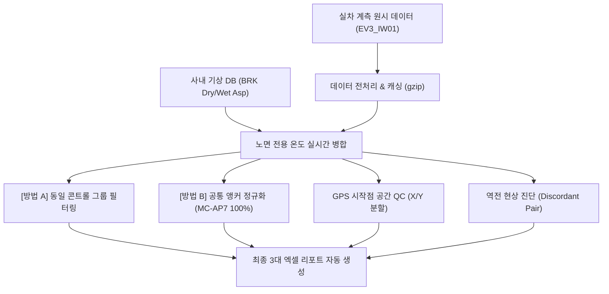

# 🏎️ 제동 성능 자동 분석 플랫폼 (Braking_AutoBuild) 마스터 대시보드

> ⚡ **Quick Jump**: [📅 1. 체인지로그](#-1-프로젝트-주요-버전-이력-changelog-타임테이블) · [🛠️ 2. 인프라&보안](#-2-개발-인프라-및-보안-정비) · [🧠 3. 핵심 공학 성과(12대)](#-3-핵심-공학-알고리즘-및-시각화-고도화-성과) · [📊 4. 보고서 산출물](#-4-엑셀-및-마크다운-보고서-자동화-산출물) · [🔍 5. 모듈 파이프라인](#-5-신규-모듈화-아키텍처-및-실행-파이프라인-ev3_iw01) · [🚀 6. 로드맵](#-6-향후-작업-로드맵-action-items--to-do)

> [!ABSTRACT] 📌 프로젝트 개요 및 실시간 상태
> 본 프로젝트는 **`EV3_IW01` (Autobuild IW01_EV3)** 기아 EV3 실차 제동 계측 데이터의 전처리, 기상/노면 온도 결합 보정, GPS 공간 품질 관리(QC), 콘트롤 타이어 편차 구제(앵커 교정), 그리고 최종 엑셀 보고서 자동 연동 파이프라인을 구축하는 차세대 제동 데이터 엔지니어링 프로젝트입니다.  
> 
> * 🏢 **상위 대시보드**: [[02_Projects/00_프로젝트_통합_대시보드|02_Projects 프로젝트 통합 대시보드]]
> * 📑 **최신 공학 분석 마스터 리포트**: [[10_EV3_IW01_Integrated_Braking_Analysis_Report|EV3 IW01 실차 제동 종합 공학 분석 마스터 리포트 (.md)]]
> * 🌡️ **노면온도 민감도 전문 분석서**: [[20_EV3_IW01_노면온도_민감도_종합분석|EV3 IW01 노면온도 민감도(Sensitivity) 종합 분석 보고서 (.md)]]
> * 📚 **연계 지식 위키**: [[04_Resources/21_제동/40_제동_성능_자동분석_및_기상_공간QC_보정_시스템|40_제동 성능 자동분석 및 기상·공간QC 보정 시스템 위키]]
> * 🛑 **기술 허브**: [[04_Resources/21_제동/00_제동_기술_통합_색인|00_제동 기술 통합 색인]]



---

## 📅 1. 프로젝트 주요 버전 이력 (Changelog 타임테이블)

| 버전 | 날짜 | 작업자 | 핵심 수정 및 개발 내역 (Changelog) | 상태 |
| :---: | :---: | :---: | :--- | :---: |
| **v2.1** | 2026-10-06 | uno &<br/>Gemini | 🌡️ **EV3_IW01 노면온도 민감도(Sensitivity) 및 스펙별 산점도 분석 체계 수립**<br/>• 노면온도 $1^\circ\text{C}$당 제동거리 변화량($m, \text{m/}^\circ\text{C}$) 및 $10^\circ\text{C}$ 상승 시 변화량($\Delta D_{10^\circ\text{C}}$) 정량화<br/>• 외측 범례(Outside Legend) 스카터 플랏 4종 및 노면별 민감도 바 차트 생성<br/>• 미쉐린 AP7의 Wet 저마찰 고온 취약성($+1.57\text{ m/}10^\circ\text{C}$) vs 국산 현용 IW01-X19의 압도적 열안정성($+0.56\text{ m/}10^\circ\text{C}$) 규명<br/>• 콘티넨탈 TS의 시험 차수 간 편차(Day-to-day Shift) 이상치 규명<br/>• 종합 마크다운 보고서(`[[20_EV3_IW01_노면온도_민감도_종합분석]]`) 발행 및 첨부 이미지 연동 | ✅ 완료 |
| **v2.0** | 2026-09-17 | uno &<br/>Gemini | 🏎️ **EV3_IW01 11대 테마 분석 및 83종 차트 생태계 완성**<br/>• 11대 테마, 13대 전문 분석 모듈, 12개 시트 통합 마스터 엑셀(`EV3_IW01_Integrated_Braking_Analysis_Report.xlsx`) 구축<br/>• 고속 vs 저속 감속도 차이($\Delta g$) vs 상대지수 상관분석 엔진 신설 (Lane 7 유의 양의 상관성 규명)<br/>• 표면 기여도 의뢰번호 병기 라벨링 및 4대 주력 스펙군 시각 하이라이트 팔레트 적용<br/>• 83종 고해상도 차트 생성 및 마크다운 기술 백서(`[[10_EV3_IW01_Integrated_Braking_Analysis_Report]]`) 전수 임베딩 | ✅ 완료 |
| **v1.9** | 2026-09-17 | uno &<br/>Gemini | 📝 **용어 표준화 및 베이스라인 실측거리 병기**<br/>• '열화/내구성' 용어 배제 ➔ '반복 횟수별 성능 변화', '성능 변동량', '변동 기울기'로 전면 개편<br/>• Surface_Ctrl_Baseline 차트(`01_01`~`01_06`) 막대에 실측거리 `(xx.xx m)` 병기 및 X축 마진 확장 | ✅ 완료 |
| **v1.8** | 2026-09-16 | uno &<br/>Gemini | 🔬 **신규 3대 테마(7, 8, 9) 신설 및 5대 테마 재현성 평가 분리**<br/>• [테마 7] 8회 반복 제동 순차 런 DB(`df_result_runs`, 240행) 기반 추세 분석 (`26번`)<br/>• [테마 8] 노면별 Mu-Drop 손실거리 및 분모 0 왜곡 진단 (`27번`)<br/>• [테마 9] 고속(100~50) vs 저속(50~0) 구간 분할 및 감속도 변화율($\Delta g$) 프로파일링 (`28번`)<br/>• [테마 5] 콘트롤 타이어 vs 테스트 타이어 재현성 평가 완전 분리 (`24번`)<br/>• GPS 제동 진입 위치 X/Y 분할 통계 표 및 제동 중 요(Yaw) 거동 무상관 규명 | ✅ 완료 |
| **v1.5** | 2026-09-15 | uno &<br/>Gemini | 📑 **통합 마크다운 마스터 리포트(`31번`) 구축 및 물리 이상치 규명**<br/>• 6대 테마 전수 세부 산출 근거 표(24개+) 및 차트 내장 통합 마크다운 리포트 구축<br/>• 마른 노면(Lane 7) 콘트롤 타이어 온도 저반응/역전 원인(트랙 컨디셔닝, 아스팔트 점착) 규명<br/>• 차트 시각화 사실주의(Fact-Only) 적용 및 상단 타이틀 오버랩 완벽 해소 | ✅ 완료 |
| **v1.0** | 2026-09-11 | uno &<br/>Gemini | 🚀 **기상 DB 실시간 노면온도 결합 및 앵커 재보정(Method B) 엔진 주조**<br/>• 사내 기상 DB(`BRK Dry/Wet Asp`) 실시간 노면온도 결합<br/>• 공통 앵커(`EXT-2026-00147`) 기반 상대 성능 정규화(Method B) 수립<br/>• 제동 시작점 횡방향(X)/종방향(Y) 분할 공간 QC 엔진 개발 | ✅ 완료 |

---

## 🛠️ 2. 개발 인프라 및 보안 정비

* **GCP 환경 변수 및 ADC 영구 연동:**
  * Windows 시스템 사용자 환경 변수에 `GOOGLE_CLOUD_PROJECT="hankook-ai"`를 영구 등록하고 애플리케이션 기본 인증(ADC)을 세팅하여 터미널 초기화 시마다 재로그인해야 하는 연동 피로도를 완벽히 격파했습니다.
  * 새로운 PC 이전을 위한 **`GCP_SETUP_GUIDE.md`**를 프로젝트 루트에 가이드라인 파일로 별도 상주 보존했습니다.
* **파이참 Git 버전 관리(VCS) 정합성 복구:**
  * `.idea/vcs.xml`에 서브모듈 `unoUtil`의 Git 경로가 뒤섞여 버전 관리 및 깃 로그가 엉키던 문제를 원천 수정하여, 깃 로그를 상호 독립된 청정 상태로 격리 회복시켰습니다.

---

## 🧠 3. 핵심 공학 알고리즘 및 시각화 고도화 성과


> [!NOTE]- ① 실시간 기상/노면 전용 온도 결합 고도화 (`BRK Dry/Wet Asp`) [클릭하여 펼치기]
> * **기존:** 단순 대기 기온 기반 보정으로 기온 변동 마진의 한계가 존재했습니다.
> * **개선:** 실시간 기상 DB와 연동하여 마른 노면(`dry`) 평가 시 **`BRK Dry Asp` (마른 노면 온도)**, 젖은 노면(`wet`, `wetre`) 평가 시 **`BRK Wet Asp` (젖은 노면 온도)** 컬럼을 실시간 타겟 병합하여 물리적 독립 변수의 공학적 설명력을 비약적으로 향상시켰습니다.

> [!NOTE]- ② [방법 A] 동일 콘트롤 그룹 필터링 (Local Baseline Groups) [클릭하여 펼치기]
> * **목표:** 서로 다른 세션의 타이어 간 기준선(콘트롤) 스펙 편차를 원천 차단하기 위해 동일한 콘트롤 제품을 쓴 프로젝트들끼리만 청정 묶음 대조하도록 그룹화했습니다.
>   * **Group A (ex-MC-AP7 / EXT-2026-00147 수입 기준):** `26RE040025KF` & `26RE070033KF`
>   * **Group B (KPKT1033338X00019 자체 기준):** `26RE080029KF`, `26RE080030KF` 및 **`26RE070057KF` (KP, MP 몰드 포함)**
>   * 노면별 편차 그래프와 함께 **노면에 상관없는 전체 통합(Overall) 가로바 차트**를 새로 산출하여 종합적 거동 비교를 완비했습니다.

> [!NOTE]- ③ [방법 B] 공통 앵커 타이어 기반 전체 정규화 (Anchor Recalibration) [클릭하여 펼치기]
> * **목표:** 기준 타이어가 달라 직접 대조가 불가능한 프로젝트들 전체를 통틀어, 교차 주행한 공통 타이어 **`ex-MC-AP7` (TestTireSpec: `EXT-2026-00147`)을 절대 기준(100.0%)**으로 삼아 전체 지수를 상대 리스케일링(Re-scale)해 수평 정렬했습니다.
> * **TestTireSpec 브릿지 체인 확장:** 콘트롤 스펙 `KPKT1033338X00019`를 공유하는 `26RE080029KF`, `26RE080030KF`, **`26RE070057KF`**를 스펙 기반으로 연속 연결하여, 마킹 차이(`2nd` vs `KP`)로 인해 누락되었던 **KP 몰드(`X22`, `X23`) 및 MP 몰드(`X00`, `X01`)를 전 프로젝트 수평 비교선에 완벽 복원**했습니다.
> * **성과:** 기준 타이어 오염이 사라지면서, 가혹 조건(노면온도 폭등) 하에서 억울하게 지수가 깎였던 고성능 타이어들을 동등 선상에서 완벽하게 대조하는 데 성공했습니다.
> * **종합 장표 탑재:** 모든 노면을 총망라해 평균을 낸 **`MethodB_Overall (노면 독립적 종합 재보정 성능)` 그래프**를 최종 주조해 내어, 밸런스가 가장 우수한 최강 규격을 즉각 판단하는 핵심 장표를 탑재했습니다.

> [!NOTE]- ④ 실측 제동거리 vs 성능지수 역전 분포 진단 (Discordant Diagnosis) [클릭하여 펼치기]
> * **개별 raw 주행 포인트 노출:** 중복 시험 결과를 강제로 평균내지 않고, 개별 주행 결과들을 엑셀과 그래프 상에 고스란히 다른 독립 포인트로 표출시켰습니다.
> * **점-선 기하학적 정합 버그 해결:** 산점도 점과, 주황색 역전 연결선, 라벨 마커의 데이터 소스를 `df_lane_points`로 100% 완전 정합하여 연결선 끝자락이 허공에 둥둥 뜨거나 어긋나던 정렬 오차를 기하학적 정중앙에 자석 밀착시켰습니다.
> * **글씨 겹침 버그 박멸:** 지수 밀집 구간에서 텍스트 라벨이 세로로 심하게 뭉개지던 현상을 **단일 라벨 라벨링(`Single-line`)** 및 **상하 충돌 방지 정렬 임계 마진(0.65)** 기법을 도입해 한 글자도 겹침 없이 사르륵 펼쳐 정렬시켰습니다.

> [!NOTE]- ⑤ 제동 진입 시작 위치 공간 QC (X축 횡방향 / Y축 종방향 분할) [클릭하여 펼치기]
> * **기존:** 단순 대각선 합성(Euclid) 편차만 표시하여 운전자의 쏠림(조향)과 밀림(타이밍)을 구분하지 못했습니다.
> * **개선:** 드라이버의 핸들 좌우 차선 유지 오차인 **`횡방향 X축 편차`**와 브레이크 페달 개시 타이밍 오차인 **`종방향 Y축 편차`**를 분할 산출(`abs().mean()`, `abs().max()`)하여 테이블과 차트에 전면 수록했습니다.
>   * **정량 증명:** 전 노면에서 운전자의 횡방향(X) 조향 오차는 평균 0.13~0.41m (최대 0.89m 이내)로 규정 차선(QC 0.5m)을 완벽히 유지했으나, 종방향(Y) 제동 타이밍은 Wet 1~2m, Dry 3~14m의 물리적 산포를 나타냄을 규명.
>   * **결과물 차트 (3종):**
>     * `06_01_Braking_Spatial_Scatter_Analysis.png` (2D 제동 진입 좌표 산점도 맵)
>     * `06_02_Braking_Centroid_Deviation_Analysis.png` (프로젝트별 횡/종/합성 편차 Grouped Bar 차트)
>     * `06_03_Braking_XY_Directional_Deviation.png` (횡방향 조향 정밀도 vs 종방향 제동 타이밍 분할 정밀 대조 차트)

> [!NOTE]- ⑥ 동일 스펙 교차 의뢰서 반복 시험 정밀 대조 (`EV3_IW01_cross_spec_compare.py`) [클릭하여 펼치기]
> * **목표:** 서로 다른 의뢰서(`TestReqNo`)에 걸쳐 동일한 노면(`TestCond`)에서 중복/반복 평가된 **동일 타이어 스펙(`TestTireSpec`)**들을 전수 색출하여 시간 경과 및 계절 변화에 따른 물리 거동을 정밀 추적.
> * **텍스트 레이블 가독성 극대화:** "의뢰번호, 마킹명, 시험 일자, 시각(Datetime)"을 X축에 15도 틸팅으로 표기하여 겹침 없이 명확화.
> * **노면별 1:1 대조 차트 (4종):**
>   * `Cross_Spec_Comparison_lane1.png`, `lane4.png`, `lane7.png`, `lane8.png`
> * **주요 공학적 발견:**
>   1. `IW01-X13 (KPKT1033338X00013)`: 4월 서늘한 봄(22.1°C) **31.90m** $\rightarrow$ 7월 혹서기(27.1°C~35.3°C) **36.34m, 35.78m**로 **+4.44m 밀림 현상** 정밀 포착.
>   2. `ex-MC-AP7 (EXT-2026-00147)`: WET 수막 노면에서 4월(32.8m) $\rightarrow$ 6월(36.7m) $\rightarrow$ 7월(36.6m) $\rightarrow$ 8월(35.1m)로 실측 거리는 크게 변동했으나, Method B 재보정을 통해 전 세션 **100.0%**로 완벽하게 수평 정합됨.
>   3. `IW01-X19 (KPKT1033338X00019)`: 57KF(KP 몰드), 29KF/30KF(2nd 몰드)에 걸쳐 Method B 브릿지 체인을 통해 Lane 1: **101.1%**, Lane 4: **103.5%**, Lane 7: **101.4%**로 통일성 있게 환산되어 프로젝트 간 연결성 완비.

> [!NOTE]- ⑦ 6대 분석 모듈화 및 통합 엑셀 마스터 리포트 완성 [클릭하여 펼치기]
> * **목표:** 모놀리식 스크립트 구조를 탈피하고, 동적 계층화(`list_group_cols`)를 지원하는 **6대 독립 분석 모듈 + 1개 통합 엑셀 마스터 빌더 + 1개 총괄 오케스트레이터(Wrapper)** 구조로 전면 리팩토링.
> * **모듈 구성 (`EV3_IW01/`):**
>   1. `00_EV3_IW01_make_result.py`: 원시 데이터 파싱 및 기상 노면온도 결합 전처리 캐시.
>   2. `10_EV3_IW01_analysis.py`: 총괄 오케스트레이터 (Wrapper). 동적 그룹바이, 원클릭 파이프라인.
>   3. `20_EV3_IW01_surface_and_control_baseline.py`: [테마 1] 노면 및 로컬 콘트롤 기준 편차 분석.
>   4. `21_EV3_IW01_temperature_sensitivity.py`: [테마 2] 노면온도 의존성 및 감인성($m \text{ [m/°C]}$) 1차 회귀.
>   5. `22_EV3_IW01_discordance_diagnosis.py`: [테마 3] 실측 제동거리 vs 성능지수 역전 현상(Discordance) 색출 및 온도 보정 타당성 입증.
>   6. `23_EV3_IW01_anchor_recalibration.py`: [테마 4] 공통 앵커(`EXT-2026-00147`) 재보정(Method B), 슬로프 차트 및 Overall 랭킹.
>   7. `24_EV3_IW01_cross_spec_repeatability.py`: [테마 5] 동일 스펙 교차 의뢰서 반복 시험 정밀 대조.
>   8. `25_EV3_IW01_spatial_gps_qc.py`: [테마 6] 제동 진입 위치 GPS 공간 품질 QC (횡방향 X축, 종방향 Y축, 합성 편차 정밀 진단).
>   9. `30_EV3_IW01_export_integrated_excel.py`: 6대 테마 결과를 1개의 통합 엑셀 파일(**`EV3_IW01_Integrated_Braking_Analysis_Report.xlsx`**)에 7개 시트(Executive Summary 표지 + 6개 분석 시트)로 자동 완성.
>   10. `31_EV3_IW01_export_integrated_markdown.py`: 엑셀급 데이터 투명성을 보장하는 24개 이상 마크다운 상세 표 및 22개 차트 내장 통합 마스터 리포트(**`10_EV3_IW01_Integrated_Braking_Analysis_Report.md`**) 자동 생성 및 옵시디언 볼트 이중 동기화.

> [!NOTE]- ⑧ 엑셀 수준의 데이터 투명성을 갖춘 통합 마크다운 마스터 리포트 빌더(`31_EV3_IW01_export_integrated_markdown.py`) [클릭하여 펼치기]
> * **목표:** 엑셀을 열지 않고도 웹/옵시디언 환경에서 전수 데이터를 검증할 수 있도록 엑셀의 모든 산출 근거 데이터(24개 이상의 마크다운 정밀 표)를 100% 이식.
> * **표준 상대 경로 및 옵시디언 이중 지원:** 로컬 환경에서는 `` 상대경로로, 옵시디언 볼트에서는 `![[파일명]]` 위키링크 형식으로 완벽 호환 변환.
> * **온디맨드 동기화 스위치:** 기본값은 로컬 빌드(`sync_obsidian=False`)로 격리하여 불필요한 I/O를 방지하고, 필요 시 1회성 파라미터(`sync_obsidian=True`)로 볼트(`02_Projects/...` 및 `_attachments/...`)에 원클릭 무결 배포.

> [!NOTE]- ⑨ 마른 노면(Lane 7) 콘트롤 타이어 온도 감인성 이상치(Anomaly) 규명 [클릭하여 펼치기]
> * **현상 진단:** Lane 7(마른 아스팔트)의 겉보기 음(-)의 추세선은 서로 다른 콘트롤 타이어 투입에 의한 통계적 착시(심슨의 역설)였으며, 동일 콘트롤 타이어 내에서도 10~13°C의 극심한 온도 상승 대비 제동거리 증가량은 +0.17m에 불과하거나 -0.70m 역전 발생.
> * **공학적 원인 규명:**
>   1. **트랙 컨디셔닝(Track Conditioning) 왜곡:** 아침 첫 시험(C1, Green Track) 시 노면 먼지로 인한 슬립 ➔ 주행 반복에 따른 트랙 클리닝 및 고무 피막(Rubber Deposit) 형성으로 오후(C2) 접지력 급상승.
>   2. **아스팔트 점착(Adhesion) 마찰 보상:** 45~53°C 폭염 노면에서 아스팔트 바인더와 트레드 고무의 연화로 인한 점착 마찰 이득이 타이어 강성 저하를 상쇄.
> * **엔지니어링 원칙 확립:** 타 노면(+0.10~+0.15 m/°C) 대비 비정상적으로 극히 작은 이상치(Anomaly)이므로, **인위적인 온도 보정식 적용을 엄격히 배제**하고 반드시 당일 콘트롤 직접 대조 방식으로만 평가하도록 규정.

> [!NOTE]- ⑩ 차트 시각화 사실주의(Fact-Only) 표준 및 타이틀 오버랩 완벽 해소 [클릭하여 펼치기]
> * **피규어 불변성 및 사실주의 원칙:** 이미지 파일(`.png`) 내부에는 주관적 해석/판단("심슨의 역설", "비정상" 등) 텍스트 박스를 일체 배제하고, 순수 데이터 산점도, 회귀 추세선, 통계 수치($r$, $m$, $p$)만 객관적으로 시각화. (판단 변경 시 이미지 재렌더링 방지 및 유지보수성 극대화)
> * **타이틀 오버랩 제로화:**
>   * 4.3 실측 제동거리 vs 성능지수 산점도 매트릭스(`03_01_Raw_Distance_vs_Index_Analysis_With_Temp.png`)의 전체 타이틀(`fig.suptitle`)과 서브플롯 4개 타이틀 간의 글자 겹침을 `figsize=(13, 11)`, `ax.set_title(fontsize=12, pad=9)`, `subplots_adjust(top=0.89)`로 완벽 해소.

> [!NOTE]- ⑪ 표면 기여도(`Surface_Contribution`) 스펙 식별성 강화 및 4대 계열 하이라이트 [클릭하여 펼치기]
> * **의뢰번호 및 스펙 결합 라벨링:** 단순 마킹 표기로 인한 중복 혼선을 원천 방지하기 위해 `[의뢰번호] 몰드-패턴-마킹 (TireSet)` 포맷으로 Y축 및 데이터 테이블을 일괄 개편.
> * **4대 핵심 스펙군 시각 하이라이트:** 개발 주력 스펙군에 고유 컬러 팔레트와 엑셀 셀 배경색/폰트 서식을 적용하여 직관적 식별력 극대화:
>   * `1st-IW01`: 선명한 블루 (`#1f77b4` / 엑셀 `#D9E1F2`)
>   * `2nd-IW01`: 선명한 오렌지 (`#e67e22` / 엑셀 `#FCE4D6`)
>   * `2nd-QW01A`: 선명한 그린 (`#27ae60` / 엑셀 `#E2EFDA`)
>   * `2nd-QW01B`: 선명한 레드 (`#c0392b` / 엑셀 `#FADBD8`)
>   * 기준품 `ex-MC-AP7`: 다크 네이비, 수입품 `ex-PI-CW3`: 퍼플

> [!NOTE]- ⑫ 고속 vs 저속 감속도 차이(Δg)와 상대 제동 성능지수(Index) 간 상관성 분석 (`Speed_Zone_Analysis`) [클릭하여 펼치기]
> * **물리 메커니즘 규명:** 고속 대비 저속 감속도의 변화량($\Delta g = g_{low} - g_{high}$)이 시험 의뢰서 내 기준품(100.0%) 대비 상대 성능지수(Index, %)에 미치는 영향을 4대 노면별로 상관분석(Pearson $r$, $R^2$, $p$-value, 선형 회귀식) 수행.
>   * **Lane 7 (Dry 아스팔트, $r = +0.529, R^2 = 0.280, p = 0.0424 < 0.05$):** 통계적으로 유의미한 양(+)의 상관관계. 고속(100km/h)에서 진입하여 후반 정지 직전까지 블록 전단 강성과 점착 마찰을 유지하여 감속도를 끌어올린($\Delta g > 0$) 스펙이 전체 제동거리를 효과적으로 단축시킴.
>   * **Lane 4 (Wet 저마찰, $r = -0.347, R^2 = 0.120, p = 0.0825 < 0.10$):** 음(-)의 상관 경향성. 고속 수막현상(Hydroplaning)으로 인해 고속 감속도가 붕괴된 타이어일수록 저속에서 접지력을 회복하더라도 $\Delta g$ 편차만 벌어지며, 전체 제동거리의 63.2%를 차지하는 고속 손실을 만회하지 못해 최종 상대 성능지수가 저하됨.
>   * **Lane 1 (Wet 고마찰, $r = -0.123, p = 0.628$):** 비유의. 고수막 배수가 양호하여 속도 구간별 차이보다는 절대 감속도 레벨이 지수를 지배함.
>   * **Lane 8 (Dry, $r = +0.513, R^2 = 0.263, p = 0.194$):** 양(+)의 경향성.
> * **차트 사실주의(Fact-Only) 표준 준수:** 차트 내부 통계 박스에서 주관적 소견 문장을 전면 배제하고 정량적 통계 지표($r$, $R^2$, $p$-value, 선형 회귀식)만 콤팩트하게 표기하여 데이터 포인트와의 시각적 간섭을 제로화.
> * **신규 차트 5종 탑재 (총 83종 생태계):**
>   * `09_05_Speed_Zone_AccDiff_vs_Index_Correlation.png` (4대 노면 2x2 종합 산점도 및 신뢰구간 밴드 차트)
>   * `09_05_AccDiff_vs_Index_lane1.png` ~ `lane8.png` (노면별 단독 상관분석 고해상도 차트 4종)

---

## 📊 4. 엑셀 및 마크다운 보고서 자동화 산출물

1. **📑 [[02_Projects/회사_업무/10_Braking_AutoBuild/10_EV3_IW01_Integrated_Braking_Analysis_Report|10_EV3_IW01_Integrated_Braking_Analysis_Report.md]] (통합 마크다운 마스터 리포트)**
   * **형태:** 단일 완성형 공학 기술 백서 (옵시디언 볼트 및 로컬 프로젝트 동시 배포).
   * **데이터 투명성:** 엑셀 12대 시트의 모든 세부 산출 근거 표(표 45개 이상) 전수 수록.
   * **시각화 무결성:** 83개 고해상도 넘버링 차트 완벽 임베딩.
2. **📑 `EV3_IW01_Integrated_Braking_Analysis_Report.xlsx` (12대 시트 통합 마스터 엑셀 리포트)**
   * **Executive_Summary 시트:** 전 테마 핵심 공학적 소견 종합 및 시트 구성 가이드.
   * **Test_Campaign_Overview 시트:** 전체 시험 캠페인 매트릭스 및 전수 평가 명세.
   * **Surface_Ctrl_Baseline 시트:** 노면별 및 로컬 콘트롤 기준 성능 편차 (스펙/몰드/패턴 계층 분석).
   * **Temperature_Sensitivity 시트:** 콘트롤 타이어 노면온도 의존성 및 감인성(m/°C) 1차 회귀 요약.
   * **Discordance_Diagnosis 시트:** 실측 제동거리 vs 성능지수 역전 현상 전수 색출 및 온도 열세 보정 정당성 입증.
   * **Anchor_Recalibration 시트:** Method A vs B 순위 변동 대조표 및 전 노면 통합 Overall 재보정 랭킹.
   * **Cross_Spec_Repeatability 시트:** 동일 스펙 반복 시험 변동폭(Delta) 및 세부 평가 로그.
   * **Spatial_GPS_QC 시트:** 프로젝트별 제동 진입 위치 공간 편차 및 운전자 주행 일관성 진단.
   * **Run_Degradation 시트:** 8회 반복 제동 순차 성능 변화 실측표 및 성능 변동 대조.
   * **MuDrop_Analysis 시트:** 노면별 Mu-Drop 손실거리 실측/보정 대조 및 왜곡 진단.
   * **Speed_Zone_Analysis 시트:** 고속 vs 저속 성능 분할표 및 감속도 차이(Δg) vs 상대지수 상관성 분석표/차트 신설.
   * **Surface_Contribution 시트:** 노면별 기여율, 감속도 레벨 차이, Mu-Drop 영향도 및 의뢰서별 속도 프로파일 대조 (스펙 하이라이트).
   * **Tire_Speed_Zone_Analysis 시트:** 타이어 스펙별 고속 vs 저속 종합 매트릭스 및 노면별 명세표.
3. **📊 `Braking_Performance_Calibration_Validation_Report.xlsx` (종합 검증 보고서)**
4. **🌡️ `Control_Tire_Temperature_Dependency_Report.xlsx` (온도/역전 정밀 진단서)**
5. **🗺️ `Braking_GPS_Spatial_QC_Report.xlsx` (GPS 공간 QC 보고서)**

---

## 🔍 5. 신규 모듈화 아키텍처 및 실행 파이프라인 (`EV3_IW01/`)

> [!NOTE]- 🔍 11대 전문 분석 모듈 및 실행 파이프라인 상세 명세 [클릭하여 펼치기]
> 전체 파이프라인이 단일 모놀리식 구조에서 **11대 전문 분석 모듈 및 2대 빌더(Excel / Markdown)** 체계로 모듈화되어, 데이터 분리 저장(`0. db/`), 11대 테마 83종 고해상도 시각화(`2. fig/`), 12개 데이터 시트 마스터 엑셀 및 마크다운 리포트 배포를 원클릭 제어합니다.
> 
> | 모듈 번호 | 파이썬 모듈 파일명 | 핵심 엔지니어링 역할 및 담당 테마 | 주요 산출물 (Chart / Sheet / Doc) |
> | :---: | :--- | :--- | :--- |
> | **00** | `00_EV3_IW01_make_result.py` | 원시 제동 시험 데이터 파싱, 기상 DB(대기/노면온도) 결합 및 캐싱 | `0. db/df_result_summary.gzip` |
> | **10** | `10_EV3_IW01_analysis.py` | **총괄 오케스트레이터 (Wrapper)**: 12대 모듈 로드, 83개 차트 저장, 엑셀/마크다운 마스터 빌더 원클릭 제어 | 파이프라인 통합 관제 |
> | **20** | `20_EV3_IW01_surface_and_control_baseline.py` | **[테마 1] 노면 및 로컬 콘트롤 편차 분석**: Wet/Dry 독립 분리, 막대에 실측거리 `(xx.xx m)` 병기 | `01_01_` ~ `01_06_`<br>Sheet: `Surface_Ctrl_Baseline` |
> | **21** | `21_EV3_IW01_temperature_sensitivity.py` | **[테마 2] 노면온도 의존성 및 감인성 분석**: 1차 선형 회귀 기울기($m \text{ [m/°C]}$) 및 피어슨 $r$ 산출 | `02_01_Control_Tire_vs_Temperature_Analysis.png`<br>Sheet: `Temperature_Sensitivity` |
> | **22** | `22_EV3_IW01_discordance_diagnosis.py` | **[테마 3] 실측 제동거리 vs 성능지수 역전 진단**: Discordant Pair 색출 및 온도 열세 보정 정당성 입증 | `03_01_Raw_Distance_vs_Index_Analysis_With_Temp.png`<br>Sheet: `Discordance_Diagnosis` |
> | **23** | `23_EV3_IW01_anchor_recalibration.py` | **[테마 4] 공통 앵커(`EXT-2026-00147`) 재보정 (Method B)**: 슬로프 차트 동순위 Y슬롯 분리(글자 겹침 제로), Wet/Dry 종합 랭킹 분리 | `04_01_` ~ `04_07_`<br>Sheet: `Anchor_Recalibration` |
> | **24** | `24_EV3_IW01_cross_spec_repeatability.py` | **[테마 5 개편] 콘트롤 타이어 vs 테스트 타이어 재현성 분리 평가**: 세션 간/세션 내 C1 vs C2 편차 및 Method A/B 수렴성 검증 | `05_01_` ~ `05_04_`<br>Sheet: `Cross_Spec_Repeatability` |
> | **25** | `25_EV3_IW01_spatial_gps_qc.py` | **[테마 6] 제동 시작/정지 GPS 2포인트 공간 QC 및 요(Yaw) 모션**: 횡방향(X)/종방향(Y) 분할 진단, 요 모션 무관성 입증 | `06_01_` ~ `06_05_`<br>Sheet: `Spatial_GPS_QC` |
> | **26** | `26_EV3_IW01_run_degradation.py` | **[테마 7] 반복 횟수별 성능 변화 분석**: 제동 1회당 1행 마스터 DB(`df_result_runs`, 240행), 런 추세선, 변동 기울기, 편차폭 정량화 | `07_01_` ~ `07_03_` (9종)<br>Sheet: `Run_Degradation` |
> | **27** | `27_EV3_IW01_mudrop_analysis.py` | **[테마 8] 노면별 Mu-Drop 손실거리 및 환경 보정 왜곡 진단**: 실측 vs 보정 손실거리 대조, 콘트롤 분모 0 왜곡 규명 | `08_01_` ~ `08_04_` (4종)<br>Sheet: `MuDrop_Analysis` |
> | **28** | `28_EV3_IW01_speed_zone_analysis.py` | **[테마 9] 속도 구간별 성능 분할 & 감속도 차이(Δg) vs 상대지수 상관성 분석**: 고속 vs 저속 분할 및 감속도 변화율, 상대지수 상관성 2x2 및 단독 차트 | `09_01_` ~ `09_05_` (9종)<br>Sheet: `Speed_Zone_Analysis` |
> | **29** | `29_EV3_IW01_surface_contribution.py` | **[테마 10] 노면별 기여율, 감속도 레벨 차이, Mu-Drop 영향도 및 의뢰서별 속도 프로파일 대조**: 고속/저속 기여율(%), $\Delta g$, Mu-Drop 기여율(100% 누적 시각화 및 타이어별 대조), 의뢰서별 속도 감속도 프로파일 (4대 스펙 하이라이트) | `10_01_` ~ `10_05_` (13종)<br>Sheet: `Surface_Contribution` |
> | **32** | `32_EV3_IW01_tire_speed_zone_analysis.py` | **[테마 11 신규] 타이어 스펙별 고속 vs 저속 성능 분할 및 감속도 프로파일 종합 분석**: 25개 전수 스펙 기준 제동거리, 고속/저속 감속도, $\Delta g$, 유지율 및 4대 노면 종합 매트릭스 | `11_01_` ~ `11_05_` (5종)<br>Sheet: `Tire_Speed_Zone_Analysis` |
> | **30** | `30_EV3_IW01_export_integrated_excel.py` | **통합 엑셀 마스터 리포트 빌더**: 12개 데이터 시트 생성, A열 슬림화, 고해상도 차트 83종 전수 자동 삽입 | `EV3_IW01_Integrated_Braking_Analysis_Report.xlsx` |
> | **31** | `31_EV3_IW01_export_integrated_markdown.py` | **통합 마크다운 마스터 리포트 빌더**: 45개+ 산출 근거 표 + 83개 차트 수록, 볼트 온디맨드 이중 동기화(`sync_obsidian`) | `10_EV3_IW01_Integrated_Braking_Analysis_Report.md` |
> 
> ### 🚀 파이프라인 원클릭 실행 스크립트
> 
> ```python
> # D:\uno\Python\Projects\Braking_AutoBuild\EV3_IW01\10_EV3_IW01_analysis.py 실행
> from EV3_IW01.10_EV3_IW01_analysis import run_ev3_iw01_analysis_pipeline
> 
> results = run_ev3_iw01_analysis_pipeline(
>     list_group_cols=['TestTireMold', 'TestTirePTN', 'TestTireMark'],  # 동적 그룹화 계층
>     plot=False,           # Figure 메모리 정리 (저장 후 plt.close() 실행)
>     save=True,            # 2. fig 폴더에 11대 테마 83개 차트 저장
>     excel=True,           # 12개 데이터 시트 통합 엑셀 마스터 리포트 빌드 (차트 전수 삽입)
>     sync_obsidian=True,   # 옵시디언 볼트(02_Projects 및 _attachments) 동시 배포
>     b_print_log=True
> )
> ```

---

## 🚀 6. 향후 작업 로드맵 (Action Items & To-Do)

* [x] **1단계: 임시 실험 코드(`temp_analysis`)의 메인 분석 모듈화 통합** (완료 - `21번`, `22번` 모듈로 분리 구축 완료)
* [x] **2단계: 메인 분석 스크립트 실행 및 결과 차트 22종·엑셀 7개 시트 전수 검증** (완료)
* [x] **3단계: 통합 마크다운 마스터 리포트 빌더(`31번`) 구축 및 옵시디언 볼트 이중 동기화** (완료)
* [x] **4단계: 신규 3대 테마(반복 횟수별 성능 변화, Mu-Drop 실측/보정 진단, Speed Zone) 구축 및 10개 시트 확장** (완료)
* [x] **5단계: 콘트롤 vs 테스트 타이어 재현성 평가 분리 체계 및 실측거리 병기 표기 고도화** (완료)
* [x] **6단계: 노면별 기여도/감속도 레벨/Mu-Drop 영향도 및 의뢰서별 속도 감속도 프로파일(가속포인트) 분석 완성** (완료 - 시트 `Surface_Contribution` & 차트 13종)
* [x] **7단계: 타이어 스펙별 고속 vs 저속 성능 분할 및 전 노면 종합 대조 매트릭스 완성** (완료 - 시트 `Tire_Speed_Zone_Analysis` & 차트 5종)
* [x] **8단계: Surface_Contribution 의뢰번호 라벨링 및 4대 스펙군 하이라이트 구축** (완료 - `1st-IW01`, `2nd-IW01`, `2nd-QW01A`, `2nd-QW01B` 색상 코딩 및 엑셀 서식 적용)
* [x] **9단계: Speed_Zone_Analysis 고속-저속 감속도 차이(Δg) vs 상대지수 상관성 분석 완성** (완료 - 엑셀 섹션 2 신설, 2x2 종합 차트 및 단독 4종, 83종 차트 생태계 달성)
* [ ] **10단계: `MINI_W426` 프로젝트로 분석 로직 확장**
  * `EV3_IW01`에서 검증된 11대 테마 파이프라인 및 엑셀/마크다운 자동화 프레임워크를 이웃 프로젝트인 `MINI_W426` 분석 코드에도 그대로 이식하여 전사 통합 제동 분석 플랫폼 완성.


---

## 🏠 7. 자택 / 원격 PC 세팅 유의사항

1. `D:\uno\1. 2026\1. BRK\Autobuild IW01_EV3` 등 GCP 데이터 및 캐시 경로가 자택 컴퓨터에도 동일하게 존재하는지 확인합니다.
2. 드라이브 문자나 폴더 구조가 다를 경우 스크립트 상단의 `BASE_DIR = Path(...)` 경로만 자택 환경에 맞게 일치시킵니다.
3. 새로운 PC 세팅을 위한 **`GCP_SETUP_GUIDE.md`** 가이드도 프로젝트 루트에 상주하고 있으므로 참고합니다.


