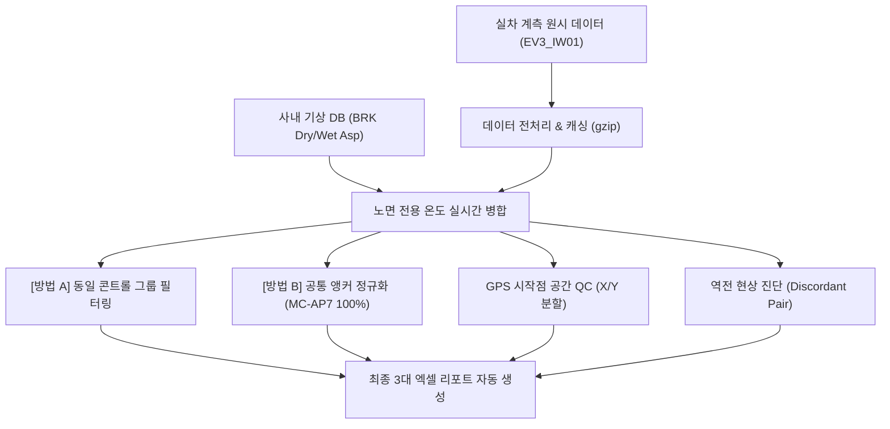

# 🏎️ 제동 성능 자동 분석 플랫폼 (Braking_AutoBuild) 마스터 대시보드

> [!ABSTRACT] 📌 프로젝트 개요 및 실시간 상태
> 본 프로젝트는 **`EV3_IW01` (Autobuild IW01_EV3)** 기아 EV3 실차 제동 계측 데이터의 전처리, 기상/노면 온도 결합 보정, GPS 공간 품질 관리(QC), 콘트롤 타이어 편차 구제(앵커 교정), 그리고 최종 엑셀 보고서 자동 연동 파이프라인을 구축하는 차세대 제동 데이터 엔지니어링 프로젝트입니다.  
> 
> * 🏢 **상위 대시보드**: [[02_Projects/00_프로젝트_통합_대시보드|02_Projects 프로젝트 통합 대시보드]]
> * 📚 **연계 지식 위키**: [[04_Resources/21_제동/40_제동_성능_자동분석_및_기상_공간QC_보정_시스템|40_제동 성능 자동분석 및 기상·공간QC 보정 시스템 위키]]
> * 🛑 **기술 허브**: [[04_Resources/21_제동/00_제동_기술_통합_색인|00_제동 기술 통합 색인]]

---

## 🛠️ 1. 개발 인프라 및 보안 정비

* **GCP 환경 변수 및 ADC 영구 연동:**
  * Windows 시스템 사용자 환경 변수에 `GOOGLE_CLOUD_PROJECT="hankook-ai"`를 영구 등록하고 애플리케이션 기본 인증(ADC)을 세팅하여 터미널 초기화 시마다 재로그인해야 하는 연동 피로도를 완벽히 격파했습니다.
  * 새로운 PC 이전을 위한 **`GCP_SETUP_GUIDE.md`**를 프로젝트 루트에 가이드라인 파일로 별도 상주 보존했습니다.
* **파이참 Git 버전 관리(VCS) 정합성 복구:**
  * `.idea/vcs.xml`에 서브모듈 `unoUtil`의 Git 경로가 뒤섞여 버전 관리 및 깃 로그가 엉키던 문제를 원천 수정하여, 깃 로그를 상호 독립된 청정 상태로 격리 회복시켰습니다.

---

## 🧠 2. 핵심 공학 알고리즘 및 시각화 고도화 성과

### ① 실시간 기상/노면 전용 온도 결합 고도화 (`BRK Dry/Wet Asp`)
* **기존:** 단순 대기 기온 기반 보정으로 기온 변동 마진의 한계가 존재했습니다.
* **개선:** 실시간 기상 DB와 연동하여 마른 노면(`dry`) 평가 시 **`BRK Dry Asp` (마른 노면 온도)**, 젖은 노면(`wet`, `wetre`) 평가 시 **`BRK Wet Asp` (젖은 노면 온도)** 컬럼을 실시간 타겟 병합하여 물리적 독립 변수의 공학적 설명력을 비약적으로 향상시켰습니다.

### ② [방법 A] 동일 콘트롤 그룹 필터링 (Local Baseline Groups)
* **목표:** 서로 다른 세션의 타이어 간 기준선(콘트롤) 스펙 편차를 원천 차단하기 위해 동일한 콘트롤 제품을 쓴 프로젝트들끼리만 청정 묶음 대조하도록 그룹화했습니다.
  * **Group A (ex-MC-AP7 / EXT-2026-00147 수입 기준):** `26RE040025KF` & `26RE070033KF`
  * **Group B (KPKT1033338X00019 자체 기준):** `26RE080029KF`, `26RE080030KF` 및 **`26RE070057KF` (KP, MP 몰드 포함)**
  * 노면별 편차 그래프와 함께 **노면에 상관없는 전체 통합(Overall) 가로바 차트**를 새로 산출하여 종합적 거동 비교를 완비했습니다.

### ③ [방법 B] 공통 앵커 타이어 기반 전체 정규화 (Anchor Recalibration)
* **목표:** 기준 타이어가 달라 직접 대조가 불가능한 프로젝트들 전체를 통틀어, 교차 주행한 공통 타이어 **`ex-MC-AP7` (TestTireSpec: `EXT-2026-00147`)을 절대 기준(100.0%)**으로 삼아 전체 지수를 상대 리스케일링(Re-scale)해 수평 정렬했습니다.
* **TestTireSpec 브릿지 체인 확장:** 콘트롤 스펙 `KPKT1033338X00019`를 공유하는 `26RE080029KF`, `26RE080030KF`, **`26RE070057KF`**를 스펙 기반으로 연속 연결하여, 마킹 차이(`2nd` vs `KP`)로 인해 누락되었던 **KP 몰드(`X22`, `X23`) 및 MP 몰드(`X00`, `X01`)를 전 프로젝트 수평 비교선에 완벽 복원**했습니다.
* **성과:** 기준 타이어 오염이 사라지면서, 가혹 조건(노면온도 폭등) 하에서 억울하게 지수가 깎였던 고성능 타이어들을 동등 선상에서 완벽하게 대조하는 데 성공했습니다.
* **종합 장표 탑재:** 모든 노면을 총망라해 평균을 낸 **`MethodB_Overall (노면 독립적 종합 재보정 성능)` 그래프**를 최종 주조해 내어, 밸런스가 가장 우수한 최강 규격을 즉각 판단하는 핵심 장표를 탑재했습니다.

### ④ 실측 제동거리 vs 성능지수 역전 분포 진단 (Discordant Diagnosis)
* **개별 raw 주행 포인트 노출:** 중복 시험 결과를 강제로 평균내지 않고, 개별 주행 결과들을 엑셀과 그래프 상에 고스란히 다른 독립 포인트로 표출시켰습니다.
* **점-선 기하학적 정합 버그 해결:** 산점도 점과, 주황색 역전 연결선, 라벨 마커의 데이터 소스를 `df_lane_points`로 100% 완전 정합하여 연결선 끝자락이 허공에 둥둥 뜨거나 어긋나던 정렬 오차를 기하학적 정중앙에 자석 밀착시켰습니다.
* **글씨 겹침 버그 박멸:** 지수 밀집 구간에서 텍스트 라벨이 세로로 심하게 뭉개지던 현상을 **단일 라벨 라벨링(`Single-line`)** 및 **상하 충돌 방지 정렬 임계 마진(0.65)** 기법을 도입해 한 글자도 겹침 없이 사르륵 펼쳐 정렬시켰습니다.

### ⑤ 제동 진입 시작 위치 공간 QC (X, Y 축 분할)
* **기존:** 대각선 유클리드 편차만을 기준으로 한 단순 요약이었습니다.
* **개선:** 드라이버의 진입 앞뒤 밀림 오차인 **`X축 편차 (종방향)`**와 좌우 쏠림 오차인 **`Y축 편차 (횡방향)`**를 완벽하게 분할 연산(`abs().mean()`, `abs().max()`) 기재하도록 개조했습니다.
  * 예시를 통해 "드라이버가 핸들 횡(Y) 정렬은 44cm 미만으로 잘 지켰으나, 제동 타이밍 종(X) 오차는 ±1.53m 흔들렸음"을 정량적으로 증명할 수 있습니다.
  * 결과물 차트: `Braking_Spatial_Scatter_Analysis.png`, `Braking_Position_Deviation_Analysis.png`

---

## 📊 3. 엑셀 연동 자동화 및 최종 3대 마스터 보고서

시트 통합 시 송부가 번거롭던 실무 특성을 방지하고자 **최종 3개의 완전히 독립된 엑셀 보고서**로 분할 구축했으며, 파이썬이 연산하는 고정밀 수치 전체를 무삭제 전수 인쇄(Full Log Table) 기입해 정비했습니다.

1. **📊 `Braking_Performance_Calibration_Validation_Report.xlsx` (종합 검증 보고서)**
   * **1번 시트 (기존 보정 Method A):** 원시 왜곡 상태의 가로바 차트 2장 및 전수 데이터.
   * **2번 시트 (재보정 Method B):** 수평 정합된 Overall 차트 및 2x2 노면 차트 4장, 정합된 데이터 전수 표 (패턴 PTN 및 의뢰서 결합으로 바 덮어쓰기 완전 해결).
   * **3번 시트 (A vs B 대조 비교):** 겹침이 완벽 박멸된 슬로프 그래프 3장 및 기존 지수/순위 vs 재보정 지수/순위 대조, **`▲상승(파랑)`/`▼하락(빨강)` 랭크 쉬프트 컬러 마킹** 전수 탑재.
   * **4번 시트 (타당성 검증):** 공학적 원리 해설문, 적용 보정 멀티플라이어 표 및 `X10`, `X00`, `X13` 타이어 우열 변동 정밀 Case Study 수록.
2. **🌡️ `Control_Tire_Temperature_Dependency_Report.xlsx` (온도/역전 정밀 진단서)**
   * 콘트롤 타이어 온도 의존성 거동 요약표 및 감지된 약 200여 건의 모든 개별 주행 간 역전 쌍 전수 데이터 표 완비.
3. **🗺️ `Braking_GPS_Spatial_QC_Report.xlsx` (GPS 공간 QC 보고서)**
   * 수백 회에 이르는 모든 개별 주행 건의 PosX, PosY 좌표와 종(X)/횡(Y)축 개별 편차 오차 전수를 정밀 합격 마크(`합격/경고/탈락`) 채색과 함께 완벽 정합 기재.

---

## 🔍 4. 파일별 개발 및 분석 코드 현황

### ① `EV3_IW01_analysis.py` (메인 분석 코드)
* **상태:** 수정 완료 및 안정화
* **핵심 기능:**
  1. 기상 DB 및 노면 온도 연동 + 최종 기상 통합 데이터프레임 캐시 (`df_result_summary.gzip`) 업데이트 및 저장.
  2. 라인별 제동 성능 지수 편차 가로바 차트 생성.
  3. 세대(Mold)/패턴(PTN) 그룹 대조 분석 차트 생성.
  4. 성능 지수와 실측 제동거리 간 역전 현상(Discordant Pair) 발생 시 **노면 온도 편차**를 포함한 정밀 물리 진단 콘솔 출력.
  5. 제동 진입 위치 GPS 좌표 분석 및 프로젝트 편차 진단 QC 차트 생성.

### ② `EV3_IW01_temp_analysis.py` (임시 실험용 분석 코드)
* **상태:** 메인 통합 대기 중 (실험 로직 보존)
* **포함된 주요 실험 분석:**
  * **[분석 1] 콘트롤 타이어 온도 의존성 분석:** 콘트롤 타이어(`C` 세트)들의 대기 온도 변화에 따른 제동거리 상관관계를 분석하여 1차 추세선(기울기 및 상관계수)을 도출하고 산점도에 시간(HH:MM) 라벨을 마킹하는 차트 생성 (`Control_Tire_vs_Temperature_Analysis.png`).
  * **[분석 2] 실측 제동거리 vs 보정 성능지수 2D 분포 시각화:** 대기 온도를 컬러맵(Colorbar)으로 표현한 2D 산점도에, 역전 현상이 일어난 타이어 쌍들을 붉은 점선으로 연결하여 시각적 왜곡을 진단하는 차트 생성 (`Raw_Distance_vs_Index_Analysis_With_Temp.png`).

---

## 🚀 5. 향후 작업 로드맵 (Action Items & To-Do)

### 1단계: 임시 실험 코드를 메인 분석 코드로 통합
* **목표:** `EV3_IW01_temp_analysis.py`의 2대 시각화 로직을 메인 파일인 `EV3_IW01_analysis.py`로 합병.
* **합칠 대상:**
  1. 콘트롤 타이어 온도 의존성 분석 그래프 (추세선 + 시간 마킹)
  2. 실측 제동거리 vs 성능지수 2D 분포 및 역전 라인 연결 그래프 (온도 컬러맵)
* **기준 변수 고도화:** 대기 온도 대신 메인 코드의 **`노면온도` (`BRK Dry/Wet Asp`)** 컬럼을 기준 변수로 승격하여 정밀도 극대화.

### 2단계: 메인 분석 스크립트 실행 및 결과 차트 6종 검증
* **예상 결과 이미지 6종 리스트:**
  1. `Integrated_Braking_Performance_{lane}.png` (라인별 편차 차트)
  2. `Integrated_Braking_Performance_Group_{lane}.png` (그룹 비교 차트)
  3. `Control_Tire_vs_Temperature_Analysis.png` (콘트롤 타이어 온도 의존성)
  4. `Raw_Distance_vs_Index_Analysis_With_Temp.png` (2D 역전 맵)
  5. `Braking_Spatial_Scatter_Analysis.png` (GPS 시작점 산점도)
  6. `Braking_Position_Deviation_Analysis.png` (GPS 오차 바 그래프)

### 3단계: `MINI_W426` 프로젝트로 분석 로직 확장
* `EV3_IW01`에서 검증된 기상 결합, 앵커 캘리브레이션, GPS 공간 QC, 엑셀 자동화 프레임워크를 이웃 프로젝트인 `MINI_W426` 분석 코드에도 그대로 이식하여 전사 통합 제동 분석 플랫폼 완성.

---

## 🏠 6. 자택 / 원격 PC 세팅 유의사항

1. `D:\uno\1. 2026\1. BRK\Autobuild IW01_EV3` 등 GCP 데이터 및 캐시 경로가 자택 컴퓨터에도 동일하게 존재하는지 확인합니다.
2. 드라이브 문자나 폴더 구조가 다를 경우 스크립트 상단의 `BASE_DIR = Path(...)` 경로만 자택 환경에 맞게 일치시킵니다.
3. 새로운 PC 세팅을 위한 **`GCP_SETUP_GUIDE.md`** 가이드도 프로젝트 루트에 상주하고 있으므로 참고합니다.

---

## 📜 7. 버전 이력 및 주요 체인지로그 (Changelog)

| 일자 | 구분 | 내용 요약 |
| :--- | :--- | :--- |
| **2026-09-11** | 🚀 엔진 고도화 | 실시간 노면온도(`BRK Dry/Wet Asp`) 결합, 앵커 재보정(Method B), GPS X/Y 종횡 분할 공간 QC 엔진 주조 |
| **2026-09-11** | 📊 엑셀 자동화 | 최종 3대 마스터 리포트 자동 생성 파이프라인 완성 (슬로프 차트 & 랭크 쉬프트 컬러 마킹) |
| **2026-09-14** | 🏛️ 볼트 위키 통합 | 날짜별 임시 작업 명세(`10_Braking_AutoBuild_작업_정리.md`)를 마스터 대시보드로 100% 통합 흡수 및 낱개 파일 정리 (Zero-Clutter Law) |
