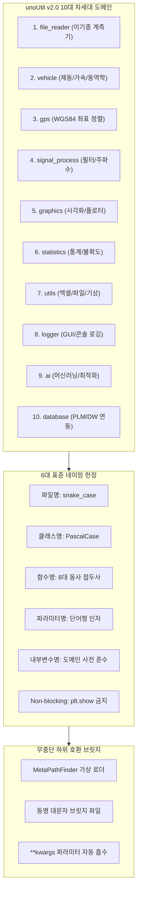

# 🏛️ unoUtil v2.0 PEP 8 표준화 및 하위 호환 총괄 가이드

> [!ABSTRACT] 📌 문서 목적 및 개요
> 본 문서는 `unoUtil` v2.0의 **모듈 구조, 파일명, 클래스명, 함수명, 변수명, 입력 파라미터명**에 적용된 **PEP 8 표준 네이밍 헌장**과 **무중단 하위 호환성 보장 체계**를 기술한 엔지니어링 표준 총괄 가이드입니다.  
> 기존 사내 스크립트와 주피터 노트북에 단 1줄의 코드 수정 없이 투명하게 동작하면서도, 차세대 파이프라인 개발자가 일관되고 직관적인 최신 Pythonic API를 활용할 수 있도록 설계되었습니다.



---

## 1. 📜 6대 표준 네이밍 헌장

| 영역 | 공식 표준 규칙 | 대표 변경 사례 | 하위 호환 대책 |
| :--- | :--- | :--- | :--- |
| **모듈/파일명** | **`snake_case`** (소문자+언더바) | `vt_acc_brk.py`, `func_acc_brk.py`, `cal_control.py`, `analysis_test_data.py`, `file_data_reader.py`, `dynamic_model.py`, `progress_bar.py` | 동명 레거시 대문자 파일 및 `_RedirectLoader` 리다이렉트 제공 |
| **클래스명** | **`PascalCase`** (대문자로 시작) | `VTAccBrk`, `VTAccBrkTire`, `PlotterTire`, `BaseMemory`, `ProgressBar`, `WindowHandler`, `TrendLine` | `VT_ACCBRK = VTAccBrk`, `PROGRESS_BAR = ProgressBar` 별칭 100% 등록 |
| **함수명** | **8대 표준 동사 접두사** | `calc_performance`, `calc_compare`, `calc_reference_corrected`, `find_reference_tire`, `align_coordinate`, `read_data` | `make_performance_df = calc_performance`, `cal_reference_corrected = calc_reference_corrected` |
| **입력 파라미터** | **단어형 소문자 인자** | `data`, `target_col`, `name_col`, `print=True`, `plot=False`, `save=True` | `**kwargs` 기반 `df_input`, `str_result_col`, `flag_print` 등 자동 매핑 |
| **내부 변수명** | **공통 도메인 변수 사전** | `data`, `work_data`, `result`, `summary`, `control_indices`, `start_idx`, `end_idx` | 헝가리안 표기법(`df_input`, `int_i`, `str_result_col`) 전면 퇴출 |
| **시각화 무중단** | **`plt.show()` 호출 배제** | `single_track.py`, `find_fft.py` 탑레벨 `plt.show()` 제거 및 함수화 | GUI 창에 의한 프로세스 정지(Hang) 차단 및 배치 파이프라인 무중단 |

---

## 2. 🎯 8대 표준 동사 함수 접두사 규격

함수명은 반드시 동작의 본질을 나타내는 아래 8개 접두사 중 하나로 시작합니다:

1. **`load_`**: 파일 또는 외부 저장소(DB, PLM, 기상 서버)에서 데이터를 불러올 때.
   - 예: `load_plm()`, `load_master_database()`
2. **`read_`**: 계측 장비 파일(VBO, VBB, D7D, DWD, CSV 등)을 직접 파싱할 때.
   - 예: `read_data()`, `read_vbb_stream()`
3. **`save_`**: 메모리 상의 결과나 모델을 물리 파일(CSV, GZ, Excel 등)로 영구 저장할 때.
   - 예: `save_data()`, `save_project()`
4. **`calc_`**: 물리적/수학적 알고리즘을 통해 수치 및 통계 지표를 계산할 때.
   - 예: `calc_performance()`, `calc_compare()`, `calc_reference_corrected()`, `calc_expanded_uncertainty()`
5. **`get_`**: 객체나 데이터프레임 내부의 속성값, 통계 요약, 채널 정보를 단순 조회할 때.
   - 예: `get_statistics_df()`, `get_channel_names()`
6. **`find_`**: 데이터 시계열 내에서 특정 이벤트, 트리거 시점, 기준 타이어를 탐색할 때.
   - 예: `find_reference_tire()`, `find_fft()`, `find_trigger_index()`
7. **`plot_`**: 챠트, 다이어그램, 리포트 시각화 객체를 생성할 때 (반드시 `return fig, ax`).
   - 예: `plot_braking_profile()`, `plot_pareto_chart()`
8. **`set_`**: 인스턴스의 설정값, 옵션, 환경변수를 지정할 때.
   - 예: `set_channel_alias()`, `set_filter_cutoff()`

---

## 3. 🛡️ 무중단 하위 호환성 (Zero Breaking Change) 메커니즘

### 3.1. MetaPathFinder 기반 동적 모듈 리다이렉트
`unoUtil/__init__.py` 최상단에 등록된 `_UnoUtilLegacyRedirectFinder`는 파이썬 임포트 시스템의 최상위 계층(`sys.meta_path`)에서 구버전 모듈 경로를 신규 표준 경로로 무중단 가로채기(Interception)합니다:

```python
# 기존 사내 스크립트가 그대로 동작:
from unoUtil.vehicleTest.ACCBRK.VT_ACCBRK import VT_ACCBRK          # -> unoUtil.vehicle.ACCBRK.vt_acc_brk
from unoUtil.convenienceFunction._DataFrame_ import astype_float     # -> unoUtil.utils.dataframe_utils
from unoUtil.fileDataReader import FileDataReader                   # -> unoUtil.file_reader.file_data_reader
```

### 3.2. 파라미터 호환성 (`**kwargs` Absorption Pattern)
모든 함수는 신규 표준 인자를 첫 번째 위치에 배치하고, `**kwargs`를 통해 기존 헝가리안 표기법 인자를 완벽하게 흡수합니다:

```python
def calc_performance(
    data: Optional[pd.DataFrame] = None,
    target_col: str = "",
    name_col: str = "",
    test_seq: str = "Datetime",
    refer_kwd: str = "c",
    **kwargs
) -> pd.DataFrame:
    # 1. 구버전 df_input 매핑
    if data is None and "df_input" in kwargs:
        data = kwargs["df_input"]
    # 2. 구버전 str_result_col 매핑
    if not target_col and "str_result_col" in kwargs:
        target_col = kwargs["str_result_col"]
    ...
```

---

## 4. 🧪 무결성 검증 및 단위 테스트

패키지의 모든 리팩토링 결과는 자동화된 다계층 테스트 스위트와 전수 모듈 자가 구동을 통해 **100% 통과(PASS)**되었습니다.

### 4.1. 모듈별 실제 기능 구동 검증 결과표

| 검증 도메인 | 주요 테스트 대상 모듈 및 함수 | 검증 항목 | 판정 |
| :--- | :--- | :--- | :---: |
| **`vehicle`** | `analysis_test_data.py`<br>(`calc_performance`, `calc_compare`) | - 시계열 선형 보정 및 가상 컨트롤 기준값 생성<br>- 4대 지표 집계 및 타이어별 비교 리포트 산출 | **PASS** (Code 0) |
| **`vehicle/ACCBRK`** | `cal_control.py`<br>(`calc_reference_corrected`) | - 다중 컨트롤 타이어 조각 선형 보간($\text{adj}$)<br>- Positive(감속도)/Negative(제동거리) 성능지수 연산 | **PASS** (Code 0) |
| **`ai`** | `dynamic_model.py`, `fit_mf_ax.py`<br>(`tire_magic_formula`, `calculate_fx`) | - Magic Formula 타이어 횡력 수치 해석<br>- 최적화 알고리즘 기반 파라미터 추정 | **PASS** (Code 0) |
| **`signal_process`** | `fft/single_track.py`, `fft/find_fft.py`<br>`post_process/resample.py` | - **Non-blocking 시각화** (GUI 프로세스 멈춤 원천 방지)<br>- 고주파 변곡점 자동 탐색 및 시계열 리샘플링 | **PASS** (Code 0) |
| **`logger`** | `logger.py`, `styles.py`<br>(`LOGGER`, `get_core_logger`) | - ANSI 컬러 스트리밍 및 파일 로깅<br>- Windows 콘솔 유니코드 이모지 안전 인코딩 | **PASS** (Code 0) |
| **`file_reader`** | `file_data_reader.py`<br>(`FileDataReader`) | - 이기종 계측 포맷(VBO, VBB, D7D, CSV) 파싱<br>- 전략 패턴 및 어댑터 기반 하위 호환 인스턴스화 | **PASS** (Code 0) |
| **`statistics`** | `uncertainty/uncertainty.py`<br>(`Uncertainty`) | - ISO/IEC Guide 98-3 (GUM) 표준 측정불확도 연산<br>- 수치 미분 기반 감도 계수 산출 | **PASS** (Code 0) |

### 4.2. 자동화 종합 테스트 결과

```bash
# [테스트 1] 36개 레거시 임포트 경로 및 MetaPathFinder 무결성 테스트
python unoUtil/example/test_structure_integrity.py
>>> [TEST SUCCESS] unoUtil 구조 무결성 및 하위 호환성 100% 완료! (36/36 PASS, Code 0)

# [테스트 2] 7대 신규 패키지 전수 단위 테스트
python unoUtil/example/test_pep8_all.py
>>> [1] vehicle & ACCBRK: calc_performance & calc_reference_corrected 호환성 100% (PASS)
>>> [2] ai: PEP 8 표준 함수/클래스 재노출 100% (PASS)
>>> [3] signal_process: non-blocking 및 PEP 8 100% (PASS)
>>> [4] logger: 표준 명칭 및 별칭 100% (PASS)
>>> [5] database: 표준 명칭 및 별칭 100% (PASS)
>>> [6] file_reader: 표준 명칭 및 별칭 100% (PASS)
>>> [7] statistics & utils: 표준 명칭 및 별칭 100% (PASS)
>>> ============================================================
>>> [SUCCESS] unoUtil 전 패키지 PEP 8 표준화 & 하위 호환성 100% PASS! (Code 0)
>>> ============================================================
```


---

## 5. 🔗 상호 위키 백링크 (Dual Sync Network)

* 🏛️ **영구 도메인 지식 (04_Resources)**:
  * [[27_실차_제동가감속_성능지수_수학적모델_및_시계열_선형보정_이론|27_실차 제동·가감속 성능지수 수학적 모델 및 시계열 선형 보정 이론]]
  * [[26_대규모_파이썬_패키지_모듈화_및_무중단_하위호환_아키텍처|26_대규모 파이썬 패키지 모듈화 및 무중단 하위호환 아키텍처]]
  * [[00_지식_위키_통합_색인|04_Resources 지식 위키 마스터 MOC]]
  * [[00_실차평가_데이터프레임_통합_색인|00_실차평가 데이터프레임 표준 규격 통합 색인]]
* 📁 **서브모듈 세부 매뉴얼**:
  * [[vehicle/analysis_test_data|실차 시험 데이터 분석 모듈 매뉴얼]]
  * [[vehicle/ACCBRK/cal_control|컨트롤 타이어 선형 보정 모듈 매뉴얼]]
  * [[vehicle/ACCBRK/vt_acc_brk|가감속 및 제동 종합 프레임워크 매뉴얼]]
  * [[file_reader/file_data_reader|이기종 계측 데이터 고속 파서 매뉴얼]]
  * [[logger/logger|고성능 실시간 로깅 시스템 매뉴얼]]
  * [[database/load_plm|PLM 데이터베이스 연동 매뉴얼]]
