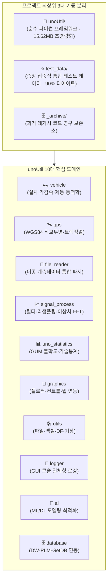

# 💼 unoUtil 사내 파이썬 통합 프레임워크 개발 프로젝트

> [!SUCCESS] 🎉 unoUtil v2.7 클린 아키텍처 및 무중단 하위 호환성 체계 확립 (2026-09-23)
> - **Zero Physical Legacy 달성**: 물리 `legacy/` 9개 디렉터리 및 `convenienceFunction/` 전량 `_archive/` 격리 퇴출 완료
> - **100% 무중단 가상화**: `_UnoUtilLegacyRedirectFinder` 및 `sys.modules` 기반 구버전 사내 코드 단 1줄 수정 없는 무중단 호환
> - **초경량 패키지 다이어트**: 패키지 내 분산된 1GB+ 거대 계측 데이터를 루트 `test_data/`로 분리하여 **15.62MB 순수 파이썬 초경량화 (98.5% 절감)**
> - **PEP 8 표준화 헌장 수립**: 8대 표준 동사, 4대 공통 인자, snake_case/PascalCase 일괄 정합화

> [!ABSTRACT] 🛠️ 프레임워크 개요
> **unoUtil**은 사내 실차 주행 시험(제동, 가속, 조종안정성 등)과 센서 계측 데이터(VBOX, Dewesoft, GPS 등)의 수집, 신호 전처리, 동역학 물리 분석, 시험 환경 보정, 그리고 시각화 리포팅을 표준화하기 위한 **사내 통합 파이썬 라이브러리 개발 프로젝트**입니다.

---

## 📅 1. 프로젝트 주요 버전 이력 (Changelog 타임테이블)

| 버전 | 날짜 | 작업자 | 핵심 수정 및 개발 내역 (Changelog) | 상태 |
| :---: | :---: | :---: | :--- | :---: |
| **v2.8** | 2026-09-24 | uno &<br/>Gemini | 🏁 **unoUtil v2.0 아키텍처 전면 완료 및 전수 무결성 검증 100% 통과 (Final)**<br/>🛡️ **사내 보안 정책(AppLocker) 및 Windows 11 Smart App Control 대응**: `D:\uno\Python\envs\unoBase` 표준 가상환경 구축, Conda `envs_dirs` 1순위 영구 등록 및 사용자 `Path` 정합 완료<br/>📦 **Smart App Control 공식 서명 휠 정합**: PyPI 공식 배포본 기반 `scipy`, `scikit-learn`, `numpy==1.26.4` 패키징 정합으로 C/Fortran 확장 DLL 로드 차단 완벽 해소<br/>🧪 **전사 10대 도메인 & 36개 세부 레거시 경로 무결성 100% 통과** (`test_structure_integrity.py` Exit 0 달성)<br/>🧹 **Git 작업 트리 Clean 확정**: `_archive/` 디렉터리 원격 영구 백업 커밋, `.ai/` `.gitignore` 배제, `setup.py` v2.0.0 일치 완료 | ✅ 완료 |
| **v2.7** | 2026-09-23 | uno &<br/>Gemini | 🧹 **전사 역방향 별칭(`Standard = LEGACY`) 전수 제거 및 정방향(`LEGACY = Standard`) 일괄 정합화**<br/>🛡️ 물리 `legacy/` 9개 디렉터리 및 `convenienceFunction/` 전량 `_archive/` 영구 퇴출 (Zero Physical Legacy 달성)<br/>🔌 `_UnoUtilLegacyRedirectFinder` 및 `sys.modules` 사전 바인딩 기반 무중단 가상화 100% 검증 (`test_structure_integrity.py` 36개 항목 PASS) | ✅ 완료 |
| **v2.6** | 2026-09-23 | uno &<br/>Gemini | 🗄️ **GetDB 실차시험 스펙 및 결과 통합 엔진 신규 구축**<br/>• `_func_connect_spec_with_req_set.py`: 의뢰번호(`RQST_CD`)+타이어세트(`TIRE_SET_VAL`) 기반 PLM 세부 스펙 역추적 고속 추출 엔진(`connect_spec_with_req_set`) 구현<br/>• `_func_connect_vehicle_test_and_spec.py`: 실차 평가 결과(Wet/Dry/Snow 제동 등)를 공통 키(`TRS_TITM_OBJ_TBLK`) 기반 `LEFT JOIN`으로 스펙과 원스톱 결합하는 통합 모듈(`connect_vehicle_test_and_spec`) 구현<br/>• 사내망 Databricks OAuth SSL 인증서 검증 에러(`self-signed certificate in certificate chain`) 원인 규명 및 `_authconn_.py` 내 `_tls_no_verify=True` 패치 적용 완료<br/>• 옵시디언 1:1 위키 매뉴얼 배포: `[[auth_conn]]`, `[[connect_spec_with_req_set]]`, `[[connect_vehicle_test_and_spec]]` | ✅ 완료 |
| **v2.5** | 2026-09-22 | uno &<br/>Gemini | 🌦️ `weather.py` 내의 모든 보간 호출 위치에서 숫자형 컬럼(`select_dtypes(include='number')`)만 골라 처리하도록 고도화하여 Pandas 2.0+ `FutureWarning` 경고 100% 원천 차단<br/>📝 `vt_acc_brk_tire.py`, `vt_acc_brk_project.py`, `an_response.py`, `an_skewness.py` 내의 `logger.debug` 문자열 시작 개행 문자 `\n` 전수 제거로 로그 한 줄 칼정렬 교정 완료<br/>❄️ 외부 스노우 분석 스크립트 2종(`a_make_SnowAccBrkTest_DF.py`, `a_make_SnowSurfaceCharacteristic_DF.py`)의 임포트 경로 및 대문자 함수명(VT_ACCBRK, SP_Resample 등)을 PEP 8 표준(vt_acc_brk, resample_data 등)으로 전수 치환 완료 | ✅ 완료 |
| **v2.4** | 2026-09-21 | uno &<br/>Gemini | 📂 하위 도메인 레거시 브릿지 전격 이격 격리 및 `legacy/` 폴더 수용<br/>🎨 **ProgressBar 콘솔 레이아웃 및 렌더링 무결화**: 진행율 수치 좌측 대이동(`16.7% (1/6) |████░░░░|`), VT100 하드웨어 자동 개행 제어(`DECAWM`), 색상 플리커 차단<br/>📝 `base_memory.py` 내 메모리 디버그 로그 한 줄 칼정렬(`\n` 소거) 교정 완료 | ✅ 완료 |
| **v2.0** | 2026-09-18 | uno &<br/>Gemini | 🏎️ **unoUtil v2.0 Clean Architecture 10대 도메인 설계 전면 전환**<br/>📦 **패키지 다이어트**: 패키지 내부 1GB+ 거대 계측 데이터 전량 분리 $\rightarrow$ 루트 `test_data/` 중앙 통합 (15.62MB 순수 파이썬 초경량화, 98.5% 절감)<br/>🎯 **8대 표준 동사 네이밍 수립** 및 `MetaPathFinder` 무중단 가상 로더 수립 | ✅ 완료 |
| **v1.0** | 2026-09-10 | uno | 🚀 unoUtil 사내 파이썬 통합 프레임워크 개발 프로젝트 킥오프 및 기본 분석 파이프라인 수립 | ✅ 완료 |

---

## 🏛️ 2. Clean Architecture 10대 도메인 아키텍처

### 2.1. 최상위 3대 기둥 분리 구조



### 2.2. 패키지 서브모듈 구조 트리

```text
📂 unoUtil/
├── 🏎️ vehicle/               # 실차 주행 시험 및 차량 동역학 종합 분석 패키지
│   ├── 🏁 acc_brk/           # 실차 가감속 / 제동 성능 정밀 분석 엔진
│   │   ├── base_memory.py    # RAM 캐시 관리 (BaseMemory, 구 AN_MEMORY)
│   │   ├── vt_acc_brk.py     # 통합 가감속/제동 파이프라인 (VTAccBrk)
│   │   ├── vt_acc_brk_tire.py# 단일 타이어 성능 분석기 (VTAccBrkTire)
│   │   ├── vt_acc_brk_project.py # 프로젝트 취합 및 선형보간 (VTAccBrkProject)
│   │   ├── cal_control.py    # 컨트롤 타이어 조각 선형 보정 엔진
│   │   ├── correct.py        # 환경 보정 알고리즘
│   │   ├── func_acc_brk.py   # 공통 물리/수학 연산 라이브러리
│   │   ├── plotter_tire.py   # 단일 타이어 시각화 플로터
│   │   ├── plotter_project.py# 프로젝트 종합 시각화 플로터
│   │   └── 📂 analyzers/     # 6대 전문 물리 분석 엔진 (an_acceleration, an_mu_drop 등)
│   ├── vehicle_dynamic.py    # 차량동역학 좌표변환 엔진 (VehicleDynamic)
│   ├── handling_test.py      # 실차 핸들링 평가 엔진 (HandlingTest)
│   ├── analysis_test_data.py # VCTA 타이어 성능 분석 유틸리티
│   └── test_info_res.py      # TestInfoRes 시험 정보 및 결과 컨테이너
├── 🛰️ gps/                    # GNSS / VBOX 공간 데이터 및 WGS84 좌표 투영 엔진
│   └── gps_to_xy.py          # WGS84 타원체 정밀 벡터화 투영 엔진 (GPStoXYCord)
├── 🚀 file_reader/            # 차세대 객체지향 이종 계측 데이터 통합 리더
│   ├── file_data_reader.py   # 플루언트 파이프라인 파사드 (FileDataReader)
│   ├── datetime_helper.py    # 글로벌 시험장 GPS 타임존 자동 판별
│   └── 📂 parsers/           # 전문 파서 서브패키지 (vbo, vbb, dwd, text, base)
├── 📶 signal_process/         # 신호처리 종합 패키지
│   ├── 📂 post_process/      # 4대 전처리 엔진 (filters, resample, scaler, outliers)
│   ├── 📂 curve_fit/         # 특성 곡선 피팅 (curve_combiner)
│   └── 📂 fft/               # 주파수 스펙트럼 및 전달함수 분석 (tf_estimate, find_fft, single_track)
├── 🎨 graphics/               # 실차 시각화 및 상호작용 패키지
│   ├── 📂 plotters/          # 차트 드로잉 엔진 (plotter, pair_plot, surface_3d, text_offset)
│   ├── 📂 controls/          # 화면 제어기 (cursor_mode, range_selector)
│   └── 📂 web/               # 대화형 웹 차트 (plotly_tools)
├── 📊 uno_statistics/         # 통계 분석 및 정밀 측정불확도 패키지
│   ├── summary.py            # 10대 요약 기술통계량 (get_statistics_df)
│   └── 📂 uncertainty/       # ISO GUM / IEC Guide 98-3 정밀 측정불확도 산출 엔진
├── 🛠️ utils/                  # 사내 통합 공통 유틸리티
│   ├── files.py              # 경로 검증 및 파일 탐색
│   ├── excel.py              # 엑셀 시트 및 차트 연동
│   ├── dataframe_utils.py    # 데이터프레임 보조 연산 및 비율 산출
│   ├── console_style.py      # 터미널 스타일링
│   ├── weather.py            # 테크노링 기상대 데이터 동기화
│   └── window_msg.py         # 윈도우 알림 및 메시지 박스
├── 📝 logger/                 # 고성능 실시간 로깅 및 콘솔 UI
│   ├── logger.py             # 싱글톤 멀티 스트림 로거 (LOGGER)
│   ├── progress_bar.py       # DECAWM 기반 제자리 갱신 진행률 표시 바
│   ├── styles.py             # ANSI 컬러 포맷터
│   └── window_handler.py     # GUI 텍스트 위젯 연동 및 팝업 핸들러
├── 🤖 ai/                     # 머신러닝/딥러닝 및 동역학 파라미터 최적화
│   ├── fit_mf_ax.py          # 타이어 제동 마찰계수 최적화
│   ├── fit_minimize_optimization.py # 비선형 최적화 추정 엔진
│   ├── fit_nn.py             # 신경망 피팅 모델
│   └── dynamic_model.py      # 동역학 모델 수식 정의
└── 🗄️ database/               # 시험 데이터베이스 및 사내 시스템 연동 (GetDB)
    ├── auth_conn.py          # Databricks OAuth 및 DB 인증 세션
    ├── connect_spec_with_req_set.py    # 의뢰번호/타이어세트 기반 PLM 세부 스펙 추출
    ├── connect_vehicle_test_and_spec.py# 실차 시험 결과와 세부 스펙 원스톱 결합
    ├── load_plm.md           # PLM 타이어 규격 및 스펙 로더
    └── 📂 queries/           # 도메인별 SQL 쿼리 모듈 (q1 ~ q5)
```

---

## 📐 3. 개발 및 코딩 표준 헌장 (PEP 8 & Clean Code)

### 3.1. 6대 표준 네이밍 헌장

| 영역 | 공식 표준 규칙 | 대표 변경 사례 | 하위 호환 대책 |
| :--- | :--- | :--- | :--- |
| **모듈/파일명** | **`snake_case`** (소문자+언더바) | `vt_acc_brk.py`, `func_acc_brk.py`, `cal_control.py`, `analysis_test_data.py`, `file_data_reader.py`, `dynamic_model.py`, `progress_bar.py` | `_UnoUtilLegacyRedirectFinder` 가상 리다이렉트 제공 |
| **클래스명** | **`PascalCase`** (대문자로 시작) | `VTAccBrk`, `VTAccBrkTire`, `PlotterTire`, `BaseMemory`, `ProgressBar`, `WindowHandler`, `FileDataReader` | `VT_ACCBRK = VTAccBrk`, `PROGRESS_BAR = ProgressBar` 정방향 별칭 등록 |
| **함수명** | **8대 표준 동사 접두사** | `calc_performance`, `calc_compare`, `calc_reference_corrected`, `find_reference_tire`, `align_coordinate`, `read_data` | `make_performance_df = calc_performance` 등 레거시 별칭 제공 |
| **입력 파라미터** | **단어형 소문자 인자** | `data`, `target_col`, `name_col`, `print=True`, `plot=False`, `save=True`, `close=True` | `**kwargs` 기반 `df_input`, `str_result_col`, `flag_print` 등 자동 매핑 |
| **내부 변수명** | **공통 도메인 변수 사전** | `data`, `work_data`, `result`, `summary`, `control_indices`, `start_idx`, `end_idx` | 헝가리안 표기법(`df_input`, `int_i`, `str_result_col`) 전면 퇴출 |
| **시각화 무중단** | **`plt.show()` 호출 배제** | 모든 플롯 함수에서 `plt.show()` 호출을 금지하고 `plt.close(fig)` 처리 | GUI 창에 의한 프로세스 정지(Hang) 차단 및 배치 파이프라인 무중단 |

### 3.2. 8대 표준 동사 함수 접두사 규격

모든 함수는 동작의 본질을 나타내는 아래 8개 접두사 중 하나로 시작해야 합니다:
1. **`load_`**: 파일 시스템 디스크 또는 외부 DB에서 데이터를 메모리로 불러올 때 (`load_plm`, `load_master_database`)
2. **`read_`**: 계측 장비 원시 파일(VBO, VBB, DWD, CSV 등)을 직접 파싱할 때 (`read_data`, `read_vbb_stream`)
3. **`save_`**: 메모리 상의 데이터/이미지를 물리 파일로 영구 저장할 때 (`save_data`, `save_figure`, `save_project`)
4. **`calc_`**: 물리적/수학적 알고리즘을 통해 수치 및 통계 지표를 계산할 때 (`calc_performance`, `calc_reference_corrected`, `calc_ratio`)
5. **`get_`**: 객체나 데이터프레임 내부의 속성값, 통계 요약, 채널 정보를 단순 조회할 때 (`get_statistics_df`, `get_channel_names`)
6. **`find_`**: 데이터 시계열 내에서 특정 이벤트, 트리거 시점, 기준 타이어를 탐색할 때 (`find_reference_tire`, `find_fft`, `find_continuous_interval`)
7. **`plot_`**: 차트, 다이어그램, 리포트 시각화 객체를 생성할 때 (`plot_braking_profile`, `plot_uncertainty`, `return fig, ax`)
8. **`set_`**: 인스턴스의 설정값, 옵션, 환경변수를 지정할 때 (`set_cursor_mode`, `set_korean_font`)

### 3.3. 4대 불변 키워드 인자 및 공통 변수명 사전

* **4대 필수 키워드 인자**:
  - `print` (`bool`): 콘솔 진행 상황 및 요약 출력 여부 (기본값 `False` 또는 `True`)
  - `plot` (`bool`): 차트 시각화 활성화 여부 (기본값 `False` 또는 `True`)
  - `save` (`str` / `bool`): 결과 파일 저장 경로 또는 저장 여부 (미저장 시 `False`)
  - `close` (`bool`): 시각화 생성 후 자동 창 닫기 (기본값 `True`, 무중단 원칙 준수)
* **공통 변수명 규격**:
  - 원본 데이터: `data` (`data: pd.DataFrame`)
  - 작업/가공 복사본: `work_data`
  - 최종 반환 객체: `result`
  - 시각화 객체: `fig`, `ax` (복수 시 `axes`)
  - 임계값/조건: `threshold`, `window`, `method`

### 3.4. 무중단 하위 호환성 (Zero Breaking Change) 메커니즘

1. **MetaPathFinder 가상 로더 (`_UnoUtilLegacyRedirectFinder`)**:
   - `unoUtil/__init__.py`에서 파이썬 임포트 최상위 계층(`sys.meta_path`)을 가로채어, 구버전 경로(`unoUtil.vehicleTest.ACCBRK`, `unoUtil.convenienceFunction` 등) 호출을 신규 v2.0 패키지로 무중단 매핑합니다.
2. **`**kwargs` Absorption Pattern**:
   - 신규 함수는 표준 인자를 전면에 배치하고 `**kwargs`를 통해 과거의 헝가리안 표기법 인자(`df_input`, `str_result_col` 등)를 자동 흡수하여 이전 스크립트와의 100% 호환성을 유지합니다.
3. **Zero Physical Legacy 원칙**:
   - 디스크 상의 물리적 `legacy/` 폴더를 전량 `_archive/`로 영구 격리하고, 가상 리다이렉터로만 호환을 제공하여 디스크 용량 절감 및 네임스페이스 오염을 원천 차단합니다.

---

## 📦 4. 테스트 데이터 중앙 관리 원칙 (test_data)

패키지 코드 디렉토리 내에 거대 계측 데이터가 혼재되어 배포 용량이 1GB를 초과하던 문제를 해소하기 위해 아래 원칙을 엄격히 적용합니다:

1. **코드와 데이터의 완전 분리**:
   - 순수 파이썬 패키지(`unoUtil/`) 내에는 어떠한 원시 계측 데이터나 결과 이미지(`.png`)도 포함하지 않습니다.
   - 모든 검증/예제 데이터는 프로젝트 최상위 루트의 **`test_data/`** 폴더에서 중앙 집중식으로 관리합니다.
2. **5대 도메인별 대표 최소 샘플 단일화**:
   - `raw_readers/`: 포맷별 최소 단위 파싱 샘플 (`sample.vbo`, `sample.vbb`, `sample.d7d`, `sample.txt`)
   - `acc_brk/`: 래퍼 함수 및 PJT 폴더 트리 검증 세트 (`pjt_bmw320_mock/` 내 C1, T1, C2 최소 세트)
   - `handling/`: 조안성 및 WGS84 좌표 연산 샘플
   - `signal_process/`: FFT 및 CurveFit 대표 SDF 샘플
   - `ai/`: 파라미터 최적화 데이터 (`brk_data.csv`)
3. **폴더 계층 구조 래퍼 함수 호환성 100% 보장**:
   - `VTAccBrk`의 `PJT_load` 등 폴더 구조 의존적 래퍼 함수가 정상 작동하도록 디렉토리 계층(`PJT_명/일자_시험명/1. rawdata/`)을 경량 Mock 데이터셋으로 유지합니다.

---

## 🚀 5. 도메인별 세부 기술 문서 목차 (Master MOC)

unoUtil 프로젝트 내 **71개 전체 서브모듈 문서**가 10대 도메인 아키텍처에 따라 1:1로 온전히 색인되어 있습니다:

### 🏎️ 5.1. vehicle (실차 가감속, 제동, 조종안정성 및 동역학)
* 🏁 **가감속 및 제동 종합 분석 (acc_brk)**:
  * 대시보드: [[00_vt_acc_brk_대시보드|VT_ACCBRK 통합 실차 성능 분석 시스템 대시보드]]
  * 통합 파이프라인: [[vt_acc_brk|vt_acc_brk (통합 가감속/제동 파이프라인 엔진)]]
  * 단일 타이어 분석: [[vt_acc_brk_tire|vt_acc_brk_tire (단일 타이어 성능 분석기)]]
  * 프로젝트 취합/보간: [[vt_acc_brk_project|vt_acc_brk_project (프로젝트 종합 취합 및 선형보간)]]
  * 메모리 캐시: [[base_memory|base_memory (BaseMemory RAM 캐시 관리자)]]
  * 컨트롤 타이어 보정: [[cal_control|cal_control (컨트롤 타이어 시계열 조각 선형 보정)]]
  * 환경 보정: [[correct|correct (시험 환경 및 기온/기압 보정)]]
  * 공통 연산: [[func_acc_brk|func_acc_brk (가감속 제동 공통 물리/수학 연산 유틸리티)]]
  * 시각화 플로터: [[plotter_tire|plotter_tire (단일 타이어 플로터)]], [[plotter_project|plotter_project (프로젝트 종합 플로터)]]
  * 6대 물리 분석기: [[an_acceleration|an_acceleration (가속 성능 분석)]], [[an_mu_drop|an_mu_drop (마찰계수 드롭 특성 분석)]]
* 🚗 **차량 동역학 및 조종안정성 (dynamic / handling)**:
  * 동역학 좌표변환: [[vehicle_dynamic|vehicle_dynamic (차량 동역학 축변환 및 슬립각 연산)]]
  * 핸들링 시험 분석: [[hndl_test|hndl_test (실차 핸들링 시험 데이터 분석기)]]
  * VCTA 성능 분석: [[analysis_test_data|analysis_test_data (VCTA 타이어 성능 분석 유틸리티)]]
  * 시험 메타 매핑: [[test_infor_res|test_infor_res (시험 메타정보 및 결과 컨테이너)]]

### 🛰️ 5.2. gps (공간 데이터 처리 및 좌표 변환)
* 공간 좌표 투영: [[gps_to_xy|gps_to_xy (WGS84 타원체 정밀 벡터 투영 및 트랙 정렬 엔진)]]

### 🚀 5.3. file_reader (이기종 계측 데이터 객체지향 파서)
* 통합 파사드: [[file_data_reader|file_data_reader (차세대 계측 데이터 통합 리더 컨트롤 타워)]]
* 글로벌 타임존 판별: [[datetime_helper|datetime_helper (글로벌 시험장 GPS 타임존 자동 판별)]]
* **parsers (전문 파서군)**:
  * 기본 파서 규격: [[base_parser|base_parser (추상 기본 파서 및 MeasurementData 컨테이너)]]
  * VBO 파서: [[vbo_parser|vbo_parser (Racelogic VBO 고속 파서)]]
  * VBB 바이너리 파서: [[vbb_parser|vbb_parser (Racelogic VBB 바이너리 파서)]]
  * Dewesoft DWD 파서: [[dwd_parser|dwd_parser (Dewesoft DWD/D7D 비동기 정합 디코더)]]
  * 텍스트 파서: [[text_parser|text_parser (ASCII / CSV 고속 테이블 파서)]]
* 레거시 디코더 연계: [[dwdReader|dwdReader (Dewesoft 구형 C-DLL 인터페이스)]], [[VBBReader|VBBReader (VBB 저수준 바이너리 디코더)]]

### 📶 5.4. signal_process (신호 후처리, 커브피팅 및 주파수 분석)
* **post_process (신호 후처리 4대 엔진)**:
  * 대시보드: [[00_post_process_대시보드|post_process 신호 후처리 패키지 대시보드]]
  * 필터링: [[filters|filters (Zero-Phase 이동평균 및 SOS 고속 필터)]]
  * 리샘플링: [[resample|resample (비수치 메타데이터 무손실 시계열 보간 및 리샘플링)]]
  * 이상치 정제: [[outliers|outliers (다변량 이상치 제거 및 유효 제동 구간 탐색)]]
  * 확장 이상치 검출: [[extended_isolation_forest|extended_isolation_forest (확장 고립 포레스트 EIF)]]
  * 정규화: [[scaler|scaler (MinMax, Standard, Robust 데이터 스케일러)]]
* **curve_fit (특성 곡선 피팅)**:
  * 곡선 합성: [[curve_combiner|curve_combiner (타이어 복합 곡선 피팅 및 합성 엔진)]]
* **fft (주파수 스펙트럼 및 전달함수)**:
  * 전달함수 추정: [[tf_estimate|tf_estimate (Pwelch 기반 전달함수 추정기)]]
  * 피크 탐색: [[find_fft|find_fft (주파수 변곡점 및 피크 탐색기)]]
  * 단일 트랙 모델: [[single_track|single_track (단일 Track 동역학 모델)]]

### 🎨 5.5. graphics (실차 시각화 및 인터랙션)
* 대시보드: [[00_graphics_대시보드|graphics 실차 시각화 및 인터랙션 패키지 대시보드]]
* **plotters (렌더링 플로터)**:
  * 차트 드로잉: [[plotter|plotter (Non-blocking 범용 시각화 드로잉 엔진)]]
  * 페어 플롯: [[pair_plot|pair_plot (다변량 파라미터 상관관계 페어 플롯)]]
  * 3D 서피스: [[surface_3d|surface_3d (3차원 반응표면 시각화)]]
  * 텍스트 주석: [[text_offset|text_offset (포인트 오프셋 텍스트 및 화살표 자동 배치)]]
* **controls (화면 제어기)**:
  * 십자선 커서: [[cursor_mode|cursor_mode (실시간 십자선 커서 및 수치 팝업 제어)]]
  * 구간 선택기: [[range_selector|range_selector (마우스 2점 클릭 관심구간 ROI 추출기)]]
* **web (웹 차트)**:
  * 웹 인터랙티브: [[plotly_tools|plotly_tools (Plotly 대화형 차트 및 HTML 변환기)]]

### 📊 5.6. uno_statistics (통계 분석 및 정밀 측정불확도)
* 기술통계 요약: [[summary|summary (10대 요약 기술통계량 산출기 - get_statistics_df)]]
* 측정불확도 평가: [[uncertainty|uncertainty (ISO GUM 기반 합성표준불확도 및 확장불확도 평가 엔진)]]
* 수학적 이론: [[uncertainty_theory|uncertainty_theory (측정불확도 완벽 이론 및 수학적 유도 가이드)]]

### 🛠️ 5.7. utils (사내 통합 공통 유틸리티)
* 대시보드: [[00_utils_대시보드|utils 사내 공통 유틸리티 패키지 대시보드]]
* 경로 및 파일: [[files|files (경로 점검, 폴더 자동 생성 및 파일 탐색)]]
* 엑셀 연동: [[excel|excel (엑셀 시트 자동 생성 및 고해상도 차트 삽입)]]
* DF 보조 연산: [[dataframe_utils|dataframe_utils (데이터프레임 수치 변환 및 비율 연산 통합)]]
* 터미널 스타일: [[console_style|console_style (콘솔 ANSI 컬러 및 텍스트 포맷터)]]
* 기상대 동기화: [[weather|weather (테크노링 기상 관측 데이터 동기화 및 선형 보간)]]
* 알림 메시지: [[window_msg|window_msg (윈도우 시스템 알림 및 메시지 박스 제어)]]

### 📝 5.8. logger (고성능 실시간 로깅 및 콘솔 UI)
* 싱글톤 로거: [[logger|logger (멀티 스트림 콘솔/파일 계층형 싱글톤 로거)]]
* 프로그레스 바: [[progress_bar|progress_bar (DECAWM 기반 콘솔 제자리 갱신 진행률 표시 바)]]
* 컬러 스타일: [[styles|styles (ANSI 터미널 컬러 테마 포맷터)]]
* 윈도우 핸들러: [[window_handler|window_handler (GUI 텍스트 위젯 연동 및 에러 팝업 핸들러)]]

### 🤖 5.9. ai (머신러닝 및 동역학 파라미터 최적화)
* 마찰계수 최적화: [[fit_mf_ax|fit_mf_ax (타이어 제동 마찰계수 최적화 피팅)]]
* 비선형 추정기: [[fit_minimize_optimization|fit_minimize_optimization (SciPy 기반 파라미터 비선형 최적화)]]
* 신경망 모델: [[fit_nn|fit_nn (신경망 동역학 피팅 모델)]]
* 동역학 모델 수식: [[dynamic_model|dynamic_model (차량 및 타이어 동역학 수식 정의)]]

### 🗄️ 5.10. database (사내 DW / PLM 시스템 연동)
* 인증 세션: [[auth_conn|auth_conn (사내 Databricks OAuth 및 DB 세션 인증)]]
* 스펙 역추적: [[connect_spec_with_req_set|connect_spec_with_req_set (의뢰번호/타이어세트 기반 PLM 스펙 고속 추출)]]
* 결과/스펙 결합: [[connect_vehicle_test_and_spec|connect_vehicle_test_and_spec (실차 평가 결과와 세부 스펙 원스톱 결합)]]
* PLM 로더: [[load_plm|load_plm (PLM 타이어 규격 및 메타정보 로더)]]
* **queries (5대 핵심 SQL 쿼리)**:
  * 시험의뢰 마스터: [[q1_hkt_rnd_dw__test__tb_th_req_master_mst|q1: 시험의뢰 마스터 정보]]
  * 시험결과 차수조건: [[q2_hkt_rnd_dw__test__tb_th_rslt_odr_cdn_bas|q2: 시험결과 차수 조건]]
  * 시험의뢰 항목: [[q3_hkt_rnd_dw__test__tb_th_req_item_bas|q3: 시험 의뢰 세부 항목]]
  * 타이어 PLM 스펙: [[q4_hkt_rnd_dw__specification__tb_pl_dw_spec_plm_tire_bas|q4: 타이어 상세 규격 PLM]]
  * 의뢰 타이어 스펙: [[q5_hkt_rnd_dw__test__tb_th_req_tire_spec_bas|q5: 시험의뢰 타이어 세부 스펙]]

---

## 🔗 6. 영구 도메인 지식 연계 (04_Resources 백링크)

* 🏛️ **실차 동역학 및 보정 이론**:
  * [[27_실차_제동가감속_성능지수_수학적모델_및_시계열_선형보정_이론|27_실차 제동·가감속 성능지수 수학적 모델 및 시계열 선형 보정 이론]]
  * [[00_실차평가_데이터프레임_통합_색인|00_실차평가 데이터프레임 표준 규격 통합 색인]]
* 🏗️ **엔지니어링 아키텍처 및 코딩 표준**:
  * [[26_대규모_파이썬_패키지_모듈화_및_무중단_하위호환_아키텍처|26_대규모 파이썬 패키지 모듈화 및 무중단 하위호환 아키텍처]]
  * [[00_unoUtil_모듈개발_대시보드#3-개발-및-코딩-표준-헌장-pep-8--clean-code|unoUtil PEP 8 & Clean Code 코딩 표준 헌장 (본 문서 3장)]]
* 📊 **측정불확도 및 통계 공학**:
  * [[00_측정_불확도_공학_통합_색인|23_측정_불확도_공학 통합 색인 (MOC)]]
  * [[10_측정불확도_완벽_이론_및_수학적_유도_가이드|측정불확도 완벽 이론 및 수학적 유도 가이드]]
  * [[11_타이어_RR_측정_불확도_평가_마스터_가이드_및_통계_핸드북|타이어 RR 측정 불확도 평가 마스터 가이드 & 통계 핸드북]]
  * [[20_타이어_회전저항_RR_측정_불확도_산출_기술_보고서|타이어 회전저항(RR) 측정 불확도 산출 기술 보고서 (ISO 28580 / GUM)]]
* 🛰️ **계측 데이터 규격 및 GPS 공학**:
  * [[23_이종_계측_데이터_통합_파이프라인_및_대규모_마이그레이션_엔지니어링|23_이종 계측 데이터 통합 파이프라인 및 대규모 마이그레이션 엔지니어링]]
  * [[22_GPS_좌표_기반_타임존_자동_판별_및_시계열_합성_이론|22_GPS 좌표 기반 타임존 자동 판별 및 시계열 합성 이론]]
  * [[20_VBOX_계측_데이터_규격_및_GPS좌표계|20_VBOX 계측 데이터 규격 및 GPS 좌표계]]
  * [[21_바이너리_파일_IO_및_VBB_데이터_포맷_구조|21_바이너리 파일 IO 및 VBB 데이터 포맷 구조]]
