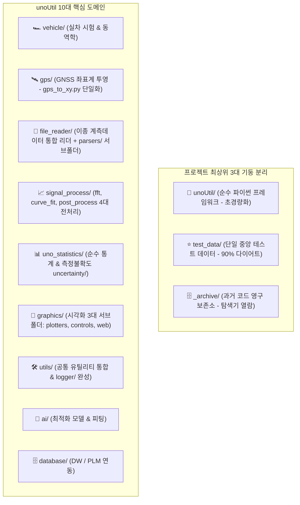

# 💼 unoUtil 사내 파이썬 통합 프레임워크 개발 프로젝트

> [!SUCCESS] 🎉 unoUtil v2.9 vehicle 도메인 완결 및 Single Baseline Law 확립 (2026-09-26)
> - **Single Baseline Law 명문화**: `GEMINI.md`, `PYTHON_CODE_AGENT.md`, `SKILL.md`에 v1 오리지널 레거시 단일 기준 호환 원칙 제정. 과도기적 미완성 코드의 별칭/브릿지 양산 원천 배제.
> - **VehicleDynamic 클래스화 (Option B)**: `vehicle_dynamic.py`를 `VehicleDynamic` 단일 표준 클래스로 캡슐화 완료. 8대 표준 동사, v1 호환 별칭 바인딩, 비차단 시각화 및 3-시나리오 자가 구동 테스트 스위트 구축.
> - **hndl_test.py**: `plt.show()` 제거 및 비차단 저장(`_handle_figure_save`), `moving_average` 정합, 인라인 임포트 상단 정리.
> - **test_infor_res.py**: `TestInformation`, `TestResult` PascalCase 본체화 및 v1 호환 별칭(`TEST_INFORMATION`, `TEST_RESULT`), `from_dict`, `update_metadata` 표준화.
> - **analysis_test_data.py**: `print()` 퇴출 및 `LOGGER` 적용, `calc_performance`, `calc_compare` 3-시나리오 테스트 스위트 구축.
> - **1:1 위키 매뉴얼 100% 달성**: 누락 5종(`an_response.md`, `an_skewness.md`, `an_slip_pdf.md`, `an_split_speed.md`, `correct_factors.md`) 신규 작성 및 기존 4종(`vehicle_dynamic.md`, `hndl_test.md`, `test_infor_res.md`, `analysis_test_data.md`) 최신 사양 갱신 완료.

> [!ABSTRACT] 🛠️ 프레임워크 개요
> **unoUtil**은 사내 실차 주행 시험(제동, 가속, 조종안정성 등)과 센서 계측 데이터(VBOX, Dewesoft, GPS 등)의 수집, 신호 전처리, 동역학 물리 분석, 시험 환경 보정, 그리고 시각화 리포팅을 표준화하기 위한 **사내 통합 파이썬 라이브러리 개발 프로젝트**입니다.

---

## 📅 1. 프로젝트 주요 버전 이력 (Changelog 타임테이블)

| 버전 | 날짜 | 작업자 | 핵심 수정 및 개발 내역 (Changelog) | 상태 |
| :---: | :---: | :---: | :--- | :---: |
| **v3.2** | 2026-09-28 | uno & Gemini | 🏁 **vehicle 도메인 4대 핵심 모듈 및 가감속/제동 Git 정합 완결 (`b1a0eb3`, `ab1132e`)** • **vehicle 4대 모듈 8대 동사 전면 표준화**: `VehicleDynamic` 클래스화 및 8대 동사 함수군(`align_coordinate`, `rotate_kinematics`, `calc_side_slip_angle`, `calc_load_transfer_longitudinal`), `analysis_test_data`(`calc_performance`, `calc_compare`), `hndl_test`(`calc_curvefit_rf`, `calc_curvefit_mf`), `test_infor_res`(`TestInformation`, `TestResult`) 정합 및 v1 레거시 브릿지 바인딩 완료. • **func_acc_brk.py 후처리 임포트 결함 완치**: `post_process`의 `moving_average_fast`, `resample_data` 임포트 불일치 교정으로 전수 무결성 테스트 100% PASS 복구. • **1:1 마크다운 매뉴얼 6종 반영**: `standard_channel_pattern.md`, `an_response.md`, `an_skewness.md`, `an_slip_pdf.md`, `an_split_speed.md`, `correct_factors.md` 원격 저장소 푸시 완결. • **00_vehicle_dynamic_대시보드.md 신규 구축**: 조종안정성 및 차량 동역학 전용 MOC 대시보드 신규 배포 및 상위 허브 연동. | ✅ 완료 |
| **v3.1** | 2026-09-27 | uno & Gemini | 🚀 **file_reader 이기종 계측 데이터 리더 도메인 8대 동사 전면 표준화 및 자가 구동/대시보드 완비** • **standard_channel_pattern.py 표준화**: 8대 표준 동사 `to_standard_channels`, `get_default_signals` 신규 구현, 레거시 `funcChangeSignalName` 100% 호환 보존, 3개 시나리오 자가 구동 스위트 및 1:1 매뉴얼(`standard_channel_pattern.md`) 신설. • **dwdReader.py 8대 동사 정규화**: `read_dwd_file`, `diagnose_dwd` 신규 표준 함수 추가 및 구버전 카멜케이스 별칭 바인딩, `dwd_parser.py` 호출 정합. • **파서 서브패키지 Mock 자립 구동 전면 보강**: `base_parser`, `vbo_parser`, `vbb_parser`, `dwd_parser`, `text_parser` 전수 외부 파일 의존성 없는 3-시나리오 자립형 자가 구동 스위트 완비. • **00_file_reader_대시보드.md 신규 구축**: 전용 MOC 대시보드 신규 배포 및 마스터 대시보드 링크 정합. | ✅ 완료 |
| **v3.0** | 2026-09-27 | uno & Gemini | 🎯 **No Redundant Prefix Law & Single Baseline Law 전사 안착 및 func_acc_brk 전면 표준화 완비** • **No Redundant Prefix Law 적용**: `Plotter`, `PlotterTire`, `PlotterProject` 등 역할 내포 클래스의 메서드 접두사 중복 배제(`plot_` 배제 $\rightarrow$ `accbrk()`, `compare_braking()` 등). • **func_acc_brk 8대 표준 동사 전면 표준화**: `calc_mu_drop`, `calc_slip_mode_skewness`, `calc_response` 표준화, print 전면 퇴출 $\rightarrow$ `logger` 일원화, 리소스 누수 방지 `plt.close` 처리. • **잠재적 NameError 결함 차단**: `calc_slip_mode_skewness` 내 미선언 변수 `arr_g_filtered` $\rightarrow$ `ax_filtered` 수정. • **Single Baseline Law 입각 과도기 별칭 소각**: 순환 별칭 정리 및 v1 오리지널 레거시 단일 별칭 바인딩. • **vt_acc_brk_tire.py 호출 정합**: `calc_acc_brk` 및 PascalCase 6대 분석기(`AnAcceleration` 등) 정규 인스턴스화 연결. • **자립형 Mock 테스트 스위트**: 외부 파일 의존성 없는 100Hz 시뮬레이션 합성 데이터 검증 스위트 완비 및 전 파일 `py_compile` 무결점 통과. | ✅ 완료 |
| **v2.9** | 2026-09-26 | uno & Gemini | 🏎️ **unoUtil.vehicle 도메인 v2 전면 표준화 및 Single Baseline Law 확립 (Finalize)** • **Single Baseline Law 명문화**: `GEMINI.md`, `PYTHON_CODE_AGENT.md`, `SKILL.md`에 v1 오리지널 레거시 단일 기준 호환 원칙 제정. 과도기적 미완성 코드의 별칭/브릿지 양산 원천 배제. • **VehicleDynamic 클래스화 (Option B)**: `vehicle_dynamic.py`를 `VehicleDynamic` 단일 표준 클래스로 캡슐화 완료. 8대 표준 동사(`align_coordinate`, `rotate_kinematics`, `rotate_origin`, `calc_p2p_inter_coordinate`, `calc_side_slip_angle`, `calc_slip_angle_fr`, `calc_load_transfer_longitudinal`, `make_standard_df`) 정합, v1 호환 별칭 바인딩, 비차단 시각화 및 3-시나리오 자가 구동 테스트 스위트 구축. • **hndl_test.py**: `plt.show()` 제거 및 비차단 저장(`_handle_figure_save`), `moving_average` 정합, 인라인 임포트 상단 정리, 3-시나리오 테스트 스위트 구축. • **test_infor_res.py**: `TestInformation`, `TestResult` PascalCase 본체화 및 v1 호환 별칭(`TEST_INFORMATION`, `TEST_RESULT`), `from_dict`, `update_metadata` 표준화, 3-시나리오 테스트 스위트 구축. • **analysis_test_data.py**: `print()` 퇴출 및 `LOGGER` 적용, `calc_performance`, `calc_compare` 3-시나리오 테스트 스위트 구축. • **1:1 위키 매뉴얼 100% 달성**: 누락 5종(`an_response.md`, `an_skewness.md`, `an_slip_pdf.md`, `an_split_speed.md`, `correct_factors.md`) 신규 작성 및 기존 4종(`vehicle_dynamic.md`, `hndl_test.md`, `test_infor_res.md`, `analysis_test_data.md`) 최신 사양 갱신 완료. | ✅ 완료 |
| **v2.8** | 2026-09-24 | uno & Gemini | 🏁 **unoUtil v2.0 아키텍처 전면 완료 및 전수 무결성 검증 100% 통과 (Final)** 🛡️ **사내 보안 정책(AppLocker) 및 Windows 11 Smart App Control 대응**: `D:\uno\Python\envs\unoBase` 표준 가상환경 구축, Conda `envs_dirs` 1순위 영구 등록 및 사용자 `Path` 정합 완료 📦 **Smart App Control 공식 서명 휠 정합**: PyPI 공식 배포본 기반 `scipy`, `scikit-learn`, `numpy==1.26.4` 패키징 정합으로 C/Fortran 확장 DLL 로드 차단 완벽 해소 🧪 **전사 10대 도메인 & 36개 세부 레거시 경로 무결성 100% 통과** (`test_structure_integrity.py` Exit 0 달성) 🧹 **Git 작업 트리 Clean 확정**: `_archive/` 디렉터리 원격 영구 백업 커밋, `.ai/` `.gitignore` 배제, `setup.py` v2.0.0 일치 완료 | ✅ 완료 |
| **v2.7** | 2026-09-23 | uno & Gemini | 🧹 **전사 역방향 별칭(`Standard = LEGACY`) 전수 제거 및 정방향(`LEGACY = Standard`) 일괄 정합화** 🛡️ 물리 `legacy/` 9개 디렉터리 및 `convenienceFunction/` 전량 `_archive/` 영구 퇴출 (Zero Physical Legacy 달성) 🔌 `_UnoUtilLegacyRedirectFinder` 및 `sys.modules` 사전 바인딩 기반 무중단 가상화 100% 검증 (`test_structure_integrity.py` 36개 항목 PASS) | ✅ 완료 |
| **v2.6** | 2026-09-23 | uno & Gemini | 🗄️ **GetDB 실차시험 스펙 및 결과 통합 엔진 신규 구축** • `_func_connect_spec_with_req_set.py`: 의뢰번호(`RQST_CD`)+타이어세트(`TIRE_SET_VAL`) 기반 PLM 세부 스펙 역추적 고속 추출 엔진(`connect_spec_with_req_set`) 구현 • `_func_connect_vehicle_test_and_spec.py`: 실차 평가 결과(Wet/Dry/Snow 제동 등)를 공통 키(`TRS_TITM_OBJ_TBLK`) 기반 `LEFT JOIN`으로 스펙과 원스톱 결합하는 통합 모듈(`connect_vehicle_test_and_spec`) 구현 • 사내망 Databricks OAuth SSL 인증서 검증 에러(`self-signed certificate in certificate chain`) 원인 규명 및 `_authconn_.py` 내 `_tls_no_verify=True` 패치 적용 완료 • 옵시디언 1:1 위키 매뉴얼 배포: `[[auth_conn]]`, `[[connect_spec_with_req_set]]`, `[[connect_vehicle_test_and_spec]]` | ✅ 완료 |
| **v2.5** | 2026-09-22 | uno & Gemini | 🌦️ `weather.py` 내의 모든 보간 호출 위치에서 숫자형 컬럼(`select_dtypes(include='number')`)만 골라 처리하도록 고도화하여 Pandas 2.0+ `FutureWarning` 경고 100% 원천 차단 📝 `vt_acc_brk_tire.py`, `vt_acc_brk_project.py`, `an_response.py`, `an_skewness.py` 내의 `logger.debug` 문자열 시작 개행 문자 `\n` 전수 제거로 로그 한 줄 칼정렬 교정 완료 ❄️ 외부 스노우 분석 스크립트 2종(`a_make_SnowAccBrkTest_DF.py`, `a_make_SnowSurfaceCharacteristic_DF.py`)의 임포트 경로 및 대문자 함수명(VT_ACCBRK, SP_Resample 등)을 PEP 8 표준(vt_acc_brk, resample_data 등)으로 전수 치환 완료 | ✅ 완료 |
| **v2.4** | 2026-09-21 | uno & Gemini | 📂 하위 도메인 레거시 브릿지 전격 이격 격리 및 `legacy/` 폴더 수용 🎨 **ProgressBar 콘솔 레이아웃 및 렌더링 무결화**: 진행율 수치 좌측 대이동(`16.7% (1/6) |████░░░░|`), VT100 하드웨어 자동 개행 제어(`DECAWM`), 색상 플리커 차단 📝 `base_memory.py` 내 메모리 디버그 로그 한 줄 칼정렬(`\n` 소거) 교정 완료 | ✅ 완료 |
| **v2.0** | 2026-09-18 | uno & Gemini | 🏎️ **unoUtil v2.0 Clean Architecture 10대 도메인 설계 전면 전환** 📦 **패키지 다이어트**: 패키지 내부 1GB+ 거대 계측 데이터 전량 분리 $\rightarrow$ 루트 `test_data/` 중앙 통합 (15.62MB 순수 파이썬 초경량화, 98.5% 절감) 🎯 **8대 표준 동사 네이밍 수립** 및 `MetaPathFinder` 무중단 가상 로더 수립 | ✅ 완료 |
| **v1.0** | 2026-09-10 | uno | 🚀 unoUtil 사내 파이썬 통합 프레임워크 개발 프로젝트 킥오프 및 기본 분석 파이프라인 수립 | ✅ 완료 |

---

## 🏛️ 2. Clean Architecture 10대 도메인 아키텍처

### 2.1. 최상위 3대 기둥 분리 구조

---

## 📚 3. 도메인별 세부 대시보드 및 MOC 링크

* 🏎️ **[[vehicle/00_vehicle_dynamic_대시보드|vehicle_dynamic 실차 주행 동역학 및 조종안정성 대시보드]]**
* 🛑 **[[vehicle/acc_brk/00_vt_acc_brk_대시보드|VT_ACCBRK 가감속/제동 성능 분석 대시보드]]**
* 🚀 **[[file_reader/00_file_reader_대시보드|file_reader 이기종 계측 데이터 리더 대시보드]]**
* 🎨 **[[graphics/00_graphics_대시보드|graphics 실차 시각화 및 인터랙션 대시보드]]**
* 📶 **[[signal_process/post_process/00_post_process_대시보드|post_process 신호 후처리 대시보드]]**
* 🛠️ **[[utils/00_utils_대시보드|utils 사내 공통 유틸리티 대시보드]]**

---
**Last Updated**: 2026-09-28  
**Standard**: unoUtil Clean Architecture v2.0 & Single Baseline Law
