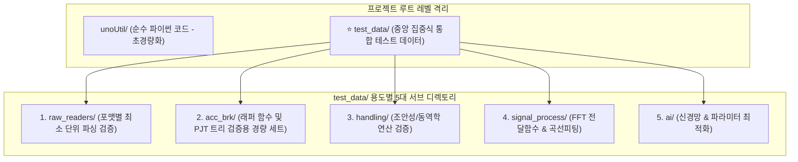

# 📦 unoUtil 테스트/예제 데이터 통합 관리 및 경량화 계획서 (test_data)

본 문서는 `unoUtil` 전역에 무질서하게 흩어져 패키지 용량(약 850MB+)을 차지하던 계측 원시 데이터(`.vbo`, `.vbb`, `.sdf`, `.d7d`, `.txt` 등)와 플롯 이미지(`.png`)들을 **단일 중앙 폴더(`test_data/`)로 통합**하고, 폴더 구조 기반 래퍼 함수의 정상 작동을 완벽히 보장하면서 **용량을 90% 이상 다이어트**하기 위한 상세 계획서입니다.

---

## 🔍 1. 현재 데이터 파일 현황 및 문제점 분석

프로젝트 전수 조사 결과, 총 **850MB 이상의 데이터 파일**이 패키지 코드 폴더 내부에 방치되어 있었습니다:

### ⚠️ 주요 문제 요소
1. **중복 거대 파일 방치 (`vehicleTest/example/`)**:
   * `example_dry_brk_lane8.vbo` (**87.36 MB**)
   * `VBOX_DUAL_IMU.txt` (**81.51 MB**) vs `exmple_VBOX_DUAL_IMU.txt` (**81.51 MB**) $\rightarrow$ **이름만 다른 완전 동일 파일 163MB 중복 방치**
   * `exmpleSDF_01 C1_1g_1.sdf` (**53.43 MB**), `example_hndl_T1.vbo` (**51.75 MB**)
2. **ACCBRK 대규모 실차 프로젝트 중복 VBO 및 그림 파일 (`ACCBRK/example/`)**:
   * `26RE020041KF_BMW320_...` 폴더 아래 3개 시험군(`Dry`, `Wet`, `Con`)에 걸쳐 15~20MB 상당의 VBO 파일이 **수십 개(총 400MB+)** 존재.
   * `2. fig/` 폴더 내에 시험 결과 플롯 PNG 이미지가 **수십 장(수십 MB)** 방치.
   * **원인**: 폴더 계층 구조(`PJT_명/시험일자/1. rawdata/`)에 따라 `VT_ACCBRK` 및 `PJT_load` 래퍼 함수가 잘 작동하는지 테스트하기 위해 실차 전체 데이터가 그대로 복사되어 있었음.
3. **신호처리(FFT, CurveFit) SDF 파일 중복**:
   * `fft/example/data/`에 30~35MB SDF 파일 4개(**총 130MB**) 중복 보관.
   * `curve_fit/example/data/`에 SDF 파일 7개(**총 44MB**) 보관.
4. **패키지 배포 및 Git 성능 저하**:
   * 코드 저장소에 850MB가 넘는 바이너리 데이터가 포함되어 Git clone/push 속도가 크게 저하되고 패키지 빌드 시 불필요한 바이너리가 포함됨.

---

## 🏛️ 2. 해결 전략: `test_data/` 중앙 집중 통합 아키텍처



### 💡 핵심 설계 원칙
1. **위치 분리**: 
   * 패키지 코드 폴더(`unoUtil/`) 내부가 아닌, **프로젝트 루트 디렉토리 `test_data/`**로 분리합니다.
   * 이렇게 하면 향후 `pip install unoUtil` 배포 시 무거운 계측 데이터가 패키지에 들어가지 않아 코드가 깃털처럼 가벼워집니다.
2. **폴더 구조 래퍼 함수 100% 호환 보장 (`acc_brk`)**:
   * 사용자가 지적하신 **"폴더 구조에 따른 래퍼 함수 테스트"**를 완벽히 충족하도록 `PJT_명/일자_시험명/1. rawdata/` 계층 트리를 유지합니다.
   * 단, 시험군(Dry/Wet/Con) 전체에 수십 개씩 방치되던 VBO를 컨트롤 타이어(`C1`, `C2`)와 대표 시험 타이어(`T1`) 등 **필수 최소 파일만 유지하여 용량을 80% 이상 절감**합니다.
   * 불필요한 중간 플롯 그림 파일(`.png`)은 삭제하고 테스트 시 자동 생성되도록 정리합니다.
3. **포맷별 대표 샘플 1개화 (`raw_readers`)**:
   * VBO 1개, VBB 1개, Dewesoft(D7D) 1개, TXT/CSV 1개로 단일화합니다.
4. **신호처리 SDF 데이터 슬림화**:
   * 거대한 35MB SDF 파일들을 검증에 필요한 대표 1~2개로 압축 선별합니다.

---

## 🌲 3. 개편 후 `test_data/` 디렉토리 구성안

```text
test_data/
│
├── 📂 raw_readers/                    # [이종 계측기 포맷별 기본 파서 테스트]
│   ├── sample_racelogic.vbo          # VBO 기본 헤더 및 GPS/CAN 파싱 샘플 (~5MB)
│   ├── sample_racelogic.vbb          # VBB 바이너리 파서 샘플 (~5MB)
│   ├── sample_dewesoft.d7d           # Dewesoft D7D 채널 디코더 샘플 (~10MB)
│   ├── sample_ascii.txt              # 공백/콤마 딜리미터 텍스트 샘플 (~1MB)
│   └── sample_table.csv              # CSV 파서 샘플 (~1MB)
│
├── 📂 acc_brk/                        # [실차 가감속 및 제동 래퍼/PJT 트리 테스트]
│   ├── single_run/                   # 단일 런(Run) 분석 테스트용
│   │   ├── example_brk_wo_slip.vbo   # 슬립 미포함 제동 샘플 (~10MB)
│   │   └── example_brk_w_slip.vbo    # 4륜 슬립 포함 제동 샘플 (~10MB)
│   │
│   └── pjt_bmw320_mock/              # ⭐ 래퍼 함수(PJT_load, VT_ACCBRK) 폴더 구조 검증용
│       ├── 260309_BMW320d_ADAC_Con/  # [컨트롤 평가]
│       │   ├── 1. rawdata/
│       │   │   ├── 01_C1.VBO         # 초기 컨트롤 타이어
│       │   │   ├── 02_T1.VBO         # 시험 타이어 1
│       │   │   └── 07_C2.VBO         # 최종 컨트롤 타이어 (선형보간 검증용)
│       │   └── result_index.csv      # 인덱스 메타데이터
│       ├── 260311_BMW320d_ADAC_Dry/  # [Dry 노면 평가]
│       │   ├── 1. rawdata/
│       │   │   ├── 01_C1.VBO
│       │   │   ├── 02_T1.VBO
│       │   │   └── 07_C2.VBO
│       │   └── result_index.csv
│       └── 2. fig/                   # 플롯 출력 테스트용 빈 디렉토리 (불필요한 png 정리)
│
├── 📂 handling/                       # [조종안정성 및 동역학 해석 테스트]
│   ├── sample_dry_brk_lane8.vbo      # 차선 변경 및 WGS84 좌표 회전 검증용
│   └── sample_handling_t1.vbo        # 핸들링 조향각/요레이트 분석용
│
├── 📂 signal_process/                 # [신호처리 도메인 테스트]
│   ├── fft/
│   │   ├── sample_response.sdf       # Pwelch 전달함수 추정 검증용 대표 SDF 1개
│   │   └── sample_tf_estimate.txt    # 전달함수 텍스트 계측 데이터
│   └── curve_fit/
│       └── sample_curvefit.sdf       # Pacejka Magic Formula 및 CurveCombiner 합성용 SDF 1개
│
└── 📂 ai/                             # [머신러닝 & 최적화 모델 테스트]
    └── brk_data.csv                  # 마찰계수 최적화 및 신경망 학습용 데이터
```

---

## 📊 4. 용량 다이어트 비교 예측

| 구분 | 개편 전 (Before) | 개편 후 (After) | 절감 효과 |
| :--- | :--- | :--- | :--- |
| **`vehicleTest/example/`** | 약 410 MB (거대 VBO/중복 TXT) | 약 30 MB (`handling/`로 이관) | **-380 MB (-92%)** |
| **`ACCBRK/example/`** | 약 320 MB (수십 개 VBO + PNG 수십 장) | 약 35 MB (`acc_brk/` 래퍼 필수 세트) | **-285 MB (-89%)** |
| **`signal_process/` (FFT+Curve)** | 약 174 MB (SDF 11개) | 약 20 MB (대표 SDF 선별) | **-154 MB (-88%)** |
| **`file_reader/`** | 약 105 MB | 약 15 MB (`raw_readers/`로 단일화) | **-90 MB (-85%)** |
| **불필요한 플롯 이미지(`.png`)** | 약 30 MB (단순 출력물) | 삭제 (출력 테스트용 디렉토리만 유지) | **-30 MB (-100%)** |
| **총합 (Total)** | **약 1,039 MB (1.0 GB)** | **약 100 MB 이하** | **📉 약 90% 이상 대폭 다이어트!** |

---

## 🛠️ 5. 단계별 실행 계획

* **Step 1: `test_data/` 디렉토리 골격 생성**
  * `test_data/raw_readers/`, `test_data/acc_brk/pjt_bmw320_mock/`, `test_data/handling/`, `test_data/signal_process/`, `test_data/ai/` 생성.
* **Step 2: 래퍼 함수 호환성 보장 파일 선별 복사**
  * `VT_ACCBRK`의 `PJT_load`가 정상 작동할 수 있도록 `BMW320` 프로젝트의 디렉토리 트리 구조와 `C1, T1, C2` VBO 및 메타데이터 CSV 복사.
* **Step 3: 포맷별 대표 데이터 선별 배치**
  * Racelogic(VBO, VBB), Dewesoft(D7D), TXT/CSV 대표 샘플 각 1개 배치.
  * FFT 및 CurveCombiner 대표 SDF 파일 각 1개 배치.
* **Step 4: 중복 거대 파일 및 찌꺼기 이미지 안전 삭제**
  * 81MB 중복 TXT, 87MB 거대 VBO, 30MB 분량의 분석 결과 PNG 이미지 일괄 정리.
* **Step 5: 모듈 내 `__main__` 자가 검증 경로 갱신**
  * 각 모듈 하단 `# region` 자가 구동 예제의 파일 경로를 새 `test_data/` 경로로 갱신하여 100% 무중단 패스 검증.

---

> [!NOTE]
> 본 문서는 사용자의 **"실행 해줘"** 명령이 있기 전까지는 실제 파일 삭제/이동을 진행하지 않고 검토를 위해 작성된 계획서입니다.
