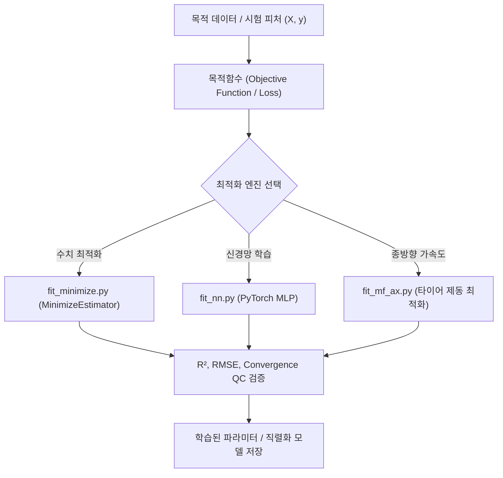

# 📖 ai 모듈 사전 (Domain Engineering Guide)

> ⚡ **Quick Jump**: [🎯 1. 설계 철학](#-1-설계-철학-및-모듈-개요) · [📚 2. 배경 지식](#-2-배경-지식-및-이론-지식-허브) · [🏗️ 3. 아키텍처](#️-3-아키텍처-및-데이터-파이프라인) · [🚀 4. 실전 워크플로우](#-4-실전-워크플로우-및-종합-스니펫) · [🛠️ 5. 트러블슈팅](#️-5-트러블슈팅-및-튜닝-노하우)

> [!ABSTRACT] 🤖 도메인 개요
> 타이어 제동 마찰계수 비선형 최적화, 베이지안/그리드 탐색 기반 목적함수 최소화(`fit_minimize`), 심층 신경망(MLP/PyTorch) 동역학 모델 피팅을 수행하는 **인공지능 및 수치 최적화 전문 패키지**입니다.

---

## 🎯 1. 설계 철학 및 모듈 개요

### 1.1. 탄생 배경과 목적
* **기존 방식의 한계**: 비선형 최적화 시 국소 최적해(Local Minima)에 갇히거나 초기값 민감도로 인해 최적화가 수렴하지 못하고 실패하는 문제.
* **해결 과제**: 베이지안 최적화 및 다목적 손실함수 최소화 추정기(`MinimizeEstimator`), 실차 데이터 맞춤형 신경망 피터.
* **핵심 가치**: 공학적 물리 구속 조건(Bounds & Constraints) 하에서 복잡한 다변량 파라미터를 안정적으로 글로벌 최적화.

### 1.2. 아키텍처 설계 사상
* **Scikit-Learn 스타일 인터페이스**: 머신러닝 및 최적화 추정기에 일관된 `.fit()`, `.predict()`, `.score()` 프로토콜 부여.
* **경량화 추론**: 거대 딥러닝 프레임워크 의존성을 최소화하고, CPU 환경에서도 0.1초 내 추론 가능한 최적화 알고리즘 탑재.

---

## 📚 2. 배경 지식 및 이론 (지식 허브)

> [!NOTE] 🧠 머신러닝 및 최적화 공학 링크 (Knowledge Atomization)
> *SVM/SVR 및 심층 신경망 고급 분석 기법은 `04_Resources`에 영구 보존되어 있습니다.*

* 📄 **SVM/SVR 원리 및 하이퍼파라미터**: [[32_서포트_벡터_머신_및_회귀(SVM_SVR)_원리와_하이퍼파라미터_가이드|SVM/SVR 회귀 원리 및 초평면 마진 최적화]]
* 📄 **비선형 메타 추정기 아키텍처**: [[40_비선형_회귀_메타_추정기_및_에르미트_블렌딩_아키텍처|비선형 회귀 메타 추정기 및 에르미트 블렌딩 아키텍처]]
* 📄 **심층신경망 고급 기법**: [[33_심층신경망_및_고급_분석_기법|심층신경망 및 고급 분석 기법 (MLP, 최적화)]]

---

## 🏗️ 3. 아키텍처 및 데이터 파이프라인

### 3.1. 최적화 및 학습 파이프라인



### 3.2. 핵심 서브모듈 역할 분담표

| 파일명 | 담당 클래스 / 함수 | 핵심 책임 및 역할 |
| :--- | :--- | :--- |
| `fit_minimize.py` | `MinimizeEstimator` | Scipy `minimize` 기반 베이지안/그리드 목적함수 최소화 파라미터 추정 |
| `fit_mf_ax.py` | `fit_tire_braking_mu` | 타이어 제동 감속도 및 마찰계수 최적화 전담 모듈 |
| `fit_nn.py` | `NeuralNetFitter` | 다층 퍼셉트론(MLP) 기반 차량 동역학 시계열 대리 모델 학습기 |

---

## 🚀 4. 실전 워크플로우 및 종합 스니펫

```python
"""
MinimizeEstimator를 활용한 비선형 목적함수 파라미터 최적화
"""
import numpy as np
from unoUtil.ai import MinimizeEstimator

# 1. 목적함수 정의 (예: 잔차 제곱합 최소화)
def objective_loss(params, x, y):
    a, b = params
    y_pred = a * np.exp(b * x)
    return np.mean((y - y_pred) ** 2)

# 2. 시험 데이터 생성
x_data = np.linspace(0, 2, 50)
y_data = 2.5 * np.exp(1.2 * x_data) + np.random.normal(0, 0.1, 50)

# 3. MinimizeEstimator 최적화 실행
estimator = MinimizeEstimator(
    objective=objective_loss,
    initial_params=[1.0, 1.0],
    bounds=[(0, 10), (0, 5)],
)
res = estimator.fit(x_data, y_data)

print(f"최적화 파라미터 [a, b]: {res.best_params}")
print(f"최종 손실값: {res.min_loss:.5f}")
```

---

## 🛠️ 5. 트러블슈팅 및 튜닝 노하우

### 5.1. 초기값 의존성으로 인한 Local Minima 수렴
* **증상**: 파라미터 초기값(`initial_params`)이 적절하지 않아 엉뚱한 값으로 조기 종료.
* **조치**: `MinimizeEstimator(method="differential_evolution")` 또는 다중 무작위 재시작(Multi-start) 옵션을 사용하여 글로벌 탐색 공간을 충분히 확보.
