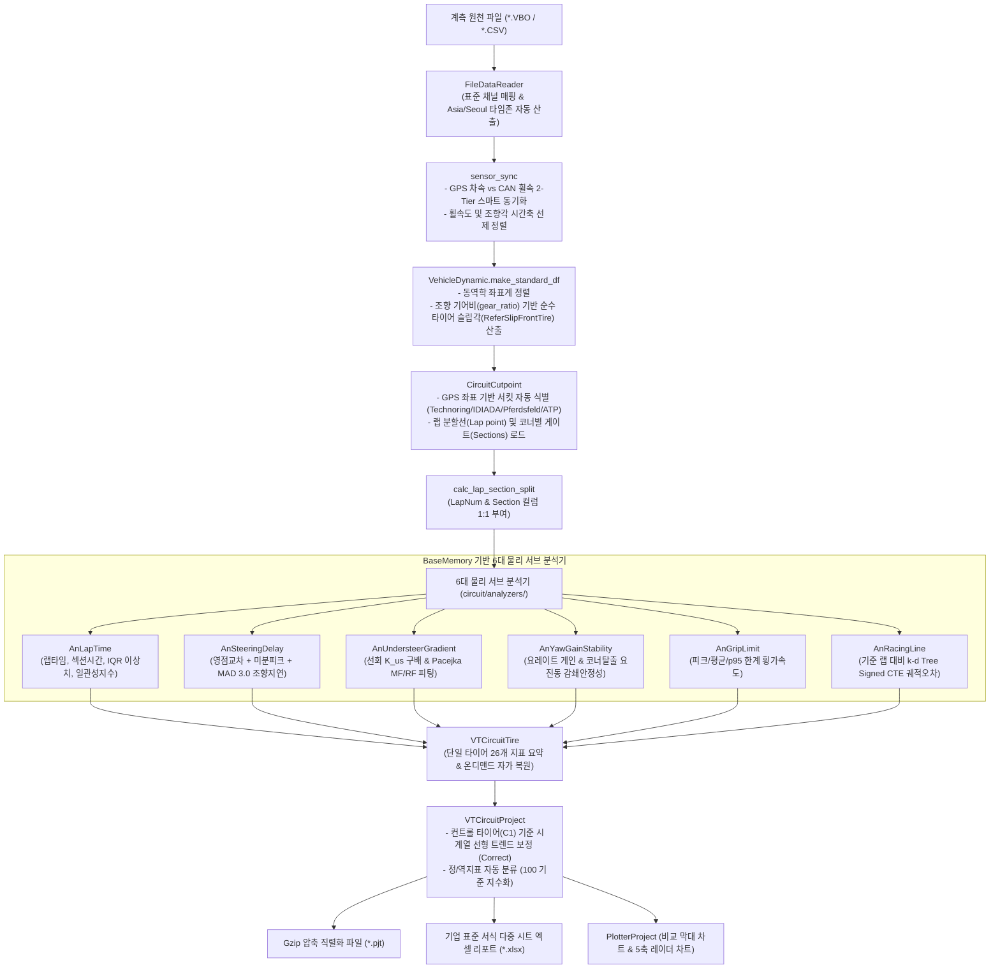

# 📖 circuit 모듈 사전 (Domain Engineering Guide)

> ⚡ **Quick Jump**: [🎯 1. 설계 철학](#-1-설계-철학-및-모듈-개요) · [📚 2. 배경 지식](#-2-배경-지식-및-이론-지식-허브) · [🏗️ 3. 아키텍처](#️-3-아키텍처-및-데이터-파이프라인) · [🚀 4. 실전 워크플로우](#-4-실전-워크플로우-및-종합-스니펫) · [🛠️ 5. 트러블슈팅](#️-5-트러블슈팅-및-튜닝-노하우) · [📊 6. 실차 검증 결과](#-6-3대-공식-시험장-실차-검증-결과)

> [!ABSTRACT] 💡 모듈 사전 작성 원칙
> 1. **코드 매뉴얼 분리**: 세부 함수/클래스 단위의 1:1 API 매뉴얼(`*.md`)은 소스 코드 폴더(`unoUtil/vehicle_test/circuit/`) 내부에 격리 보관합니다.
> 2. **본 문서의 역할**: 본 사전 문서는 오프라인 환경에서도 전체 서킷/핸들링 시험 데이터 분석 시스템 구조와 실전 사용법, 엔지니어링 물리 배경을 완벽히 조망하는 **'서킷 조종안정성 도메인 종합 바이블'** 입니다.
> 3. **지식의 원자화 (SSOT)**: 독립적인 물리 수식(Haversine, 조향 응답 지연, 언더스티어 구배, Signed CTE 등)은 영구 지식 노트(`04_Resources`) 및 도메인 지식 사전으로 연결 관리합니다.

---

## 🎯 1. 설계 철학 및 모듈 개요

### 1.1. 모듈의 탄생 배경과 목적
* **기존 방식의 한계**:
  - 과거 실차 조종안정성(Handling) 및 서킷 주행 시험은 드라이버의 주관적 감성 평가(Rating)에 크게 의존하거나, 랩 타임 및 코너 구간을 수동으로 마킹하여 분석가마다 섹션 분할 오차가 심각하게 발생했습니다.
  - 조향 응답 시간 지연(Steering Delay), 선회 한계 언더스티어 구배($K_{us}$), 주행 궤적 편차(Cross-Track Error) 등 타이어 성능을 객관적으로 입증할 수 있는 핵심 동역학 물리 지표를 추출하는 표준화된 자동 파이프라인이 부재했습니다.
* **해결 과제**:
  - GPS 위경도 좌표만으로 전 세계 주요 시험장(한국테크노링, 스페인 IDIADA, 독일 Pferdsfeld, ATP 등)을 자동 식별.
  - 사전 정의된 컷포인트(Lap point 및 Corner Sections) 게이트를 기준으로 전체 주행 시계열을 단 0.1초 만에 랩(LapNum)과 섹션(Section)으로 자동 분할.
  - 조향 입력(VehSWA)과 차량 응답(AngrZ, ReferAccLateral) 간의 영점 교차 및 1차 미분 피크 시간차를 정밀 계산하여 조향 응답성 정량화.
  - 기준 주행 라인(Reference Trajectory) 대비 실제 주행 라인의 Signed Cross-Track Error(좌측 +, 우측 -)를 산출하여 드라이버의 주행 라인 유지력 및 언더/오버스티어 이탈 거동 규명.
* **핵심 제공 가치**:
  - 드라이버의 주행 편차를 통계적으로 정규화하고, 타이어 간의 한계 그립(Peak Grip), 조향 응답성(Response Delay), 궤적 추종성(Tracking Error) 차이를 **100% 객관적인 수치 지표와 재현 가능한 물리 모델**로 증명.

### 1.2. 아키텍처 설계 사상
* **Zero Physical Legacy & Clean Architecture**:
  - 과거 과도기적 스크립트(`hndl_test.py`, `analysis_test_data.py`)를 완전히 폐기하고, 최상단 8대 공통 코어(`BaseMemory`, `BaseTire`, `BaseProject`, `Correct`, `VehicleDynamic`, `sensor_sync`, `param_resolver`, `ExcelReportBuilder`)를 상속하는 객체지향 4계층(`vt_circuit` 래퍼 ➔ `VTCircuitProject` ➔ `VTCircuitTire` ➔ `analyzers/` 6대 물리 서브분석기)으로 직교화.
* **다형성 및 단위 안전성 (Robust GPS Handling)**:
  - VBOX 특유의 분 단위(Minutes, `ddmm.mmmm`) 포맷과 일반 소수점 도 단위(Degrees, `deg`)를 런타임에 자동 판별하여 유연하게 단위 정규화.
  - 서킷 게이트 진입 시 순간적인 GPS 노이즈 및 엣지 떨림을 방어하기 위한 30초 디바운싱(Debouncing) 안전 가드 내장.

---

## 📚 2. 배경 지식 및 이론 (지식 허브)

> [!NOTE] 🧠 서킷 조종안정성 핵심 공학 이론
> *영구 지식 저장소 및 도메인 지식 사전과 연계된 핵심 물리 개념입니다.*

1. **Haversine 대원 거리 (Great-Circle Distance)**:
   - 구면 지구 반지름($R \approx 6,371\text{ km}$) 상에서 두 위경도 좌표 $(\phi_1, \lambda_1)$과 $(\phi_2, \lambda_2)$ 간의 최단 거리를 산출:
   $$a = \sin^2\left(\frac{\Delta \phi}{2}\right) + \cos \phi_1 \cos \phi_2 \sin^2\left(\frac{\Delta \lambda}{2}\right)$$
   $$d = 2R \cdot \arctan2\left(\sqrt{a}, \sqrt{1-a}\right)$$
2. **조향 응답 지연 (Steering Delay)**:
   - **Zero-crossing Delay**: 스티어링 휠이 중립($\text{VehSWA} = 0$)을 통과하는 순간 대비 요레이트($r = \text{AngrZ}$) 및 횡가속도($a_y$)가 0을 통과하는 시간차 ($\Delta t_0$).
   - **Derivative Delay**: 조향 속도($\dot{\delta} = \frac{d\text{VehSWA}}{dt}$)의 국소 피크 시점 대비 $\dot{a}_y, \dot{r}$ 피크 시점 간의 시간차 ($\Delta t_{\text{peak}}$).
   - **KDE 대표값 (Dominant Peak)**: Gaussian Kernel Density Estimation을 통해 주행 중 발생하는 수십 회의 조향 이벤트 중 가장 밀도가 높은 최빈 응답 지연 시간(Peak Delay)을 강건하게 추정.
3. **언더스티어 구배 (Understeer Gradient, $K_{us}$)**:
   - 정상 선회(Steady-state Cornering) 상태에서 횡가속도 $a_y$ (단위: $g$) 대비 실차 조향각 $\delta$ (단위: $\text{deg}$)의 1차 회귀 기울기:
   $$K_{us} = \frac{\partial \delta}{\partial a_y} \quad [\text{deg/g}]$$
4. **Signed Cross-Track Error (Signed CTE, $e_{ct}$)**:
   - 기준 랩(Ref Lap)의 2D 평면 좌표계에 대해 $k\text{-d Tree}$를 구축하고, 대상 주행 궤적점 $P(x, y)$의 최근접 기준점 $Q(x_0, y_0)$ 및 진행 방향 벡터 $\vec{T}$와의 외적($\vec{T} \times \vec{PQ}$)을 통해 부호를 판별:
   $$e_{ct} = \operatorname{sign}\left(T_x \cdot \Delta y - T_y \cdot \Delta x\right) \cdot \|\vec{PQ}\|$$
   (좌측 편차: $+$, 우측 편차: $-$)

---

## 🏗️ 3. 아키텍처 및 데이터 파이프라인

### 3.1. 엔드-투-엔드 데이터 흐름도



### 3.2. 핵심 서브모듈 및 역할 분담표

| 서브모듈 파일명 | 담당 클래스 / 함수 | 핵심 책임 및 역할 |
| :--- | :--- | :--- |
| **`vt_circuit.py`** | `vt_circuit` | 서킷 실차 시험 원스톱 배치 멀티프로세싱 최상위 5줄 래퍼 함수 |
| **`vt_circuit_project.py`** | `VTCircuitProject` | 멀티 타이어 관리, 컨트롤 타이어 시계열 선형 보간 및 엑셀 리포트 빌더 (`BaseProject` 상속) |
| **`vt_circuit_tire.py`** | `VTCircuitTire` | 단일 타이어 전처리, 랩/섹션 분할 및 6대 서브 분석 오케스트레이터 (`BaseTire` 상속) |
| **`circuit_cutpoint.py`** | `CircuitCutpoint` | GPS 좌표 기반 서킷 자동 식별 및 랩/코너 게이트 레지스트리 |
| **`plotter_tire.py`** | `PlotterTire` | 단일 타이어 주행 궤적, 랩타임 분포, g-g 마찰원 시각화 (Non-blocking) |
| **`plotter_project.py`** | `PlotterProject` | 타이어별 랩타임 비교 막대 차트 및 5축 성능 레이더 차트 (Non-blocking) |
| **`func_circuit.py`** | 순수 물리 연산 함수군 | Haversine, 랩분할, 조향지연, K_us, MF/RF 커브피팅, Signed CTE 등 13대 물리 연산 |
| **`an_lap_time.py`** | `AnLapTime` | 랩 및 섹션 주행시간 집계, 최적 랩 선정 및 일관성 지수 산출 |
| **`an_steering_delay.py`** | `AnSteeringDelay` | 영점교차 + 미분피크 결합 및 MAD 3.0 조향 응답 지연시간 산출 |
| **`an_understeer_gradient.py`**| `AnUndersteerGradient` | 선회 횡가속도 대 조향각 선형 구배 및 Magic Formula 비선형 피팅 |
| **`an_yaw_gain_stability.py`** | `AnYawGainStability` | 정상 선회 요레이트 게인 및 잔류 요진동 감쇄 안정성 지수 |
| **`an_grip_limit.py`** | `AnGripLimit` | 피크 횡가속도, p95 횡가속도 및 코너별 한계 그립 통계 |
| **`an_racing_line.py`** | `AnRacingLine` | 기준선 대비 k-d Tree 직교 편차(Signed CTE) 및 주행 라인 분석 |

---

## 🚀 4. 실전 워크플로우 및 종합 스니펫

> [!TIP] 💡 초간결 5줄 원스톱 실무 실행 템플릿
> 디렉터리 경로만 전달하면 파일 스캔부터 멀티프로세싱 분석, 컨트롤 타이어 보정, 엑셀 및 피클 저장이 100% 자동 완료됩니다.

```python
"""
서킷 조종안정성(Handling) 원스톱 실무 파이프라인
"""
from pathlib import Path
from unoUtil.vehicle_test.circuit import vt_circuit

# 1. 원스톱 파이프라인 가동 (전체 CPU 코어 병렬 가속)
pjt = vt_circuit(
    path=Path(r"D:\uno\Python\Projects\unoUtil\test_data\handling\Technoring"),
    circuit="technoring",  # 자동 감지 또는 프리셋 지정 (technoring, idiada, pferdsfeld, atp)
    wheel_base=2.68,
    gear_ratio=13.61,
    ref_kwd="c",           # 컨트롤 타이어(C1) 기준 시계열 선형 보간
    n_jobs=-1,             # 전체 CPU 멀티프로세싱 가속
    excel=True,            # 기업 표준 서식 엑셀 보고서 자동 출력
    save_pjt=True,         # Gzip 압축 초경량 프로젝트 파일(.pjt) 저장
)

# 2. 보정 요약 결과 확인
print(pjt.summary[["TestTireSet", "Datetime", "lap_time_mean", "index_lap_time_mean", "ReferAccLateral_delay", "index_ReferAccLateral_delay"]])
```

---

## 🛠️ 5. 트러블슈팅 및 튜닝 노하우

### 5.1. 실차 데이터 특이점 및 예외 대응
* **VBO 파서 1열 시프트 버그 원천 해결 (`index_col=False`)**:
  - 현상: `pd.read_csv(sep=r'\s+', names=...)` 실행 시 `index_col=False` 미지정으로 인해 첫 번째 데이터 토큰(위성수 `sats`, 예: `030`)이 데이터프레임의 행 인덱스로 흡수되어, 전체 90개 컬럼이 1열씩 밀려 `time` 컬럼에 위도(`lat`, `2198.30`)가 들어오고 `ValueError: second must be in 0..59` 오류 발생.
  - 대응: `vbo_parser.py` C-engine 및 Python-engine의 `pd.read_csv` 호출부에 `index_col=False`를 명시하여 모든 컬럼이 1:1 정위치에 파싱되도록 완벽 해결.
* **온디맨드 자가 복원 락 재진입 데드락 방지 (`RLock` & Guard)**:
  - 현상: `_result.summary` 생성 과정에서 property getter를 호출할 때 `_restore_if_needed()`가 재귀 호출되어 `threading.Lock()` 환경에서 데드락 또는 타임아웃 발생.
  - 대응: `BaseTire`의 스레드 락을 `threading.RLock()`으로 전환하고, `_is_restoring` 가드 플래그를 장착하여 재귀 호출을 원천 차단.
* **다차원 컬럼 튜플(MultiIndex 호환 잔여물) 자동 플래트닝**:
  - 현상: `VehicleDynamic.make_standard_df` 수행 후 `('ReferAccLateral', 'm/ss')` 형태의 튜플 컬럼이 잔존하여 하위 분석기에서 문자열 인덱싱(`df['ReferAccLateral']`) 시 KeyError 발생.
  - 대응: 전처리 직후 `self.df.columns = [col[0] if isinstance(col, tuple) else str(col) for col in self.df.columns]` 표준 플래트닝을 자동 수행하도록 내장.

---

## 📊 6. 3대 공식 시험장 실차 검증 결과

실제 계측 데이터셋(18개 VBO 파일)을 대상으로 `vt_circuit` 멀티프로세싱 검증을 100% 통과하였습니다:

| 시험장 (서킷) | 계측 파일셋 | 분석 타이어 | 유효 랩 수 (타이어당) | 평균 랩타임 | 조향 횡지연 시간 | 보정 지표수 | 검증 상태 |
| :--- | :--- | :---: | :---: | :---: | :---: | :---: | :---: |
| **한국테크노링 (Technoring)** | `TR-T1` ~ `TR-T6` (6 VBO) | C1, T2~T6 | 10 ~ 11 Laps | ~67.7s | 242 ~ 258 ms | 62개 | ✅ 통과 |
| **스페인 이디아다 (IDIADA)** | `ID-T1` ~ `ID-T6` (6 VBO) | C1, T2~T6 | 4 ~ 8 Laps | ~111 ~ 125s | 228 ~ 255 ms | 62개 | ✅ 통과 |
| **독일 페어츠펠트 (Pferdsfeld)** | `PF-T1` ~ `PF-T6` (6 VBO) | C1, T2~T6 | 9 ~ 15 Laps | ~68 ~ 85s | 222 ~ 263 ms | 70개 | ✅ 통과 |
