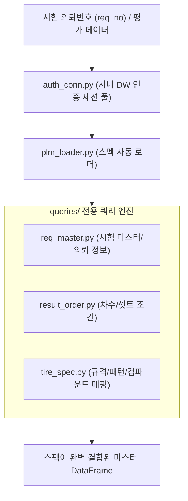

# 📖 database 모듈 사전 (Domain Engineering Guide)

> ⚡ **Quick Jump**: [🎯 1. 설계 철학](#-1-설계-철학-및-모듈-개요) · [📚 2. 배경 지식](#-2-배경-지식-및-이론-지식-허브) · [🏗️ 3. 아키텍처](#️-3-아키텍처-및-데이터-파이프라인) · [🚀 4. 실전 워크플로우](#-4-실전-워크플로우-및-종합-스니펫) · [🛠️ 5. 트러블슈팅](#️-5-트러블슈팅-및-튜닝-노하우)

> [!ABSTRACT] 🗄️ 도메인 개요
> 사내 PLM(Product Lifecycle Management) 및 DW(Data Warehouse) 시스템과 연동하여, 시험 의뢰번호(`req_no`) 및 평가 아이템(`item`)에 따른 **타이어 상세 규격(패턴, 컴파운드, 하중지수)과 시험 차수 정보를 자동 쿼리하고 데이터프레임에 매핑하는 전사 데이터 인프라 패키지**입니다.

---

## 🎯 1. 설계 철학 및 모듈 개요

### 1.1. 탄생 배경과 목적
* **기존 방식의 한계**: 시험 데이터 분석 시 타이어 스펙(규격, 패턴, 컴파운드 코드)을 수동 엑셀에서 복사해오면서 오기입 및 매핑 누락 빈발. DB 연결 세션 관리 미흡으로 타임아웃 오류 발생.
* **해결 과제**: 단일 인증 커넥션 풀(`auth_conn`), 의뢰번호 기반 스펙 자동 결합(`connect_spec_with_req_set`), 도메인별 쿼리 모듈 분리.
* **핵심 가치**: `req_no`만 주어지면 평가 데이터에 사내 공식 타이어 스펙 메타데이터가 100% 무결하게 자동 병합.

### 1.2. 아키텍처 설계 사상
* **세션 풀링 및 캐싱**: DB 조회 결과를 로컬 메모리에 캐싱하여 반복적인 쿼리 요청으로 인한 사내 DB 부하 방지.
* **선언적 쿼리 모듈화**: `queries/` 폴더 내에 마스터 정보, 차수 정보, 타이어 스펙 쿼리를 독립 파일로 분리 관리.

---

## 📚 2. 배경 지식 및 이론 (지식 허브)

> [!NOTE] 🧠 사내 DB 및 평가 데이터 스키마 링크 (Knowledge Atomization)
> *사내 데이터베이스 규격 및 표준 테이블 명세는 `04_Resources`에 영구 보존되어 있습니다.*

* 📄 **사내 DB 사용 매뉴얼**: [[10_회사_DB_사용_매뉴얼|사내 실차 DB 접속 및 쿼리 사용 가이드]]
* 📄 **제동평가 DB 스키마**: [[20_제동평가_DB칼럼명_및_타입정리|제동평가 DB 칼럼명 및 표준 타입 정리]]
* 📄 **실차 평가 데이터프레임 규격**: [[10_실차_평가_데이터_프레임|실차 평가 데이터프레임 표준 명세]]

---

## 🏗️ 3. 아키텍처 및 데이터 파이프라인

### 3.1. DB 연동 및 매핑 파이프라인



### 3.2. 핵심 서브모듈 역할 분담표

| 파일명 | 담당 클래스 / 함수 | 핵심 책임 및 역할 |
| :--- | :--- | :--- |
| `auth_conn.py` | `DBConnection` | 사내 DW 및 오라클/Postgres 세션 인증 및 커넥션 풀 제어 |
| `plm_loader.py` | `connect_spec_with_req_set` | 의뢰번호 기준 타이어 스펙 자동 조회 및 데이터프레임 Left Join |
| `queries/req_master.py` | `query_req_master` | 시험 의뢰자, 시험 목적, 차량 모델 등 상위 메타데이터 추출 |
| `queries/tire_spec.py` | `query_tire_spec` | 규격, 림폭, 공기압, 패턴, 컴파운드 ID 정밀 매핑 |

---

## 🚀 4. 실전 워크플로우 및 종합 스니펫

```python
"""
database 패키지를 활용한 시험 타이어 스펙 자동 결합
"""
import pandas as pd
from unoUtil.database import connect_spec_with_req_set

# 1. 계측 결과 요약 데이터프레임 (의뢰번호 및 세트 번호 포함)
df_runs = pd.DataFrame({
    "ReqNo": ["2026-BRK-001", "2026-BRK-001"],
    "SetNo": [1, 2],
    "MeanDistance": [38.2, 37.8],
})

# 2. 사내 PLM DB 연동하여 타이어 규격 및 패턴 자동 병합
df_enriched = connect_spec_with_req_set(df_runs, req_col="ReqNo", set_col="SetNo")

print(df_enriched[["ReqNo", "SetNo", "Pattern", "Compound", "MeanDistance"]])
```

---

## 🛠️ 5. 트러블슈팅 및 튜닝 노하우

### 5.1. 사내망 폐쇄망 또는 VPN 미연결 시 타임아웃
* **증상**: 외부 환경에서 실행 시 DB 커넥션 시도로 30초 이상 행(Hang) 발생.
* **조치**: `connect_spec_with_req_set(offline_fallback=True)`를 지정하여 DB 연결 불가 시 로컬 캐시 스펙 사전을 사용하고 경고 로그만 남기도록 방어.
