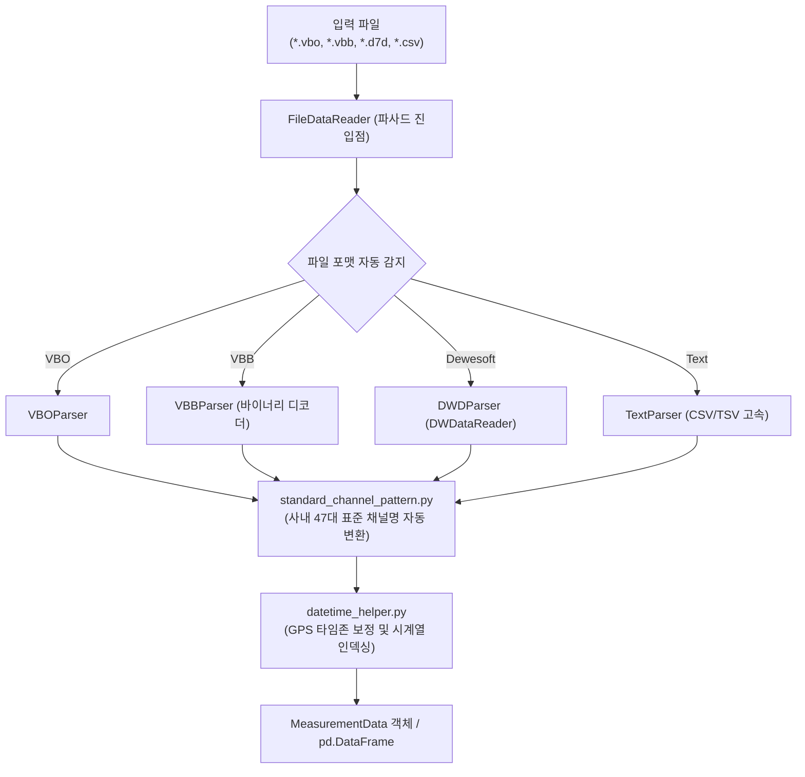

# 📖 file_reader 모듈 사전 (Domain Engineering Guide)

> ⚡ **Quick Jump**: [🎯 1. 설계 철학](#-1-설계-철학-및-모듈-개요) · [📚 2. 배경 지식](#-2-배경-지식-및-이론-지식-허브) · [🏗️ 3. 아키텍처](#️-3-아키텍처-및-데이터-파이프라인) · [🚀 4. 실전 워크플로우](#-4-실전-워크플로우-및-종합-스니펫) · [🛠️ 5. 트러블슈팅](#️-5-트러블슈팅-및-튜닝-노하우)

> [!ABSTRACT] 🚀 도메인 개요
> Racelogic VBox(`.vbo`), 바이너리 VBB(`.vbb`), Dewesoft(`.d7d`/`.dwd`), 일반 텍스트(`.csv`/`.txt`) 등 **이기종 실차 주행 시험 계측기 포맷을 단일 진입점에서 자동 감지하고, 표준 채널 명세와 타임존 정규화를 거쳐 초고속 파싱하는 통합 I/O 프레임워크**입니다.

---

## 🎯 1. 설계 철학 및 모듈 개요

### 1.1. 탄생 배경과 목적
* **기존 방식의 한계**: 시험 장비마다(VBOX vs Dewesoft) 파싱 함수와 채널명이 제각각 분산되어 있어 상위 분석 스크립트가 특정 장비에 종속됨. 구형 C-DLL 래퍼 오류 및 타임존(UTC vs KST) 불일치 문제 빈발.
* **해결 과제**: 객체지향 추상 파서 기반의 `FileDataReader` 파사드 단일 진입점 구축, 사내 표준 채널 매핑 사전 연동, GPS 위경도 기반 타임존 자동 판별.
* **핵심 가치**: 파일 확장자나 내부 바이너리 구조를 몰라도 `FileDataReader(path).read()` 단 한 줄로 정규화된 고속 DataFrame 반환.

### 1.2. 아키텍처 설계 사상
* **파사드 패턴 (Facade Pattern)**: 상위 모듈은 개별 파서(`vbo_parser`, `dwd_parser` 등)를 직접 알 필요 없이 `FileDataReader` 단일 객체만 상대함.
* **전략 패턴 파서 계층**: `BaseParser` 추상 기반 클래스를 상속받아 신규 계측기 포맷 등장 시 기존 코드 수정 없이 신규 파서 플러그인 장착 가능(OCP).
* **메모리 최적화**: 대용량 바이너리(`.vbb`) 파싱 시 C-레벨 버퍼 복사 및 고속 판다스 벡터화 적용.

---

## 📚 2. 배경 지식 및 이론 (지식 허브)

> [!NOTE] 🧠 공학 이론 및 계측 데이터 규격 위키 링크 (Knowledge Atomization)
> *실차 계측 데이터 포맷 및 좌표계 변환 이론은 `04_Resources`에 영구 보존되어 있습니다.*

* 📄 **VBOX 규격 및 GPS 좌표계**: [[20_VBOX_계측_데이터_규격_및_GPS좌표계|VBOX 계측 데이터 규격 및 WGS84 GPS 좌표계]]
* 📄 **바이너리 VBB 포맷 분석**: [[21_바이너리_파일_IO_및_VBB_데이터_포맷_구조|바이너리 파일 I/O 및 Racelogic VBB 포맷 구조]]
* 📄 **시계열 합성 및 타임존**: [[22_GPS_좌표_기반_타임존_자동_판별_및_시계열_합성_이론|GPS 좌표 기반 타임존 자동 판별 및 시계열 합성 이론]]
* 📄 **이종 계측 통합 파이프라인**: [[23_이종_계측_데이터_통합_파이프라인_및_대규모_마이그레이션_엔지니어링|이종 계측 데이터 통합 파이프라인 엔지니어링]]
* 📄 **사내 표준 채널 명세서**: [[24_유노유틸_파일리더_표준채널명|unoUtil 표준 채널명 정규표현식 매핑 사전 (SSOT)]]

---

## 🏗️ 3. 아키텍처 및 데이터 파이프라인

### 3.1. 엔드-투-엔드 데이터 흐름도



### 3.2. 핵심 서브모듈 역할 분담표

| 서브모듈 파일명 | 담당 클래스 / 함수 | 핵심 책임 및 역할 |
| :--- | :--- | :--- |
| `file_data_reader.py` | `FileDataReader` | 파일 포맷 자동 감지, 최적 파서 디스패칭 및 통합 파사드 |
| `base_parser.py` | `BaseParser`, `MeasurementData` | 파서 추상 규격 정의 및 헤더/데이터 캡슐화 컨테이너 |
| `vbo_parser.py` | `VBOParser` | Racelogic ASCII VBO 헤더, 채널, 위성수 파싱 |
| `vbb_parser.py` | `VBBParser` | Racelogic 바이너리 VBB 프레임 디코딩 및 고속 언팩 |
| `dwd_parser.py` | `DWDParser` | Dewesoft C-DLL 인터페이스 연동 및 동기/비동기 채널 추출 |
| `text_parser.py` | `TextParser` | 일반 CSV, TSV 텍스트 파일 고속 인메모리 파서 |
| `datetime_helper.py` | `DateTimeHelper` | UTC 시간 $\to$ 로컬 타임존 변환 및 시계열 타임스탬프 정규화 |
| `standard_channel_pattern.py` | `STANDARD_CHANNEL_MAP` | 헝가리안 및 이종 계측 채널명을 사내 표준 컬럼으로 1:1 매핑 |

---

## 🚀 4. 실전 워크플로우 및 종합 스니펫

```python
"""
FileDataReader를 활용한 이종 파일 원스톱 로드 및 채널 표준화
"""
from pathlib import Path
from unoUtil.file_reader import FileDataReader

# 1. 대상 파일 경로 지정 (VBO, VBB, DWD, CSV 모두 동일)
target_path = Path("D:/test_data/raw_readers/sample.vbo")

# 2. FileDataReader 단일 호출로 로드
reader = FileDataReader(target_path)
data_obj = reader.read()

# 3. 데이터프레임 및 메타데이터 추출
df = data_obj.df
print(f"로드된 시계열 길이: {len(df)} 행")
print(f"표준 채널 목록: {list(df.columns)}")
print(f"시험 일시 (KST): {data_obj.test_datetime}")

# 4. 필수 표준 채널 검증
assert "Velocity" in df.columns, "표준 속도 채널 누락"
assert "LongitudinalAccel" in df.columns, "표준 종가속도 채널 누락"
```

---

## 🛠️ 5. 트러블슈팅 및 튜닝 노하우

### 5.1. Dewesoft C-DLL 차단 (Windows 11 Smart App Control)
* **증상**: Dewesoft 파일 파싱 시 DLL 로드 실패 또는 `WinError 126` 발생.
* **조치**: 사내 표준 환경(`D:\uno\Python\envs\unoBase`)을 사용하고, DLL 경로가 `file_reader/DWDataReader_v5_0_8/` 내부 표준 바이너리를 가리키도록 설정 확인.

### 5.2. 특수 채널명 미인식 및 대소문자 불일치
* **증상**: 센서 이름이 임의로 지정되어(`Lat_Acc_FL`, `V_GPS`) 표준 채널로 변환되지 않는 현상.
* **조치**: `FileDataReader(custom_channel_map={"Lat_Acc_FL": "LateralAccel"})` 인자를 통해 실무자 커스텀 매핑 사전을 즉시 주입.
