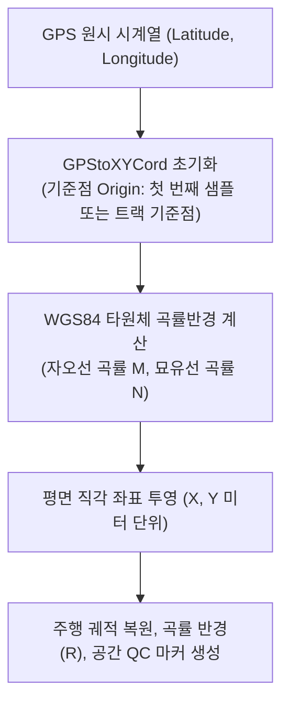

# 📖 gps 모듈 사전 (Domain Engineering Guide)

> ⚡ **Quick Jump**: [🎯 1. 설계 철학](#-1-설계-철학-및-모듈-개요) · [📚 2. 배경 지식](#-2-배경-지식-및-이론-지식-허브) · [🏗️ 3. 아키텍처](#️-3-아키텍처-및-데이터-파이프라인) · [🚀 4. 실전 워크플로우](#-4-실전-워크플로우-및-종합-스니펫) · [🛠️ 5. 트러블슈팅](#️-5-트러블슈팅-및-튜닝-노하우)

> [!ABSTRACT] 🛰️ 도메인 개요
> VBOX 등 GNSS 수신기로부터 계측된 구면 좌표계(위도, 경도, 고도) 데이터를 WGS84 지구 타원체 모델을 기반으로 **평면 직각 데카르트 좌표계(XY 평면, 미터 단위)로 오차 없이 정밀 투영하고, 주행 궤적 및 제동 시작점 공간 QC를 지원하는 측지 좌표 공학 패키지**입니다.

---

## 🎯 1. 설계 철학 및 모듈 개요

### 1.1. 탄생 배경과 목적
* **기존 방식의 한계**: 위도/경도(도/분/초) 단위를 단순 평면으로 가정하여 거리를 계산할 경우, 고위도 지역(핀란드 이발로 등)에서 종/횡방향 축척 왜곡이 심각하게 발생.
* **해결 과제**: WGS84 타원체 곡률반경을 엄밀히 반영한 정밀 투영 클래스 `GPStoXYCord` 단일화, 기준점(Origin Point) 기반 상대 벡터 변환.
* **핵심 가치**: 전 세계 어느 시험장(남양, 태안, 이발로, 이다)에서도 1cm 미만 오차로 궤적 및 공간 제동 거동 복원.

### 1.2. 아키텍처 설계 사상
* **단일화(Consolidation)**: 과거 분산되어 있던 함수형 GPS 변환 코드를 `gps_to_xy.py` 단일 파일 및 `GPStoXYCord` 단일 클래스로 통합.
* **벡터화 연산 (Vectorized Calculation)**: 수십만 포인트의 GPS 시계열 데이터를 NumPy/Pandas 기반 벡터 연산으로 0.01초 내 일괄 투영.

---

## 📚 2. 배경 지식 및 이론 (지식 허브)

> [!NOTE] 🧠 측지학 및 GPS 좌표계 위키 링크 (Knowledge Atomization)
> *GPS 타원체 좌표계 및 시계열 합성 이론은 `04_Resources`에 영구 보존되어 있습니다.*

* 📄 **VBOX 계측 규격 및 GPS 좌표계**: [[20_VBOX_계측_데이터_규격_및_GPS좌표계|VBOX 계측 데이터 규격 및 WGS84 GPS 좌표계]]
* 📄 **GPS 좌표 기반 타임존 판별**: [[22_GPS_좌표_기반_타임존_자동_판별_및_시계열_합성_이론|GPS 좌표 기반 타임존 자동 판별 및 시계열 합성 이론]]
* 📄 **차량 좌표계 변환 역학**: [[10_차량동역학_측정점_기준점_운동역학_변환|차량 계측점 기준점 동역학 변환]]

---

## 🏗️ 3. 아키텍처 및 데이터 파이프라인

### 3.1. 좌표 투영 파이프라인



### 3.2. 핵심 서브모듈 역할 분담표

| 파일명 | 담당 클래스 / 함수 | 핵심 책임 및 역할 |
| :--- | :--- | :--- |
| `gps_to_xy.py` | `GPStoXYCord` | WGS84 타원체 기반 위경도 $\to$ 평면 직각 데카르트(XY, m) 정밀 투영 엔진 |
| `gps_to_xy.py` | `transform_gps` | 데이터프레임 내 위경도 컬럼을 고속 벡터 변환하여 X, Y 컬럼 추가 |

---

## 🚀 4. 실전 워크플로우 및 종합 스니펫

```python
"""
GPStoXYCord를 활용한 실차 주행 궤적 평면 직각 좌표 변환
"""
import pandas as pd
from unoUtil.gps import GPStoXYCord, transform_gps

# 1. GPS 시계열 데이터프레임 준비
df = pd.DataFrame({
    "Latitude": [37.123456, 37.123500, 37.123600],
    "Longitude": [126.987654, 126.987700, 126.987800],
})

# 2. 첫 번째 포인트를 기준점(Origin)으로 투영 변환
transformer = GPStoXYCord(origin_lat=df["Latitude"].iloc[0], origin_lon=df["Longitude"].iloc[0])
df["X_m"], df["Y_m"] = transformer.transform(df["Latitude"], df["Longitude"])

print(df[["Latitude", "Longitude", "X_m", "Y_m"]])
# 출력: X_m, Y_m (단위: 미터, 0점 기준 상대 거리)
```

---

## 🛠️ 5. 트러블슈팅 및 튜닝 노하우

### 5.1. 위성 신호 끊김(드롭아웃)에 따른 좌표 점프 현상
* **증상**: 터널 통과나 차폐 구역에서 위경도가 0으로 떨어지며 XY 좌표가 수천 킬로미터로 발산.
* **조치**: `transform_gps(filter_invalid=True)`를 적용하여 위도/경도가 0이거나 위성수(Satellites)가 4개 미만인 샘플을 자동 결측 처리 및 선형 보간.
