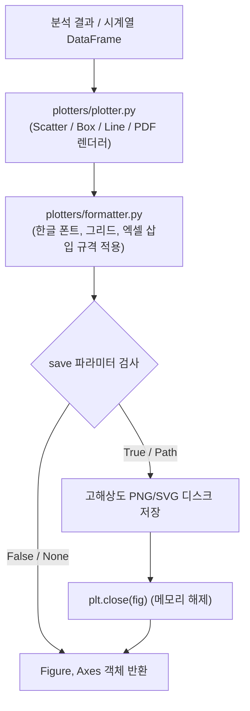

# 📖 graphics 모듈 사전 (Domain Engineering Guide)

> ⚡ **Quick Jump**: [🎯 1. 설계 철학](#-1-설계-철학-및-모듈-개요) · [📚 2. 배경 지식](#-2-배경-지식-및-이론-지식-허브) · [🏗️ 3. 아키텍처](#️-3-아키텍처-및-데이터-파이프라인) · [🚀 4. 실전 워크플로우](#-4-실전-워크플로우-및-종합-스니펫) · [🛠️ 5. 트러블슈팅](#️-5-트러블슈팅-및-튜닝-노하우)

> [!ABSTRACT] 🎨 도메인 개요
> 대용량 실차 주행 시험 시계열 데이터를 배치 파이프라인 중단 없이 고속 렌더링하는 **비차단(Non-blocking) 시각화 엔진, 폰트 및 레이아웃 서식화 도구, 인터랙티브 마우스 컨트롤러 및 웹 대화형(Plotly) 변환 툴킷을 총괄하는 그래픽스 패키지**입니다.

---

## 🎯 1. 설계 철학 및 모듈 개요

### 1.1. 탄생 배경과 목적
* **기존 방식의 한계**: 수천 건의 배치 분석 중 `plt.show()` 호출로 인해 프로세스가 멈추거나(Hang), 메모리 누수로 인해 서버가 다운됨. 한글 폰트 깨짐 현상 및 다변량 차트 간 스타일 불일치.
* **해결 과제**: "파일 저장(`savefig`) $\to$ 메모리 해제(`close`) $\to$ Figure 객체 반환" 비차단 라이프사이클 의무화, 사내 고품질 표준 테마(`format_fig`), 마우스 십자선 커서 측정기.
* **핵심 가치**: 자동화 파이프라인의 100% 무중단 안정성과 보고서용 고해상도 벡터/래스터 그래픽스 품질 동시 달성.

### 1.2. 아키텍처 설계 사상
* **3대 서브패키지 구조**: 드로잉 전담(`plotters/`), 사용자 이벤트 인터랙션(`controls/`), 웹 반응형 변환(`web/`)으로 분할.
* **`save` 파라미터 다형성**: `Union[bool, str, Path]`를 완벽 지원하여 생략, 기본 경로 저장, 지정 경로 저장의 유연한 분기 제공.
* **리소스 누수 방어**: 모든 시각화 함수는 `close=True` 플래그를 기본 수용하여 백그라운드 구동 시 Figure 버퍼 즉시 해제.

---

## 📚 2. 배경 지식 및 이론 (지식 허브)

> [!NOTE] 🧠 엔터프라이즈 시각화 표준 위키 링크 (Knowledge Atomization)
> *비차단 시각화 아키텍처 및 GUI 제어 패턴은 `04_Resources`에 영구 보존되어 있습니다.*

* 📄 **시각화 무중단 개발 표준**: [[50_Matplotlib_시각화_무중단_개발_표준|Matplotlib 시각화 무중단 개발 표준 (Non-blocking 아키텍처)]]
* 📄 **엔터프라이즈 로깅 및 시각화**: [[20_엔터프라이즈_계층형_로깅_및_무중단_시각화_패턴|엔터프라이즈 계층형 로깅 및 무중단 시각화 패턴]]

---

## 🏗️ 3. 아키텍처 및 데이터 파이프라인

### 3.1. 엔드-투-엔드 데이터 흐름도



### 3.2. 핵심 서브모듈 역할 분담표

| 서브모듈 파일명 | 담당 클래스 / 함수 | 핵심 책임 및 역할 |
| :--- | :--- | :--- |
| `plotters/plotter.py` | `Plotter` | 산점도, 박스플롯, 확률밀도함수, 시계열 비교 표준 렌더링 |
| `plotters/formatter.py`| `format_fig` | 사내 공식 타이포그래피, 폰트 스케일링, 축 레이아웃 서식화 |
| `plotters/surface_3d.py`| `plot_3d_surface` | 노면 높이 및 3차원 공간 트랙 메쉬 렌더러 |
| `plotters/text_offset.py`| `auto_text_offset` | 데이터 포인트 간 텍스트 주석 겹침 방지 알고리즘 |
| `controls/cursor_mode.py`| `set_cursor_mode` | GUI 상에서 마우스 실시간 좌표/수치 추적 십자선 바인딩 |
| `controls/range_selector.py`| `RangeSelector` | 차트 상에서 마우스 2점 클릭으로 분석 구간 선택 인터랙션 |
| `web/plotly_tools.py` | `convert_to_plotly` | 대화형 웹 뷰어 HTML 변환 및 반응형 대시보드 렌더러 |

---

## 🚀 4. 실전 워크플로우 및 종합 스니펫

```python
"""
graphics 모듈을 활용한 비차단 제동 성능 분포 시각화
"""
from pathlib import Path
import pandas as pd
from unoUtil.graphics.plotters import Plotter, format_fig

# 1. 시각화 데이터 준비
df = pd.read_csv("data/braking_summary.csv")

# 2. Plotter 인스턴스 초기화 및 표준 박스플롯 생성
plotter = Plotter(style="publication")
fig, ax = plotter.boxplot(
    data=df,
    x="TireName",
    y="BrakingDistance",
    title="타이어 사양별 제동거리 분포 비교",
)

# 3. 사내 표준 서식 및 레이아웃 적용
format_fig(fig, ax, xlabel="시험 타이어", ylabel="제동 거리 [m]", grid=True)

# 4. 다형성 save를 통한 안전 저장 및 메모리 해제
fig, ax = plotter.save_figure(
    fig=fig,
    save=Path("reports/braking_boxplot.png"),
    close=True,  # Non-blocking 메모리 해제
)
```

---

## 🛠️ 5. 트러블슈팅 및 튜닝 노하우

### 5.1. 한글 폰트 네모(토푸, □) 깨짐 현상
* **증상**: 윈도우/리눅스 환경 차이로 차트 라벨의 한글이 깨져서 저장되는 현상.
* **조치**: `format_fig(fig, ax, font_family="Malgun Gothic")`를 호출하거나, 내부 `unoUtil.graphics.formatter.init_korean_font()`가 시스템 폰트를 자동 로드하도록 설정.

### 5.2. 대용량 배치 처리 중 Out Of Memory (OOM) 발생
* **증상**: 수백 개 차트를 루프로 생성할 때 프로세스 메모리 사용량이 계속 증가하다 강제 종료.
* **조치**: 반드시 모든 드로잉 루프 하단에서 `close=True` 인자를 전달하여 `plt.close(fig)`가 실행되도록 보장.
