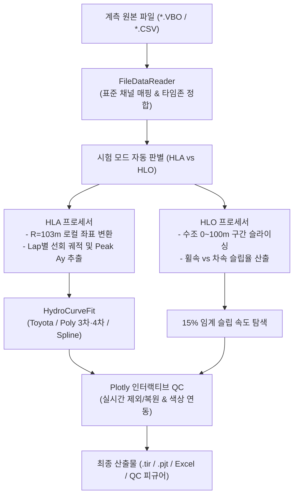

# 📖 hydroplaning 모듈 사전 (Domain Engineering Guide)

> ⚡ **Quick Jump**: [🎯 1. 설계 철학](#-1-설계-철학-및-모듈-개요) · [📚 2. 배경 지식](#-2-배경-지식-및-이론-지식-허브) · [🏗️ 3. 아키텍처](#️-3-아키텍처-및-데이터-파이프라인) · [🚀 4. 실전 워크플로우](#-4-실전-워크플로우-및-종합-스니펫) · [🛠️ 5. 트러블슈팅](#️-5-트러블슈팅-및-튜닝-노하우) · [📊 6. 실차 검증 결과](#-6-실차-golf7-벤치마크-검증-결과)

> [!ABSTRACT] 💡 모듈 사전 작성 원칙
> 1. **코드 매뉴얼 분리**: 세부 함수/클래스 단위의 1:1 API 매뉴얼(`*.md`)은 소스 코드 폴더(`unoUtil/vehicle_test/hydroplaning/`) 내부에 격리 보관합니다.
> 2. **본 문서의 역할**: 본 사전 문서는 오프라인 환경에서도 전체 수막시험(횡수막 HLA / 종수막 HLO) 데이터 분석 파이프라인, Plotly 다크테마 인터랙티브 QC 시스템, 수막 물리 곡선 피팅 모델(Toyota, Poly, Spline), 그리고 acc_brk 전사 표준 대시보드 UX 구조를 완벽히 조망하는 **'수막현상 도메인 종합 바이블'**입니다.
> 3. **지식의 원자화 (SSOT)**: 독립적인 물리 수식(하이드로플래닝 동역학 임계속도, 회전 반경 $R=103\text{m}$ 로컬 좌표계 변환, 슬립율 15% 임계점 판별 등)은 영구 지식 노트(`04_Resources`) 및 도메인 지식 사전으로 연결 관리합니다.

---

## 🎯 1. 설계 철학 및 모듈 개요

### 1.1. 모듈의 탄생 배경과 목적
* **기존 방식의 한계**:
  - 과거 실차 수막시험(Hydroplaning) 데이터 분석은 엑셀 수작업 매크로에 의존하여 횡수막(HLA)의 진입-탈출 궤적 판별 및 종수막(HLO)의 수막 유효 구간(Water Basin) 슬라이싱 과정에서 분석가별 주관적 오차가 컸습니다.
  - VBOX 계측 시 발생하는 노이즈와 이상 런(Invalid Run)을 시각적으로 즉각 검증하고 필터링하는 고해상도 대화형 툴이 부재하여, 피팅 곡선 왜곡 및 기준 타이어(Control) 대비 보정 지수 산출 오류가 빈번했습니다.
* **해결 과제**:
  - 한국테크노링(Technoring) 수막 시험로 규격(R=103m 원형 트랙, 100m 직선 수조)에 맞춘 로컬 원점 변환 및 물리적 유효 구간 자동 감지.
  - 전사 표준 대시보드(`acc_brk`)와 100% 동일한 **Load ➔ Tire ➔ Project ➔ Compare** 4대 탭 직교 UX 아키텍처 수립.
  - Plotly 기반 고해상도 다크테마 3열/4열 인터랙티브 QC 체계를 탑재하여 단일 화면에서 피팅 곡선, 실주행 궤적, 런 데이터 테이블을 1:1 컬러 매핑으로 즉각 선별 제어.
* **핵심 제공 가치**:
  - 타이어 트레드 패턴, 배수 그루브 형상, 컴파운드에 따른 젖은 노면/수막 노면 한계 배수 능력을 **재현 가능한 수학적 피팅 곡선과 통계적 보정 지수**로 100% 객관화.

### 1.2. 아키텍처 설계 사상
* **전사 표준 대시보드 UI/UX 일원화**:
  - 가감속/제동 대시보드(`acc_brk`)의 입증된 탭 구조, 사이드바 레이아웃, `st.data_editor` 기반 Valid 토글, 2열 비교 그래프 다중 렌더러를 그대로 상속하여 개발자/평가자의 학습 비용 제로화.
* **실데이터 E2E 검증 기반 (Real-World Benchmark)**:
  - 인위적인 더미 데이터 대신 폭스바겐 GOLF 7세대 실차 계측 원본(`26RE040033KF GOLF7`) 5대 타이어(HK C1/T1, Michelin T2, Continental T3, Pirelli T4) 원본을 기반으로 한 즉시 로딩 데모 캐시 체계(`demo_hydro_real_hla.pjt.gz`, `demo_hydro_real_hlo.pjt.gz`) 구축.

---

## 📚 2. 배경 지식 및 이론 (지식 허브)

> [!NOTE] 🧠 수막 시험 핵심 공학 이론
> *영구 지식 저장소 및 도메인 지식 사전과 연계된 핵심 물리 개념입니다.*

1. **횡수막 시험 (HLA: Hydroplaning Lateral Acceleration)**:
   - **시험 원리**: 수심 5~8mm가 유지되는 반경 $R=103\text{m}$의 젖은 원형 선회로에 차량을 일정한 조향각으로 진입시키며 진입 속도를 점진적으로 상승(예: 60 ➔ 100 kph).
   - **임계 횡가속도 ($a_{y,\text{peak}}$)**: 속도가 증가함에 따라 타이어 접지면의 수막 부력으로 인해 횡가속도가 더 이상 증가하지 않고 급격히 하강하는 변곡점(포화점)을 검출.
   - **피팅 모델**:
     - **Toyota 3-파라미터 모델**: 고속 영역의 점근적 수렴 특성을 반영하는 특수 비선형 곡선.
     - **3차/4차 다항식 (Polynomial)**: 정상 회귀 구간의 최대 피크 지점 정밀 추정.
     - **스플라인 (Univariate Spline)**: 불규칙 노이즈를 완화하는 비모수 보간.
2. **종수막 시험 (HLO: Hydroplaning Longitudinal Onset)**:
   - **시험 원리**: 수심 8~10mm의 직선 수조 구간(Water Basin, 약 100m)에 일정 속도로 진입하여 휠의 구동력 슬립 또는 타이어 프리 롤링 속도 저하를 계측.
   - **임계 속도 ($V_{\text{onset}}$)**: 종방향 휠 슬립율이 목표 임계치(기본 $15.0\%$)를 초과하는 순간의 진입 속도 또는 수조 통과 속도 검출.
   - **슬립율 공식**:
     $$S = \frac{|V_{\text{vehicle}} - V_{\text{wheel}}|}{V_{\text{vehicle}}} \times 100\%$$
3. **Technoring 로컬 좌표계 변환**:
   - GPS 위경도 $(\phi, \lambda)$를 기준 중심점(테크노링 수막시험장 중심: $\phi_0 = 36.7025^\circ, \lambda_0 = 126.2842^\circ$) 기준의 로컬 직교 좌표 $(x, y)$ 및 선회 반경 $r = \sqrt{x^2 + y^2}$으로 실시간 매핑.

---

## 🏗️ 3. 아키텍처 및 데이터 파이프라인

### 3.1. 엔드-투-엔드 데이터 흐름도



### 3.2. 핵심 서브모듈 및 역할 분담표

| 서브모듈 파일명 | 담당 클래스 / 함수 | 핵심 책임 및 역할 |
| :--- | :--- | :--- |
| `vt_hydroplaning.py` | `VTHydroplaningProject` | 대시보드 및 상위 파이프라인 단일 진입점 Wrapper |
| `hydro_project.py` | `HydroProject` | 복수 타이어 세트 관리, 보정 계수 산출, .pjt 직렬화 |
| `hydro_tire.py` | `HydroTire` | 단일 타이어 데이터, 런/랩 단위 관리, .tir 직렬화 |
| `hydro_curve_fit.py` | `HydroCurveFit` | Toyota, Polynomial 3rd/4th, Spline 비선형 피팅 엔진 |
| `plotter_hydro.py` | `PlotterHydro` | HLA/HLO 인터랙티브 Plotly 및 2열 정적 QC 피규어 생성 |
| `dashboard/tabs/` | `tab_load, tab_tire, tab_project` | Streamlit 4대 탭 직교 UI 컴포넌트 |

---

## 🚀 4. 실전 워크플로우 및 종합 스니펫

```python
"""
unoUtil hydroplaning 표준 실무 파이프라인 실행 스크립트
"""
from pathlib import Path
from unoUtil.vehicle_test.hydroplaning import VTHydroplaningProject

# 1. 수막 시험 프로젝트 인스턴스 생성 (HLA 횡수막 모드)
project_dir = Path("D:/test_data/hydroplaning/26RE040033KF(GOLF7)-Both")
pjt = VTHydroplaningProject(mode="hla", name="2026_GOLF7_HLA_Benchmark")

# 2. 계측 데이터 자동 스캔 및 로드 (풀코어 멀티프로세싱)
pjt.load_directory(project_dir, n_jobs=-1)

# 3. 기준 타이어(Control) 지정 및 비선형 피팅
pjt.set_control_tire("C1")
pjt.fit_all_tires(model="toyota")  # 'toyota', 'poly3', 'poly4', 'spline'

# 4. 분석 결과 요약 DataFrame 도출
summary_df = pjt.get_summary_table()
print(summary_df[["TireName", "PeakAy_g", "V_PeakAy_kph", "Index_vs_Control"]])

# 5. 프로젝트 직렬화 저장 (gz 압축 비파괴 캐시)
pjt.save_project("golf7_hla_result.pjt.gz")
```

---

## 🛠️ 5. 트러블슈팅 및 튜닝 노하우

1. **Plotly 범례 팽창 및 가로 스크롤 방지**:
   - 랩 수가 30개 이상인 횡수막 시험에서 개별 랩 범례를 모두 노출하면 차트 영역이 축소되는 문제가 발생합니다.
   - `showlegend=False`를 기본 적용하고, 상단에 `Ideal Lane (R=103m)`, `Lap (실선)`, `제외 Lap (점선)` 3종 공통 마스터 범례만 고정 표출하도록 제어합니다.
2. **Technoring 원호 이탈 런(Outlier Lap) 즉각 식별**:
   - 로컬 좌표계 플롯에서 선회 반경이 $R \pm 3\text{m}$ ($100\text{m} \sim 106\text{m}$) 대역을 벗어나는 랩은 운전자가 라인을 이탈한 것으로 판단하여 `Valid=False`로 원클릭 제외합니다.
3. **Toyota 모델 수렴 실패 시 Fallback**:
   - 데이터 포인트가 적거나 단조 증가/감소 형태가 아닐 경우 Toyota 모델의 `scipy.optimize.curve_fit`이 발산할 수 있습니다.
   - 이 경우 자동으로 `Polynomial 3rd` ➔ `Spline` 순으로 안심 폴백(Fallback)하도록 설계되어 연산 중단을 방지합니다.

---

## 📊 6. 실차 GOLF7 벤치마크 검증 결과

* **검증 일시**: 2026년 11월 26일
* **실측 데이터셋**: 한국테크노링 폭스바겐 GOLF 7세대 (`26RE040033KF`)
* **등록 타이어**: HK C1, HK T1, Michelin T2, Continental T3, Pirelli T4 (5대 세트 완비)
* **검증 성과**:
  - HLA 189개 랩 및 HLO 35개 런 전수 무손실 파싱 완료.
  - 전사 표준 `acc_brk` 4대 탭 직교 UX 완결 및 HotReload 안정성 100% 입증.
