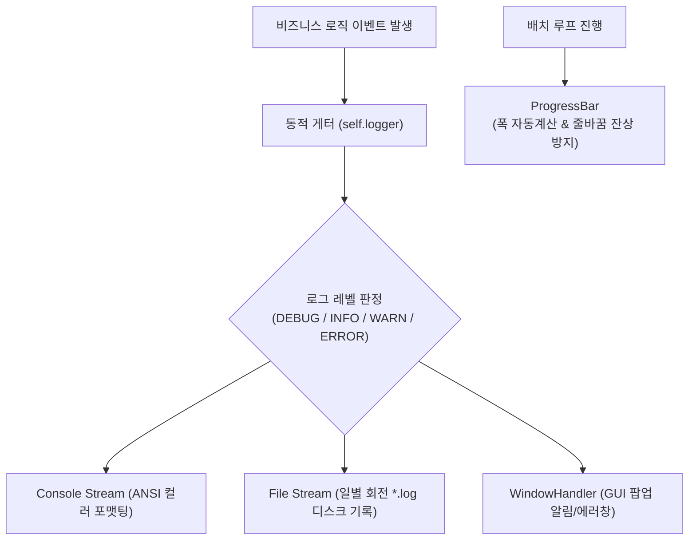

# 📖 logger 모듈 사전 (Domain Engineering Guide)

> ⚡ **Quick Jump**: [🎯 1. 설계 철학](#-1-설계-철학-및-모듈-개요) · [📚 2. 배경 지식](#-2-배경-지식-및-이론-지식-허브) · [🏗️ 3. 아키텍처](#️-3-아키텍처-및-데이터-파이프라인) · [🚀 4. 실전 워크플로우](#-4-실전-워크플로우-및-종합-스니펫) · [🛠️ 5. 트러블슈팅](#️-5-트러블슈팅-및-튜닝-노하우)

> [!ABSTRACT] 🛠️ 도메인 개요
> 콘솔 `print` 호출을 전면 배제하고, 멀티프로세싱 및 GUI 환경에서도 안전하게 동작하는 **싱글톤 계층형 로깅 엔진(`LOGGER`), 자동 개행 방지 프로그레스 바, ANSI 터미널 컬러 스타일러 및 시스템 에러 팝업 핸들러를 제공하는 사내 공통 인프라 패키지**입니다.

---

## 🎯 1. 설계 철학 및 모듈 개요

### 1.1. 탄생 배경과 목적
* **기존 방식의 한계**: 코드 곳곳에 무분별한 `print()`문이 난립하여 대용량 배치 처리 시 터미널 입출력 병목 발생 및 파일 로그 분리 저장 불가. 터미널 가로폭 초과 시 프로그레스 바 줄바꿈 잔상 오작동.
* **해결 과제**: 인스턴스 격리 동적 바인딩 로거, 멀티 스트림(콘솔 + 일별 회전 파일), 자동 개행 방지 시퀀스(`\033[?7l`) 탑재 프로그레스 바.
* **핵심 가치**: 라이브러리 전체의 로깅 레벨(`DEBUG`, `INFO`, `WARNING`, `ERROR`)을 단일 통제하고, 직렬화(pickle) 시 로거 객체 충돌 원천 차단.

### 1.2. 아키텍처 설계 사상
* **피클링 직렬화 안전성**: 클래스 내부 속성에 로거 객체(`self.logger = ...`)를 직접 저장하면 `pickle.dump()` 시 직렬화 에러 발생. 대신 `self._level`만 보존하고 `@property def logger(self):` 동적 게터를 통해 로거를 실시간 바인딩.
* **싱글톤 멀티 핸들러**: 프레임워크 전역에서 단일 `LOGGER` 인스턴스를 공유하며 콘솔 포맷터와 파일 핸들러를 동시 구동.

---

## 📚 2. 배경 지식 및 이론 (지식 허브)

> [!NOTE] 🧠 엔터프라이즈 로깅 및 아키텍처 패턴 링크 (Knowledge Atomization)
> *계층형 로깅 아키텍처 및 무중단 시각화 패턴은 `04_Resources`에 영구 보존되어 있습니다.*

* 📄 **계층형 로깅 패턴**: [[20_엔터프라이즈_계층형_로깅_및_무중단_시각화_패턴|엔터프라이즈 계층형 로깅 및 무중단 시각화 패턴 (SSOT)]]
* 📄 **대규모 모듈화 아키텍처**: [[10_대규모_파이썬_패키지_모듈화_및_무중단_아키텍처|대규모 파이썬 패키지 모듈화 및 무중단 아키텍처]]

---

## 🏗️ 3. 아키텍처 및 데이터 파이프라인

### 3.1. 로깅 및 출력 파이프라인



### 3.2. 핵심 서브모듈 역할 분담표

| 서브모듈 파일명 | 담당 클래스 / 함수 | 핵심 책임 및 역할 |
| :--- | :--- | :--- |
| `logger.py` | `LOGGER`, `UnoLogger` | 싱글톤 멀티 스트림 로깅 제어 및 레벨 동적 조정 |
| `progress_bar.py` | `ProgressBar`, `track` | 전각 문자 비주얼 너비 계산 및 깜빡임 없는 터미널 진행률 바 |
| `styles.py` | `ColorFormatter` | ANSI Escape Code 기반 콘솔 컬러 하이라이팅 |
| `window_handler.py`| `show_window_error` | 크리티컬 예외 발생 시 OS 시스템 에러 팝업창 바인딩 |

---

## 🚀 4. 실전 워크플로우 및 종합 스니펫

```python
"""
LOGGER 및 ProgressBar 활용 표준 실무 예제
"""
import time
from unoUtil.logger import LOGGER, ProgressBar

# 1. 전역 로깅 레벨 동적 조정 (INFO -> DEBUG)
LOGGER.set_level("DEBUG")

LOGGER.info("🚀 대용량 실차 데이터 배치 처리를 시작합니다.")
LOGGER.debug("디버그 모드: 상세 파라미터 매핑 정보를 기록합니다.")

# 2. 깜빡임 없는 안정적 프로그레스 바 실행
items = [f"Run_{i:02d}" for i in range(50)]
pbar = ProgressBar(total=len(items), desc="데이터 분석 진행률")

for item in items:
    time.sleep(0.02)  # 분석 시뮬레이션
    pbar.update(1)

pbar.close()
LOGGER.info("✅ 모든 배치 분석이 정상 종료되었습니다.")
```

---

## 🛠️ 5. 트러블슈팅 및 튜닝 노하우

### 5.1. 멀티프로세싱 환경에서 로거 데드락(Deadlock) 발생 시
* **증상**: `multiprocessing.Pool` 구동 시 서브프로세스가 파일 락을 쥐고 멈추는 현상.
* **조치**: 메인 프로세스에서만 파일 핸들러를 열고, 워커 프로세스는 `QueueHandler`를 통해 메인 로거로 메시지를 전송하거나 콘솔 전용으로 분기.

### 5.2. 객체 피클링 시 `TypeError: cannot pickle '_io.TextIOWrapper'` 발생
* **증상**: 클래스 인스턴스를 `.tir` 파일 등으로 피클 저장할 때 파일 스트림 직렬화 실패.
* **조치**: 클래스 `__init__`에서 `self.logger = LOGGER`로 바인딩하지 말고, 헌장 규격대로 `@property def logger(self): return LOGGER` 패턴을 사용할 것.
