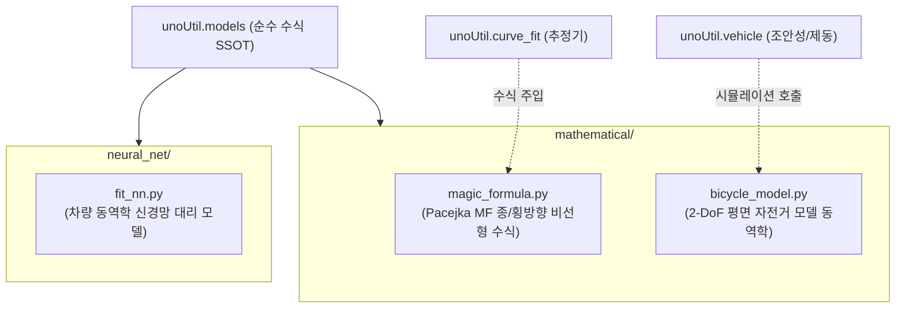

# 📖 models 모듈 사전 (Domain Engineering Guide)

> ⚡ **Quick Jump**: [🎯 1. 설계 철학](#-1-설계-철학-및-모듈-개요) · [📚 2. 배경 지식](#-2-배경-지식-및-이론-지식-허브) · [🏗️ 3. 아키텍처](#️-3-아키텍처-및-데이터-파이프라인) · [🚀 4. 실전 워크플로우](#-4-실전-워크플로우-및-종합-스니펫) · [🛠️ 5. 트러블슈팅](#️-5-트러블슈팅-및-튜닝-노하우)

> [!ABSTRACT] 📐 도메인 개요
> Pacejka Magic Formula(MF), 2자유도 평면 차량 자전거 모델(Bicycle Model), 신경망 동역학 피팅 등 **타이어 및 차량 거동을 지배하는 순수 공학 수학 수식과 물리 시뮬레이션 모델의 단일 진실 공급원(SSOT) 패키지**입니다.

---

## 🎯 1. 설계 철학 및 모듈 개요

### 1.1. 탄생 배경과 목적
* **기존 방식의 한계**: 동일한 Pacejka 수식과 자전거 모델 코드가 `vehicle/`, `curve_fit/`, `ai/` 등 여러 도메인에 중복 하드코딩되어 계수 정의 및 파라미터 규격 불일치 발생.
* **해결 과제**: 순수 지배 방정식과 시뮬레이터만을 `models/` 패키지로 완전히 독립 격리하여, 피팅 엔진(`curve_fit`)과 차량 분석기(`vehicle`)가 동일한 수식을 주입받도록 일원화.
* **핵심 가치**: 데이터 피팅(How to fit)과 순수 수식(What equation)의 완벽한 분리 및 사내 표준 수식 SSOT 확립.

### 1.2. 아키텍처 설계 사상
* **순수 함수 및 무상태(Stateless) 설계**: 지배 수식 함수는 외부 상태에 의존하지 않고, 입력 인자(슬립각, 수직하중, 계수 튜플)에 대해서만 결정론적 출력을 반환.
* **수학 모델 vs 신경망 모델 이원화**: `mathematical/`(해석적 물리 수식)과 `neural_net/`(데이터 기반 딥러닝 서브로게이트 모델) 계층 구조화.

---

## 📚 2. 배경 지식 및 이론 (지식 허브)

> [!NOTE] 🧠 공학 지배 방정식 및 차량 동역학 위키 링크 (Knowledge Atomization)
> *Pacejka 타이어 모델 및 차량 운동역학 이론은 `04_Resources`에 영구 보존되어 있습니다.*

* 📄 **Pacejka MF 수식 원리**: [[12_차량_시스템_제동성능과_마찰계수_상관관계|Pacejka Magic Formula 및 마찰계수 상관관계]]
* 📄 **차량 동역학 시뮬레이션**: [[10_차량_제동_동역학_시뮬레이션|타이어-노면 마찰 및 하중 이동 제동 동역학]]
* 📄 **타이어 전단력 메커니즘**: [[10_Tire_Shear_Force|타이어 접지면 전단력 및 슬립각 특성]]
* 📄 **차량 좌표계 변환 역학**: [[10_차량동역학_측정점_기준점_운동역학_변환|차량 계측점 기준점 동역학 변환]]

---

## 🏗️ 3. 아키텍처 및 데이터 파이프라인

### 3.1. 모듈 의존성 구조도



### 3.2. 핵심 서브모듈 역할 분담표

| 서브모듈 파일명 | 담당 클래스 / 함수 | 핵심 책임 및 역할 |
| :--- | :--- | :--- |
| `mathematical/magic_formula.py` | `calc_magic_formula`, `calc_constrained_magic_formula` | Pacejka B, C, D, E 표준 수식 및 원점 초기 강성($K = B \cdot C \cdot D$) 등식 구속 3-파라미터 타이어 마찰력/횡력 산출 (SSOT) |
| `mathematical/bicycle_model.py` | `BicycleModel` | 조향각 및 전후륜 횡력 기반 요레이트($\gamma$), 횡가속도($a_y$) 미분방정식 수치적분 |
| `neural_net/fit_nn.py` | `TireDynamicNN` | PyTorch 기반 다변량 비선형 차량 거동 신경망 추론기 |

---

## 🚀 4. 실전 워크플로우 및 종합 스니펫

```python
"""
models 패키지를 활용한 Pacejka MF 수식 평가 및 2-DoF 자전거 모델 시뮬레이션
"""
import numpy as np
from unoUtil.models.mathematical import (
    calc_magic_formula,
    calc_constrained_magic_formula,
    BicycleModel,
)

# 1. Pacejka MF 순수 수식 및 초기 강성(K) 구속 수식 호출 (슬립율 0~0.5 범위)
slip_ratio = np.linspace(0, 0.5, 50)
mu_pred = calc_magic_formula(
    x=slip_ratio, B=10.0, C=1.65, D=1.05, E=-0.5
)
mu_constrained = calc_constrained_magic_formula(
    x=slip_ratio, C=1.35, D=0.45, E=0.2, K=12.5
)
print(f"Pacejka 최대 마찰계수: {np.max(mu_pred):.3f}, 구속 모델: {np.max(mu_constrained):.3f}")

# 2. 2-DoF 자전거 모델 시뮬레이터 인스턴스 생성
vehicle = BicycleModel(
    mass=1600.0,      # 차량 질량 [kg]
    lf=1.2, lr=1.5,   # 무게중심에서 전/후륜 차축 거리 [m]
    cf=80000.0, cr=80000.0,  # 전/후륜 코너링 스티프니스 [N/rad]
)

# 3. 차속 80km/h에서 계단 조향각 3도 입력에 대한 과도 응답 시뮬레이션
sim_result = vehicle.simulate_step_steer(
    velocity_kmh=80.0, steer_deg=3.0, time_span=3.0, dt=0.01
)
print(f"정상상태 요레이트: {sim_result['yaw_rate'].iloc[-1]:.3f} rad/s")
```

---

## 🛠️ 5. 트러블슈팅 및 튜닝 노하우

### 5.1. Pacejka 수식 피팅 시 파라미터 발산 현상
* **증상**: 파라미터 $E$가 $+1.0$ 이상으로 올라가 곡선 후반부가 위로 치솟는 비물리적 거동 발생.
* **조치**: $E \le 1.0$, $C \in [1.0, 2.5]$, $B > 0$ 경계 조건(Bounds)을 필수로 부여하여 연산 안정성 보장.

### 5.2. 자전거 모델 고속 시뮬레이션 발산
* **증상**: 120km/h 이상 고속 주행 조건에서 수치적분(Euler) 오차로 요레이트가 무한 발산.
* **조치**: 시뮬레이션 타임스텝 $dt \le 0.005\text{s}$ (Runge-Kutta 4차 옵션 권장)로 미세화.
