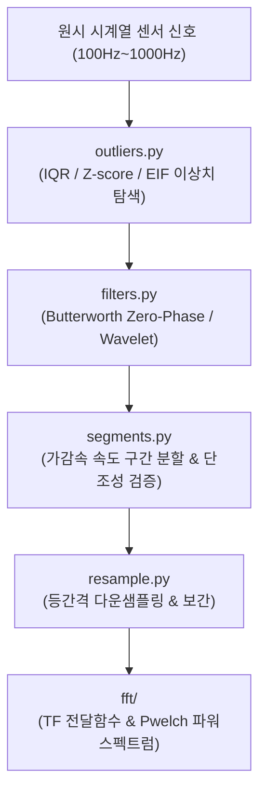

# 📖 signal_process 모듈 사전 (Domain Engineering Guide)

> ⚡ **Quick Jump**: [🎯 1. 설계 철학](#-1-설계-철학-및-모듈-개요) · [📚 2. 배경 지식](#-2-배경-지식-및-이론-지식-허브) · [🏗️ 3. 아키텍처](#️-3-아키텍처-및-데이터-파이프라인) · [🚀 4. 실전 워크플로우](#-4-실전-워크플로우-및-종합-스니펫) · [🛠️ 5. 트러블슈팅](#️-5-트러블슈팅-및-튜닝-노하우)

> [!ABSTRACT] 📶 도메인 개요
> 실차 주행 중 발생하는 고주파 진동 및 센서 노이즈를 위상 지연 없이 정제하는 **Zero-Phase 필터, 피크 가속도를 보존하는 1D 웨이블렛 디노이징, 가감속 속도 구간 분할(Segments) 및 FFT 주파수 스펙트럼 분석을 총괄하는 신호처리 엔지니어링 패키지**입니다.

---

## 🎯 1. 설계 철학 및 모듈 개요

### 1.1. 탄생 배경과 목적
* **기존 방식의 한계**: 단순 이동평균(Moving Average) 필터 사용 시 시계열 신호의 위상(Phase)이 뒤로 밀려 제동 시작점과 감속 피크 시점이 지연 왜곡됨. 노이즈 제거 시 급격한 제동 피크 $G$가 깎여 나가는 문제 발생.
* **해결 과제**: 양방향 필터링(`filtfilt`)을 통한 위상지연 제로화($\Delta \theta = 0$), 피크를 보존하는 Symlet/Daubechies 1D 웨이블렛 디노이징, 단조성 검사 기반 속도 구간 분할(`segments.py`).
* **핵심 가치**: 원시 센서 데이터의 물리적 진폭과 타이밍을 1ms 오차 이내로 보존하면서 고주파 노이즈 완벽 분리.

### 1.2. 아키텍처 설계 사상
* **도메인 격리 구조**: `post_process/`(시계열 필터, 정규화, 리샘플링, 이상치 탐지)와 `fft/`(주파수 전달함수 및 스펙트럼 분석)의 명확한 책임 분리.
* **비수치 메타데이터 보존**: 리샘플링(`resample.py`) 시 수치형 센서 신호 보간과 함께 텍스트/라벨 메타데이터가 손실되지 않도록 정합.

---

## 📚 2. 배경 지식 및 이론 (지식 허브)

> [!NOTE] 🧠 공학 이론 및 신호처리 위키 링크 (Knowledge Atomization)
> *신호처리 수학 이론 및 알고리즘은 `04_Resources`에 영구 보존되어 있습니다.*

* 📄 **Zero-Phase 필터링 이론**: [[10_Zero_Phase_필터링_및_위상지연_극복_공학|Zero-Phase 필터링 및 위상지연 극복 공학 (filtfilt 원리)]]
* 📄 **1D 웨이블렛 변환 수학**: [[20_1D_웨이블렛_변환_디노이징_및_피크_보존_수학|1D 웨이블렛 변환 디노이징 및 피크 보존 수학]]
* 📄 **적응형 KDE 알고리즘**: [[30_적응형_커널_밀도_추정_KDE_및_초고속_알고리즘|적응형 커널 밀도 추정 (KDE) 및 초고속 슬립 분석]]
* 📄 **다변량 센서 이상치 탐지**: [[40_다변량_센서_이상치_탐지_및_시계열_리샘플링_공학|다변량 센서 이상치 탐지 (EIF) 및 시계열 리샘플링]]

---

## 🏗️ 3. 아키텍처 및 데이터 파이프라인

### 3.1. 엔드-투-엔드 데이터 흐름도



### 3.2. 핵심 서브모듈 역할 분담표

| 서브모듈 파일명 | 담당 클래스 / 함수 | 핵심 책임 및 역할 |
| :--- | :--- | :--- |
| `filters.py` | `apply_filter`, `calc_wavelet_denoise` | Butterworth 저역통과 Zero-Phase 필터 및 1D 웨이블렛 디노이징 |
| `segments.py` | `find_speed_segments` | 가감속 시험 속도 대역(100-5km/h 등) 자동 분할 및 1ms 경계 보간 |
| `outliers.py` | `remove_outliers` | 통계적 임계치 및 연속 구간 기반 센서 노이즈/이상치 마스킹 |
| `resample.py` | `resample_timeseries` | 메타데이터를 보존하는 고속 시계열 리샘플링 및 보간 |
| `scaler.py` | `scale_series` | MinMax, Standard, Robust 정규화 변환기 |
| `extended_isolation_forest.py` | `ExtendedIsolationForest` | 다변량 센서 신호 고차원 이상치 탐지 |
| `fft/tf_estimate.py` | `tf_estimate` | 주파수 전달함수(Transfer Function) 추정 및 크기/위상 응답 산출 |

---

## 🚀 4. 실전 워크플로우 및 종합 스니펫

```python
"""
signal_process를 활용한 제동 가속도 노이즈 정제 및 구간 분할
"""
from pathlib import Path
import pandas as pd
from unoUtil.signal_process.post_process import (
    apply_filter,
    calc_wavelet_denoise,
    find_speed_segments,
)

# 1. 원시 계측 데이터 로드
df = pd.read_csv("data/raw_braking.csv")

# 2. 종가속도 신호에 Zero-Phase Butterworth 필터 적용 (위상지연 0)
df["FilteredAccel"] = apply_filter(
    df["LongitudinalAccel"], cutoff=5.0, sample_rate=100.0, filter_type="lowpass"
)

# 3. 급격한 감속 피크 보존을 위한 1D 웨이블렛 변환 디노이징
df["WaveletAccel"] = calc_wavelet_denoise(
    df["LongitudinalAccel"], wavelet="sym4", level=3
)

# 4. 제동 속도 구간 분할 (100km/h -> 5km/h 단조 감속 구간 추출)
segments = find_speed_segments(
    df, vel_col="Velocity", start_vel=100.0, end_vel=5.0, tolerance=0.5
)
valid_run_df = segments[0]  # 첫 번째 유효 제동 런
print(f"제동 구간 데이터 길이: {len(valid_run_df)} 샘플")
```

---

## 🛠️ 5. 트러블슈팅 및 튜닝 노하우

### 5.1. 필터 통과 후 신호 양 끝단 왜곡(Edge Effect) 발생 시
* **증상**: 시계열의 시작과 끝 샘플에서 필터 과도응답으로 인해 신호가 튀는 현상.
* **조치**: `apply_filter(pad_type='reflect')`를 지정하여 신호 경계를 대칭 반사 패딩 처리함으로써 에지 효과를 방어.

### 5.2. 속도 구간 분할 시 노이즈로 인한 단조성 실패
* **증상**: ABS 제동 맥동으로 인해 속도가 일시적으로 0.1km/h 상승하여 단조 감속 판정 탈락.
* **조치**: `find_speed_segments(allow_local_fluctuation=True, window=5)`를 활성화하여 국소 롤링 평활화 후 단조성 검사를 수행하도록 설정.
