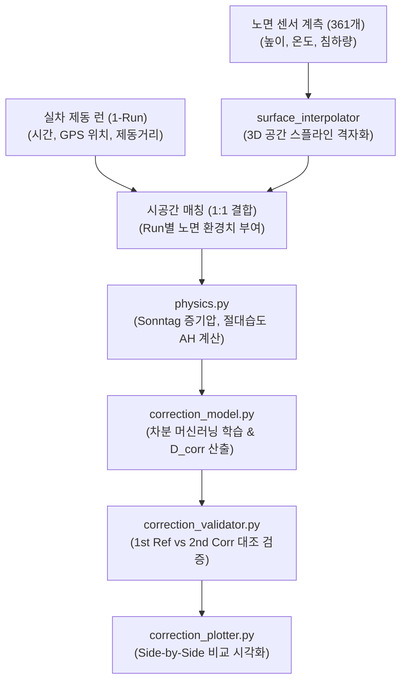

# 📖 snow_condition 모듈 사전 (Domain Engineering Guide)

> ⚡ **Quick Jump**: [🎯 1. 설계 철학](#-1-설계-철학-및-모듈-개요) · [📚 2. 배경 지식](#-2-배경-지식-및-이론-지식-허브) · [🏗️ 3. 아키텍처](#️-3-아키텍처-및-데이터-파이프라인) · [🚀 4. 실전 워크플로우](#-4-실전-워크플로우-및-종합-스니펫) · [🛠️ 5. 트러블슈팅](#️-5-트러블슈팅-및-튜닝-노하우)

> [!ABSTRACT] ❄️ 도메인 개요
> 자연 기상 상태에서 급변하는 눈(Snow) 트랙의 물리적 환경(눈 침하 깊이, 기온, 습도, 융해/재동결)을 계측하고, **타이어 고유의 스노우 제동 성능을 공정하게 복원·정규화하는 지능형 환경 보정 프레임워크**입니다.

---

## 🎯 1. 설계 철학 및 모듈 개요

### 1.1. 탄생 배경과 목적
* **기존 방식의 한계**: 노면 온도나 트랙 숙성도에 따라 동일 타이어도 제동 거리가 1~3m 이상 편차 발생. 콘트롤 타이어 단순 선형 보간은 비선형적인 설질 변화(압설, 습설, 얼음 크러스트)를 포착하지 못함.
* **해결 과제**: 361개 노면 센서 스냅샷 기반의 3D 시공간 격자 맵 구축 및 실차 1-Run 단위 결합, 머신러닝 차분 회귀($D_{\text{corr}} = D_{\text{raw}} - \Delta D_{\text{pred}}$)를 통한 순수 타이어 실력 복원.
* **핵심 가치**: 타이어 사양(컴파운드/패턴) 간 순위 보존도 100% 유지 및 잔차 분산 극소화.

### 1.2. 아키텍처 설계 사상
* **SSOT 데이터 관문 (`schema.py`)**: 47대 표준 컬럼 명세를 단일화하여 이기종 데이터 유입 시 `harmonize_snow_dataframe()`으로 즉시 정규화.
* **컴포지션 패턴 분할**: 연산(`SnowCorrectionModel`), 정량 검증(`SnowCorrectionValidator`), 시각화(`SnowCorrectionPlotter`)의 단일 책임 원칙(SRP) 확립.
* **다형성 모델 앙상블**: Random Forest, SVR, KNN, Ridge, 2D-KNN 슬로프 모델을 동일한 `.fit()` / `.predict()` 인터페이스로 교체 가능.

---

## 📚 2. 배경 지식 및 이론 (지식 허브)

> [!NOTE] 🧠 공학 이론 및 알고리즘 위키 링크 (Knowledge Atomization)
> *스노우 환경 보정에 필요한 물리 및 머신러닝 핵심 이론은 `04_Resources`에 영구 보존되어 있습니다.*

* 📄 **보정 알고리즘 총론**: [[30_Snow_제동성능보정_알고리즘|Snow 제동성능 보정 알고리즘 원리]]
* 📄 **디지털 트윈 아키텍처**: [[31_스노우_노면_디지털트윈_및_제동성능_보정_위키|스노우 노면 디지털 트윈 및 제동 성능 보정 종합 위키]]
* 📄 **기상·노면 인자 조합 비교 보고서**: [[25_2026_스노우_기상및노면인자별_보정모델_3종_통합종합비교보고서|스노우 기상 및 노면 인자별 보정모델 3종 통합 종합 비교보고서]]
* 📄 **머신러닝 SVR 이론**: [[32_서포트_벡터_머신_및_회귀(SVM_SVR)_원리와_하이퍼파라미터_가이드|SVR 회귀 원리 및 초평면 마진 최적화]]
* 📄 **눈 결정 및 물리역학**: [[10_눈_결정_형성과정_및_물리특성|눈 결정 형성과정과 성장 특성]]
* 📄 **설질 5대 변형 기작**: [[11_설질변화_유형_및_변형기작|5대 설질 변화 메커니즘 (압력, 융해-재동결, 습윤, 구조, 파괴)]]
* 📄 **눈 밀도 추정 모델**: [[20_눈_밀도_추정_방법론|다짐도 및 하중 기반 눈 밀도 수학 모델]]
* 📄 **선행 연구 논문 리뷰**: [[90_스노우_선행연구_논문_리뷰|글로벌 스노우 트랙 마찰 연구 선행 논문 요약]]

---

## 🏗️ 3. 아키텍처 및 데이터 파이프라인

### 3.1. 엔드-투-엔드 데이터 흐름도



### 3.2. 9대 코어 서브모듈 역할 분담표

| 파일명 | 담당 클래스 / 함수 | 핵심 책임 및 역할 |
| :--- | :--- | :--- |
| `schema.py` | `harmonize_snow_dataframe` | 47대 표준 컬럼 강제 및 이기종 데이터 정규화 |
| `preprocessor.py` | `preprocess_snow_data` | 시간-공간 결측치 보정 및 이상치 필터링 |
| `physics.py` | `calc_sonntag_vapor_pressure` | 온·습도 기반 Sonntag 절대습도($g/m^3$) 및 접지압 계산 |
| `surface_interpolator.py` | `SnowSurfaceInterpolator` | 3D 트랙 센서 공간 격자 보간 및 시공간 1-Run 결합 |
| `surface_animator.py` | `SnowSurfaceAnimator` | Plotly 기반 3차원 트랙 시계열 애니메이션 렌더러 |
| `correction_model.py` | `SnowCorrectionModel` | 6대 머신러닝 기반 환경 차분 예측 및 다중 스케일(`StandardScaler`) 자동 정규화 보정 산출 |
| `correction_validator.py` | `SnowCorrectionValidator` | 1st Ref 대비 2nd Raw/Corr 오차율 및 순위 보존도 산출 |
| `correction_plotter.py` | `SnowCorrectionPlotter` | Non-blocking 검증 산점도, 기상/노면 동적 축 스케일링 및 다중 모델 Side-by-Side 대조 차트 |
| `slope_model.py` | `SnowSlopeModel` | 센서가 부재한 과거 7개년 데이터 전담 2D-KNN/LOESS 공간 보정 |

---

## 🚀 4. 실전 워크플로우 및 종합 스니펫

```python
"""
snow_condition 원스톱 머신러닝 환경 보정 실행 파이프라인
"""
from pathlib import Path
import pandas as pd
from unoUtil.snow_condition import (
    harmonize_snow_dataframe,
    SnowSurfaceInterpolator,
    SnowCorrectionModel,
    SnowCorrectionValidator,
    SnowCorrectionPlotter,
)

# 1. 원천 데이터 로드 및 스키마 정규화
raw_df = pd.read_csv("data/snow_run_data.csv")
df = harmonize_snow_dataframe(raw_df)

# 2. 3D 노면 센서 보간 및 제동 런 결합
interpolator = SnowSurfaceInterpolator(grid_res=(100, 20))
merged_df = interpolator.fit_transform(df)

# 3. 환경 차분 머신러닝 보정 (노면 센서 보유 시 ['char_height', 'cd_test_ah'] / 기상 단독 시 ['cd_test_temp', 'cd_test_hum'])
model = SnowCorrectionModel(x_cols=["char_height", "cd_test_ah"], y_col="char_brk_dist")
df_diff = model.calc_difference_dataset(merged_df)
model.train_models(df_diff)
corrected_df = model.correct_dataframe(merged_df)

# 4. 정량 검증 (1st vs 2nd 세트 오차 개선율 산출)
df_comp = model.validator.calc_corrected_comparison_table(corrected_df)
summary = model.validator.calc_error_reduction_summary(df_comp)

# 5. Non-blocking 멀티 모델 대조 시각화
model.plot.scatter_restoration_comparison(
    corrected_df, save=Path("reports/snow_corr_scatter.png"), close=True
)
model.plot.correction_map_comparison(
    save=Path("reports/snow_corr_contour.png"), close=True
)
```

---

## 🛠️ 5. 트러블슈팅 및 튜닝 노하우

### 5.1. 노면 센서 결측 및 노이즈 발생 시
* **증상**: 트랙터 정비(Preparing) 직후 센서 음영 구역에서 침하량이 0 이하로 왜곡되는 현상.
* **조치**: `preprocessor.py`의 `offset_baseline_filter(threshold=0.0)`를 활성화하여 트랙터 통과 시점 전후 평균값 차이로 Offset을 자동 감산 처리.

### 5.2. 모델 과적합 및 외삽(Extrapolation) 방어
* **증상**: 학습 데이터 범위를 벗어난 극단적 외기온($<-25^\circ\text{C}$ 또는 $>0^\circ\text{C}$)에서 보정 거리가 발산.
* **조치**: `SnowCorrectionModel`의 트리 깊이 규제(`max_depth=3`, `min_samples_leaf=4`) 및 SVR 완만화 대역폭(`gamma=0.07`)을 기본 적용. 센서가 없는 과거 데이터셋에는 `SnowSlopeModel`을 적용하여 2D-KNN 러프 평활화로 전환.

### 5.3. 기상 인자 조합 시 열역학 다중공선성(VIF) 회피 및 다중 스케일 자동 정규화 (`v3.47`)
* **열역학 다중공선성(`VIF`) 주의**:
  * 기온($T$)과 절대습도($AH$)는 Sonntag 포화수증기압 방정식($AH \propto e_s(T) \cdot RH / T$)에 의해 동계 시험장 환경에서 피어슨 상관계수 $r = +0.970$ (**`VIF = 16.89`**)의 강한 다중공선성을 띠어 2차원 평면에서 1차원 직선 띠로 붕괴됩니다.
  * 따라서 **노면 센서가 없는 기상 단독 보정 시에는 반드시 `[cd_test_temp, cd_test_hum]` (`[기온 + 상대습도]`, `VIF = 2.53`) 조합을 사용**해야 열적 융해 효과($\Delta T$)와 대기 습윤도($\Delta RH$)를 독립 분리할 수 있습니다 (`Random Forest` 기준 물리 제동거리 `MAE = 0.495 m` [+43.6%], 시험타이어 지수 `MAE = 2.732 %p` [+20.6%] 달성).
  * 반면 **노면 계측 데이터 보유 시에는 직교성이 가장 높은 `[char_height, cd_test_ah]` (`[눌림량 + 절대습도]`, `VIF = 1.07`)** 조합이 차분 회귀 결정계수(`RF R² = 0.5913`, `SVR R² = 0.4580`) 및 `SVR` 복원력(`0.538 m`)에서 최적입니다.
* **다중 스케일 피처 자동 정규화 (`StandardScaler`)**:
  * `SnowCorrectionModel.train_models()`는 입력 피처 간 표준편차 스케일이 큰 조합($\max(\sigma_X) > 2.5$, 예: $\Delta T, \Delta RH \approx \pm 15$)이 감지되면 자동으로 `SVR`($\gamma_{\text{eff}} = 0.07 \times 1.28^2 \approx 0.1147$)과 `KNN Regressor`에 `StandardScaler` 파이프라인을 결합하여 거리 왜곡과 등고선 말림을 원천 차단합니다.

