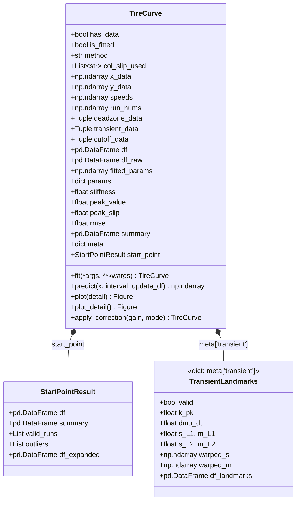

# 📖 tire_curve 모듈 사전 (TireCurve Domain Guide)

> ⚡ **Quick Jump**: [🎯 1. 개요 및 설계 철학](#-1-개요-및-설계-철학) · [🏛️ 2. 클래스 객체 구조](#️-2-tirecurve-클래스-객체-구조-및-데이터-저장-체계) · [⏱️ 3. 과도기 싱크 기준](#️-3-과도기-위상-동기화-기준-가속도-vs-슬립) · [🎯 4. 콘트롤 타이어 성능 보정](#-4-콘트롤-타이어-성능-보정-control-tire-correction-아키텍처) · [🚀 5. 실전 코드 스니펫](#-5-실전-파이썬-코드-스니펫) · [🔗 5. 관련 위키 링크](#-5-관련-위키-및-보고서-링크)

> [!ABSTRACT] 🎯 도메인 개요
> 실차 시험 계측 데이터(슬립율, 가속도, 제동력, 구동력)로부터 타이어의 고유 물리적 특성치(초기 강성 $K$, 피크 마찰계수 $D$, 최적 슬립 $\kappa_{\text{peak}}$, 마찰 빌드업 속도 $d\mu/dt$)를 도출하는 **단일 진실 공급원(SSOT) 도메인 파사드 클래스**입니다.  
> 휠 관성 지연 및 센서 양자화로 인한 초기 과도 응답($L0 \sim L3$)을 물리 랜드마크 기반으로 정합하고, 순수 정상 상태(Steady-State) 데이터만으로 비선형 Magic Formula 피팅을 완결합니다.

---

## 🎯 1. 개요 및 설계 철학

`TireCurve`(`unoUtil.curve_fit.tire_curve.cf_tire`)는 타이어 도메인의 복잡한 물리 현상을 캡슐화하여 `VTAccBrkTire` 분석기 및 `VTAccBrkProject` 시스템과 유기적으로 결합하는 도메인 총괄 클래스입니다.

1. **역할 분리 (Decoupling)**:
   - 데이터 추출 및 물리 랜드마크 분석(`TireCurve`)과 순수 수학적 비선형 회귀 최적화(`estimators/`)를 엄격히 분리.
2. **이원화 파이프라인 (Two-Stage Pipeline)**:
   - **과도기 구간 ($L0 \to L3$)**: 초기 탄성 강성($K_{\text{pk}}$) 및 시간축 마찰 응답 속도($d\mu/dt$) 산출에만 사용 후 본체 피팅에서 분리.
   - **정상 상태 구간 ($L3 \sim$)**: 순수 정상 마찰 데이터만으로 Pacejka Magic Formula 최적화를 수행하여 피팅 오차(RMSE)를 $18 \sim 24\%$ 절감.
3. **단일 진실 공급원 (SSOT)**:
   - 모든 제동(`brk`) 및 가속(`acc`) 타이어 커브 피팅 결과는 `TireCurve` 객체 내의 정형화된 프로퍼티 및 데이터프레임(`df`, `df_raw`, `params`, `summary`)을 통해 단일 창구로 제공됩니다.

---

## 🏛️ 2. TireCurve 클래스 객체 구조 및 데이터 저장 체계

`TireCurve` 객체(`cf`)는 로우 데이터(유효 산점도), 제외된 과도 구간 데이터, 피팅된 대표 곡선 테이블, 모델 파라미터를 아래와 같이 명확한 멤버 변수와 프로퍼티로 구분하여 저장합니다.

### 2.1. 클래스 아키텍처 다이어그램



### 2.2. 인스턴스 멤버 변수 상세 분류

#### 1) 로우 데이터 및 분리 데이터군 (Raw & Excluded Datasets)
| 멤버 변수 | 데이터 타입 | 설명 |
| :--- | :--- | :--- |
| **`cf.x_data`** | `np.ndarray` (1D) | 본체 피팅에 최종 투입된 **유효 슬립율($s$)** 배열 |
| **`cf.y_data`** | `np.ndarray` (1D) | 본체 피팅에 최종 투입된 **유효 가속도/마찰계수($\mu$)** 배열 (보정 게인 반영) |
| **`cf.df_raw`** | `pd.DataFrame` | 유효 계측 산점도 데이터프레임 (`columns: ['SlipRatio', 'AccForward']`) |
| **`cf.speeds`** | `np.ndarray` (1D) | 유효 산점도 각 데이터 포인트에 대응하는 **실시간 주행 차속 [km/h]** |
| **`cf.run_nums`** | `np.ndarray` (1D) | 유효 산점도 각 포인트가 속한 **시험 회차 번호 (`EffNum`)** |
| **`cf.deadzone_data`** | `Tuple[np.ndarray, np.ndarray]` | 관성 지연/센서 불감대로 제외된 **데드존 ($L0 \sim L1$)** `(slip, mu)` 데이터 |
| **`cf.transient_data`** | `Tuple[np.ndarray, np.ndarray]` | 초기 강성 추출 후 본체 피팅에서 분리된 **초반 과도 루프 ($L1 \sim L3$)** `(slip, mu)` |
| **`cf.cutoff_data`** | `Tuple[np.ndarray, np.ndarray, np.ndarray]` | 설정 속도 범위 밖으로 분리된 **차속 컷오프** `(slip, mu, speed)` 데이터 |
| **`cf._y_data_raw`** | `np.ndarray` | 콘트롤 보정 적용 전의 원본(Raw) 계측 가속도 스냅샷 (멱등성 보장) |
| **`cf._transient_raw`**| `Tuple[np.ndarray, np.ndarray]` | 콘트롤 보정 적용 전의 원본 과도 루프 데이터 스냅샷 |

#### 2) 피팅 결과 및 모델 파라미터군 (Fitted Results & Parameters)
| 프로퍼티 / 변수 | 데이터 타입 | 설명 |
| :--- | :--- | :--- |
| **`cf.df`** | `pd.DataFrame` | **피팅된 대표 곡선 테이블** (`['SlipRatio', 'AccForward']`, 기본 $0.0 \sim 1.0$, 간격 $0.005$) |
| **`cf.fitted_params`** | `np.ndarray` (1D) | 추정된 Magic Formula 파라미터 배열 `[B, C, D, E, Sh, Sv]` |
| **`cf.params`** | `Dict[str, float]` | 모델 파라미터 딕셔너리 (`{'B', 'C', 'D', 'E', 'Sh', 'Sv'}`) |
| **`cf.B`, `cf.C`, `cf.D`, `cf.E`** | `float` | Magic Formula 개별 계수 (`D`는 최대 피크 $\mu_{\text{pk}}$) |
| **`cf.stiffness`** | `float` | 원점 초기 탄성 강성 기울기 ($K = B \times C \times D = \left.\frac{d\mu}{ds}\right|_{s=0}$) |
| **`cf.peak_value`** | `float` | 모델의 최대 피크 마찰계수 ($\mu_{\text{max}}$) |
| **`cf.peak_slip`** | `float` | 최대 마찰계수가 발생하는 슬립율 위치 ($\kappa_{\text{peak}}$) |
| **`cf.rmse`** | `float` | 피팅 곡선과 유효 계측 데이터 간의 평균 제곱근 오차 (RMSE) |
| **`cf.summary`** | `pd.DataFrame` | 주요 물리 지표 1행 요약 테이블 (`cf_peak_mu`, `cf_stiffness`, `cf_rmse` 등) |
| **`cf.result`** | `Any` | 하위 수학 추정기(`LeastSquaresResult`, `CombinerEstimator` 등)의 상세 결과 객체 |

#### 3) 메타데이터 및 상태 관리군 (Metadata & States)
| 멤버 변수 | 데이터 타입 | 설명 |
| :--- | :--- | :--- |
| **`cf.has_data`** | `bool` | 유효 데이터 로드 및 피팅 수행 여부 |
| **`cf.is_fitted`** | `bool` | 파라미터 추정 및 피팅 성공 완료 여부 |
| **`cf.col_slip_used`** | `List[str]` | 슬립률 계산에 채택된 휠 채널 리스트 (예: `['SRFL', 'SRFR']`) |
| **`cf.meta['transient']`** | `Dict[str, Any]` | 과도기 위상 정합 상세 결과 (L1/L2 대표 좌표, $K_{\text{pk}}$, $d\mu/dt$, 대표 루프 배열) |
| **`cf.start_point`** | `StartPointResult` | 회차별 시작점 복원 상세 요약 객체 (`.df`, `.summary`, `.valid_runs`, `.outliers`) |
| **`cf.corr_gain`** | `float` | 적용된 콘트롤 타이어 성능 보정 배율 (기본 $1.0$) |
| **`cf.corr_mode`** | `str \| None` | 보정 모드 (`'mean'`, `'curve'`, `'manual'`, `None`) |

---

## ⏱️ 3. 과도기 위상 동기화 기준: 가속도 vs 슬립?

> [!QUESTION] 🤔 과도기 싱크를 맞출 때의 기준 신호는 무엇인가?
> **결론: 단일 신호 고정이 아니라, 물리적 현상(관성 지연 $\to$ 타이어 물림 $\to$ 제어 개입)에 따라 슬립과 가속도의 극점(Peak)을 교차(Cross-Signal) 기준으로 맞춥니다.**

```
시간 경과 ────────────────────────────────────────────────────────►
[L0: 슬립 바닥] ──► [L1: 슬립 피크] ──► [L2: 감속도 피크] ──► [L3: 감속도 저점]
 (기준: 슬립 s)       (기준: max s)        (기준: max μ)        (기준: min μ)
   답력 직후           차체 관성 지연       타이어 바이트         ABS 1차 감압
```

### 3.1. 시간축($t$) 단순 평균의 문제점
* 운전자의 페달 조작 시점 및 답력 속도 차이로 인해 회차별로 **$\sigma \approx 12 \sim 30\,\text{ms}$의 타이밍 지터(Timing Jitter)**가 발생합니다.
* 시간축($t$)만으로 단순 평균을 내면 슬립 피크와 감속도 피크의 시점이 서로 어긋나 **피크가 평탄화(Phase Blur/Cancellation)**되며, 타이어가 노면을 꽉 물었을 때의 최대 초기 강성을 심각하게 과소평가하게 됩니다.

### 3.2. 제동 (Braking) 4대 랜드마크 교차 판정 기준
| 랜드마크 | 명칭 | **판정 기준 신호** | 상세 물리 조건 및 알고리즘 판정 기준 |
| :---: | :---: | :---: | :--- |
| **L0** | True Slip Onset | **슬립 (Slip)** | 페달 답력 직후 전륜 휠 슬립이 본격 급증하기 직전의 바닥점 ($s \le 0.035$). 시계열 $t=0$ 기준점. |
| **L1** | 1st Slip Surge Peak | **슬립 극대 ($\max s$)** | 휠 브레이크 압력으로 휠이 먼저 감속되어 도달한 **1차 슬립 극대점**. 차체 관성 지연으로 **감속도는 아직 $0.09\,\text{g}$ 이하로 바닥**에 머물러 감속도로는 탐지 불가. |
| **L2** | 1st Decel Peak (Tire Bite) | **감속도 극대 ($\max \mu$)** | 서스펜션 하중 이동이 완료되며 타이어가 노면을 최대로 움켜쥔 **1차 감속도 피크점**. 휠 슬립은 역으로 회복($s \approx 0.10$). **초기 강성 $K_{\text{pk}} = \mu_{L2} / s_{L2}$ 산출 기준점**. |
| **L3** | 1차 ABS 안착 저점 | **감속도 극소 ($\min \mu$)** | 휠 락을 방지하기 위해 ABS 모듈레이터가 1차 감압 밸브를 열어 감속도가 일시 하강한 극소점. 과도기 종료 및 정상 상태 진입 경계. |

### 3.3. 가속 (Acceleration) 4대 랜드마크 교차 판정 기준
| 랜드마크 | 명칭 | **판정 기준 신호** | 상세 물리 조건 및 알고리즘 판정 기준 |
| :---: | :---: | :---: | :--- |
| **L0** | Launch Onset | **가속도 / Jerk** | 스로틀 전개 직후 구동 토크 전달로 차체 종가속도가 들뜨기 시작하는 시작점 (`onset_idx`). |
| **L1** | Sensor Wake-up | **슬립 & 차속** | 저속 CAN 휠속 센서 양자화 불감대($v < 3\,\text{km/h}$) 통과 후 양(+)의 슬립 램프가 시작되는 점 ($s > 0.005$). |
| **L2** | Traction Bite Knee | **슬립 변화율 ($ds/dt$)** | 순수 탄성 변형을 넘어 휠스핀으로 급격히 이탈($ds/dt > 28\%/\text{s}$, $d\omega - dv > 0$)하기 직전의 **물리적 무릎점(Knee)**. |
| **L3** | TCS / Spin Entry | **슬립 (Slip)** | L2 이후 본격 휠스핀 및 TCS 제어로 전이되는 과도기 종료점. |

### 3.4. 실측 데이터 기반 종합 진단 그래프
![[_attachments/02_Projects/회사_업무/20_unoUtil_모듈개발/10_도메인_지식_사전/tire_curve_사전/story_fig10_transient_sync_criteria.png]]
*(a) 시간축 단일 런 신호 지연 · (b) 멀티 런 타이밍 지터 · (c) 제동 $s-\mu$ 위상 정합 대표 루프 및 $K_{\text{pk}}$ · (d) 가속 Onset 및 트랙션 무릎점*

---

---

## 🎯 4. 콘트롤 타이어 성능 보정 (Control Tire Correction) 아키텍처

> [!TIP] 💡 왜 커브 피팅 이후에 콘트롤 타이어 보정이 필수적인가?
> 실차 제동/가속 시험은 아침부터 오후까지 수 시간에 걸쳐 진행되므로, 기온 변화·노면 눈 다짐·마찰계수 저하로 인한 **노면 드리프트(Surface Drift)**가 필연적으로 발생합니다.  
> 따라서 기준 타이어(Control Tire: C1, C2)의 성능 추이를 추적하여 모든 평가 타이어(T1, T2, T3)의 마찰 곡선과 물리 특성치를 공정하게 보정하는 **후처리 스케일링 엔진**이 필수적입니다.

### 4.1. 비선형 Magic Formula의 콘트롤 스케일링 동형성 법칙 (Scaling Isomorphism)
Pacejka Magic Formula 수식의 수학적 특성상, 마찰계수 보정 게인( = G_i$)을 곱하는 것은 **피크 계수($)와 수직 이동 계수($)를  스케일링하는 것과 완벽히 동형(Isomorphic)**입니다:

y_{\text{corr}}(s) = g \cdot y_{\text{raw}}(s) = (g \cdot D) \sin\Big(C \arctan\big(B s - E(B s - \arctan(B s))\big)\Big) + (g \cdot S_v)

* **초기 탄성 강성 보정**: {\text{corr}} = B \times C \times (g \cdot D) = \mathbf{g \cdot K_{\text{raw}}}$ (자동으로  스케일링)
* **피크 마찰계수 보정**: {\text{corr}} = \mathbf{g \cdot D_{\text{raw}}}$
* **최적 슬립률 위치 보존**: 형상 계수 , C, E 보존되므로 피크 발생 슬립 위치($\kappa_{\text{peak}}$)는 왜곡 없이 순수하게 유지됨.

### 4.2. 스냅샷 기반 멱등성 (Idempotency) 보장
보정 모드를 변경('mean' \to 'curve' \to None)하거나 반복 호출할 때 누적 오차가 발생하는 것을 원천 차단하기 위해 **스냅샷 복원 아키텍처**를 적용합니다:
* 최초 보정 호출 시 _save_raw_snapshot()을 통해 원본 산점도(_y_data_raw), 과도 루프(_transient_raw), 원본 파라미터(_fitted_params_raw)를 동결 보존.
* 보정 시에는 항상 원본 스냅샷에  곱하며, gain=1.0 또는 mode=None 전달 시 완전한 원본(Raw) 피팅 상태로 즉시 복원.

### 4.3. 산점도 및 과도 랜드마크 지표 일괄 동기화
단순히 피팅 곡선만 올리는 것이 아니라, 	c.apply_correction(gain=g) 호출 시 다음 모든 속성이 단일 트랜잭션으로  동기화됩니다:
* 	c.y_data = tc._y_data_raw * g (본체 유효 산점도)
* 	c.deadzone_data = (x, y * g) (관성 데드존 데이터)
* 	c.transient_data = (x, y * g) (과도 루프 데이터)
* 	c.cutoff_data = (x, y * g, vel) (속도 컷오프 데이터)
* 	c.meta['transient']['m_L1'] * g, m_L2 * g, k_pk * g, dmu_dt * g (과도 랜드마크 물리값)

### 4.4. 프로젝트 레벨 일괄 적용 (pply_tire_curve_control_correction)
* **corr='mean'**: 콘트롤 타이어들의 평균 가속도 기준 단일 배율 보정.
* **corr='curve'**: 시험 순서(시간 경과)에 따른 콘트롤 타이어의 2차 다항식/선형 성능 드리프트 추세선을 추적하여 런별 맞춤형 게인($) 적용.
* **단일 Control (100%) 기준선 통합**: 분산되어 있던 C1과 C2를 단일한 Control 기준선으로 결합하고, 평가 타이어(T1, T2)는 콘트롤 대비 상대 지수(Index: %)로 직관화.

![[_attachments/02_Projects/회사_업무/20_unoUtil_모듈개발/10_도메인_지식_사전/tire_curve_사전/story_fig5b_brk_project_corr_curve.png]]
*노면 드리프트 보정 완료: 분산된 C1, C2가 단일 Control(100%)로 통합되고 평가 타이어(T1, T2, T3)가 공정 비교됨*

---

## 🚀 5. 실전 파이썬 코드 스니펫

### 4.1. TireCurve 피팅 및 로우/피팅 데이터 접근
```python
from unoUtil.curve_fit import TireCurve

# 1. TireCurve 피팅 실행 (초기 과도 분리 활성화)
tc = TireCurve(tire=tire, method="constrained_mf").fit(filter_transient=True)

# 2. 로우 데이터 및 분리된 과도 데이터 접근
x_valid, y_valid = tc.x_data, tc.y_data         # 본체 피팅에 투입된 순수 정상 데이터
df_scatter       = tc.df_raw                    # SlipRatio, AccForward DataFrame
s_dz, mu_dz      = tc.deadzone_data             # L0~L1 관성 불감대 데이터
s_tr, mu_tr      = tc.transient_data            # L1~L3 초반 과도 루프 데이터

# 3. 피팅된 모델 파라미터 및 대표 곡선 조회
print(f"초기 강성 K: {tc.stiffness:.2f}")
print(f"최대 피크 마찰 D: {tc.peak_value:.3f} (@ 슬립 {tc.peak_slip:.3f})")
print(f"피팅 RMSE: {tc.rmse:.4f}")
print("MF 파라미터:", tc.params)                # {'B', 'C', 'D', 'E', 'Sh', 'Sv'}

df_curve = tc.df                               # 0.0~1.0 대표 곡선 테이블 (interval=0.005)

# 4. 임의 슬립율 예측 (predict)
y_at_15 = tc.predict(0.15)                     # 단일 슬립율 예측값
y_grid  = tc.predict([0.0, 0.05, 0.10, 0.20])  # 배열 슬립율 예측값
```

### 4.2. 과도기 위상 정합 메타데이터 조회
```python
trans = tc.meta.get("transient", {})
if trans.get("valid"):
    print(f"L1 대표점 (슬립 피크): s={trans['s_L1']:.3f}, μ={trans['m_L1']:.2f}g")
    print(f"L2 바이트 대표점: s={trans['s_L2']:.3f}, μ={trans['m_L2']:.2f}g")
    print(f"확정 초기 강성 K_pk: {trans['k_pk']:.2f}")
    print(f"마찰 빌드업 속도 dμ/dt: {trans['dmu_dt']:.2f} g/s")

    # 위상 정합 대표 루프 경로 배열
    warped_s = trans["warped_s"]
    warped_m = trans["warped_m"]
```

---

## 🔗 5. 관련 위키 및 보고서 링크

* 📖 [[curve_fit_사전|curve_fit 모듈 사전 (추정기 및 에르미트 합성)]]
* 📖 [[vt_acc_brk_사전|VTAccBrk 도메인 사전]]
* 📄 [[10_휠속도_시간지연_보정_및_타이어_커브피팅_종합보고서|휠속도 시간지연 보정 및 타이어 커브피팅 종합보고서]]
* 📄 [[20_타이어_커브피팅_전면_개발스토리_및_공학검증보고서|타이어 커브피팅 전면 개발스토리 및 공학검증보고서]]
* 📄 [[30_가속_시험_타이어_커브피팅_검증보고서|가속 시험 타이어 커브피팅 검증보고서]]
* 📄 [[40_NoABS_실측_VBB_타이어_커브피팅_검증보고서|NoABS 실측 VBB 타이어 커브피팅 검증보고서]]

---

## 🧭 6. 8단계 통합 엔지니어링 파이프라인 및 실차 데이터 4대 한계 극복 (v3.61 신규 확립)

```
[PART 1 : 신호 전처리 및 과도 위상 정렬]
[Stage 1: 원시신호 & 휠속가드] ➔ [Stage 2: 센서지연 보상 & 슬립선별] ➔ [Stage 3: Onset 복원 & 이상회차 배제] ➔ [Stage 4: 4대 과도 랜드마크 정합]
                                                                                                          │ (K_pk 확정)
[PART 2 : 데이터 정제 및 구속조건 MF 피팅]                                                                  ▼
[Stage 5: 3단 데이터 분리] ➔ [Stage 6: 슬립구간 밀도 역가중치] ➔ [Stage 7: 구속조건 MF (B=K/CD)] ➔ [Stage 8: 6-파라미터 복원 & 출력]
```

### 🚨 실차 계측 Raw 데이터의 4대 태생적 한계 및 극복 메커니즘
1. **슬립-마찰 산점도 왜곡**:
   - 차체 관성 지연 데드존($L0 \sim L1$, 휠만 잠기고 감속도 $0\text{g}$) 및 서스펜션 하중이동 과도 루프($L1 \sim L3$) ➔ **3단 데이터 분리(`deadzone_data`, `transient_data`)로 본체 피팅 왜곡 원천 차단**
   - ABS 제어 슬립($0.15 \sim 0.25$) 80% 편중 ➔ **구간 밀도 역가중치($w_i \propto 1/\text{count}^{0.65}$)로 고슬립 처짐 극복**
2. **센서 고주파 노이즈 구름**:
   - GPS 차속 100Hz 수치미분으로 인한 가속도 상하 $\pm 0.15\text{g}$ 노이즈 산포 ➔ **0.15초 영위상 양방향 이동평균(Zero-Phase Filter) 정제**
3. **다중 런(Multi-Run) 조작 타이밍 지터**:
   - 운전자 페달 전개 시차($\sigma \approx 20 \sim 30\text{ms}$)로 인해 회차별 피크 시점이 분산됨 ➔ **단순 시간축 평균 시 피크가 15~25% 뭉개지는 위상 상쇄(Phase Blur)를 극점 교차 랜드마크($L1 \to L2$) 동기화로 극복**
4. **시간 경과에 따른 노면 마찰 드리프트**:
   - 야외 스노우 시험 중 기온/일사/눈깎임으로 인한 마찰력 변화($C1 \ne C2$) ➔ **콘트롤 타이어 선형 보간 게인($G_i = \bar{\mu}_{\text{ctrl}} / \mu_{\text{ctrl}}(t_i)$) 적용으로 단일 기준선 정규화**

### 📁 핵심 산출물 아티팩트
* **가속/제동 통합 기술 백서**: `tire_curve/tire_curve_pipeline_and_real_data_issues.md`
* **발표/보고용 Chevron 화살표 PPTX**: `tire_curve/tire_curve_pipeline_flowchart.pptx`
* **실측 로우 데이터 4분할 종합 진단 차트**: `tire_curve/fig/real_vehicle_raw_data_limitations.png` (코드: `plot_raw_data_limitations.py`)
