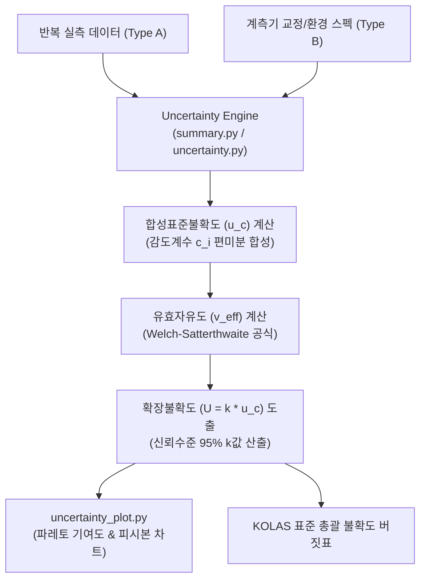

# 📖 uncertainty 모듈 사전 (Domain Engineering Guide)

> ⚡ **Quick Jump**: [🎯 1. 설계 철학](#-1-설계-철학-및-모듈-개요) · [📚 2. 배경 지식](#-2-배경-지식-및-이론-지식-허브) · [🏗️ 3. 아키텍처](#️-3-아키텍처-및-데이터-파이프라인) · [🚀 4. 실전 워크플로우](#-4-실전-워크플로우-및-종합-스니펫) · [🛠️ 5. 트러블슈팅](#️-5-트러블슈팅-및-튜닝-노하우)

> [!ABSTRACT] 📊 도메인 개요
> ISO/IEC Guide 98-3(GUM) 및 KOLAS 공인 시험 규격을 완벽히 충족하도록, 타이어 회전저항(RR) 및 실차 제동 시험의 **Type A(반복성) 및 Type B(장비, 환경, 교정) 불확도 요인을 감도계수(합성)와 유효자유도(Welch-Satterthwaite) 기반으로 자동 산출하는 측정불확도 공학 패키지**입니다.

---

## 🎯 1. 설계 철학 및 모듈 개요

### 1.1. 탄생 배경과 목적
* **기존 방식의 한계**: 측정불확도 산출 시 수동 엑셀 수식 작성으로 인한 계산 실수 빈발, 시험원마다 포함인자($k$) 산정 기준 불일치, KOLAS 인증 심사 시 보고서 작성에 수일 소요.
* **해결 과제**: 시험 데이터프레임 입력 시 합성표준불확도($u_c$) 및 확장불확도($U$) 원클릭 자동 산정, 피시본(Fishbone) 및 파레토 기여도 시각화, 표준 성적서 자동 발행.
* **핵심 가치**: 복잡한 편미분 감도계수 연산의 자동화 및 공인 시험 규격 100% 무결성 보장.

### 1.2. 아키텍처 설계 사상
* **선언적 불확도 버짓 (Uncertainty Budget)**: 장비 스펙 및 환경 요인을 딕셔너리 형태로 선언하면 엔진이 자동 파싱하여 GUM 표준 계산 수행.
* **비차단 시각화**: 기여도 파레토 차트 및 불확도 타원 다이어그램을 Non-blocking 방식으로 디스크 자동 저장.

---

## 📚 2. 배경 지식 및 이론 (지식 허브)

> [!NOTE] 🧠 측정불확도 수학적 유도 및 표준 핸드북 링크 (Knowledge Atomization)
> *ISO GUM 완벽 수학 유도식 및 회전저항 평가 지침은 `04_Resources`에 영구 보존되어 있습니다.*

* 📄 **측정불확도 수학적 유도**: [[10_측정불확도_완벽_이론_및_수학적_유도_가이드|측정불확도 완벽 이론 및 수학적 유도 가이드 (ISO GUM)]]
* 📄 **타이어 RR 불확도 핸드북**: [[11_타이어_RR_측정_불확도_평가_마스터_가이드_및_통계_핸드북|타이어 RR 측정 불확도 평가 마스터 가이드 & 통계 핸드북]]
* 📄 **회전저항 산출 기술 보고서**: [[20_타이어_회전저항_RR_측정_불확도_산출_기술_보고서|타이어 회전저항(RR) 측정 불확도 산출 기술 보고서]]
* 📄 **불확도 자동 평가 엔진**: [[30_측정불확도_자동_평가_엔진_아키텍처_및_사용_가이드|측정불확도 자동 평가 엔진 아키텍처 및 사용 가이드]]

---

## 🏗️ 3. 아키텍처 및 데이터 파이프라인

### 3.1. 엔드-투-엔드 데이터 흐름도



### 3.2. 핵심 서브모듈 역할 분담표

| 서브모듈 파일명 | 담당 클래스 / 함수 | 핵심 책임 및 역할 |
| :--- | :--- | :--- |
| `uncertainty.py` | `Uncertainty` | ISO GUM 기반 Type A/B 불확도 합성 및 확장불확도 총괄 계산 엔진 |
| `uncertainty_plot.py`| `UncertaintyPlot` | 요인별 기여도 파레토 차트, 피시본 원인결과도 시각화 |
| `summary.py` | `get_statistics_df` | 10대 기본 기술통계 요약 (평균, 표준편차, 왜도, 첨도, 신뢰구간 등) |

---

## 🚀 4. 실전 워크플로우 및 종합 스니펫

```python
"""
Uncertainty 엔진을 활용한 타이어 회전저항(RR) 확장불확도 산정
"""
from pathlib import Path
import numpy as np
from unoUtil.statistics.uncertainty import Uncertainty, UncertaintyPlot

# 1. 반복 시험 실측 데이터 (Type A)
rr_measured = np.array([6.42, 6.45, 6.41, 6.44, 6.43])  # 단위: kg/t

# 2. Type B 요인 버짓 명세 (로드셀 교정, 드럼 속도, 온도 센서 오차)
type_b_budget = {
    "load_cell_calibration": {"value": 0.02, "distribution": "normal", "k": 2.0},
    "drum_speed_resolution": {"value": 0.01, "distribution": "rectangular"},
    "ambient_temp_sensor":   {"value": 0.015, "distribution": "triangular"},
}

# 3. 불확도 평가 엔진 실행
engine = Uncertainty(data=rr_measured, budget=type_b_budget)
result = engine.calculate()

print(f"측정 평균값: {result.mean:.3f} kg/t")
print(f"합성표준불확도 (u_c): {result.u_c:.4f} kg/t")
print(f"유효자유도 (v_eff): {result.v_eff:.1f}")
print(f"확장불확도 (U, 95%): {result.expanded_u:.4f} kg/t (k={result.k:.2f})")

# 4. 불확도 요인 기여도 파레토 차트 시각화
plotter = UncertaintyPlot(result)
fig, ax = plotter.pareto_chart(
    save=Path("reports/rr_uncertainty_pareto.png"), close=True
)
```

---

## 🛠️ 5. 트러블슈팅 및 튜닝 노하우

### 5.1. 유효자유도 계산 시 제로 분모(Zero Division) 오류
* **증상**: Type B 요인의 자유도가 무한대($\infty$)로 취급될 때 Welch-Satterthwaite 분모가 0이 되는 현상.
* **조치**: `Uncertainty(dof_inf_threshold=1e6)`를 적용하여 무한대 자유도 요인은 분모 역수 연산에서 0으로 안전 수렴하도록 처리.

### 5.2. 비선형 감도계수 산출 필요 시
* **증상**: 환경 변수가 결과치에 2차 이상의 비선형 함수로 작용하여 단순 편미분이 어려운 경우.
* **조치**: `Uncertainty(numerical_gradient=True, delta=1e-5)` 옵션을 주어 수치 미분 방식으로 국소 감도계수를 자동 계산.
