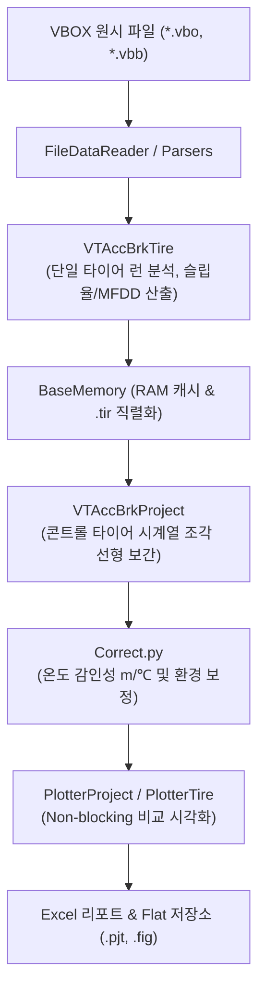

# 📖 vt_acc_brk 모듈 사전 (Domain Engineering Guide)

> ⚡ **Quick Jump**: [🎯 1. 설계 철학](#-1-설계-철학-및-모듈-개요) · [📚 2. 배경 지식](#-2-배경-지식-및-이론-지식-허브) · [🏗️ 3. 아키텍처](#️-3-아키텍처-및-데이터-파이프라인) · [🚀 4. 실전 워크플로우](#-4-실전-워크플로우-및-종합-스니펫) · [🛠️ 5. 트러블슈팅](#️-5-트러블슈팅-및-튜닝-노하우)

> [!ABSTRACT] 🏎️ 도메인 개요
> 실차 주행 시험에서 계측된 VBOX/Dewesoft 시계열 데이터로부터 가감속 및 제동 거동(MFDD, 슬립율, 제동거리, 응답시간)을 정밀 추출하고, **콘트롤 타이어 시계열 선형 보간 및 환경 보정을 통해 타이어 순수 성능 지수를 자동 산출하는 핵심 엔진**입니다.

---

## 🎯 1. 설계 철학 및 모듈 개요

### 1.1. 탄생 배경과 목적
* **기존 방식의 한계**: 수동 엑셀 분석 시 작업자마다 제동 시작점(트리거) 기준이 달라 수 미터의 오차 발생. 평가 중간 노면 온도 변화($\text{m}/^\circ\text{C}$)와 마찰계수 변화에 따른 왜곡 보정 체계 부재.
* **해결 과제**: 브레이크 시작점 자동 탐지(`find_brake_start_point`), 13대 물리 연산 표준화, 콘트롤 타이어 시계열 선형 보간 엔진 통합.
* **핵심 가치**: 단일 타이어 분석(`tire`) $\to$ 프로젝트 취합(`project`) $\to$ 원스톱 자동화 배치(`vt_acc_brk`) 3단계 계층 구조 및 Flat 단일 계층 저장소 정합.

### 1.2. 아키텍처 설계 사상
* **Single Stem Law (단일 식별자 불변 원칙)**: 타이어 객체 식별자(`[req]_[surface]_[item]_[cond]_[vel_tag]_{set}`)가 `.tir` 파일명, 차트 타이틀, 저장 이미지명과 100% 일치하도록 보장.
* **인메모리 프록시 캐싱 (`BaseMemory`)**: 대용량 실차 시계열 데이터를 딕셔너리 및 슬림 피클링으로 관리하여 반복 호출 시 디스크 I/O 병목 제거.
* **No Redundant Prefix**: 시각화 플로터(`PlotterTire`, `PlotterProject`) 메서드에서 중복 동사를 제거하여 `plotter.accbrk()`, `plotter.compare_braking()` 형태로 직관적 API 구축.

---

## 📚 2. 배경 지식 및 이론 (지식 허브)

> [!NOTE] 🧠 공학 이론 및 알고리즘 위키 링크 (Knowledge Atomization)
> *제동 동역학 및 보정 이론은 `04_Resources`에 완결된 단일 백서로 구축되어 있습니다.*

* 📄 **실차 가감속 종합 백서**: [[30_실차_가감속_성능변화_분석_및_보정_시스템|실차 가감속 성능변화 분석 및 보정 시스템 (마스터 백서)]]
* 📄 **제동 시작점 자동 탐지**: [[31_실차_제동_시작점_자동_탐지_및_과도응답_슬립_복원_공학|브레이크 시작점 노이즈 방어 및 슬립율 복원 공학]]
* 📄 **차량 제동 동역학**: [[10_차량_제동_동역학_시뮬레이션|타이어-노면 마찰 및 하중 이동 제동 동역학]]
* 📄 **노면온도 감인성 분석**: [[11_노면_온도와_타이어_제동_상관관계|노면 온도와 타이어 제동 거리 상관관계 (m/℃)]]
* 📄 **마찰계수 상관관계**: [[12_차량_시스템_제동성능과_마찰계수_상관관계|차량 시스템 제동성능과 마찰계수 상관관계]]
* 📄 **ABS 유압 제어 메커니즘**: [[20_ABS_로직_및_3단계_유압제어_분석|ABS 3단계 유압 제어 및 압력 맥동 분석]]
* 📄 **좌표계 변환 역학**: [[10_차량동역학_측정점_기준점_운동역학_변환|차량 계측점 기준점 동역학 변환]]
* 📄 **인메모리 캐싱 패턴**: [[30_대용량_시계열_인메모리_프록시_및_비파괴_캐싱_패턴|대용량 시계열 인메모리 프록시 아키텍처]]
* 📄 **표준 네이밍 기술 백서**: [[50_vt_acc_brk_표준_네이밍_규칙_및_저장_구조|가감속/제동 Flat 네이밍 규칙 및 저장 구조]]

---

## 🏗️ 3. 아키텍처 및 데이터 파이프라인

### 3.1. 엔드-투-엔드 데이터 흐름도



### 3.2. 핵심 서브모듈 역할 분담표

| 서브모듈 파일명 | 담당 클래스 / 함수 | 핵심 책임 및 역할 |
| :--- | :--- | :--- |
| `vt_acc_brk.py` | `VTAccBrk` | 전체 프로젝트 일괄 배치 및 최상위 오케스트레이션 |
| `vt_acc_brk_tire.py` | `VTAccBrkTire` | 단일 타이어 런 분할, 제동 시작점 검출 및 런별 지표 집계 |
| `vt_acc_brk_project.py`| `VTAccBrkProject` | 다중 타이어 취합, 콘트롤 타이어 시계열 선형 보간 및 성능지수 산출 |
| `correct.py` | `Correct` | 노면온도 감인성(m/℃) 및 기상/노면 외생 변수 보정 |
| `base_memory.py` | `BaseMemory` | 대용량 시계열 RAM 프록시 및 비파괴 슬림 피클링 관리 |
| `func_acc_brk.py` | `find_brake_start_point` 등 | 13대 핵심 물리 수식 (MFDD, 슬립율, 제동에너지, 감속도 등) |
| `plotter_tire.py` | `PlotterTire` | 단일 타이어 런 산점도, 감속도 프로파일, 슬립 곡선 시각화 |
| `plotter_project.py`| `PlotterProject` | 프로젝트 시험 간 순위 비교, 콘트롤 시계열 추이 바 차트 |
| `analyzers/` (6대 서브)| `AnAcceleration` 등 | 가속대역, 감속응답, 슬립PDF, Mu-Drop, 왜도, 구간속도 전문 분석 |

---

## 🚀 4. 실전 워크플로우 및 종합 스니펫

```python
"""
vt_acc_brk 가감속/제동 프로젝트 원스톱 실행 스크립트
"""
from pathlib import Path
from unoUtil.vehicle.acc_brk import (
    VTAccBrk,
    VTAccBrkProject,
    PlotterProject,
)

# 1. 가감속/제동 마스터 객체 초기화
pjt_dir = Path("D:/test_data/acc_brk/pjt_bmw320_mock")
runner = VTAccBrk(target_dir=pjt_dir, vel_range=[100, 5])

# 2. 프로젝트 일괄 로드 및 콘트롤 타이어 선형 보간 실행
project: VTAccBrkProject = runner.run()

# 3. 보정 성능 결과 요약 데이터프레임 추출
summary_df = project.get_statistics_df()
print(summary_df[["TireName", "MeanDistance", "CorrectedDistance", "RelativeIndex"]])

# 4. 프로젝트 비교 시각화 차트 자동 저장 (Non-blocking)
plotter = PlotterProject(project)
fig, ax = plotter.compare_braking(
    save=pjt_dir / "2. fig" / f"{project.project_name}_compare.png",
    close=True,
)
```

---

## 🛠️ 5. 트러블슈팅 및 튜닝 노하우

### 5.1. 제동 시작점 50km/h 컷에 따른 외삽 결함 발생 시
* **증상**: 감속도 $0 \to 0.45\text{g}$ 구간이 조기 절단되어 음수 슬립율이 발생하거나 클램핑 수평선 결함 발생.
* **조치**: `func_acc_brk.py`의 `find_brake_start_point(window=11, baseline_sec=1.0, persistence=5)`를 적용하여 정속 기저선 대비 3중 노이즈 필터링으로 과도응답 램프업 구간을 자동 복원.

### 5.2. 콘트롤 타이어 평가 차수 불균형
* **증상**: C1과 C2 사이 시험 타이어가 과도하게 많거나 시간 간격이 4시간 이상 벌어져 선형 보간의 신뢰도 저하.
* **조치**: `correct.py`의 `set_interpolation_mode(mode='segmented_linear')`를 호출하거나, 온·습도 기상 DB가 존재하는 경우 `Correct.run(weather_adjust=True)`를 켜서 노면 온도 감인성 보정을 병합 적용.
