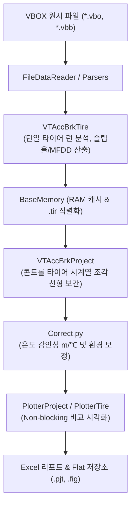

# 📖 vt_acc_brk 모듈 사전 (Domain Engineering Guide)

> ⚡ **Quick Jump**: [🎯 1. 설계 철학](#-1-설계-철학-및-모듈-개요) · [📚 2. 배경 지식](#-2-배경-지식-및-이론-지식-허브) · [🏗️ 3. 아키텍처](#️-3-아키텍처-및-데이터-파이프라인) · [🚀 4. 실전 워크플로우](#-4-실전-워크플로우-및-종합-스니펫) · [🛠️ 5. 트러블슈팅](#️-5-트러블슈팅-및-튜닝-노하우)

> [!ABSTRACT] 🏎️ 도메인 개요
> 실차 주행 시험에서 계측된 VBOX/Dewesoft 시계열 데이터로부터 가감속 및 제동 거동(MFDD, 슬립율, 제동거리, 응답시간)을 정밀 추출하고, **콘트롤 타이어 시계열 선형 보간 및 환경 보정을 통해 타이어 순수 성능 지수를 자동 산출하는 핵심 엔진**입니다.

---

## 🎯 1. 설계 철학 및 모듈 개요

### 1.1. 탄생 배경과 목적
* **기존 방식의 한계**: 수동 엑셀 분석 시 작업자마다 제동 시작점(트리거) 기준이 달라 수 미터의 오차 발생. 평가 중간 노면 온도 변화($\text{m}/^\circ\text{C}$)와 마찰계수 변화에 따른 왜곡 보정 체계 부재.
* **해결 과제**: 브레이크 시작점 자동 탐지(`find_brake_start_point`), 13대 물리 연산 표준화, 콘트롤 타이어 시계열 선형 보간 엔진 통합.
* **핵심 가치**: 단일 타이어 분석(`tire`) $\to$ 프로젝트 취합(`project`) $\to$ 원스톱 자동화 배치(`vt_acc_brk`) 3단계 계층 구조 및 Flat 단일 계층 저장소 정합.

### 1.2. 아키텍처 설계 사상
* **Single Stem Law (단일 식별자 불변 원칙)**: 타이어 객체 식별자(`[req]_[surface]_[item]_[cond]_[vel_tag]_{set}`)가 `.tir` 파일명, 차트 타이틀, 저장 이미지명과 100% 일치하도록 보장.
* **인메모리 프록시 캐싱 (`BaseMemory`)**: 대용량 실차 시계열 데이터를 딕셔너리 및 슬림 피클링으로 관리하여 반복 호출 시 디스크 I/O 병목 제거.
* **No Redundant Prefix**: 시각화 플로터(`PlotterTire`, `PlotterProject`) 메서드에서 중복 동사를 제거하여 `plotter.accbrk()`, `plotter.compare_braking()` 형태로 직관적 API 구축.

---

## 📚 2. 배경 지식 및 이론 (지식 허브)

> [!NOTE] 🧠 공학 이론 및 알고리즘 위키 링크 (Knowledge Atomization)
> *제동 동역학 및 보정 이론은 `04_Resources`에 완결된 단일 백서로 구축되어 있습니다.*

* 📄 **실차 가감속 종합 백서**: [[30_실차_가감속_성능변화_분석_및_보정_시스템|실차 가감속 성능변화 분석 및 보정 시스템 (마스터 백서)]]
* 📄 **제동 시작점 자동 탐지**: [[31_실차_제동_시작점_자동_탐지_및_과도응답_슬립_복원_공학|브레이크 시작점 노이즈 방어 및 슬립율 복원 공학]]
* 📄 **차량 제동 동역학**: [[10_차량_제동_동역학_시뮬레이션|타이어-노면 마찰 및 하중 이동 제동 동역학]]
* 📄 **노면온도 감인성 분석**: [[11_노면_온도와_타이어_제동_상관관계|노면 온도와 타이어 제동 거리 상관관계 (m/℃)]]
* 📄 **마찰계수 상관관계**: [[12_차량_시스템_제동성능과_마찰계수_상관관계|차량 시스템 제동성능과 마찰계수 상관관계]]
* 📄 **ABS 유압 제어 메커니즘**: [[20_ABS_로직_및_3단계_유압제어_분석|ABS 3단계 유압 제어 및 압력 맥동 분석]]
* 📄 **좌표계 변환 역학**: [[10_차량동역학_측정점_기준점_운동역학_변환|차량 계측점 기준점 동역학 변환]]
* 📄 **인메모리 캐싱 패턴**: [[30_대용량_시계열_인메모리_프록시_및_비파괴_캐싱_패턴|대용량 시계열 인메모리 프록시 아키텍처]]
* 📄 **표준 네이밍 기술 백서**: [[50_vt_acc_brk_표준_네이밍_규칙_및_저장_구조|가감속/제동 Flat 네이밍 규칙 및 저장 구조]]

---

## 🏗️ 3. 아키텍처 및 데이터 파이프라인

### 3.1. 엔드-투-엔드 데이터 흐름도



### 3.2. 핵심 서브모듈 역할 분담표

| 서브모듈 파일명 | 담당 클래스 / 함수 | 핵심 책임 및 역할 |
| :--- | :--- | :--- |
| `vt_acc_brk.py` | `vt_acc_brk` | 전체 프로젝트 일괄 배치 및 최상위 오케스트레이션 (`col_curve_fit_wheelslip`, `cf_*` 3계층 분기 패스스루) |
| `vt_acc_brk_tire.py` | `VTAccBrkTire` | 단일 타이어 런 분할, 제동 시작점 검출, 7대 서브 분석기(`acceleration`, `response`, `slip_pdf`, `mu_drop`, `skewness`, `split_speed`, `curve_fit`) 및 런별·MF 피팅 지표(`cf_*`) 집계 |
| `vt_acc_brk_project.py`| `VTAccBrkProject` | 다중 타이어 취합, 콘트롤 타이어 시계열 선형 보간, `curve_fit` 보정 동기화 및 성능지수(`index_cf_*`) 산출 |
| `correct.py` | `Correct` | 노면온도 감인성(m/℃), 콘트롤 타이어 선형 보간 및 `analyzer.curve_fit` 게인($G_i$) 동기화 |
| `base_memory.py` | `BaseMemory` | 대용량 시계열 RAM 프록시 및 비파괴 슬림 피클링 관리 |
| `func_acc_brk.py` | `find_brake_start_point` 등 | 13대 핵심 물리 수식 (MFDD, 슬립율, 제동에너지, 감속도 등) |
| `plotter_tire.py` | `PlotterTire` | 단일 타이어 9대 시각화 (`accbrk`, `acceleration`, `response`, `slip_pdf`, `mu_drop`, `skewness`, `split_speed`, `curve_fit`, `curve_fit_detail`) |
| `plotter_project.py`| `PlotterProject` | 프로젝트 시험 간 9대 비교 플로터 (`compare_braking`, `compare_curve_fit` 등) |
| `analyzers/` (6대 서브) + `cf_tire.py`| `AnAcceleration`, `TireCurve` 등 | 가속대역, 감속응답, 슬립PDF, Mu-Drop, 왜도, 구간속도분할 및 Magic Formula 커브 피팅 전문 분석 |

### 3.3. 온디맨드(On-demand) 하이브리드 캐싱 아키텍처 및 센티널 라이프사이클 (v3.69)

#### 1) `None` vs `빈 데이터프레임(pd.DataFrame())`의 역할과 상태 전이 모델
`unoUtil v2` 분석기(`analyzers/`) 및 최상위 오케스트레이터(`VTAccBrkTire`)는 대용량 시계열 연산의 병목을 없애고 RAM 누수를 방지하기 위해 **온디맨드(On-demand) 자가 복원 프로퍼티 패턴**을 채택하고 있습니다. 여기서 `None`과 `pd.DataFrame()`(빈 DF)은 정반대의 명확한 라이프사이클 책임을 갖습니다:

| 상태 값 | 내부 의미 | `@property` 접근 시 동작 | 발생 시점 |
| :---: | :---: | :---: | :---: |
| **`None`** | **캐시 부재 / 메모리 소거**<br/>(연산 미수행 상태) | **`analysis()` 백그라운드 자동 복원 기동** | 최초 인스턴스 생성 시, `.tir` 저장 직렬화 시(`__getstate__`), `clear_cache()` 호출 시 |
| **`pd.DataFrame()`**<br/>(`empty == True`) | **연산 완료 (결과 부재 센티널)**<br/>(Sentinel Value) | **재연산 절대 금지! 빈 DF $O(1)$ 즉시 반환** | `analysis()`를 실행했으나 휠속도 채널 부재 또는 유효 구간 미검출로 조기 종료된 경우 |
| **`pd.DataFrame`**<br/>(`empty == False`) | **연산 완료 (정상 데이터 적재)** | **결과 데이터프레임 $O(1)$ 즉시 반환** | `analysis()`가 정상 완료된 경우 |

> [!IMPORTANT] 🛡️ 빈 데이터프레임의 센티널(Sentinel) 방어막 역할
> 만약 휠속도나 시험 구간이 없다고 해서 `self._df`를 `None`으로 남겨두면, 시스템은 이를 "아직 연산되지 않았거나 캐시가 비워진 상태"로 오판하여 프로퍼티(`.df`, `.summary`)를 조회할 때마다 `analysis()`를 무한히 재호출하는 **연쇄 호출 폭탄(Cascade Loop)**이 발생합니다.
> 따라서 `analysis()` 시작 시점에 빈 데이터프레임(`self._df = pd.DataFrame()`)을 채워두고 조기 종료함으로써, `self._df is not None` 상태를 만들어 **"이미 확인해 보았으니 재연산하지 말라"**는 센티널 방어막을 구축합니다.

#### 2) 선제적 빈 데이터프레임 초기화 (Pre-emptive Initialization) 패턴
`VTAccBrkTire.analysis()` 및 하위 분석기 모듈들은 메서드 진입 즉시(try 블록 최상단) 모든 결과 필드를 빈 데이터프레임으로 선제 초기화합니다:
```python
# VTAccBrkTire.analysis() 및 AnSlipPdf.analysis() 진입 즉시
self._result.df = pd.DataFrame()
self._result.summary = pd.DataFrame()
self._result.summary_all = pd.DataFrame()
self._result.detail = pd.DataFrame()
self._result.detail_all = pd.DataFrame()
```
* **효과**: 시험 속도 불일치, 속도/가속도 센서 노이즈, 유효 런 미검출 등으로 인해 중간에 어떤 지점에서 조기 반환(`return self`)하더라도, 모든 결과 속성이 안전한 빈 `pd.DataFrame()`으로 보장됩니다.
* **크래시 방어**: 외부 호출자나 시각화 플로터(`PlotterTire`, `PlotterProject`)에서 `tire.result.summary.empty`나 `tire.result.df.columns`에 접근할 때 **`AttributeError: 'NoneType' object has no attribute...`로 인한 시스템 다운을 100% 원천 차단**합니다.

#### 3) 단일 위임(Single Delegation) 및 책임 분리 헌장
* **단일 생성 책임**: 휠속도 채널 검증(`is_col_wheel_speed`) 및 휠 슬립률 시계열(`SR*`) 생성의 책임은 오직 **`AnSlipPdf`**에만 있습니다.
* **하위 분석기의 단일 위임**: `AnSlipModeSkewness`, `AnResponse`, `AnMuDrop` 등 슬립률을 소비하는 하위 분석기들은 상위 `test.df`의 컬럼을 직접 까보며 중복 가드를 치지 않고, 오직 `if self.test.slip_pdf.df.empty: return self` 단일 위임 조건만으로 우아하게 조기 종료합니다.
* **시각화 모듈 연계 안정성**: `PlotterTire`와 `PlotterProject`의 수많은 플롯 가드가 프로퍼티를 반복 조회하더라도, 이미 $O(1)$ 즉시 반환되므로 경고 로그 누출이나 재연산 병목 없이 안전하게 시각화를 건너뜁니다.

#### 4) 가속/제동 대표 성능 지표의 네이밍 비대칭 당위성 (`brk_mean` vs `acc_time_mean`)
* **가속 시험 (`acc`)**: `acc`라는 단어 자체가 물리적으로 '가속도(Acceleration, g)'를 뜻하므로, 목표 속도 도달 시간 지표는 단어 충돌을 방지하기 위해 반드시 **`acc_time_mean`**(가속시간)과 **`acc_mean`**(가속도)으로 분리 명명함.
* **제동 시험 (`brk`)**: 제동 성능의 절대적 1순위 대표 지표는 '제동거리(Braking Distance, m)'이므로, 프레임워크 전반에서 대표 제동거리를 **`brk_mean`** 단일 표준으로 명명함.
* **하위 호환성 및 파생 지표 정합**: `corr_brk_mean`(보정 제동거리), `index_brk_mean`(제동거리 지수), `adj_refer_brk_mean`(컨트롤 타이어 기준값) 등 프레임워크 수십 개 모듈과 엑셀 리포트가 `brk_mean`을 SSOT로 바인딩하고 있으므로, `brk_dist_mean` 등으로 변경하지 않고 `brk_mean` 단일 표준을 엄격히 고수함.

---

### 3.4. 보정 데이터 파이프라인 일원화 및 하드코딩 제로 적응형(Data-Driven) 과도 응답 알고리즘 (v3.71)

#### 1) 보정 데이터 파이프라인 일원화 및 보정 전·후 원본 보존 원칙
* **단일 파이프라인 승계**: CAN 통신 지연(약 20ms)과 출발 직후 저속 휠속 센서 슬립(Wakeup) 복원이 완료된 정제 데이터를 최상위 `VTAccBrkTire`와 서브 분석기 `AnSlipPdf`, `AnResponse`, `TireCurve`에서 단일 파이프라인으로 승계합니다.
* **보정 전·후 대조 원본 보존**: 보정 전 원본 채널(`WS*_Raw`, `SR*_Raw`)을 데이터프레임 내에 함께 보존하여 언제든 보정 전·후 차이와 신호처리 알고리즘 효과를 직접 대조·검증할 수 있습니다.
* **`calc_wheel_delay_compensation` 고도화**:
  - **CAN 지연 추정**: 제동 시 전륜 슬립($WS < Vel$) 현상을 고려하여, 시험 모드(가속/제동)와 무관하게 파일 내 완만한 양(+)의 가속 구간($0.02 \sim 0.18\text{g}$)을 최우선 활용하고, 단발성 제동 스니펫 데이터는 타력/초기 감속 구간($-0.08 \sim -0.015\text{g}$)에서 폴백 추정하여 20ms 지연을 정밀 보정합니다.
  - **가속 발진 저속 웨이크업 복원**: 정차 출발점($i_{\text{rest}}$)부터 첫 웨이크업 펄스($t_{\text{true}}$)까지 $C^1$ 연속 선형 램프로 저속 웨이크업 구간을 복원하여 계단식 점프를 원천 제거합니다.

#### 2) 제동 시 차량 동역학적 물리 지연($\sim 220\text{ms}$) 규명과 공학적 해석
* **남은 지연의 물리적 실체**: 20ms CAN 통신 지연을 보정한 후에도 휠 감속 시작점과 차체 감속 시작점 사이에는 약 $180 \sim 250\text{ms}$($\sim 220\text{ms}$)의 지연이 여전히 존재합니다.
* **차량 역학적 과도 응답(Transient Dynamics Response)**:
  $$\text{브레이크 유압 인가} \longrightarrow \text{휠 감속 및 타이어 슬립 형성} \longrightarrow \text{노면 마찰력(Braking Force) 발현} \longrightarrow \text{서스펜션 피칭(Dive) 압축} \longrightarrow \text{차체 질량 감속}$$
  - 이는 센서 계측 결함이나 통신 지연이 아니라, **타이어의 탄성 변형 $\to$ 마찰력 생성 $\to$ 섀시 서스펜션 기구부의 탄성 변형을 거쳐 1~2톤에 달하는 차체 질량이 실제로 감속하기까지 소요되는 본질적인 차량 동역학적 물리 지연 시간**입니다.
  - 본 알고리즘은 이를 센서 오류로 치부하지 않고, 차량-타이어 시스템의 순수 응답성 지표(`sys_response_time`, `sys_response_dist`)로 정확히 정량화합니다.

#### 3) 하드코딩 제로 적응형(Data-Driven) 과도 응답 및 10~90% 라이징 알고리즘
* **노면 마찰 한계(Dry/Wet/Snow/Ice) 연동 적응형 타겟 대역**:
  - 고정된 임계값(예: $-0.5\text{g} \sim -0.2\text{g}$)을 전면 배제하고, 각 런의 실제 피크 가속도($A_{\text{peak}}$)와 평형 기저선($A_{\text{base}}$) 대비 유효 진폭의 $18\% \sim 45\%$ 대역을 동적으로 계산합니다.
  - 노이즈 플로어($\text{Median} \pm 2.5 \times \text{MAD}$) 대비 최소 마진을 보장하여 마찰력이 낮은 빙설로(Snow/Ice) 및 웻(Wet) 노면에서도 거짓 감지 없이 지연 시간($\Delta t_{\text{resp}}$) 및 응답 거리($\Delta d_{\text{resp}}$)를 안정적으로 산출합니다.
* **평형 기저점($A_{\text{base}}$) 및 1차 과도 피크($d^2Vel = 0$) 역추적**:
  - 트리거 이전 $2.0\text{s}$ 백트래킹 윈도우를 확보하여 제동/가속 전 평형 구간($\text{Median} \pm \text{MAD}$)을 분석, 실제 거동 개시 기저점($A_{\text{base}}$)을 식별합니다.
  - $A_{\text{base}}$ 이후 가속도 2차 도함수가 0으로 수렴하는 첫 번째 1차 과도 피크($A_{\text{peak}}$, $d^2Vel \le 0$)까지의 순수 진폭($\Delta A = |A_{\text{peak}} - A_{\text{base}}|$) 기준 $10\% \sim 90\%$ 내분 구간에서 라이징 타임($t_{\text{rising}}$) 및 선형 회귀 기울기($\text{Slope}$)를 산출합니다.
* **런별 진단 메타데이터 기록**: `Offset_Eff_Zero`, `Offset_Vel_Base`, `Offset_Ws_Base`, `Offset_Peak_L2`, `Base_Val`, `Peak_Val`, `Thresh_Start`, `Thresh_End`, `Run_Response_Time`, `Run_Rising_Time`, `Run_Rising_Slope` 등을 데이터프레임 내 보존하여 시각화 모듈과 유기적으로 결합합니다.

### 3.5. 3열 다중 진단 시각화 및 2×2 보정 진단 대시보드 구조 (v3.71)

#### 1) 3열 다중 과도 응답 진단 뷰 (`PlotterTire.sys_response`)
* **1열 (Speed Profile & CAN Delay Compensation)**: 보정 전 원본 휠속(`WS_Raw`, 회색 점선), 보정 휠속(`WS`, 청색 실선), 차체 속도(`Vel`, 적색 실선), 트리거 시점 수직 점선, 온셋 포인트 배지 표시.
* **2열 (Transient Accel & Response Lag Detection)**: 적응형 타겟 대역($[\text{Thresh}_{\text{start}}, \text{Thresh}_{\text{end}}]$) 수평 주황 음영, 휠/차체 Onset 다이아몬드 마커, 응답 구간 중심점(Centroid) 수직선 및 $\Delta t$ 양방향 화살표 표출.
* **3열 (Adaptive Baseline, 1st Peak & Rising Fit 10~90%)**: 평형 기저점($A_{\text{base}}$, 삼각 마커), 1차 과도 피크($A_{\text{peak}}$, 별 마커), 순수 진폭 $10\% \sim 90\%$ 녹색 음영 및 $dVel_{\text{fit}}$ 선형 회귀 직선 오버레이.
* **모든 Run 행의 열별 동적 Y축 스케일 100% 통일 (하드코딩 배제)**: 런별 데이터 극값 및 마진을 자동 계산하여 열 단위로 일괄 통일함으로써 다중 런 간의 응답 거동 차이를 직관적으로 비교 분석 가능.

#### 2) 2×2 상세 보정 진단 대시보드 (`PlotterTire.slip_check`)
* **상단 (Row 1 - 전체 세션 요약)**:
  - Panel 1: 전체 시계열 차속 대 4륜 휠속도 동기화 프로파일.
  - Panel 2: 전체 시계열 4륜 슬립률($SR_{FL}, SR_{FR}, SR_{RL}, SR_{RR}$) 프로파일.
* **하단 (Row 2 - 첫 유효 런 과도 구간 초정밀 확대 진단)**:
  - Panel 3: 첫 유효 런의 `WS_Raw` vs `WS` 지연/웨이크업 보정 전후 대조 및 차속 오버레이.
  - Panel 4: 첫 유효 런의 `SR_Raw` vs `SR` 슬립률 보정 전후 대조 및 저속 웨이크업 복원 구간 강조 하이라이트.

## 🚀 4. 실전 워크플로우 및 종합 스니펫

```python
"""
vt_acc_brk 가감속/제동 프로젝트 원스톱 실행 및 curve_fit 서브 분석·보정 비교 스크립트
"""
from pathlib import Path
from unoUtil.vehicle.acc_brk import (
    vt_acc_brk,
    VTAccBrkProject,
)

# 1. 가감속/제동 마스터 래퍼 실행 (curve_fit 옵션 3계층 자동 패스스루)
pjt_dir = Path("D:/test_data/acc_brk/pjt_bmw320_mock")
projects = vt_acc_brk(
    paths=pjt_dir,
    test_vel=[100, 5],
    cf_method="robust",
    cf_filter_transient=True,
    plot=True,
    excel=True,
)
project: VTAccBrkProject = projects[0]

# 2. 보정 성능 결과 및 MF 피팅 요약 데이터프레임 추출
summary_df = project.summary.df
print(summary_df[["TestSet", "mean_Distance", "corr_mean_Distance", "cf_peak_mu", "corr_cf_peak_mu", "index_cf_peak_mu"]])

# 3. 개별 타이어 상세 MF 진단 및 프로젝트 보정 MF 커브(0~1.0) 오버레이 비교 (Non-blocking)
first_tire = next(iter(project.tire_analyzers.values()))
first_tire.plot.curve_fit(detail=True, close=True)
project.plot.compare_curve_fit(corr="mean", xlim=(0.0, 1.0), show_peak=True, close=True)
```

---

## 🛠️ 5. 트러블슈팅 및 튜닝 노하우

### 5.1. 제동 시작점 50km/h 컷에 따른 외삽 결함 발생 시
* **증상**: 감속도 $0 \to 0.45\text{g}$ 구간이 조기 절단되어 음수 슬립율이 발생하거나 클램핑 수평선 결함 발생.
* **조치**: `func_acc_brk.py`의 `find_brake_start_point(window=11, baseline_sec=1.0, persistence=5)`를 적용하여 정속 기저선 대비 3중 노이즈 필터링으로 과도응답 램프업 구간을 자동 복원.

### 5.2. 콘트롤 타이어 평가 차수 불균형
* **증상**: C1과 C2 사이 시험 타이어가 과도하게 많거나 시간 간격이 4시간 이상 벌어져 선형 보간의 신뢰도 저하.
* **조치**: `correct.py`의 `set_interpolation_mode(mode='segmented_linear')`를 호출하거나, 온·습도 기상 DB가 존재하는 경우 `Correct.run(weather_adjust=True)`를 켜서 노면 온도 감인성 보정을 병합 적용.

### 5.3. `curve_fit` 서브 분석기 휠스피드 부재 방어 및 구동방식(`TestVehicleLayout`) 연동 (v3.48)
* **휠스피드 부재 시 자동 Skip**: CAN/아날로그 휠스피드 채널이 없는 GPS 단독 계측 데이터에서는 `tire.curve_fit`이 에러 없이 `is_fitted = False`로 자동 Skip되어 기존 6대 서브 분석기와 요약표가 정상 산출됨.
* **제동/가속 슬립 축 자동 선택**: 제동(`brk`)은 기본 전륜축(`FL`/`FR` 유효 채널 평균)을 사용하며, 가속(`acc`)은 `TestVehicleLayout` 메타데이터가 `RWD`이면 후륜축(`RL`/`RR`), `AWD`/`4WD`이면 4륜 전체, `FWD`/미지정 시 전륜축을 자동 선택함 (`col_curve_fit_wheelslip`으로 명시적 오버라이드 가능).
* **콘트롤 보정 게인($G_i$) 자동 동기화**: `Correct.run()` 실행 시 별도 재피팅 없이 [[30_실차_가감속_성능변화_분석_및_보정_시스템#7. 🎯 비선형 마찰 곡선(Magic Formula)의 콘트롤 게인 스케일링 동형성 법칙 (Control Gain Scaling Isomorphism)|콘트롤 게인 스케일링 동형성 법칙]]에 의해 `tire.curve_fit.df`(`corr_mean_Acc`, `corr_curve_Acc`) 및 `params`(`corr_D`, `corr_peak_mu`, `corr_stiffness`)가 자동 갱신됨.

### 5.4. 온디맨드 프로퍼티 무한 재호출 및 NoneType 크래시 트러블슈팅 (v3.69)
* **증상**: 휠속도 채널이 없는 시험 데이터를 로드한 후 `tire.plot()` 또는 `tire.slip_pdf.df`, `tire.result.summary`에 접근할 때마다 `[WARNING] 휠속도에 대한 채널이 없습니다` 경고가 수십 번 반복 출력되거나 `NoneType has no attribute 'empty'` 에러 발생.
* **원인**: 
  1. `an_slip_pdf.py`의 `df` 프로퍼티에 과거 휠 지연 보정 개발 시 작성된 과도기 코드 `not cached_df.attrs.get("wheel_delay_compensated", False)`가 잔존하여, 빈 데이터프레임이 캐싱되어 있음에도 매번 `analysis()`를 강제로 재호출함.
  2. `VTAccBrkTire.analysis()` 조기 반환 시 `_result.summary` 등이 `None`으로 방치되어 외부 호출부에서 크래시 발생.
* **조치**:
  1. `an_slip_pdf.py`의 과도기 조건문을 제거하고 표준 `if self._df is None:` 온디맨드 캐싱 패턴으로 복원.
  2. `VTAccBrkTire.analysis()` 최상단에 선제적 빈 DataFrame 초기화(`self._result.summary = pd.DataFrame()`)를 적용하여 안전성 완결.
