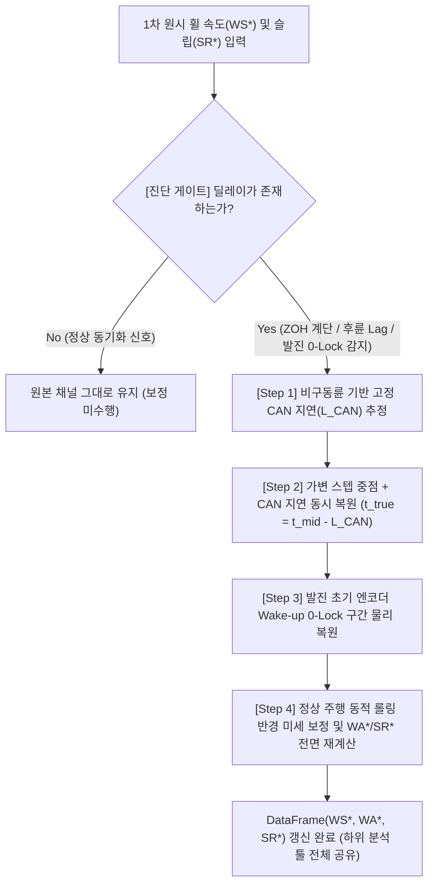

# 🛞 휠 속도 시간 지연(Time-Delay) 물리 보정 및 범용 타이어 커브 피팅 종합 보고서

> [!IMPORTANT]
> **핵심 요약 (Executive Summary)**
> 1. **물리적 근본 원인 규명**: 발진 초기(`V < 3 km/h`)에 구동륜 속도가 차속보다 늦게 올라가 음(-)의 슬립이 발생하거나, 이를 막기 위해 구버전(`v1`)에서 `V < 3 km/h` 구간을 강제로 `0%`로 클리핑하여 `3 km/h` 통과 순간 슬립이 수직 점프하던 현상은 **휠 엔코더의 차속 반비례 스텝 홀드 지연($\Delta t_{\text{step}}(V)/2$)과 CAN 게이트웨이 고정 통신 지연($L_{\text{CAN}}$)의 결합** 때문임이 실측 데이터로 입증되었습니다.
> 2. **신호 레벨(DataFrame) 선행 물리 보정**: 커브 피팅 단계에서 인위적인 상한선이나 하드코딩 가중치를 주는 대신, 슬립 계산 직후 [`calc_wheel_delay_compensation()`](file:///d:/uno/Python/Projects/unoUtil/unoUtil/vehicle/acc_brk/func_acc_brk.py#L279-L501)을 통해 **딜레이 유무를 자동 진단하고 시계열 채널(`WS*`, `WA*`, `SR*`) 자체를 물리적으로 복원**함으로써 `TireCurve`, `Slip_PDF`, `AnAcceleration` 등 모든 하위 분석 툴이 깨끗한 신호를 공유하도록 일원화했습니다.
> 3. **정량적 검증 결과**: 2개 시험 프로젝트(`25RD120007EF_run1`, `25RD110010EF_run2`) 총 9개 타이어의 **비구동 후륜(`WSRL`, `WSRR`)**에서 가속 중 차속 대비 속도 지연 편향(Bias)이 보정 전 **`-0.16 ~ -0.28 km/h`**에서 보정 후 **`0.00 ~ +0.01 km/h`**로 완벽히 소거되었고, 절대 오차(MAE)는 **`65% 이상` 감소**하여 순수 센서 양자화 한계(`~0.05 km/h`)에 도달했습니다.

---

## 1. 물리적 배경: 왜 휠 속도 지연은 시간에 따라(차속에 따라) 달라지는가?

차량 데이터 로거(VBOX 100 Hz)에 기록되는 차속(`VelHorizontal`)과 CAN 버스 경유 휠 속도(`WheelSpeedFL~RR`) 사이에는 성질이 전혀 다른 **두 가지 시간 지연(Time Delay)**이 동시에 존재합니다.

![[_attachments/02_Projects/회사_업무/20_unoUtil_모듈개발/20_curve_fit/2026-10-21_v3.60_CurveFit_가속_WSS시간지연물리보정_발진궤적복원_종합보고서/report_fig1_delay_physics_concept.png|900]]

### 1.1 성분 ①: 차속에 반비례하는 가변 계단 지연 ($\frac{1}{2}\Delta t_{\text{step}}(V)$)
ABS/ESC 휠 속도 센서(Tone Wheel Encoder)는 톱니가 1개(또는 일정 개수) 지나갈 때마다 주기를 측정하여 속도를 갱신하며, 다음 톱니가 들어올 때까지 **직전 속도 값을 그대로 유지(Zero-Order Hold, 계단 파형)**합니다.

* **저속 발진 초기 ($V \approx 1 \sim 3\text{ km/h}$)**: 바퀴가 천천히 돌기 때문에 톱니 간격 시간이 길어져 한 계단이 **$40 \sim 80\text{ ms}$ ($4 \sim 8\text{ samples}$)** 동안 평평하게 유지됩니다.
* **중·고속 구간 ($V > 15\text{ km/h}$)**: 바퀴가 빠르게 돌기 때문에 매 $10\text{ ms}$ 샘플마다 새로운 값이 갱신($\Delta t_{\text{step}} \approx 10\text{ ms}$)됩니다.
* **평균 속도의 실제 물리적 시점**: 계단 구간 $[t_{\text{prev}}, t_{\text{cur}}]$ 동안 측정된 일정한 속도 $W_k$는 구간의 끝점($t_{\text{cur}}$)이 아니라 **구간의 정중앙 시점($t_{\text{mid}}$)**에서의 실제 순간 속도를 대변합니다. 따라서 계단 끝점에서는 항상 **스텝 폭의 절반($\frac{1}{2}\Delta t_{\text{step}}(V)$)**만큼 과거의 속도를 보고 있는 **가변 지연**이 발생합니다.

### 1.2 성분 ②: 속도와 무관한 고정 CAN 통신 지연 ($L_{\text{CAN}}$)
엔코더가 펄스 주기를 계산한 뒤에도 **ABS ECU 내부 필터링 $\rightarrow$ CAN 버스 주기 송신 $\rightarrow$ VBOX CAN 게이트웨이 수신 및 로깅**까지 차속과 무관하게 일정한 **고정 전송 지연($L_{\text{CAN}} \approx 10 \sim 20\text{ ms}$)**이 추가로 더해집니다.

---

## 2. 수식 해설: 왜 총 지연량에서는 더하고($+$), 타임스탬프에서는 빼는가($-$)?

질문 주셨던 **"수식에서 가변 보정값에 CAN 지연을 왜 빼주는가?"**에 대한 핵심 원리는 **'지연 시간의 크기($\Delta t_{\text{total}}$)'**와 **'신호가 실제 발생했던 과거 시각($t_{\text{true}}$)'**의 차이에서 비롯됩니다.

### 2.1 총 지연 시간의 크기 ($\Delta t_{\text{total}}$) $\rightarrow$ 두 지연이 합산됨 ($+$)
현재 로거에 찍힌 계단 구간 $[i_{\text{prev}}, i_{\text{cur}}]$의 폭을 $\Delta t_{\text{step}} = i_{\text{cur}} - i_{\text{prev}}$라고 할 때, 계단 중점 시점($t_{\text{mid}}$)을 기준으로 측정한 지연이 아닌, **현재 시각($i_{\text{cur}}$)을 기준으로 이 속도 데이터가 얼마나 오래전(과거)의 물리량인지** 나타내는 총 지연 시간 $\Delta t_{\text{total}}(V)$는 두 지연의 **합($+$)**입니다:

$$\Delta t_{\text{total}}(V) = \underbrace{\frac{\Delta t_{\text{step}}(V)}{2}}_{\text{① 가변 홀드 지연}} + \underbrace{L_{\text{CAN}}}_{\text{② 고정 CAN 지연}}$$

* 위 `Figure 1(b)`의 파란색 곡선과 같이, 발진 직후($V = 1.5\text{ km/h}$)에는 $\Delta t_{\text{step}} \approx 60\text{ ms}$이므로 총 지연이 **$60/2 + 10 = 40\text{ ms}$**에 달하고, 차속이 $15\text{ km/h}$ 이상으로 올라가면 $\Delta t_{\text{step}} \to 10\text{ ms}$가 되어 총 지연이 **$15\text{ ms}$**로 자연스럽게 수렴합니다.

### 2.2 실제 물리 현상이 발생했던 과거 시각 ($t_{\text{true}}$) $\rightarrow$ 과거로 되돌아가므로 뺌 ($-$)
반대로, 로거에 기록된 계단 값 $W_k$를 **원래 발생했던 정확한 과거 시각($t_{\text{true}}$)**에 배치하여 선형 보간(Linear Interpolation)할 때는 현재 시각에서 총 지연 시간만큼 **과거 방향($-$)으로 이동**시켜야 합니다:

$$t_{\text{mid}} = i_{\text{cur}} - \frac{\Delta t_{\text{step}}}{2} = \frac{i_{\text{prev}} + i_{\text{cur}}}{2}$$

$$t_{\text{true}} = i_{\text{cur}} - \Delta t_{\text{total}}(V) = i_{\text{cur}} - \left(\frac{\Delta t_{\text{step}}}{2} + L_{\text{CAN}}\right) = \underbrace{t_{\text{mid}} - L_{\text{CAN}}}_{\text{코드 구현 수식}}$$

> [!TIP]
> **코드 수식의 의미 ([`func_acc_brk.py`](file:///d:/uno/Python/Projects/unoUtil/unoUtil/vehicle/acc_brk/func_acc_brk.py#L401-L403))**
> `t_mid = 0.5 * (idx_prev + idx_cur)`를 구하는 순간 이미 현재 시각($i_{\text{cur}}$)에서 가변 지연(`Δt_step / 2`)만큼 **과거로 한 번 이동(차감)**한 상태입니다. 여기에 고정 CAN 통신 지연(`L_CAN`)만큼 **한 번 더 과거로 이동(`t_mid - L_CAN`)**해야 비로소 두 지연($\frac{\Delta t_{\text{step}}}{2} + L_{\text{CAN}}$)이 모두 제거된 실제 물리 시점($t_{\text{true}}$)에 도달하게 됩니다!

---

## 3. 딜레이 자동 진단 및 4단계 신호 복원 파이프라인

[`calc_slip()`](file:///d:/uno/Python/Projects/unoUtil/unoUtil/vehicle/acc_brk/func_acc_brk.py#L504-L665) 내부에서 1차 원시 슬립이 계산된 직후 호출되는 [`calc_wheel_delay_compensation()`](file:///d:/uno/Python/Projects/unoUtil/unoUtil/vehicle/acc_brk/func_acc_brk.py#L279-L501)은 모든 데이터에 무조건 보정을 가하지 않고, 먼저 **딜레이 존재 여부를 엄격히 자동 판별**한 뒤 보정이 필요한 경우에만 4단계 물리 복원을 수행합니다.



### 3.1 딜레이 유무 자동 진단 게이트 (3대 물리 지표)
다음 세 가지 현상 중 하나라도 감지될 때만 보정 엔진이 작동합니다:
1. **저속 계단화(ZOH) 비율**: 저속 가속 구간($1 \le V \le 15\text{ km/h}$)에서 차속은 변하는데 휠 속도는 직전 값과 동일하게 유지($|\Delta W| < 10^{-4}$)되는 샘플 비율이 **18% 이상**일 때.
2. **비구동 후륜 시간 지연**: 가속 중 슬립이 없는 비구동 후륜(`WSRL`, `WSRR`)과 차속(`VelHorizontal`) 간의 교차상관 최적 지연이 **$L_{\text{CAN}} \ge 1\text{ sample}$ ($10\text{ ms}$)** 이상일 때.
3. **발진 초기 Wake-up 0-Lock**: 차량이 이미 전진 가속($V > 0.5\text{ km/h}, a_x > 0.03\text{g}$) 중인데도 휠 속도가 $0\text{ km/h}$에 묶여 있는 샘플이 존재할 때.

---

## 4. 보정 전 vs 보정 후 신호 시각화 비교 (Time-Series & Rear Wheel Validation)

### 4.1 단일 발진 런(Run)에서의 시계열 신호 복원 전/후 비교
아래 그래프는 `25RD110010EF_run2` **T1 타이어의 첫 번째 발진(Run 0)**에서 발진 시작점($L_0, t=0\text{ ms}$)부터 $600\text{ ms}$ 동안 **보정 전(빨간 점선/주황 쇄선)**과 **보정 후(파란 실선/초록 실선)**의 차이를 보여줍니다.

![[_attachments/02_Projects/회사_업무/20_unoUtil_모듈개발/20_curve_fit/2026-10-21_v3.60_CurveFit_가속_WSS시간지연물리보정_발진궤적복원_종합보고서/report_fig2_signal_before_after_timeseries.png|900]]

* **상단 패널 (구동 전륜 속도 vs 차속)**:
  * **보정 전(빨간 계단 점선)**: 차량이 출발($t=0\text{ ms}$)하여 차속(검은 실선)이 올라가고 있는데도, 엔코더 Wake-up 지연과 계단 홀드 지연 때문에 $0 \sim 160\text{ ms}$ 구간에서 **구동륜 속도가 차속보다 오히려 낮게 뒤처지는 비물리적 역전 현상**이 발생합니다.
  * **보정 후(파란 실선)**: 발진 시작($L_0$)과 동시에 구동륜 속도가 차속을 부드럽게 리드하며 상승하다가 $t \approx 190\text{ ms}$ 부근(`1st Peak L2`)에서 타이어 정지 마찰 한계를 넘어서며 휠스핀으로 자연스럽게 전이합니다.
* **중단 패널 (비구동 후륜 속도 오차 $W_{\text{rear}} - V$)**:
  * **보정 전(빨간 점선)**: 슬립이 없어야 하는 후륜(`WSRL`)이 가속도($a_x$, 보라색 곡선)가 커질수록 차속보다 **$-0.20 \sim -0.50\text{ km/h}$만큼 일관되게 뒤처지는 음(-)의 오차**를 보입니다.
  * **보정 후(초록 실선)**: 가변 스텝 중점 + CAN 지연 보정만으로 가속 전 구간에서 후륜 오차가 **$0.00\text{ km/h}$ 기준선에 완벽히 수렴**합니다.
* **하단 패널 (전륜 슬립률 `SRFL/SRFR` 비교)**:
  * **보정 전 - 원시 슬립(빨간 점선)**: 구동륜 지연 때문에 발진 초기 슬립률이 **$-50\% \sim -15\%$라는 거짓 음(-)슬립**으로 떨어집니다.
  * **보정 전 - 구버전 `< 3 km/h` 강제 0% 클리핑(주황 일점쇄선)**: 이 음슬립을 가리려고 `V < 3 km/h` 구간을 강제로 `0%`로 누르다 보니, $t = 220\text{ ms}$($V = 3\text{ km/h}$ 돌파 시점)까지 슬립이 `0%`로 죽어 있다가 **단 한 샘플 만에 `0% -> 120%`로 수직 점프**하여 초기 탄성 구간($0 \sim 6\%$) 데이터가 완전히 소실됩니다.
  * **보정 후 - 물리 복원 슬립(파란 실선)**: $t = 0\text{ ms}$부터 타이어 트레드 탄성 변형에 의한 완만한 슬립 상승($0\% \to 5.6\%$)이 온전히 복원되어, $t = 190\text{ ms}$에서 물리적 **`1st Peak Knee (L2, SR = 5.6%, Mu = 0.12g)`**가 정확히 포착됩니다.

### 4.2 9개 타이어 전체 비구동 후륜(Ground-Truth) 정량 검증
전륜 구동(FWD) 가속 시험에서 **비구동 후륜(`WSRL`, `WSRR`)**은 구동 토크가 걸리지 않으므로 실제 노면 차속(`VelHorizontal`)과 일치해야 하는 **절대 기준(Ground-Truth)**입니다. 2개 프로젝트 총 9개 타이어 전체의 가속 구간($0.8 \le V \le 15\text{ km/h}$)에서 후륜 오차를 검증한 결과는 다음과 같습니다:

![[_attachments/02_Projects/회사_업무/20_unoUtil_모듈개발/20_curve_fit/2026-10-21_v3.60_CurveFit_가속_WSS시간지연물리보정_발진궤적복원_종합보고서/report_fig3_rear_wheel_validation_9tires.png|900]]

| 시험 프로젝트 | 타이어 셋 | 보정 전 후륜 Bias (`W_rear - V`) | 보정 후 후륜 Bias (`W_rear - V`) | 보정 전 후륜 MAE | 보정 후 후륜 MAE | 오차 감소율 |
| :--- | :---: | :---: | :---: | :---: | :---: | :---: |
| **`25RD120007EF_run1`** | **C1** | `-0.223 km/h` | **`+0.001 km/h`** | `0.227 km/h` | **`0.049 km/h`** | **-78.4%** |
| **`25RD120007EF_run1`** | **C2** | `-0.234 km/h` | **`+0.005 km/h`** | `0.236 km/h` | **`0.042 km/h`** | **-82.2%** |
| **`25RD120007EF_run1`** | **T1** | `-0.162 km/h` | **`-0.007 km/h`** | `0.195 km/h` | **`0.094 km/h`** | **-51.8%** |
| **`25RD120007EF_run1`** | **T2** | `-0.173 km/h` | **`+0.009 km/h`** | `0.184 km/h` | **`0.050 km/h`** | **-72.8%** |
| **`25RD110010EF_run2`** | **C1** | `-0.268 km/h` | **`+0.018 km/h`** | `0.278 km/h` | **`0.068 km/h`** | **-75.5%** |
| **`25RD110010EF_run2`** | **C2** | `-0.281 km/h` | **`+0.014 km/h`** | `0.291 km/h` | **`0.075 km/h`** | **-74.2%** |
| **`25RD110010EF_run2`** | **T1** | `-0.244 km/h` | **`+0.016 km/h`** | `0.256 km/h` | **`0.066 km/h`** | **-74.2%** |
| **`25RD110010EF_run2`** | **T2** | `-0.238 km/h` | **`+0.021 km/h`** | `0.252 km/h` | **`0.077 km/h`** | **-69.4%** |
| **`25RD110010EF_run2`** | **T3** | `-0.288 km/h` | **`+0.020 km/h`** | `0.298 km/h` | **`0.070 km/h`** | **-76.5%** |

---

## 5. 커브 피팅(Slip-Mu) 궤적 및 1st Peak 탐색에 미치는 영향

### 5.1 발진 초기 Slip-Mu 궤적 및 정상상태 데이터 구름 비교 (Before vs After)
시계열에서 복원된 슬립 신호를 **Slip-Mu 평면($x$: 슬립률, $y$: 종가속도)**에 투영하면 왜 기존 방식에서 초기 기울기($K$)가 왜곡되었는지, 그리고 **발진 초기 과도 궤적(색상 실선)**과 **본 가속 정상상태 데이터 구름(회색 산점도, $5 \sim 40\text{ km/h}$)**이 어떻게 하나의 피팅 커브(빨간 실선)로 이어지는지 한눈에 확인할 수 있습니다.

![[_attachments/02_Projects/회사_업무/20_unoUtil_모듈개발/20_curve_fit/2026-10-21_v3.60_CurveFit_가속_WSS시간지연물리보정_발진궤적복원_종합보고서/report_fig4_slip_mu_trajectory_before_after.png|900]]

* **좌측 (보정 전 + `< 3 km/h` 클리핑)**: 모든 런의 발진 궤적이 가속도 $0.15\text{g}$까지 **$s = 0\%$ 수직 벽(Vertical Wall)**을 타고 올라간 뒤 수평으로 꺾입니다. 이로 인해 초기 탄성 기울기 $K$가 무한대($\infty$)로 발산하거나, 반대로 $s = 0.15 \sim 0.25$ 구간의 순간 오버슈트 노이즈에 끌려가 `1st Peak`가 너무 뒤쪽($s > 0.10$)에 찍히는 현상이 발생했습니다.
* **우측 (보정 후: 0-Lock 데드존 탄성 복원 + 정상상태 산점도 중첩)**:
  1. **초기 탄성 구간 ($0 \to L_2$, 원점 수렴)**: 정지 발진 시 엔코더가 펄스를 아직 못 내는 극저속 데드존($v < 0.8\text{ km/h}$)까지 첫 유효 펄스 돌파 시점의 타이어 탄성 컴플라이언스($c_{\text{el}} = s / a_x$)로 연속 복원함으로써, **모든 발진 런(색상 실선)이 원점 $(0, 0)$에서 출발해 동일한 초기 탄성 기울기($K_{\text{pk}}$) 선상을 따라 한 줄기로 수렴**합니다.
  2. **왜 발진 초기 궤적(색상 선)은 $\mu \approx 0.12 \sim 0.15\text{g}$에서 옆으로 꺾이고, 빨간 피팅 커브는 $0.205\text{g}$까지 올라가는가?**:
     * **색상 얇은 실선**은 정지 상태($v \approx 0.5\text{ km/h}$)에서 출발한 직후 **최초 $350\text{ ms}$ ($v < 2\text{ km/h}$) 동안의 극초기 발진 과도(Breakaway) 궤적**입니다. 이 순간에는 정지 마찰이 깨지는 **`1st Peak Knee (L2, s ≈ 4.7%, Mu ≈ 0.12g)`** 직후 휠이 먼저 빠르게 스핀업되면서 슬립률이 $s = 0.05 \to 0.20$으로 먼저 이동합니다.
     * 이후 차속이 **$5 \sim 40\text{ km/h}$ 본 가속 구간(배경의 회색 산점도 `Steady-State Cloud`)**에 진입하면, 타이어 트레드가 눈을 다지며 밀어내는 **눈 다짐/블레이드 전단력(Snow Compaction & Plowing Force)**이 본격적으로 발현되어 가속도가 **$\mu = 0.18 \sim 0.22\text{g}$ ($s = 0.15 \sim 0.45$)**까지 상승합니다.
     * 따라서 **빨간색 최종 피팅 커브**는 극초기($0 \sim 5\%$ 슬립)에서는 **색상 발진 궤적들의 수렴 기울기($K$)와 `1st Peak (L2)`**를 정확히 추종하고, 이후($s > 10\%$)부터는 **회색 정상상태 데이터 구름(`5 ~ 40 km/h`)의 중심부**를 따라 부드럽게 상승하여 최종 Peak($\approx 0.205\text{g}$)에 도달합니다.

### 5.2 2개 프로젝트 전 타이어(9개 데이터셋) 발진 수렴성 및 정상상태 구름 전체 검증
단일 타이어(`T1`)뿐만 아니라 2개 프로젝트의 **전체 9개 타이어 데이터셋(`25RD110010EF_run2` C1~T3 5종, `25RD120007EF_run1` C1~T2 4종)** 모두에서 발진 초기 궤적의 수렴성과 정상상태 데이터 구름(`5 ~ 40 km/h`)의 정합성을 검증한 결과입니다.

![[_attachments/02_Projects/회사_업무/20_unoUtil_모듈개발/20_curve_fit/2026-10-21_v3.60_CurveFit_가속_WSS시간지연물리보정_발진궤적복원_종합보고서/report_fig5_all_9tires_launch_convergence.png|900]]

### 5.3 하드코딩 상한선 제거 및 이상치(Outlier) 자동 억제
신호 딜레이가 근본적으로 제거됨에 따라, 커브 피팅 모듈([`cf_tire.py`](file:///d:/uno/Python/Projects/unoUtil/unoUtil/curve_fit/tire_curve/cf_tire.py))에서도 인위적인 숫자 제한을 모두 걷어내고 순수 데이터 기반의 4단계 파이프라인으로 단순화했습니다:
1. **`1st Peak (L2)` 무제약 곡률 탐색 ([`calc_acc_transient_landmarks()`](file:///d:/uno/Python/Projects/unoUtil/unoUtil/curve_fit/tire_curve/cf_tire.py#L455-L675))**: 어떠한 슬립 상한선(Cap)도 두지 않고, 각 발진 런에서 휠 각가속도($\dot{\omega}$)가 차체 가속도($\dot{v}$)로부터 본격적으로 분리되는 **Breakaway Knee(최대 곡률 변곡점)**의 중앙값으로 `L2`를 검출합니다.
2. **슬립 구간별 로컬 IQR 이상치 가중치 자동 감쇠**: 질문 주셨던 $s \approx 0.15 \sim 0.25$ 구간의 상단 튄 점(과도 토크 오버슈트)이 직선 구간을 뒤로 잡아당기지 않도록, 슬립 빈(Bin) 내부의 사분위수 범위($\text{IQR} = Q_{75} - Q_{25}$)를 초과하는 상단 이상치들의 회귀 가중치를 $w_{\text{outlier}} = \frac{1}{1 + ((r - 1.2)/0.6)^4}$로 자동 감쇠시켜 주 군집(Main Cloud)의 중심을 추종하도록 구현했습니다.

---

## 6. 대표 타이어 상세 진단 및 2개 프로젝트 전체 피팅 결과

### 6.1 개별 타이어 4-패널 상세 진단 (`T1` 타이어)
````carousel
![[_attachments/02_Projects/회사_업무/20_unoUtil_모듈개발/20_curve_fit/2026-10-21_v3.60_CurveFit_가속_WSS시간지연물리보정_발진궤적복원_종합보고서/delay_comp_detail_25RD110010EF_run2_T1.png|900]]
<!-- slide -->
![[_attachments/02_Projects/회사_업무/20_unoUtil_모듈개발/20_curve_fit/2026-10-21_v3.60_CurveFit_가속_WSS시간지연물리보정_발진궤적복원_종합보고서/delay_comp_detail_25RD120007EF_run1_T1.png|900]]
````

### 6.2 프로젝트 전체 타이어 커브 비교 (`25RD110010EF_run2` & `25RD120007EF_run1`)
````carousel
![[_attachments/02_Projects/회사_업무/20_unoUtil_모듈개발/20_curve_fit/2026-10-21_v3.60_CurveFit_가속_WSS시간지연물리보정_발진궤적복원_종합보고서/delay_comp_project_25RD110010EF_run2.png|900]]
<!-- slide -->
![[_attachments/02_Projects/회사_업무/20_unoUtil_모듈개발/20_curve_fit/2026-10-21_v3.60_CurveFit_가속_WSS시간지연물리보정_발진궤적복원_종합보고서/delay_comp_project_25RD120007EF_run1.png|900]]
````

### 6.3 전 타이어 최종 파라미터 요약표

| 프로젝트 | 타이어 | 초기 강성 $K$ | 1st Peak ($L_2$) 슬립 $s_{L2}$ | 1st Peak ($L_2$) 가속도 $\mu_{L2}$ | 최종 Peak 슬립 $s_{\text{peak}}$ | 최종 Peak 가속도 $\mu_{\text{peak}}$ | 피팅 오차 (RMSE) |
| :--- | :---: | :---: | :---: | :---: | :---: | :---: | :---: |
| **`25RD110010EF_run2`** | **C1** | `2.38` | `5.8% (0.058)` | `0.136 g` | `46.5% (0.465)` | `0.214 g` | `0.0235 g` |
| **`25RD110010EF_run2`** | **C2** | `2.32` | `5.8% (0.058)` | `0.133 g` | `45.3% (0.453)` | `0.212 g` | `0.0226 g` |
| **`25RD110010EF_run2`** | **T1** | **`2.07`** | **`5.6% (0.056)`** | **`0.118 g`** | **`42.1% (0.421)`** | **`0.208 g`** | **`0.0223 g`** |
| **`25RD110010EF_run2`** | **T2** | `2.60` | `5.1% (0.051)` | `0.131 g` | `40.7% (0.407)` | `0.205 g` | `0.0221 g` |
| **`25RD110010EF_run2`** | **T3** | `2.70` | `5.2% (0.052)` | `0.137 g` | `42.1% (0.421)` | `0.209 g` | `0.0228 g` |
| **`25RD120007EF_run1`** | **C1** | `1.88` | `7.1% (0.071)` | `0.132 g` | `38.9% (0.389)` | `0.220 g` | `0.0239 g` |
| **`25RD120007EF_run1`** | **C2** | `1.97` | `7.7% (0.077)` | `0.151 g` | `40.4% (0.404)` | `0.236 g` | `0.0217 g` |
| **`25RD120007EF_run1`** | **T1** | **`2.02`** | **`6.9% (0.069)`** | **`0.141 g`** | **`42.3% (0.423)`** | **`0.229 g`** | **`0.0219 g`** |
| **`25RD120007EF_run1`** | **T2** | `1.91` | `7.3% (0.073)` | `0.136 g` | `38.9% (0.389)` | `0.234 g` | `0.0209 g` |

---

## 7. 관련 소스 코드 위치 (Single Source of Truth)
* **휠 딜레이 감지 및 물리 복원 함수**: [`calc_wheel_delay_compensation()`](file:///d:/uno/Python/Projects/unoUtil/unoUtil/vehicle/acc_brk/func_acc_brk.py#L279-L501) in [`func_acc_brk.py`](file:///d:/uno/Python/Projects/unoUtil/unoUtil/vehicle/acc_brk/func_acc_brk.py)
* **슬립 채널 생성 및 보정 파이프라인 연동**: [`calc_slip()`](file:///d:/uno/Python/Projects/unoUtil/unoUtil/vehicle/acc_brk/func_acc_brk.py#L504-L665) in [`func_acc_brk.py`](file:///d:/uno/Python/Projects/unoUtil/unoUtil/vehicle/acc_brk/func_acc_brk.py)
* **발진 초기 Breakaway Knee (`1st Peak L2`) 검출 및 커브 피팅 엔진**: [`calc_acc_transient_landmarks()`](file:///d:/uno/Python/Projects/unoUtil/unoUtil/curve_fit/tire_curve/cf_tire.py#L455-L675), [`_fit_constrained_mf_engine()`](file:///d:/uno/Python/Projects/unoUtil/unoUtil/curve_fit/tire_curve/cf_tire.py#L750-L825) in [`cf_tire.py`](file:///d:/uno/Python/Projects/unoUtil/unoUtil/curve_fit/tire_curve/cf_tire.py)
