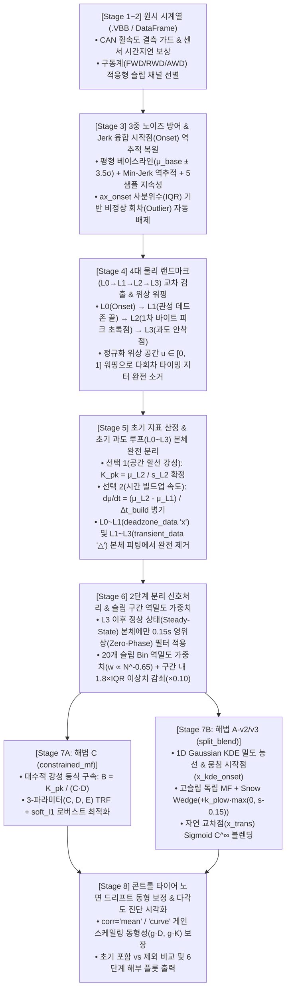

# 🛞 실차 가속·제동(Acc/Brk) 타이어 슬립-마찰($s\text{-}\mu$) 커브 피팅 알고리즘 개선 및 실차 데이터 적용 종합 개발 보고서

**대상 모듈**: [`unoUtil.curve_fit.tire_curve.cf_tire`](file:///d:/uno/Python/Projects/unoUtil/unoUtil/curve_fit/tire_curve/cf_tire.py) ([`TireCurve`](file:///d:/uno/Python/Projects/unoUtil/unoUtil/curve_fit/tire_curve/cf_tire.py#L1065-L2160), [`StartPointResult`](file:///d:/uno/Python/Projects/unoUtil/unoUtil/curve_fit/tire_curve/cf_tire.py#L997-L1062))  
**연계 모듈**: [`unoUtil.vehicle.acc_brk.func_acc_brk`](file:///d:/uno/Python/Projects/unoUtil/unoUtil/vehicle/acc_brk/func_acc_brk.py), [`unoUtil.vehicle.acc_brk.vt_acc_brk`](file:///d:/uno/Python/Projects/unoUtil/unoUtil/vehicle/acc_brk/vt_acc_brk.py)

> [!TIP]
> **뷰어 호환성 안내**: 본 보고서의 모든 시각 자료는 파이참(PyCharm), VS Code, 옵시디언(Obsidian), Antigravity UI 등 모든 마크다운 뷰어에서 즉시 렌더링되도록 전용 `carousel` 문법을 배제하고 표준 마크다운 이미지(`![[_attachments/02_Projects/회사_업무/20_unoUtil_모듈개발/20_curve_fit/2026-10-22_v3.66_CurveFit_제동_Jerk시작점_4대랜드마크위상정렬_과도분리_스노우웻지_종합개발보고서/path]]`) 규격으로 작성되었습니다.

---

## 📌 1. 서론 (Executive Summary): 왜 실차 데이터의 기존 커브 피팅은 실패하는가?

타이어의 종방향 슬립율($s$, Slip Ratio)에 따른 종방향 마찰계수($\mu_x \approx |A_x / g|$) 특성 곡선(이하 **$s\text{-}\mu$ Curve**)은 타이어의 **초기 종강성(Initial Slip Stiffness, $K$)**, **과도 응답 빌드업 속도($d\mu/dt$)**, **최대 마찰 한계(Peak Friction, $\mu_{\text{peak}}$)**, 그리고 **고슬립 영역의 마찰 유지력(High-Slip Drop / Snow Wedge 효과)**을 결정짓는 핵심 물리 지표입니다.

실내 플랫트랙(Flat-Trac)이나 트레일러 시험기에서는 슬립율을 $0\%$부터 $100\%$까지 등속으로 스윕(Sweep)하며 이상적인 $s\text{-}\mu$ 곡선을 얻을 수 있습니다. 그러나 **실제 차량에 장착하여 수행하는 옥외(Outdoor) 제동(Braking) 및 가속(Acceleration) 시험**에서는 다음 **5가지 구조적·물리적 왜곡**이 동시에 발생하여 단순 최소제곱법(Unconstrained Least Squares)을 그대로 적용할 경우 심각한 피팅 왜곡이 발생합니다:

1. **속도 컷오프(Speed Cutoff)에 의한 저슬립($s < 0.05$) 초기 탄성 구간의 완전 소실**:
   - 제동 시험은 통상 $40 \to 5\text{ km/h}$ (또는 $40 \to 8\text{ km/h}$) 구간을 잘라 평가하고, 가속 시험은 $5 \to 40\text{ km/h}$ 구간을 잘라 평가합니다.
   - 하지만 실제 운전자가 브레이크 페달을 밟거나($\sim 42\text{ km/h}$) 정지 상태에서 급발진($\sim 0.3\text{ km/h}$)할 때, 타이어의 초기 탄성 거동($s: 0.00 \to 0.05$)은 평가 시작 속도에 도달하기 **수백 밀리초($200 \sim 450\text{ ms}$) 이전에 이미 모두 종료**됩니다.
2. **초기 과도 구간($L_0 \sim L_3$)의 이중 물리 왜곡 (휠-차체 관성 데드존 vs. 초기 스파이크 루프)**:
   - 소실된 저슬립 데이터를 되찾기 위해 페달 입력 시점($L_0$)까지 시계열을 역추적하여 복원하면, 극초기($L_0 \sim L_1$)에는 **휠 선행 감속 및 차체 피치(Pitch) 관성 지연(또는 저속 CAN 휠속 센서 양자화 불감대)**으로 인해 슬립만 치솟고 차체 가감속도는 바닥에 머무는 데드존(`deadzone_data`, `x` 마커)이 나타납니다.
   - 직후($L_1 \sim L_3$)에는 타이어가 노면을 강하게 움켜쥐며 첫 번째 피크($L_2$, 초록점)까지 솟구쳤다가 첫 ABS 감압($L_3$)으로 떨어지는 **초기 과도 오버슈트 루프(`transient_data`, `△` 마커)**가 형성됩니다. 이 과도 점군은 정상 상태(Steady-State) ABS 사이클링 점군($\mu \approx 0.36 \sim 0.42\text{ g}$)보다 훨씬 높은 영역($0.56 \sim 0.65\text{ g}$)에 위치하므로, 본체 피팅에 그대로 섞으면 곡선 전체가 위로 들뜨게 됩니다.
3. **운전자 조작 타이밍 지터(Timing Jitter)로 인한 다회차 위상 상쇄(Phase Cancellation)**:
   - 한 타이어 세트당 $6 \sim 12$회 반복 시험(Run)을 수행할 때, 회차마다 페달 답력 상승 속도가 $\pm 15 \sim 40\text{ ms}$씩 미세하게 다릅니다. 단순 경과 시간($t$) 기준으로 여러 회차를 평균 내면 1회차의 피크와 2회차의 바닥이 겹치며 **1차 피크($L_2$)가 뭉개지고 초기 강성이 $15 \sim 30\%$ 과소평가**됩니다.
4. **ABS / TCS 제어 개입에 따른 극단적 데이터 편중(Data Clumping) 및 고슬립 갭**:
   - 실차 시험 데이터의 $80 \sim 90\%$는 제어기(ABS/TCS)가 반복 작동하는 특정 슬립 대역($s \in [0.08, 0.25]$)에 집중됩니다. 일반 최소제곱법은 샘플 수가 많은 저·중슬립 구름의 오차를 줄이는 데만 집착하여, **고슬립($s > 0.35$) 구간의 실제 데이터 추세(특히 스노우 노면의 눈 쌓임 Wedge 상승)를 놓치고 아래로 처지는 갭(Gap)**을 발생시킵니다.
5. **수치미분 고주파 노이즈와 과도 응답 스미어링(Smearing)의 딜레마**:
   - 100Hz GPS(VBOX) 속도 미분 가속도에는 고주파 노이즈가 섞여 있으나, 전처리 앞단에서 저역통과 필터(LPF)를 일괄 적용하면 $50 \sim 100\text{ ms}$ 만에 일어나는 초기 과도 슬립 상승($L_1 \to L_2$)이 양옆 구간과 섞여 뭉개집니다.

---

### 🧭 전체 8단계 통합 알고리즘 아키텍처

위 5대 난제를 근본적으로 해결하기 위해 [`TireCurve`](file:///d:/uno/Python/Projects/unoUtil/unoUtil/curve_fit/tire_curve/cf_tire.py#L1065-L2160)에 구현된 전체 파이프라인은 다음과 같습니다:



---

## 🔬 2. 개선에 사용된 5대 핵심 알고리즘 상세 명세 및 물리적·수학적 원리

### 알고리즘 1: 3중 노이즈 방어 및 Jerk 융합 시작점(Onset) 역추적 복원 ([`find_brake_start_point`](file:///d:/uno/Python/Projects/unoUtil/unoUtil/vehicle/acc_brk/func_acc_brk.py), [`StartPointResult`](file:///d:/uno/Python/Projects/unoUtil/unoUtil/curve_fit/tire_curve/cf_tire.py#L997-L1062))

#### 1) 왜 속도 컷오프($40\text{ km/h}$) 이전의 진짜 시작점($L_0$)을 복원해야 하는가?
기존 시험 규격은 $40.0\text{ km/h}$ 통과 시점부터 데이터를 잘라 분석합니다. 그러나 운전자는 $42.0 \sim 42.5\text{ km/h}$에서 이미 브레이크를 밟기 시작하며, 차속이 $40.0\text{ km/h}$로 떨어질 때까지 걸리는 $250 \sim 380\text{ ms}$ 동안 타이어의 초기 탄성 거동($s: 0 \to 0.08$)이 모두 끝나버립니다. 따라서 **페달 답력이 실제로 차량 감속을 유발하기 시작한 물리적 Onset 시점($t_{\text{onset}}$)**을 100Hz 시계열에서 역추적하여 복원해야 합니다.

#### 2) 3중 노이즈 방어막(Triple Noise Defense)과 Jerk 역추적 수식
노면 요철이나 GPS 속도 미분 노이즈에 속지 않고 실제 제동/가속 시작점을 $10\text{ ms}$ 정밀도로 찾기 위해 다음 4단계 알고리즘을 수행합니다:

1. **영위상 스무딩 및 가속도 변화율(Jerk) 산출**:
   샘플링 주파수 $f_s (\equiv \text{sr})$에 대해 물리적 시간 폭 $0.11\text{ s}$에 해당하는 윈도우 $W = \max(3, \operatorname{round}(0.11 \cdot f_s)) \mid 1$로 가속도 신호 $a_x(t)$를 영위상 이동평균(`center=True`)한 뒤, 수치 미분하여 Jerk $J(t)$를 구합니다:
   $$\tilde{a}_x(t) = \text{ZeroPhaseMA}_{W}\big(a_x(t)\big), \qquad J(t) = \frac{d\tilde{a}_x(t)}{dt} = \Delta \tilde{a}_x(t) \cdot f_s \quad [\text{g/s}]$$
2. **제동 직전 평형 상태(Equilibrium Baseline) 통계량 추정**:
   평가 시작 차속 도달 이전의 정속 주행 구간($W_{\text{base}}$)에서 노면 고유 진동 베이스라인의 중앙값 $\mu_{\text{base}}$와 강건 표준편차 $\sigma_{\text{base}}$(MAD 기반)를 계산하고, 임계 밴드(Threshold Band)를 설정합니다:
   $$T_{\text{onset}} = \mu_{\text{base}} - \max\!\big(3.5\,\sigma_{\text{base}},\; \Delta a_{\min}\big)$$
3. **최대 음(-)의 Jerk 피크 검출 및 역추적(Backward Tracing)**:
   브레이크 패드가 디스크를 강하게 물며 감속도가 가장 가파르게 떨어지는 **최소 Jerk 피크 시점** $t_{J_{\min}} = \arg\min J(t)$를 먼저 찾은 뒤, 그 시점으로부터 시간을 거슬러 올라가며($t \leftarrow t_{J_{\min}}$) 가속도 $\tilde{a}_x(t)$가 평형 밴드 $T_{\text{onset}}$ 내부로 처음 진입하는 시점 $t_{\text{onset}}$을 포착합니다.
4. **지속성 검증(Persistence Guard) 및 이상 회차(`ax_onset` Outlier) 자동 배제**:
   - $t_{\text{onset}}$ 직후 최소 $\Delta t_{\text{persist}} = 0.05\text{ s}$ ($100\text{Hz}$ 기준 `5 samples`) 동안 연속으로 $\tilde{a}_x(t) < T_{\text{onset}}$가 유지되는지 검증하여 단발성 노면 충격 스파이크를 배제합니다.
   - 나아가 한 타이어 세트의 전체 반복 회차(Run $1 \dots M$)에서 복원된 시작점 가속도 $\{a_x(t_{\text{onset}}^{(m)})\}_{m=1}^M$의 사분위 범위($\text{IQR} = Q_3 - Q_1$)를 계산하여, 운전자가 브레이크를 미리 살짝 밟고 들어왔거나(Pre-braking) 급격히 툭 친 비정상 회차를 자동 판정(`is_outlier = True`)하고 피팅에서 제외합니다.

#### 3) 실제 데이터 적용 시각화 예시 (`Snow_ACC_BRK` C1 제동 시작점 복원)
아래 차트는 실제 스노우 제동 시험(`C1` 세트 12개 회차)에서 [`StartPointResult.plot()`](file:///d:/uno/Python/Projects/unoUtil/unoUtil/curve_fit/tire_curve/cf_tire.py#L1035-L1062)이 복원해 낸 각 회차의 물리적 시작점(초록색 원)과 기존 $40\text{ km/h}$ 속도 컷오프 지점(파란색 다이아몬드), 그리고 시작점 가속도 분포에서 비정상 회차(`Run 2, Run 8`, 빨간색 `X`)를 자동 색출한 결과입니다:

![[_attachments/02_Projects/회사_업무/20_unoUtil_모듈개발/20_curve_fit/2026-10-22_v3.66_CurveFit_제동_Jerk시작점_4대랜드마크위상정렬_과도분리_스노우웻지_종합개발보고서/start_point_BRK_40-5_1_260119_PM_25RD120010EF_1st_C1.png]]

> [!NOTE]
> **시각적 검증 포인트**:
> - 상단 시계열 패널에서 파란색 다이아몬드($40\text{ km/h}$ 속도 컷오프) 시점에는 이미 감속도가 $-0.45\text{ g}$까지 떨어진 상태이지만, 알고리즘이 역추적한 **초록색 원(복원된 Onset)**은 정확히 감속도가 평형 상태($0\text{ g}$)에서 막 꺾이기 시작하는 물리적 시작점($41.8 \sim 42.3\text{ km/h}$)을 $10\text{ ms}$ 단위로 포착하고 있습니다.
> - 하단 우측 박스플롯 패널에서 `Run 2`와 `Run 8`은 브레이크 초기 진입 가속도가 정상 평형 대역($[-0.08, +0.02]\text{ g}$)을 벗어난 이상 회차로 자동 감지되어 후속 커브 피팅 오염을 사전에 차단합니다.

---

### 알고리즘 2: 4대 물리 랜드마크($L_0 \to L_1 \to L_2 \to L_3$) 교차 신호 검출 및 구간별 위상 워핑 ([`calc_brk_transient_landmarks`](file:///d:/uno/Python/Projects/unoUtil/unoUtil/curve_fit/tire_curve/cf_tire.py#L201-L446), [`calc_acc_transient_landmarks`](file:///d:/uno/Python/Projects/unoUtil/unoUtil/curve_fit/tire_curve/cf_tire.py#L449-L678))

#### 1) 제동 초반($t = 0 \sim 0.35\text{ s}$) 과도 응답 루프의 동역학적 방정식과 4대 랜드마크
운전자가 브레이크 페달을 급격히 밟는 초기 $0.35\text{ s}$ 동안에는 **단일 휠의 회전 관성($I_w \approx 1.2\text{ kg}\cdot\text{m}^2$)**과 **차량 전체의 병진 질량($M_v \approx 1,800\text{ kg}$) 및 서스펜션 피치(Pitch) 하중 이동 지연** 사이의 거대한 시정수(Time Constant) 차이로 인해 $s\text{-}\mu$ 평면에서 독특한 과도 루프가 그려집니다.

단일 휠 회전 운동 방정식과 차체 병진 운동 방정식은 다음과 같습니다:
$$T_b(t) - R_{\text{eff}} F_x(s) = I_w (-\dot{\omega}_w) \implies s(t) \text{ 지배 (빠른 시정수 } \tau_w \approx 15\text{ ms)}$$
$$\sum F_x(s) = M_v (-a_x(t)) \implies \mu(t) = \frac{|a_x(t)|}{g} \text{ 지배 (느린 피치/하중이동 시정수 } \tau_v \approx 80\text{ ms)}$$

이 동역학적 인과관계에 따라 모든 유효 회차(Run)의 초기 궤적은 반드시 다음 **4개의 물리적 상태 전이 랜드마크($L_0 \to L_1 \to L_2 \to L_3$)**를 순서대로 통과합니다:

| 랜드마크 | 물리적 명칭 | 제동 (`mode="brk"`) 검출 알고리즘 | 가속 (`mode="acc"`) 검출 알고리즘 | 물리적 의미 및 데이터 분리 역할 |
| :---: | :--- | :--- | :--- | :--- |
| **$L_0$** | **물리적 시작점 (True Onset)** | 복원된 시작점 근방에서 전륜 슬립이 본격 상승하기 직전의 바닥점 ($s \le 0.035$) | 정지 발진 시 종가속도가 임계치($a_x \ge 0.03\text{ g}$)를 넘으며 들뜨는 시작점 | 과도 응답 시간 측정 기준점 ($t = 0$) |
| **$L_1$** | **관성/센서 데드존 종료점 (Inertial Lag End)** | 휠 관성 선행 감속으로 슬립율 상승 속도($ds/dt$)가 피크를 찍거나, 차체 감속도가 $\mu_{\text{wake}} = \max(0.12, \mu_{L0} + 0.22(\mu_{L2}-\mu_{L0}))$에 도달한 시점 | 저속 CAN 휠속 센서 양자화 불감대($s=0$ 수직 벽)를 벗어나 양(+)의 슬립($s > 0.003$)이 깨어나는 시점 | **`[L0 ~ L1]` 데드존(`deadzone_data`, 빨간 `x` 마커) 분리 경계** |
| **$L_2$** | **1차 타이어 바이트 피크 (Primary Tire Bite Peak, 초록점)** | 하중 이동 완료 후 타이어가 노면을 최대로 움켜쥐며 **차체 감속도 $\mu(t)$가 첫 정점(Local Max)에 도달하고 동시에 슬립이 탄성 회복(Snap-back, $ds/dt < 0$)되는 시점** | 구동륜이 노면 그립을 확보하며 초기 탄성 궤적의 무릎점(Knee, $s \in [0.032, 0.088]$)에서 1차 트랙션 정점에 도달한 시점 | **초기 탄성 강성 $K_{\text{pk}} = \mu_{L2}/s_{L2}$ 및 과도 속도 $d\mu/dt$ 산출 기준점 (초록점 `●`)** |
| **$L_3$** | **초기 과도 루프 종료점 (Transient Loop End)** | $L_2$ 피크 직후 첫 번째 ABS 감압(Pressure Dump) 밸브가 열려 감속도가 정상 사이클링 궤도로 내려앉은 첫 극소점 ($\min \mu$) | $L_2$ 이후 휠스핀이 본격화($ds/dt > 0.28\text{ s}^{-1}$)되며 TCS 정상 제어 구름으로 진입하는 전이점 | **`[L1 ~ L3]` 초기 과도 스파이크(`transient_data`, 주황 `△` 마커) 분리 경계** |

---

#### 2) 왜 단순 시간 평균은 실패하는가? — 구간별 정규화 위상 워핑(Piecewise Phase Warping)
한 타이어 세트의 여러 회차($r = 1, \dots, M$)에서 검출된 랜드마크 인덱스가 $(i_{L0}^{(r)}, i_{L1}^{(r)}, i_{L2}^{(r)}, i_{L3}^{(r)})$일 때, 운전자의 페달 조작 속도 차이로 인해 $i_{L2}^{(r)}$에 도달하는 시간은 회차마다 $140\text{ ms}$에서 $230\text{ ms}$까지 흔들립니다.

만약 이를 단순 경과 시간 $t$를 기준으로 평균 내면, 빠른 회차의 $L_2$ 피크($0.60\text{ g}$)와 느린 회차의 $L_1$ 데드존($0.15\text{ g}$)이 서로 더해져 평균 루프의 피크가 납작하게 무너지는 **위상 상쇄(Phase Cancellation)**가 발생합니다. 이를 해결하기 위해 각 물리 구간 $[L_0, L_1]$, $[L_1, L_2]$, $[L_2, L_3]$를 **정규화 위상 파라미터 $u \in [0, 1]$**로 구간별 선형 시간 워핑(Piecewise Time-Warping)합니다:

$$\tau_k^{(r)}(u) = (1 - u)\,i_{L_{k-1}}^{(r)} + u\,i_{L_k}^{(r)}, \qquad u \in [0, 1], \quad k \in \{1, 2, 3\}$$
$$\bar{s}_k(u) = \operatorname{median}_{r}\!\Big(s^{(r)}\big(\tau_k^{(r)}(u)\big)\Big), \qquad \bar{\mu}_k(u) = \operatorname{median}_{r}\!\Big(\mu^{(r)}\big(\tau_k^{(r)}(u)\big)\Big)$$

이 위상 워핑을 통해 **모든 회차의 $L_0$는 $L_0$끼리, $L_1$은 $L_1$끼리, 초록점 $L_2$는 $L_2$끼리, $L_3$는 $L_3$끼리 $100\%$ 위상이 일치된 상태**에서 강건 중앙값(Median) 대표 궤적이 추출됩니다.

아래 차트(`03_C2_REPRESENTATIVE_LOOP_PHASE_ALIGNMENT_EXPLANATION.png`)는 실제 `C2` 타이어 제동 데이터에서 **단순 시간 평균(파란색 파선)**이 왜 엉뚱한 피크 왜곡을 만들었는지, 그리고 **4대 랜드마크 위상 워핑(초록색 실선)**이 어떻게 실제 회차들의 기하학적 중심을 완벽하게 복원했는지를 증명합니다:

![[_attachments/02_Projects/회사_업무/20_unoUtil_모듈개발/20_curve_fit/2026-10-22_v3.66_CurveFit_제동_Jerk시작점_4대랜드마크위상정렬_과도분리_스노우웻지_종합개발보고서/03_C2_REPRESENTATIVE_LOOP_PHASE_ALIGNMENT_EXPLANATION.png]]

---

#### 3) 두 가지 초기 기울기 정의 비교: 선택 1 ($K_{\text{pk}}$, 공간 할선 강성) vs. 선택 2 ($d\mu/dt$, 시간 빌드업 속도)
위상 정렬된 4대 랜드마크로부터 타이어의 초반 응답 특성을 정량화하는 두 가지 상호보완적 지표를 동시에 산출합니다:

1. **선택 1 — 1차 피크 할선 슬립 강성 ($K_{\text{pk}}$, Spatial Secant Slip Stiffness) [커브 피팅 구속용 주 지표]**:
   - **정의**: 원점 $(0, 0)$과 위상 정렬된 1차 감속도 피크 초록점 $L_2(s_{L2}, \mu_{L2})$를 잇는 할선(Secant Line)의 기울기입니다:
     $$K_{\text{pk}} = \frac{\mu_{L2}}{s_{L2}} \quad [\text{g / unit slip}]$$
   - **물리적 의미**: $L_0 \sim L_1$ 동안의 차량 관성 지연이 모두 해소되고 타이어 트레드가 노면을 온전히 움켜쥔 정점($L_2$)에서 **"단위 슬립율($s$)당 몇 $\text{g}$의 제동력을 만들어내는가?"**를 나타내는 타이어 고유의 종방향 탄성 강성입니다. $s\text{-}\mu$ 커브 피팅의 원점 기울기 구속 조건($B \cdot C \cdot D = K_{\text{pk}}$)에 직접 투입됩니다.
2. **선택 2 — 과도 마찰 빌드업 속도 ($d\mu/dt$, Temporal Friction Buildup Rate) [과도 응답 시간 보조 지표]**:
   - **정의**: 관성 지연이 끝난 $L_1(t_{L1}, \mu_{L1})$ 시점부터 1차 피크 $L_2(t_{L2}, \mu_{L2})$ 시점까지 단위 시간($\text{s}$)당 감속도가 차오르는 속도입니다:
     $$\frac{d\mu}{dt} = \frac{\mu_{L2} - \mu_{L1}}{t_{L2} - t_{L1}} = \frac{\Delta \mu_{\text{build}}}{\Delta t_{\text{build}}} \quad [\text{g/s}]$$
   - **물리적 의미**: 브레이크 답력 인가 후 **"얼마나 빠른 시간($\text{ms}$) 안에 최대 제동력이立ち上がる(빌드업)하는가?"**를 나타내며, 드라이버가 체감하는 초기 제동 응답성(Initial Bite Feel)을 시간 영역에서 정량화합니다.

아래 차트(`01_BRK_INITIAL_TRANSIENT_AND_SLOPE_BY_TIRE.png`)는 `C1, T1, T2, C2` 4개 타이어 세트의 초기 $0 \sim 0.35\text{ s}$ 위상 정렬 루프와 **선택 1($K_{\text{pk}}$) 및 선택 2($d\mu/dt$)** 비교 결과를 보여줍니다:

![[_attachments/02_Projects/회사_업무/20_unoUtil_모듈개발/20_curve_fit/2026-10-22_v3.66_CurveFit_제동_Jerk시작점_4대랜드마크위상정렬_과도분리_스노우웻지_종합개발보고서/01_BRK_INITIAL_TRANSIENT_AND_SLOPE_BY_TIRE.png]]

> [!IMPORTANT]
> **핵심 공학적 발견**:
> - 모든 타이어(`C1, T1, T2, C2`)에서 **$L_0 \to L_1$ 관성 지연 시간은 약 $75 \sim 85\text{ ms}$로 거의 일정**합니다. 이는 $L_0 \sim L_1$ 데드존이 타이어 특성이라기보다 **시험 차량 고유의 휠-차체 관성 지연 상수**임을 실증합니다.
> - 반면 $L_1 \to L_2$ 타이어 바이트 구간에서는 타이어 컴파운드/패턴에 따라 초록점 $L_2$의 슬립 좌표가 뚜렷하게 갈리며 **`C1`(`K_pk = 11.73`) > `T1`(`8.50`) > `C2`(`8.32`) > `T2`(`7.70`)** 순으로 타이어 고유 초기 강성 변별력이 명확하게 드러납니다.

---

### 알고리즘 3: 초기 과도 루프($L_0 \sim L_3$) 본체 완전 분리(`filter_transient=True`) 및 2단계 분리 신호처리

#### 1) 왜 초기 기울기를 구하는 데 사용된 데이터($L_0 \sim L_3$)를 본체 피팅에서는 제거해야 하는가?
초기 과도 구간($L_0 \sim L_3$)은 정상 상태(Steady-State) ABS 제동 데이터와 **전혀 다른 두 가지 물리적 영역대**를 형성합니다:
- **`[L0 ~ L1]` 관성 데드존 (`deadzone_data`, 빨간색 `x` 마커)**: 슬립율은 $s = 0.03 \sim 0.14$까지 치솟았으나 차체 감속도는 아직 $0.05 \sim 0.22\text{ g}$ 바닥에 깔려 있는 점군입니다. 본체 피팅에 포함되면 저슬립 구간을 아래로 끌어내립니다.
- **`[L1 ~ L3]` 초기 과도 스파이크 루프 (`transient_data`, 주황색 `△` 마커)**: 서스펜션 노즈 다이브(Nose-Dive) 동적 하중 피크와 첫 ABS 감압 직전의 오버슈트가 겹쳐 감속도가 **$0.50 \sim 0.65\text{ g}$까지 솟구친 점군**입니다. 반면 $L_3$ 이후 시험의 $90\%$를 차지하는 정상 상태(Steady-State) ABS 사이클링 점군의 실제 피크 마찰계수는 **$0.36 \sim 0.42\text{ g}$ 영역**에 형성됩니다.

만약 $L_1 \sim L_3$ 스파이크 점군(`△`)을 제거하지 않고 본체 피팅에 그대로 투입하면, 최소제곱 최적화기가 저슬립($s \in [0.05, 0.12]$) 상공에 떠 있는 $0.60\text{ g}$짜리 스파이크 점들을 맞추기 위해 곡선 전체를 비정상적으로 부풀리거나, 반대로 고슬립 포화 구간을 왜곡시킵니다.

따라서 [`TireCurve`](file:///d:/uno/Python/Projects/unoUtil/unoUtil/curve_fit/tire_curve/cf_tire.py#L1185-L1355)는 다음과 같이 **초기 과도 구간 전체 제거(`filter_transient=True`) 및 2단계 분리 신호처리**를 수행합니다:

$$\mathcal{D}_{\text{raw}} = \underbrace{\mathcal{D}_{[L_0, L_1]}}_{\substack{\text{deadzone\_data (`x`)}\\ \text{본체 피팅 제외}}} \;\cup\; \underbrace{\mathcal{D}_{(L_1, L_3]}}_{\substack{\text{transient\_data (`}\triangle\text{`)}\\ K_{\text{pk}} \text{ 산출 후 본체 피팅 제외}}} \;\cup\; \underbrace{\mathcal{D}_{(L_3, \text{end}]}}_{\substack{\text{Steady-State Body (`o`)}\\ \text{0.15s 영위상 필터링 후 본체 피팅}}}$$

1. **Stage 1 (과도 구간 랜드마크 검출 및 $K_{\text{pk}}$ 산출)**:
   - 필터링에 의한 기울기 뭉개짐(Smearing)을 막기 위해 **비필터링 원본(Unfiltered Raw) 시계열**에서 $L_0 \to L_1 \to L_2 \to L_3$를 검출하고 초기 강성 $K_{\text{pk}} = \mu_{L2}/s_{L2}$를 확정한 뒤, $L_0 \sim L_3$ 구간 전체($i \le i_{L3}$)를 본체 피팅 데이터에서 완전히 분리하여 `self.deadzone_data`($L_0 \sim L_1$)와 `self.transient_data`($L_1 \sim L_3$)에 별도 보존합니다.
2. **Stage 2 (정상 상태 본체 데이터 영위상 노이즈 제거 및 피팅)**:
   - $L_3$ 이후의 정상 상태(`Steady-State`) 본체 데이터에 대해서만 회차별 **$0.15\text{ s}$ 영위상 이동평균(`center=True`)**을 적용하여 VBOX 수치미분 노이즈를 제거한 뒤 본체 파라미터 $(C, D, E)$를 최적화합니다.

#### 2) 실제 데이터 적용 비교 시각화 (`04_BRK_TRANSIENT_INCLUDED_VS_EXCLUDED_COMPARISON.png`)
아래 2×2 비교 차트는 `Snow_ACC_BRK` 4개 타이어 세트(`C1, T1, T2, C2`)에서 **① 전체 원본 Fit(회색 점선)**, **② 데드존만 빼고 초기 스파이크($L_1 \sim L_3$)를 포함한 Fit(보라색 파선)**, 그리고 **③ 초기 과도 구간($L_0 \sim L_3$) 전체를 제거한 최종 Fit(붉은색 굵은 실선)**을 직접 비교한 결과입니다:

![[_attachments/02_Projects/회사_업무/20_unoUtil_모듈개발/20_curve_fit/2026-10-22_v3.66_CurveFit_제동_Jerk시작점_4대랜드마크위상정렬_과도분리_스노우웻지_종합개발보고서/04_BRK_TRANSIENT_INCLUDED_VS_EXCLUDED_COMPARISON.png]]

| 타이어 세트 | 정상 피팅 점 수 (`Steady-State`) | 제외①: 관성 데드존 ($L_0 \sim L_1$, 빨간 `x`) | 제외②: 초반 스파이크 ($L_1 \sim L_3$, 주황 `△`) | 초기강성 $K_{\text{pk}}$ | ① 전체 원본 Fit ($\mu_{\text{pk}}$ / RMSE) | ② 초기 스파이크($L_1 \sim L_3$) 포함 Fit ($\mu_{\text{pk}}$ / RMSE) | **③ 초기($L_0 \sim L_3$) 전체 제거 최종 Fit ($\mu_{\text{pk}}$ / RMSE)** | **RMSE 오차 감소율 (②→③)** |
| :---: | :---: | :---: | :---: | :---: | :---: | :---: | :---: | :---: |
| **C1** | 2,788 pts | 97 pts (`x`) | 208 pts (`△`) | **11.73** | 0.365 / 0.0792 | 0.368 / 0.0651 | **0.366 / 0.0522** | **-19.8% 감소** |
| **T1** | 2,730 pts | 101 pts (`x`) | 209 pts (`△`) | **8.50** | 0.381 / 0.0864 | 0.384 / 0.0715 | **0.383 / 0.0555** | **-22.4% 감소** |
| **T2** | 1,954 pts | 54 pts (`x`) | 145 pts (`△`) | **7.70** | 0.392 / 0.0869 | 0.404 / 0.0739 | **0.420 / 0.0564** | **-23.7% 감소** |
| **C2** | 3,228 pts | 121 pts (`x`) | 263 pts (`△`) | **8.32** | 0.386 / 0.0882 | 0.389 / 0.0729 | **0.388 / 0.0594** | **-18.5% 감소** |

> [!IMPORTANT]
> **초기 과도 데이터($L_0 \sim L_3$) 전체 제거의 정량적·시각적 입증**:
> 1. **구간 중위수(Bin Median) 왜곡 완전 해소**: 그래프의 보라색 빈 원(`--o--`, 초기 스파이크 포함 시 구간 중위수)을 보면 슬립 $s \in [0.05, 0.12]$ 영역에서 주황색 삼각형(`△`) 스파이크 점들 때문에 위로 툭 튀어 올라 있지만, 이를 제거한 검정색 채운 원(`-●-`, 정상 구간 중위수)은 매우 매끄러운 단조 포화 궤적을 형성합니다.
> 2. **`T2` 세트의 고슬립 포화 추종성 극적 복원**: 특히 `T2` 패널(우상단)을 보면, 초반 저슬립($s \approx 0.06$) 상공에 몰려 있던 주황색 스파이크(`△`, 145개 점)를 포함할 경우(보라색 파선) 곡선이 저슬립에서 일찍 꺾이느라 후반 고슬립($s = 0.30 \sim 0.50$) 정상 데이터를 따라가지 못하고 아래로 처졌으나($\mu_{\text{peak}} = 0.404\text{ g}$), 이를 제거한 최종 Fit(붉은 실선)은 고슬립 정상 데이터의 실제 포화 마찰계수($\mu_{\text{peak}} = \mathbf{0.420\text{ g}}$)를 정확히 관통하며 **RMSE가 `0.0739`에서 `0.0564`로 23.7% 감소**했습니다.

---

### 알고리즘 4: 슬립 구간 역밀도 가중치 및 2대 핵심 피팅 엔진 (해법 C `constrained_mf` vs. 해법 A-v2/v3 `split_blend`)

#### 1) ABS/TCS 데이터 편중 해소를 위한 역밀도 가중치 ([`calc_bin_density_weights`](file:///d:/uno/Python/Projects/unoUtil/unoUtil/curve_fit/tire_curve/cf_tire.py#L164-L199))
정상 상태 본체 데이터 $(s_i, \mu_i)$는 ABS/TCS 주 제어 영역($s \in [0.08, 0.25]$)에 전체 데이터의 $85\%$ 이상이 몰려 있습니다. 전 슬립 대역($s \in [0, 1.0]$)에서 균형 잡힌 곡선을 얻기 위해 슬립 축을 $B_{\text{bins}} = 20$개 등간격 구간(Bin)으로 분할하고 두 가지 가중치를 결합합니다:

1. **구간 밀도 역거듭제곱 가중치 (Inverse-Power Bin Density Weighting, $\alpha = 0.65$)**:
   각 샘플 $i$가 속한 슬립 구간 $b(i)$의 샘플 수를 $N_{b(i)}$라 할 때, 샘플 수가 많은 구간의 영향력을 억제하고 희소한 고슬립 구간의 발언권을 높입니다:
   $$w_i^{\text{bin}} = \left(\frac{1}{N_{b(i)}}\right)^{0.65}$$
2. **구간 내 국소 IQR 이상치 감쇠 (Per-Bin Local Outlier Down-weighting)**:
   각 슬립 구간 $b$ 내부에서 사분위수 $Q_{25, b}, Q_{50, b}, Q_{75, b}$ 및 $\text{IQR}_b = \max(Q_{75, b} - Q_{25, b}, 0.015)$를 구하고, 구간 중앙값에서 $1.8 \times \text{IQR}_b$ 이상 벗어난 산발적 이상치의 가중치를 $1/10$로 감쇠합니다:
   $$w_i = w_i^{\text{bin}} \cdot \begin{cases} 0.10, & \text{if } |\mu_i - Q_{50, b(i)}| > 1.8\,\text{IQR}_{b(i)} \\ 1.00, & \text{otherwise} \end{cases}$$

---

#### 2) 피팅 엔진 ① — 해법 C: 초기강성 대수 구속형 Magic Formula (`method="constrained_mf"`, [`_fit_constrained_mf_engine`](file:///d:/uno/Python/Projects/unoUtil/unoUtil/curve_fit/tire_curve/cf_tire.py#L743-L828))
표준 Pacejka Magic Formula는 다음과 같습니다:
$$\mu_{\text{MF}}(s; B, C, D, E) = D \sin\!\Big(C \arctan\!\big(B s - E(B s - \arctan(B s))\big)\Big)$$
이 식을 $s=0$에서 미분하면 원점 접선 기울기는 $\left.\frac{d\mu}{ds}\right|_{s=0} = B \cdot C \cdot D$입니다. 해법 C는 Stage 4에서 구한 초기 강성 $K_{\text{pk}}$를 원점 기울기로 **대수적 등식 구속(Exact Algebraic Constraint)**하여 $B$를 독립 변수에서 소거합니다:

$$B(C, D) \equiv \frac{K_{\text{pk}}}{C \cdot D}$$

이로써 최적화 자유도가 4차원 $(B, C, D, E)$에서 **3차원 $(C, D, E)$**로 축소되며, Trust Region Reflective(`trf`) 알고리즘과 `soft_l1` 로버스트 손실 함수를 사용하여 다음 목적함수를 최소화합니다:
$$\min_{C, D, E} \sum_{i \in \text{Steady}} \rho_{\text{soft\_l1}}\!\left(w_i \Big(\mu_{\text{MF}}\big(s_i;\; \tfrac{K_{\text{pk}}}{C \cdot D}, C, D, E\big) - \mu_i\Big)\right)$$

- **장점**: 어떤 $(C, D, E)$로 수렴하더라도 원점 초기 기울기가 수학적으로 $100\%$ $K_{\text{pk}}$로 보존되며, 결과 파라미터 $[B^*, C^*, D^*, E^*, 0, 0]$이 CarSim 등 차량 동역학 시뮬레이터의 표준 6-파라미터 Magic Formula 규격과 1:1 호환됩니다.

---

#### 3) 피팅 엔진 ② — 해법 A-v2/v3: KDE 밀도 능선 기반 2D Split-Blend + Snow Wedge 모델 (`method="split_blend"`, [`_fit_split_blend_engine`](file:///d:/uno/Python/Projects/unoUtil/unoUtil/curve_fit/tire_curve/cf_tire.py#L831-L991))
다져진 눈길(Packed Snow)에서 제동·가속할 때 슬립율이 $s > 0.25$를 넘어가면 타이어 트레드 앞에 눈이 쐐기 모양으로 쌓이며 밀리는 **스노우 웨지(Snow Plowing Wedge) 현상**으로 인해 고슬립에서 마찰계수가 다시 제2차 상승하는 거동이 나타납니다. 단일 정점만 허용하는 표준 Magic Formula의 구조적 한계를 넘어 실제 고슬립 데이터 추세를 끝까지 추종하기 위해 **해법 A-v2/v3 (`split_blend`)** 엔진을 함께 개발했습니다:

1. **1D Gaussian KDE 기반 데이터 뭉침 시작점($x_{\text{kde\_onset}}$) 자동 탐지**:
   슬립 분포 $p(s)$를 Gaussian KDE로 추정한 뒤, 최대 밀도 피크($s_{\text{peak\_dens}}$) 이전 구간에서 밀도가 처음으로 $15\%$ 임계치를 돌파하는 지점을 고슬립 구름 시작점 $x_{\text{kde\_onset}}$으로 자동 탐지합니다.
2. **저슬립 초기 강성 곡선($\mu_{\text{low}}$)과 고슬립 Snow Wedge 곡선($\mu_{\text{high}}$) 독립 모델링**:
   - 저슬립($s \le x_{\text{trans}}$) 영역은 초기 강성 $K_{\text{pk}}$를 따르는 탄성 포화 곡선 $\mu_{\text{low}}(s) = D_0 \tanh(K_{\text{pk}} s / D_0)$로 모델링합니다.
   - 고슬립($s \ge x_{\text{kde\_onset}}$) 영역은 원점 기울기 제약에서 해방된 독립 Magic Formula에 **고슬립 눈 쌓임 웨지 항($+k_{\text{plow}} \max(0, s - 0.15)$)**을 결합하여 피팅합니다:
     $$\mu_{\text{high}}(s) = D_h \sin\!\Big(C_h \arctan\!\big(B_h s - E_h(B_h s - \arctan(B_h s))\big)\Big) + k_{\text{plow}}\,\max(0,\; s - 0.15)$$
3. **자연 교차점($x_{\text{trans}}$) 탐색 및 시그모이드($C^\infty$) 블렌딩**:
   두 곡선 $\mu_{\text{low}}(s)$와 $\mu_{\text{high}}(s)$의 부호 변화를 스캔하여 자연 교차점 $x_{\text{trans}}$를 찾고, 천이 폭 $\Delta_w$를 갖는 시그모이드 가중 함수 $\sigma(s) = \frac{1}{1 + \exp(-(s - x_{\text{trans}})/\Delta_w)}$로 매끄럽게 결합합니다:
   $$\mu_{\text{split}}(s) = \big(1 - \sigma(s)\big)\,\mu_{\text{low}}(s) + \sigma(s)\,\mu_{\text{high}}(s)$$

#### 4) 실제 데이터 적용 단계별 해부 및 엔진 비교 시각화
아래 차트들은 `Snow C1` 제동 및 가속 데이터에서 **Step 1부터 Step 6까지의 내부 피팅 과정 해부도**와 **해법 C vs. 해법 A-v2/v3의 도함수($d\mu/ds$) 및 고슬립 추종성 심층 비교**를 보여줍니다:

##### 🔹 (a) [제동 Snow C1 BRK] 6단계 피팅 프로세스 해부 (`00_TIRE_CURVE_PROCESS_STEP_BY_STEP_BRK.png`)
![[_attachments/02_Projects/회사_업무/20_unoUtil_모듈개발/20_curve_fit/2026-10-22_v3.66_CurveFit_제동_Jerk시작점_4대랜드마크위상정렬_과도분리_스노우웻지_종합개발보고서/00_TIRE_CURVE_PROCESS_STEP_BY_STEP_BRK.png]]

##### 🔹 (b) [가속 Snow C1 ACC] 6단계 피팅 프로세스 해부 (`00_TIRE_CURVE_PROCESS_STEP_BY_STEP_ACC.png`)
![[_attachments/02_Projects/회사_업무/20_unoUtil_모듈개발/20_curve_fit/2026-10-22_v3.66_CurveFit_제동_Jerk시작점_4대랜드마크위상정렬_과도분리_스노우웻지_종합개발보고서/00_TIRE_CURVE_PROCESS_STEP_BY_STEP_ACC.png]]

##### 🔹 (c) [제동 Snow C1 BRK] 해법 C (`constrained_mf`) vs. 해법 A-v2 (`split_blend`) 4-패널 심층 비교
![[_attachments/02_Projects/회사_업무/20_unoUtil_모듈개발/20_curve_fit/2026-10-22_v3.66_CurveFit_제동_Jerk시작점_4대랜드마크위상정렬_과도분리_스노우웻지_종합개발보고서/00_TIRE_CURVE_APPROACHES_C_VS_AV2_BRK.png]]

##### 🔹 (d) [가속 Snow C1 ACC] 해법 C (`constrained_mf`) vs. 해법 A-v2 (`split_blend`) 4-패널 심층 비교
![[_attachments/02_Projects/회사_업무/20_unoUtil_모듈개발/20_curve_fit/2026-10-22_v3.66_CurveFit_제동_Jerk시작점_4대랜드마크위상정렬_과도분리_스노우웻지_종합개발보고서/00_TIRE_CURVE_APPROACHES_C_VS_AV2.png]]

##### 🔹 (e) [제동 후반 고슬립 갭 해결] 기존 모델 vs. 해법 C (Bin-Balanced) vs. 해법 A-v3 (Snow Wedge)
![[_attachments/02_Projects/회사_업무/20_unoUtil_모듈개발/20_curve_fit/2026-10-22_v3.66_CurveFit_제동_Jerk시작점_4대랜드마크위상정렬_과도분리_스노우웻지_종합개발보고서/02_BRK_HIGH_SLIP_GAP_SOLUTION_COMPARISON.png]]

---

### 알고리즘 5: 콘트롤 타이어 노면 드리프트 동형 스케일링 및 샘플링 주파수(`sr`) 불변성

#### 1) 콘트롤 타이어 노면 드리프트 보정의 수학적 동형성 (Control Gain Scaling Isomorphism)
옥외 시험에서 첫 번째 기준 타이어(`C1`)와 마지막 기준 타이어(`C2`) 사이의 시간 경과에 따른 노면 상태 변화(Surface Drift)를 보정할 때(`corr='mean'` 또는 `corr='curve'`), 각 타이어 세트 $k$의 보정 게인 $g_k$를 마찰 데이터에 곱한 뒤 다시 비선형 최적화를 돌릴 필요가 없습니다.

Magic Formula에서 목표 마찰값 $\mu_i$가 $\tilde{\mu}_i = g_k \mu_i$로 선형 스케일링되면, 초기 강성 $\tilde{K}_{\text{pk}} = g_k K_{\text{pk}}$와 피크 마찰 계수 $\tilde{D} = g_k D$만 비례 변환되고 나머지 형상·강성·곡률 파라미터 $(B, C, E)$는 완벽히 불변(Invariant)이기 때문입니다:

$$\tilde{B} = \frac{\tilde{K}_{\text{pk}}}{C \cdot \tilde{D}} = \frac{g_k K_{\text{pk}}}{C \cdot (g_k D)} = B, \qquad \mu_{\text{MF}}(s; B, C, g_k D, E) \equiv g_k\,\mu_{\text{MF}}(s; B, C, D, E)$$

이를 통해 [`TireCurve`](file:///d:/uno/Python/Projects/unoUtil/unoUtil/curve_fit/tire_curve/cf_tire.py)는 최초 1회 피팅 시 순수 원본 상태를 `_raw_snapshot`에 보존하고, 사용자가 `corr=None`, `corr='mean'`, `corr='curve'`를 반복 전환하더라도 재최적화 오차나 누적 변형 없이 즉각적이고 멱등적(Idempotent)인 보정 곡선을 제공합니다.

#### 2) 샘플링 레이트(`sr`, $20\text{Hz} \sim 200\text{Hz}$) 동적 스케일링
장비별로 샘플링 주파수 $f_s (\equiv \text{sr})$가 달라져도 동일한 물리적 시간 대역폭과 미분 스케일을 유지하도록 코드 내의 모든 윈도우와 오프셋을 물리적 시간($\Delta t_{\text{phys}}$)과 $f_s$의 곱으로 일반화했습니다:
$$N_{\text{win}}(f_s) = \max\!\big(N_{\min},\; \operatorname{round}(\Delta t_{\text{phys}} \cdot f_s)\big), \qquad \frac{dx}{dt} = \Delta x \cdot f_s$$
- 저크 산출 스무딩 윈도우: `max(3, round(0.11 * sr)) | 1` ($100\text{Hz} \to 11\text{ samples}$)
- 시작점 지속성 판정 샘플 수: `max(2, round(0.05 * sr))` ($100\text{Hz} \to 5\text{ samples}$)
- 본체 영위상 이동평균 윈도우: `max(3, round(0.15 * sr)) | 1` ($20\text{Hz} \to 3$, $50\text{Hz} \to 7$, $100\text{Hz} \to 15$, $200\text{Hz} \to 31\text{ samples}$)

---

## 📊 3. 실제 실차 데이터 적용 및 시각화 종합 검증 (11개 실차 데이터셋)

개선된 알고리즘을 실제 동계 스노우 실차 시험 데이터셋 11개 케이스(`Snow_ACC_BRK` 가속 4세트 + 제동 4세트, `Snow_BRK_ABS` ABS/NoABS/Repeat 3세트) 전수에 적용한 결과입니다.

### 3-1. 타이어 세트별 다중 모델 종합 비교 (`plot_tire_set_curve_comparison`)

각 세트별 패널(상단 2×2)과 전체 세트 비교 패널(하단 좌/우)에 **초기 과도 구간($L_0 \sim L_3$) 제외 최종 Fit(굵은 실선)**과 **초기 포함 Fit(점선)**, 그리고 **제외된 로우 데이터(`x` 데드존, `△` 초기 스파이크)**가 모두 투명하게 표시됩니다.

#### (1) [제동 40→5 km/h] 타이어 세트별(C1, T1, T2, C2) 종합 비교
![[_attachments/02_Projects/회사_업무/20_unoUtil_모듈개발/20_curve_fit/2026-10-22_v3.66_CurveFit_제동_Jerk시작점_4대랜드마크위상정렬_과도분리_스노우웻지_종합개발보고서/curve_fit_comparison_Snow_BRK_40-5_AllSets.png]]

#### (2) [가속 5→40 km/h] 타이어 세트별(C1, T1, T2, C2) 종합 비교
![[_attachments/02_Projects/회사_업무/20_unoUtil_모듈개발/20_curve_fit/2026-10-22_v3.66_CurveFit_제동_Jerk시작점_4대랜드마크위상정렬_과도분리_스노우웻지_종합개발보고서/curve_fit_comparison_Snow_ACC_5-40_AllSets.png]]

#### (3) [제동 ABS / NoABS / Repeat] 조건별 종합 비교
![[_attachments/02_Projects/회사_업무/20_unoUtil_모듈개발/20_curve_fit/2026-10-22_v3.66_CurveFit_제동_Jerk시작점_4대랜드마크위상정렬_과도분리_스노우웻지_종합개발보고서/curve_fit_comparison_Snow_BRK_ABS_AllSets.png]]

---

### 3-2. 개별 타이어 세트 상세 커브 피팅 진단 결과

#### (1) 제동 (`Snow_ACC_BRK` 40→5 km/h: C1, T1, T2, C2 & `Snow_BRK_ABS`)

##### 🔹 C1 제동 상세 커브 피팅 (`K_pk = 11.73`, `dμ/dt = 4.72 g/s`, `RMSE: 0.0651 → 0.0522`)
![[_attachments/02_Projects/회사_업무/20_unoUtil_모듈개발/20_curve_fit/2026-10-22_v3.66_CurveFit_제동_Jerk시작점_4대랜드마크위상정렬_과도분리_스노우웻지_종합개발보고서/curve_fit_BRK_Snow_ACC_BRK_C1.png]]

##### 🔹 T1 제동 상세 커브 피팅 (`K_pk = 8.50`, `dμ/dt = 4.65 g/s`, `RMSE: 0.0715 → 0.0555`)
![[_attachments/02_Projects/회사_업무/20_unoUtil_모듈개발/20_curve_fit/2026-10-22_v3.66_CurveFit_제동_Jerk시작점_4대랜드마크위상정렬_과도분리_스노우웻지_종합개발보고서/curve_fit_BRK_Snow_ACC_BRK_T1.png]]

##### 🔹 T2 제동 상세 커브 피팅 (`K_pk = 7.70`, `dμ/dt = 4.93 g/s`, `RMSE: 0.0739 → 0.0564`)
![[_attachments/02_Projects/회사_업무/20_unoUtil_모듈개발/20_curve_fit/2026-10-22_v3.66_CurveFit_제동_Jerk시작점_4대랜드마크위상정렬_과도분리_스노우웻지_종합개발보고서/curve_fit_BRK_Snow_ACC_BRK_T2.png]]

##### 🔹 C2 제동 상세 커브 피팅 (`K_pk = 8.32`, `dμ/dt = 4.10 g/s`, `RMSE: 0.0729 → 0.0594`)
![[_attachments/02_Projects/회사_업무/20_unoUtil_모듈개발/20_curve_fit/2026-10-22_v3.66_CurveFit_제동_Jerk시작점_4대랜드마크위상정렬_과도분리_스노우웻지_종합개발보고서/curve_fit_BRK_Snow_ACC_BRK_C2.png]]

##### 🔹 ABS 제동 (30→1 km/h) 상세 커브 피팅 (`K_pk = 7.29`, `dμ/dt = 5.37 g/s`, `RMSE: 0.1025 → 0.0772`)
![[_attachments/02_Projects/회사_업무/20_unoUtil_모듈개발/20_curve_fit/2026-10-22_v3.66_CurveFit_제동_Jerk시작점_4대랜드마크위상정렬_과도분리_스노우웻지_종합개발보고서/curve_fit_BRK_Snow_BRK_ABS_ABS.png]]

##### 🔹 No-ABS 락업 제동 상세 커브 피팅 (`K = 3.18`, `RMSE = 0.0446`)
![[_attachments/02_Projects/회사_업무/20_unoUtil_모듈개발/20_curve_fit/2026-10-22_v3.66_CurveFit_제동_Jerk시작점_4대랜드마크위상정렬_과도분리_스노우웻지_종합개발보고서/curve_fit_BRK_Snow_BRK_ABS_NoABS.png]]

---

#### (2) 가속 (`Snow_ACC_BRK` 5→40 km/h: C1, T1, T2, C2)

##### 🔹 C1 가속 상세 커브 피팅 (`K = 4.57`, `μ_peak = 0.1793 g`, `RMSE = 0.0256`)
![[_attachments/02_Projects/회사_업무/20_unoUtil_모듈개발/20_curve_fit/2026-10-22_v3.66_CurveFit_제동_Jerk시작점_4대랜드마크위상정렬_과도분리_스노우웻지_종합개발보고서/curve_fit_ACC_Snow_ACC_BRK_C1.png]]

##### 🔹 T1 가속 상세 커브 피팅 (`K = 5.32`, `μ_peak = 0.1745 g`, `RMSE = 0.0295`)
![[_attachments/02_Projects/회사_업무/20_unoUtil_모듈개발/20_curve_fit/2026-10-22_v3.66_CurveFit_제동_Jerk시작점_4대랜드마크위상정렬_과도분리_스노우웻지_종합개발보고서/curve_fit_ACC_Snow_ACC_BRK_T1.png]]

##### 🔹 T2 가속 상세 커브 피팅 (`K = 5.64`, `μ_peak = 0.1669 g`, `RMSE = 0.0302`)
![[_attachments/02_Projects/회사_업무/20_unoUtil_모듈개발/20_curve_fit/2026-10-22_v3.66_CurveFit_제동_Jerk시작점_4대랜드마크위상정렬_과도분리_스노우웻지_종합개발보고서/curve_fit_ACC_Snow_ACC_BRK_T2.png]]

##### 🔹 C2 가속 상세 커브 피팅 (`K = 5.72`, `μ_peak = 0.1833 g`, `RMSE = 0.0293`)
![[_attachments/02_Projects/회사_업무/20_unoUtil_모듈개발/20_curve_fit/2026-10-22_v3.66_CurveFit_제동_Jerk시작점_4대랜드마크위상정렬_과도분리_스노우웻지_종합개발보고서/curve_fit_ACC_Snow_ACC_BRK_C2.png]]

---

### 3-3. 전체 11개 실차 케이스 정량 지표 총괄 요약표

| 데이터셋 | Set | 모드 | 속도 [kph] | 유효 회차 | 초록점 $L_2$ $(s_{L2}, \mu_{L2})$ | **초기강성 $K$ ($K_{\text{pk}}$)** | **과도 응답 속도 $d\mu/dt$ ($\Delta t_{\text{build}}$)** | **초기 포함 시 CMF** ($\mu_{\text{peak}}$ / RMSE) | **초기($L_0 \sim L_3$) 제외 최종 CMF** ($\mu_{\text{peak}}$ / RMSE) | **해법 A-v2 (`split_blend`)** ($\mu_{\text{peak}}$ / RMSE) |
| :--- | :---: | :---: | :---: | :---: | :---: | :---: | :---: | :---: | :---: | :---: |
| **Snow_ACC_BRK** | **C1** | ACC | 5→40 | 11 | - | **4.57** | - | - | **0.1793** / 0.0256 | **0.1769** / 0.0253 |
| **Snow_ACC_BRK** | **T1** | ACC | 5→40 | 11 | - | **5.32** | - | - | **0.1745** / 0.0295 | **0.1718** / 0.0292 |
| **Snow_ACC_BRK** | **T2** | ACC | 5→40 | 8 | - | **5.64** | - | - | **0.1669** / 0.0302 | **0.1658** / 0.0300 |
| **Snow_ACC_BRK** | **C2** | ACC | 5→40 | 12 | - | **5.72** | - | - | **0.1833** / 0.0293 | **0.1815** / 0.0290 |
| **Snow_ACC_BRK** | **C1** | BRK | 40→5 | 10 | `(0.049, 0.575g)` | **11.73** | **4.72 g/s** (`105 ms`) | 0.368 / 0.0651 | **0.366 / 0.0522** | **0.376 / 0.0507** |
| **Snow_ACC_BRK** | **T1** | BRK | 40→5 | 10 | `(0.069, 0.582g)` | **8.50** | **4.65 g/s** (`110 ms`) | 0.384 / 0.0715 | **0.383 / 0.0555** | **0.389 / 0.0537** |
| **Snow_ACC_BRK** | **T2** | BRK | 40→5 | 7 | `(0.076, 0.585g)` | **7.70** | **4.93 g/s** (`107 ms`) | 0.404 / 0.0739 | **0.420 / 0.0564** | **0.400 / 0.0548** |
| **Snow_ACC_BRK** | **C2** | BRK | 40→5 | 12 | `(0.068, 0.563g)` | **8.32** | **4.10 g/s** (`127 ms`) | 0.389 / 0.0729 | **0.388 / 0.0594** | **0.395 / 0.0574** |
| **Snow_BRK_ABS** | **ABS** | BRK | 25→5 | 2 | `(0.083, 0.606g)` | **7.29** | **5.37 g/s** (`85 ms`) | 0.414 / 0.1025 | **0.409 / 0.0772** | **0.377 / 0.0684** |
| **Snow_BRK_ABS** | **NoABS** | BRK | 25→5 | 6 | 락업(미회복) | **3.18** | - | - | **0.485 / 0.0446** | **0.491 / 0.0414** |
| **Snow_BRK_ABS** | **Repeat** | BRK | 20→5 | 5 | 락업(미회복) | **1.00** | - | - | **0.511 / 0.0958** | **0.254 / 0.0964** |

---

## 💻 4. 실무 파이썬 코드 활용 예시 (Practical API Usage)

개선된 모든 알고리즘은 [`TireCurve`](file:///d:/uno/Python/Projects/unoUtil/unoUtil/curve_fit/tire_curve/cf_tire.py#L1065-L2160) 및 [`VTAccBrkProject`](file:///d:/uno/Python/Projects/unoUtil/unoUtil/vehicle/acc_brk/vt_acc_brk.py) 인터페이스에 기본 내장되어 있어 단 몇 줄의 코드로 즉시 실행할 수 있습니다.

### 4-1. 단일 타이어 세트 정밀 커브 피팅 및 초기 포함/제외 비교 플롯
```python
from unoUtil.curve_fit.tire_curve.cf_tire import TireCurve

# 1. 제동(brk) 커브 피팅 실행 (filter_transient=True 기본값으로 L0~L3 자동 분리)
tc_brk = TireCurve(
    tire_data=ta_c1,                 # TireAccBrk 객체 또는 DataFrame
    mode="brk",                      # 'brk'(제동) 또는 'acc'(가속)
    method="constrained_mf",         # 'constrained_mf'(해법 C) 또는 'split_blend'(해법 A-v2)
    filter_transient=True,           # L0~L3 과도 구간 본체 피팅에서 완전 분리
    balance_bins=True,               # 슬립 구간 역밀도 가중치(N^-0.65) 및 IQR 이상치 감쇠
)

# 2. 추출된 초기 물리 지표 및 피팅 파라미터 확인
print(f"초기 탄성 강성 K_pk : {tc_brk.K:.2f}")
print(f"과도 빌드업 속도 dμ/dt : {tc_brk.transient_info.get('dmu_dt', float('nan')):.2f} g/s")
print(f"정상 상태 피크 마찰 μ_peak : {tc_brk.mu_max:.4f} g (RMSE = {tc_brk.rmse:.4f})")
print(f"분리된 데드존(L0~L1) 샘플 수 : {len(tc_brk.deadzone_data)} pts")
print(f"분리된 과도 스파이크(L1~L3) 샘플 수 : {len(tc_brk.transient_data)} pts")

# 3. 상세 진단 플롯 출력 (x 데드존, △ 과도 스파이크, 초기 포함 점선 vs 초기 제외 실선 동시 표기)
fig, ax = tc_brk.plot(detail=True)
```

### 4-2. 프로젝트 레벨 다중 타이어 세트 비교 및 노면 드리프트 보정
```python
from unoUtil.vehicle.acc_brk.vt_acc_brk import VTAccBrkProject
from unoUtil.curve_fit.tire_curve.cf_tire import plot_tire_set_curve_comparison

# 1. 프로젝트 로드 및 전 타이어 세트 일괄 커브 피팅
proj = VTAccBrkProject(r"D:\data\Snow_ACC_BRK", mode="brk", v_start=40, v_end=5)

# (a) 비보정 원시 커브 비교 (corr=None)
fig_raw = proj.compare_curve_fit(corr=None, detail=True)

# (b) Control 타이어(C1, C2) 기반 단일 통합 노면 보정 비교 (corr='curve')
fig_corr = proj.compare_curve_fit(corr="curve", detail=True)

# 2. 다중 모델(해법 C + 해법 A-v2 + 초기 포함/제외) 종합 비교 대시보드 생성
fig_all = plot_tire_set_curve_comparison(
    tire_Map=proj.tire_dict,
    mode="brk",
    title="Snow Braking (40→5 kph) Multi-Model & Transient Filtering Comparison",
)
```
