# 🚗 가속·제동(Acc/Brk) 휠 딜레이 보정 및 과도 응답(Response/Rising) 알고리즘 상세 기술 해설서

본 문서는 `unoUtil.vehicle.acc_brk` 패키지에서 수행하는 **① 휠 속도 센서(WSS) CAN 통신 지연 및 극저속 발진 웨이크업 복원 알고리즘**과 **② 노면 적응형 과도 응답(System Response & Rising Slope) 검출 알고리즘**의 수학적·물리적 원리를 단계별로 상세히 설명하고, 실제 설상 가속/제동 시험 데이터(`25RD120007EF`)를 대입한 시각화 예시 및 기존(Before) 대비 개선(After) 결과를 정리한 기술 매뉴얼입니다.

---

## 📌 1. 전체 알고리즘 파이프라인 아키텍처

가속 및 제동 시험 데이터(`100 Hz` 원시 계측)가 입력되면, **슬립 분석기([`AnSlipPDF`](file:///d:/uno/Python/Projects/unoUtil/unoUtil/vehicle/acc_brk/analyzers/an_slip_pdf.py))**에서 먼저 휠 속도 센서의 하드웨어적 지연과 극저속 데드존을 복원한 뒤, **응답성 분석기([`AnResponse`](file:///d:/uno/Python/Projects/unoUtil/unoUtil/vehicle/acc_brk/analyzers/an_response.py))**가 보정 전(`WS*_Raw`)·후(`WS*`) 채널을 함께 인계받아 `1000 Hz` 고해상도 과도 응답 및 라이징 특성을 정량화합니다.

```mermaid
flowchart TD
    A["원시 계측 데이터 (100Hz)\n차속(VelHorizontal, GPS/INS) + 가속도(AccForward, IMU) + 휠속(WSFL~WSRR, CAN)"] --> B["Step 1. 휠 딜레이 및 발진 데드존 복원\ncalc_wheel_delay_compensation()"]
    
    subgraph S1["1단계: WSS 신호 복원 (func_acc_brk.py)"]
        B --> B1["1-1. 비구동축/저슬립 구간 교차상관\n전역 CAN 통신 지연(L_can ≈ 20ms) 자동 추정"]
        B1 --> B2["1-2. ZOH 계단 파형 펄스 계수 중점(Pulse-Midpoint) 배치\nt_true = 0.5*(i_prev + i_cur) - L_can"]
        B2 --> B3["1-3. [가속 전용] 극저속(0.35~4.0 km/h) WSS 0-Lock 데드존 해방\n첫 양(+)슬립 돌파점(k_cross) 탄성 계수(c_el) 역산 + C1 테이퍼링 복원"]
        B3 --> B4["보정 휠속(WS*) / 휠가속도(WA*) / 슬립률(SR*) 산출\n(원본 WS*_Raw 채널 동시 보존)"]
    end

    B4 --> C["Step 2. 과도 응답 탐색 창 구성 및 1000Hz 스플라인 리샘플링\nAnResponse.analysis(pre_sec=2.0)"]

    subgraph S2["2단계: 과도 랜드마크 검출 (calc_response)"]
        C --> C1["2-1. 저마찰 발진 역추적 창 자동 확장\n트리거(5 km/h) 2.0초 전까지 V>0.6 km/h이면 최대 3.5초 전 정차 기저선까지 확장"]
        C1 --> C2["2-2. 적응형 기저점(A_base, idx_vel_base) 검출\n트리거 이전 평형 분位数(Median ± MAD) + 피크 진폭 6% 결합 역추적"]
        C2 --> C3["2-3. 1차 과도 피크(A_peak, idx_peak_L2) 검출\n|A(t)| ≥ 0.78|A_max| 진입 후 2차 도함수(d²Vel = 0) 최초 부호 전환점 포착"]
    end

    subgraph S3["3단계: 응답 지연(Δt) 및 10~90% 라이징 산출"]
        C3 --> D1["3-1. 노면 적응형 타겟 대역(Adaptive Target Band)\n기저점~1차 피크 순수 진폭의 25% ~ 75% 선형 램프 허리 구간 자동 설정"]
        D1 --> D2["3-2. 휠→차체 응답 지연(Δt_resp) 및 이동거리 산출\n타겟 대역 통과 평균 시각차: Δt = mean(t_Vel) - mean(t_WS)"]
        D2 --> D3["3-3. 순수 진폭 10% ~ 90% 초기 라이징 선형 회귀\n기저 오프셋(A_base) 제거 후 10~90% 구간 1차 회귀 기울기(g/s) 산출"]
    end

    D3 --> E["Step 4. 진단 시각화 대시보드 출력\nPlotterTire.sys_response() & PlotterTire.slip_check()"]
```



---

## 🔧 2. [알고리즘 1] 휠 속도 센서(WSS) CAN 통신 지연 및 극저속 발진 웨이크업 복원

> **핵심 구현 함수**: [`calc_wheel_delay_compensation`](file:///d:/uno/Python/Projects/unoUtil/unoUtil/vehicle/acc_brk/func_acc_brk.py#L305-L535), [`calc_slip`](file:///d:/uno/Python/Projects/unoUtil/unoUtil/vehicle/acc_brk/func_acc_brk.py#L538-L621)

### 2.1 물리적 배경: 왜 원시 휠 속도(`WS_Raw`)에 왜곡이 발생하는가?
차량 시험에서 차속(`VelHorizontal`)과 종방향 가속도(`AccForward`)는 고정밀 GPS/INS 통합 항법 장비(예: VBOX / RT3000)에서 계측되는 반면, 4륜 휠 속도(`WSFL`, `WSFR`, `WSRL`, `WSRR`)는 차량 ABS/ESC 제어기 내부의 **능동형/수동형 자기 엔코더(Magnetic/Hall Tooth Sensor)** 펄스를 카운팅하여 **차량 CAN 버스**를 통해 수집됩니다. 이로 인해 다음 **3가지 물리적 아티팩트(Artifact)**가 필연적으로 발생합니다.

1. **전역 CAN 게이트웨이 전송 지연 ($L_{\text{can}} \approx 10\text{–}30\text{ ms}$)**:
   - ABS 제어기가 톱니 펄스 주기를 계산하여 CAN 메시지로 버퍼링·송출하고 데이터 로거가 수신하기까지 약 `2 샘플`(`100 Hz` 기준 `20 ms`)의 고정 위상 지연이 존재합니다.
2. **펄스 계수 중점 지연(Pulse-Counting Midpoint Lag) 및 ZOH 계단 현상**:
   - 휠 속도는 이전 펄스 시각 $t_{k-1}$과 현재 펄스 시각 $t_k$ 사이의 평균 속도이므로, 그 속도가 대표하는 실제 물리적 시각은 샘플 도착 시점($t_k$)이 아니라 두 펄스의 **시간적 중점($\frac{t_{k-1} + t_k}{2}$)**입니다.
3. **극저속 발진 시 홀 센서 웨이크업 데드존(Low-Speed Zero-Lock Deadzone)**:
   - 정차 상태에서 가속 발진할 때, 차속(`VelHorizontal`)이 `0.3 → 1.1 km/h`까지 이미 상승하고 차체 가속도(`AccForward`)가 `+0.06 ~ +0.09 g`로 발생하고 있음에도, 바퀴 엔코더의 첫 유효 톱니 펄스 주기가 완성되기 전까지 ABS 제어기는 `WS = 0.0 km/h`를 그대로 출력합니다.
   - 그 결과 보정 전 슬립률 $\text{SR}_{\text{raw}} = \frac{\text{WS}_{\text{raw}} - V}{V} \times 100\%$를 계산하면, **가속 중임에도 바퀴가 잠긴 것처럼 `-100%` 가짜 음(-)슬립 스파이크**가 발생합니다.

---

### 2.2 단계별 복원 알고리즘 수식

#### ① 전역 CAN 통신 지연 ($L_{\text{can}}$) 자동 추정
타이어 슬립이 거의 없는 **비구동축(후륜 `WSRL`, `WSRR`) 또는 저가속/완만 감속 구간**($3 < V < 80\text{ km/h}$, $0.03\text{ g} < |a_x| < 0.35\text{ g}$)의 차속 미분($\dot{V}$)과 휠속 미분($\dot{W}$) 간 정규화 교차상관(Cross-Correlation)을 계산하여 지배적인 위상 지연 $L_{\text{global}}$을 구합니다.
$$L_{\text{global}} = \operatorname*{arg\,max}_{\tau \in [0,\, L_{\max}]} \sum_{t \in \Omega_{\text{low-slip}}} \dot{V}(t) \cdot \dot{W}_{\text{ref}}(t + \tau), \qquad L_{\text{can}} = \operatorname{clip}(L_{\text{global}} - 0.5,\; 0.0,\; 4.0)$$

- 실제 `25RD120007EF` 설상 가속(`C1`, `C2`) 및 설상 제동(`T2`) 데이터에서 모두 정확히 **`global_lag_samples = 2` (`20.0 ms`)**로 일관되게 검출됩니다.

#### ② 펄스 계수 중점(Pulse-Midpoint) 시간 재배치
휠 속도 변화점(새 펄스 갱신 인덱스 $i_{\text{cur}}$, 직전 갱신 인덱스 $i_{\text{prev}}$)마다 실제 물리적 속도 발생 시각 $t_{\text{true}}$를 다음과 같이 역산하여 선형 보간합니다.
$$t_{\text{true}} = \frac{i_{\text{prev}} + i_{\text{cur}}}{2} - L_{\text{can}}$$
특히 정차(`0 km/h`)에서 첫 웨이크업 펄스($w_{\text{val}} > 0.25\text{ km/h}$)가 깨어나는 순간에는 첫 톱니 통과 소요 시간 $\Delta t_p = \min\!\left(N_{\max},\; \max\!\left(2.0,\; \frac{3.2 \cdot (\text{sr}/100)}{w_{\text{val}}}\right)\right)$을 역산하여 $t_{\text{true}} = i_{\text{cur}} - L_{\text{can}} - 0.5\Delta t_p$로 정밀 배치합니다.

#### ③ [가속 전용] 극저속 발진 데드존 탄성 슬립(Elastic Slip) 복원 및 $C^1$ 연속 테이퍼링
가속 발진 구간($0.35 \le V \le 4.5\text{ km/h}$, $a_x \ge 0.015\text{ g}$)에서 센서가 깨어나 **최초로 유의미한 양(+)의 구동 슬립을 형성한 첫 펄스 돌파 시점 $k_{\text{cross}}$** ($W(k_{\text{cross}}) > V(k_{\text{cross}}) \times 1.015$)를 찾습니다.
해당 돌파 시점에서의 실제 계측 슬립률 $\text{SR}(k_{\text{cross}})$와 종가속도 $a_x(k_{\text{cross}})$로부터 **타이어 초기 종방향 탄성 슬립 계수 $c_{\text{el}}$**을 데이터 자체에서 역산합니다:
$$c_{\text{el}} = \operatorname{clip}\!\left(\frac{\text{SR}(k_{\text{cross}})}{\max(a_x(k_{\text{cross}}),\, 0.02\text{ g})},\; 0.15,\; 1.80\right)$$
이를 이용해 발진 시작점($k=0$)부터 $k_{\text{cross}}$까지의 데드존 구간을 물리적 탄성 슬립 램프로 복원하되, 초기 가속도 계단 점프에 의한 미분 스파이크가 생기지 않도록 **2차 테이퍼링 가중치 $\alpha(k) = \left(\frac{k}{k_{\text{cross}}}\right)^2$**를 곱해 매끄럽게($C^1$ 연속) 연결합니다:
$$W_{\text{elastic}}(k) = V(k) \cdot \left(1 + \left(\frac{k}{k_{\text{cross}}}\right)^2 \cdot \min\!\left(0.30,\; c_{\text{el}} \cdot \max(a_x(k) - 0.01\text{ g},\, 0)\right)\right)$$

---

### 2.3 실측 데이터 시각화 검증 (`Step 1`)

아래 그림은 실제 설상 가속(`Snow Acc C1 Run #0`)과 설상 제동(`Snow Brk T2 Run #0`) 원시 데이터에 위 알고리즘을 적용한 전·후 비교입니다.

![[_attachments/02_Projects/회사_업무/20_unoUtil_모듈개발/30_response/10_가속_제동_과도응답_Response_알고리즘_고도화_및_실측검증보고서/fig1_can_delay_and_wakeup_algorithm.png]]

- **좌측 (설상 가속 `Snow Acc C1`)**:
  - 보정 전 붉은 점선(`WSFL_Raw`)은 차속(검은 실선)이 `1.1 km/h`에 도달할 때까지 `0 km/h`에 고착되어, 하단 슬립률 그래프에서 **`-100%`의 비물리적 음슬립 폭락**을 유발합니다.
  - 보정 후 파란 실선(`WSFL`)은 청록색 음영 구간(웨이크업 복원 구간)에서 차속과 함께 매끄럽게 상승하며, 하단 슬립률(`SRFL`)이 **`0%`에서 시작해 양(+)의 구동 슬립으로 자연스럽게 증가**합니다.
- **우측 (설상 제동 `Snow Brk T2`)**:
  - `40 km/h` 급제동 진입 순간 보정 전 붉은 점선(`WSFL_Raw`)에 존재하던 **`20 ms`(`2 샘플`)의 CAN 통신 지연이 정확히 제거**되어, 초기 제동 슬립 상승 위상이 차체 감속도(`AccForward`)와 완벽히 일치합니다.

---

## 🎯 3. [알고리즘 2] 과도 응답 랜드마크 검출: 기저점($A_{\text{base}}$)과 1차 과도 피크($A_{\text{peak}}$)

> **핵심 구현 함수**: [`calc_response`](file:///d:/uno/Python/Projects/unoUtil/unoUtil/vehicle/acc_brk/func_acc_brk.py#L2472-L2995)

가속/제동 과도 응답을 하드코딩 없이 모든 노면(Dry, Wet, Snow, Ice)에서 높은 반복성으로 추출하려면, 각 시험 차수(Run)마다 **"언제 가속/제동이 실제로 시작되었는가(기저점 $A_{\text{base}}$)"**와 **"초기 과도 응답이 언제 1차 정점에 도달했는가(1차 과도 피크 $A_{\text{peak}}$)"**를 데이터 자체의 통계적·기하학적 구조로부터 정확히 찾아야 합니다.

---

### 3.1 저마찰 노면 발진 역추적 탐색 창(Dynamic Lookback Window) 확장
가속 시험은 유효 평가 시작 트리거가 $V = 5.0\text{ km/h}$ (`Offset_Eff_Zero`)로 정의됩니다.
- 아스팔트(Dry)에서는 정차(`0 km/h`)에서 `5 km/h`까지 도달하는 데 약 `0.3 ~ 0.5초`밖에 걸리지 않지만, **눈길(Snow)이나 빙판길(Ice)에서는 타이어 슬립으로 인해 `0 → 5 km/h` 도달에 약 `1.3 ~ 1.8초`가 소요**됩니다.
- 기존 코드처럼 `pre_sec = 0.5s` 또는 `0.7s`만 앞으로 잘라내면, **탐색 창이 시작될 때 이미 차량은 한창 가속 중(`+0.12 ~ +0.15 g`)이어서 초기 발진 기저점(`0.0 g`)이 창 밖으로 잘려 나가는 치명적 문제**가 발생했습니다.

#### ✅ 해결 알고리즘 ([`func_acc_brk.py`](file:///d:/uno/Python/Projects/unoUtil/unoUtil/vehicle/acc_brk/func_acc_brk.py#L2547-L2566))
1. 기본 역추적 여유 시간을 `pre_sec = 2.0초`(`1000 Hz` 기준 `2000 pt`)로 확대했습니다.
2. 만약 가속 시험에서 트리거 `2.0초` 전 지점에서도 여전히 차속이 $V > 0.6\text{ km/h}$라면, 실제 정차 발진 시점($V \le 0.45\text{ km/h}$ 또는 $|a_x| \le 0.015\text{ g}$)이 포함될 때까지 탐색 시작점을 최대 `3.5초` 전까지 자동으로 역추적 확장합니다.

---

### 3.2 기저점 ($A_{\text{base}}$, `Offset_Vel_Base`) 검출 알고리즘: 어떻게 기저점을 찾는가?

기저점은 **"운전자가 가속 페달 또는 브레이크 페달을 밟아 차체 가속도(`dVel_smooth`)가 평형 상태(코스팅/정차 기저선)를 마지막으로 벗어나기 시작하는 출발 시각"**입니다.

#### 📌 왜 단순 `A == 0.0 g` 교차점을 쓰면 안 되는가?
- 실제 시험에서는 노면 구배, 구름 저항, 시험 직전 가속 후 페달 오프(Coast-down) 감속 등으로 인해 제동 진입 직전 기저선이 정확히 `0.000 g`가 아니라 `-0.02 g ~ +0.02 g` 범위에서 미세하게 떠 있거나 센서 노이즈를 동반합니다.
- 반대로 `A == 0.0 g`만 고집하면 평형 구간에 도달하지 못해 탐색 창 맨 앞(`idx=0`)으로 튕기거나, 노이즈 잔물결에 잘못 걸리게 됩니다.

#### ✅ 3단계 적응형 기저점($A_{\text{base}}$) 역추적 수식 ([`func_acc_brk.py`](file:///d:/uno/Python/Projects/unoUtil/unoUtil/vehicle/acc_brk/func_acc_brk.py#L2612-L2665))

1. **Step A — 트리거 이전 평형 후보 집합($\Omega_{\text{quiet}}$) 추출**:
   트리거 시점(`idx_eff_zero = 2000 pt`) 이전 구간 $A_{\text{pre}}(t)$ (`t ≤ idx_eff_zero`)에서, 이미 가속/감속이 진행된 후반부를 배제하고 순수 평형 상태에 해당하는 분위수 구간만 추출합니다.
   - **가속(`acc`)**: $A_{\text{pre}}$ 중 하위 `35%` 분위수 이하 샘플 $\Omega_{\text{quiet}} = \{t \le t_{\text{eff0}} \mid A(t) \le Q_{0.35}(A_{\text{pre}})\}$ (정차/미세 크리프 평형 바닥)
   - **제동(`brk`)**: $A_{\text{pre}}$ 중 상위 `35%`(`65%` 분위수 이상) 샘플 $\Omega_{\text{quiet}} = \{t \le t_{\text{eff0}} \mid A(t) \ge Q_{0.65}(A_{\text{pre}})\}$ (브레이크 답력 인가 직전 코스팅 평형 천장)

2. **Step B — 로버스트 기저값($A_{\text{base}}$) 및 노이즈 편차($\sigma_{\text{MAD}}$) 산출**:
   평형 후보 집합 $\Omega_{\text{quiet}}$에서 이상치(Outlier)에 강건한 **중앙값(Median)**과 **정규화 중앙절대편차(MAD)**를 계산합니다:
   $$A_{\text{base}} = \operatorname{median}_{t \in \Omega_{\text{quiet}}}\! A(t), \qquad \sigma_{\text{MAD}} = 1.4826 \times \operatorname{median}_{t \in \Omega_{\text{quiet}}}\! |A(t) - A_{\text{base}}|$$
   - 물리적 한계 클램핑: 가속 시 $A_{\text{base}} \in [-0.03\text{ g},\, \max(0.03\text{ g},\, 0.12 A_{\max})]$, 제동 시 $A_{\text{base}} \in [\min(-0.04\text{ g},\, 0.12 A_{\min}),\, +0.05\text{ g}]$.

3. **Step C — 기저 이탈 문턱값($\text{Base\_Thresh}$) 결정 및 역방향 최초 교차점 탐색**:
   기저 노이즈($2\sigma_{\text{MAD}}$)와 해당 런 최대 진폭의 `6%` 중 큰 값을 이탈 여유폭으로 설정하고(전체 진폭의 `4% ~ 16%` 범위 내 클램프), **피크 직전 상승/하강 허리 지점(`35%` 레벨)에서 시간을 거꾸로 거슬러 올라가며 $\text{Base\_Thresh}$와 만나는 가장 마지막 샘플(`index[-1]`)**을 기저점 `idx_vel_base`로 확정합니다:
   $$\text{Base\_Thresh} = \begin{cases} A_{\text{base}} + \operatorname{clip}\!\big(\max(2\sigma_{\text{MAD}},\, 0.06(A_{\max}-A_{\text{base}})),\; 0.04\Delta A,\; 0.16\Delta A\big) & (\text{가속 acc}) \\[6pt] A_{\text{base}} - \operatorname{clip}\!\big(\max(2\sigma_{\text{MAD}},\, 0.06|A_{\min}-A_{\text{base}}|),\; 0.04|\Delta A|,\; 0.16|\Delta A|\big) & (\text{제동 brk}) \end{cases}$$

#### 📊 실제 시험 데이터 대입 예시 (`Run #0`)
| 구분 | 설상 가속 (`Snow Acc C1 Run #0`) | 설상 제동 (`Snow Brk T2 Run #0`) |
| :--- | :--- | :--- |
| **트리거 시점 (`Offset_Eff_Zero`)** | `2000 pt` ($V = 5.0\text{ km/h}$ 통과 시각) | `2000 pt` ($V = 40.0\text{ km/h}$ 통과 시각) |
| **검출된 평형 기저값 (`Base_Val`, $A_{\text{base}}$)** | **`+0.0173 g`** (정차 크리프 기저선) | **`-0.0238 g`** (제동 직전 코스팅 감속 기저선) |
| **적응형 기저 이탈 문턱 (`Base_Thresh`)** | **`+0.0174 g`** | **`-0.0239 g`** |
| **확정된 차체 기저점 (`Offset_Vel_Base`)** | **`562 pt`** (트리거 `1.438초` 전 실제 발진 시작!) | **`1430 pt`** (트리거 `0.570초` 전 브레이크 감속 시작!) |
| **확정된 휠 기저점 (`Offset_Ws_Base`)** | **`617 pt`** | **`1633 pt`** |

---

### 3.3 1차 과도 피크 ($A_{\text{peak}}$, `Offset_Peak_L2`) 검출 알고리즘: 어떻게 피크를 찾는가?

1차 과도 피크는 **"발진 또는 제동 시작 후 초기 과도 상승(Ramp-up)이 끝나는 첫 번째 물리적 정점(First Transient Peak / Shoulder)"**입니다.

#### 📌 왜 단순 전역 최대/최소값(`idxmax()` / `idxmin()`)을 쓰면 안 되는가?
- 가속이나 제동 시험은 `3 ~ 8초` 동안 지속됩니다. 초기 발진/제동 과도 응답이 약 `0.2 ~ 1.0초` 만에 끝난 뒤에도, 노면 마찰계수 변화나 슬립 제어(TCS/ABS)에 의해 **런 후반부(`t = 3 ~ 5초`)에서 가속도가 조금 더 높은 전역 최대값(`Global Max`)을 기록하는 경우**가 빈번합니다.
- 만약 단순 `idxmax()`/`idxmin()`을 피크로 잡으면, 초기 과도 응답이 끝난 뒤 평탄 구간(Plateau)까지 라이징 구간에 전부 포함되어 **라이징 타임이 수 초로 부풀려지고 기울기(Slope)가 1/3 이하로 왜곡**됩니다.

#### ✅ 2차 도함수($\frac{d^2 V}{dt^2} = 0$) 기반 1차 과도 피크 포착 알고리즘 ([`func_acc_brk.py`](file:///d:/uno/Python/Projects/unoUtil/unoUtil/vehicle/acc_brk/func_acc_brk.py#L2668-L2708))

1. **Step A — 초기 과도 탐색 윈도우 제한**:
   차체 기저점(`idx_vel_base`)으로부터 최대 `2.5초`(`2500 pt`) 이내의 초기 과도 구간 $\Omega_{\text{init}} = [t_{\text{base}},\, t_{\text{base}} + 2.5\text{ s}]$에서 최대 도달 크기 $A_{\max\text{\_init}}$ (제동 시 $A_{\min\text{\_init}}$)를 먼저 확인합니다.
2. **Step B — 주요 과도 영역(`78%` 진폭 대역) 진입 후 첫 변곡 정점($\frac{d^2 V}{dt^2} = 0$) 탐색**:
   스무딩된 차체 가속도 $A_s(t) = \text{dVelHorizontal\_smooth}(t)$의 시간 미분(즉, 속도의 2차 도함수 / 저크 Jerk) $J(t) = \frac{d A_s(t)}{dt}$를 계산합니다.
   - **가속(`acc`)**:
     $$A_s(t) \ge A_{\text{base}} + 0.78 \cdot (A_{\max\text{\_init}} - A_{\text{base}}) \quad \text{이면서} \quad J(t) = \frac{d^2 V}{dt^2} \le 0 \text{ 이 최초로 성립하는 시각 } t_{\text{kneepoint}}$$
   - **제동(`brk`)**:
     $$A_s(t) \le A_{\text{base}} + 0.78 \cdot (A_{\min\text{\_init}} - A_{\text{base}}) \quad \text{이면서} \quad J(t) = \frac{d^2 V}{dt^2} \ge 0 \text{ 이 최초로 성립하는 시각 } t_{\text{kneepoint}}$$
3. **Step C — 국소 정밀 피크(`Offset_Peak_L2`) 확정**:
   변곡 정점 $t_{\text{kneepoint}}$ 직후 `+150 ms`(`150 pt`) 국소 이웃 구간 내에서 실제 가속도 곡선의 국소 극값(`idxmax` / `idxmin`)을 취하여 **1차 과도 피크 `idx_peak_L2` 및 $A_{\text{peak}}$ (`Peak_Val`)**로 확정합니다.

#### 📊 실제 시험 데이터 대입 예시 (`Run #0`)
- **설상 가속 (`Snow Acc C1 Run #0`)**:
  - 전체 런의 전역 최대값은 후반부에 위치하지만, 알고리즘은 기저점(`562 pt`, `+0.0173 g`) 이후 가속도가 `78%` 레벨을 돌파하고 $\frac{d^2 V}{dt^2} \le 0$이 되는 **첫 과도 피크 `Offset_Peak_L2 = 2085 pt` ($A_{\text{peak}} = +0.1805\text{ g}$)**를 정확히 포착합니다.
- **설상 제동 (`Snow Brk T2 Run #0`)**:
  - 기저점(`1430 pt`, `-0.0238 g`) 이후 급감속 램프가 정점에 도달하여 $\frac{d^2 V}{dt^2} \ge 0$으로 꺾이는 **첫 과도 피크 `Offset_Peak_L2 = 2025 pt` ($A_{\text{peak}} = -0.3945\text{ g}$)**를 정확히 포착합니다.

---

## 📐 4. [알고리즘 3] 적응형 타겟 대역 응답 지연($\Delta t_{\text{resp}}$) 및 순수 진폭 `10~90%` 라이징 회귀

기저점($A_{\text{base}}$)과 1차 과도 피크($A_{\text{peak}}$) 두 랜드마크가 확정되면, 해당 런의 **순수 과도 진폭(Net Transient Amplitude)** $\Delta A_{\text{net}}$이 다음과 같이 정의됩니다:
$$\Delta A_{\text{net}} = A_{\text{peak}} - A_{\text{base}}$$

---

### 4.1 노면 적응형 타겟 대역(`Adaptive Target Band`) 및 응답 지연($\Delta t_{\text{resp}}$) 산출

#### 📌 기존 하드코딩 타겟 대역(`[-0.5 g, -0.2 g]`)의 한계
- 마른 노면(Dry) 제동에서는 최대 감속도가 `-1.0 ~ -1.1 g`에 달하므로 `[-0.5 g, -0.2 g]`가 적절한 상승 허리 구간이 됩니다.
- 그러나 **눈길(Snow) 제동에서는 최대 차체 감속도가 `-0.35 ~ -0.40 g` 수준**이며, **설상 가속에서는 최대 가속도가 `+0.15 ~ +0.20 g` 수준**에 불과합니다.
- 따라서 고정된 `[-0.5 g, -0.2 g]`나 `[+0.2 g, +0.5 g]`를 적용하면, 차체 가속도가 종료 임계치(`±0.5 g`)에 영원히 도달하지 못해 루프가 깨지거나 피크 끝단으로 밀려나면서 휠과 차체를 서로 다른 구간에서 비교하는 오류가 발생했습니다.

#### ✅ 해결 알고리즘: 순수 진폭 대비 `25% ~ 75%` 적응형 선형 허리 대역 매칭
각 런의 1차 과도 피크가 정해지면, 휠 가속도(`dWheelSpeed`)와 차체 가속도(`dVelHorizontal`)가 **가장 깨끗한 선형 상승/하강 기울기를 보이는 중앙 허리 구간(`25% ~ 75%` 진폭 대역)**으로 타겟 대역 `[Thresh_Start, Thresh_End]`를 자동 스케일링합니다 ([`func_acc_brk.py`](file:///d:/uno/Python/Projects/unoUtil/unoUtil/vehicle/acc_brk/func_acc_brk.py#L2713-L2798)):

$$\text{Thresh\_Start} = A_{\text{base}} + 0.25 \cdot \Delta A_{\text{net}}, \qquad \text{Thresh\_End} = A_{\text{base}} + 0.75 \cdot \Delta A_{\text{net}}$$
*(고마찰 노면에서 사용자가 지정한 `response_target` 범위 내에 이미 충분히 들어오는 경우에는 설정 대역과 적응형 대역의 교집합 중심부를 사용하여 고마찰/저마찰 모두에서 일관성을 유지합니다.)*

이후 **동일한 물리적 가속도 대역 $[\text{Thresh\_Start},\, \text{Thresh\_End}]$**를 통과하는 휠 가속도 구간 $T_{\text{WS}} = [t_{\text{WS,start}},\, t_{\text{WS,end}}]$과 차체 가속도 구간 $T_{\text{Vel}} = [t_{\text{Vel,start}},\, t_{\text{Vel,end}}]$의 중심 시각 차이로 **시스템 응답 지연 시간 $\Delta t_{\text{resp}}$**과 **응답 지연 이동거리 $D_{\text{resp}}$**를 산출합니다:

$$\Delta t_{\text{resp}} = \frac{\overline{T_{\text{Vel}}} - \overline{T_{\text{WS}}}}{\text{sr}} \quad [\text{s}], \qquad D_{\text{resp}} = \overline{V(T_{\text{Vel}} \cup T_{\text{WS}})} \times \Delta t_{\text{resp}} \quad [\text{m}]$$

> [!IMPORTANT]
> **제동 시 CAN 지연(`20 ms`)을 보정했는데도 왜 $\Delta t_{\text{resp}} \approx 220\text{ ms}$가 나오는가?**
> - Step 1에서 제거한 `20 ms`는 **센서-통신 계통의 가짜 시간 지연(Measurement Artifact)**입니다.
> - 반면 제동 시 휠 감속(`dWheelSpeed`, `1665 pt`)과 차체 감속(`dVelHorizontal`, `1885 pt`) 사이에 존재하는 **`220 ms`(`0.220 s`)의 시간차는 실제 차량 동역학적 지연(True Physical Vehicle Lag)**입니다:
>   1. 브레이크 유압 인가 즉시 회전 관성이 작은 바퀴(`Wheel`)가 먼저 급감속(`1652~1678 pt`)하며 슬립률을 형성합니다.
>   2. 타이어 트레드 블록 변형 및 눈길 전단력 형성 → 서스펜션 부싱 압축 및 전륜 노즈다이브(Pitching) 하중 이동을 거쳐, 약 `1.5 톤`의 차체 질량(`Vehicle Body`)이 동일한 감속도에 도달(`1839~1931 pt`)하기까지 정확히 **`220 ms` (약 `2.52 m` 진행)**가 소요됩니다.
> - CAN 지연 보정 덕분에 이 물리적 응답 지연이 `T2`의 6개 전 차수(Run #0 ~ #5)에서 **`220.0, 223.5, 218.0, 223.5, 220.0, 224.0 ms` (평균 `224.0 ms`, 표준편차 `2.4 ms` 미만)**라는 놀라운 반복성으로 계측됩니다.

---

### 4.2 순수 진폭 `10% ~ 90%` 초기 라이징 타임 및 기울기(Rising Slope) 산출

기저선 오프셋 $A_{\text{base}}$를 명시적으로 분리하여, **순수 과도 진폭 $\Delta A_{\text{net}} = A_{\text{peak}} - A_{\text{base}}$의 `10%` 진입 레벨부터 `90%` 도달 레벨까지**를 라이징 구간 $T_{\text{rising}} = [t_{10\%},\, t_{90\%}]$으로 정의합니다 ([`func_acc_brk.py`](file:///d:/uno/Python/Projects/unoUtil/unoUtil/vehicle/acc_brk/func_acc_brk.py#L2800-L2875)):

$$A_{10\%} = A_{\text{base}} + 0.10 \cdot (A_{\text{peak}} - A_{\text{base}}), \qquad A_{90\%} = A_{\text{base}} + 0.90 \cdot (A_{\text{peak}} - A_{\text{base}})$$

- **라이징 타임 ($\text{Rising Time}$)**:
  $$t_{\text{rising}} = \frac{t_{90\%} - t_{10\%}}{\text{sr}} \quad [\text{s}]$$
- **라이징 기울기 ($\text{Rising Slope}$)**:
  구간 $t \in [t_{10\%},\, t_{90\%}]$의 차체 가속도 샘플에 대해 1차 최소자승 선형 회귀($\text{polyfit}(t,\, A(t),\, 1)$)를 수행하여 초당 가속도 변화율(`g/s`)을 산출합니다:
  $$\hat{A}(t) = \text{Slope}_{\text{rising}} \cdot \left(\frac{t}{\text{sr}}\right) + \beta_0 \quad [\text{g/s}]$$

---

### 4.3 실측 데이터 해부도 시각화 (`Step 2 & 3`)

아래 해부도는 실제 `Snow Acc C1 Run #0`(상단)와 `Snow Brk T2 Run #0`(하단)에서 위 수식들이 찾은 **기저점($A_{\text{base}}$), 1차 과도 피크($A_{\text{peak}}$), 적응형 응답 타겟 대역($\Delta t_{\text{resp}}$), 그리고 `10~90%` 라이징 선형 회귀선**의 실제 위치를 포인트 단위로 보여줍니다.

![[_attachments/02_Projects/회사_업무/20_unoUtil_모듈개발/30_response/10_가속_제동_과도응답_Response_알고리즘_고도화_및_실측검증보고서/fig2_adaptive_landmarks_and_rising_anatomy.png]]

---

## ⚖️ 5. 기존(Before) vs 개선(After) 알고리즘 비교 및 정량적 변화

### 5.1 실측 파형 상에서의 Before vs After 직접 비교 (`Step 4`)

![[_attachments/02_Projects/회사_업무/20_unoUtil_모듈개발/30_response/10_가속_제동_과도응답_Response_알고리즘_고도화_및_실측검증보고서/fig3_before_vs_after_comparison.png]]

### 5.2 항목별 알고리즘 변경 요약표

| 비교 항목 | ❌ 기존 알고리즘 (Before) | ✅ 개선 알고리즘 (After) | 실제 데이터 개선 효과 |
| :--- | :--- | :--- | :--- |
| **1. 휠 속도(`WS`) 입력 신호** | CAN 지연(`20ms`) 및 극저속 `0 km/h` 데드존이 포함된 원시 휠속(`WS_Raw`) 직접 미분 | [`AnSlipPDF`](file:///d:/uno/Python/Projects/unoUtil/unoUtil/vehicle/acc_brk/analyzers/an_slip_pdf.py)에서 **CAN 지연(`20ms`) + 펄스 중점 + 극저속 탄성 웨이크업 복원**을 마친 `WS` 사용 (`WS_Raw` 동시 보존) | 가속 발진 시 `-100%` 가짜 음슬립 스파이크 완전 제거, 제동 진입 시 `20ms` 센서 위상 오차 해소 |
| **2. 가속 발진 탐색 창 (`pre_sec`)** | `0.5s ~ 0.7s` 고정 탐색 창 → 눈길 발진(`1.4초` 소요) 시 초기 정차 기저선이 창 밖으로 절단됨 | 기본 `pre_sec = 2.0s` + 창 시작점 차속 $V > 0.6\text{ km/h}$ 시 **최대 `3.5s` 정차 기저선까지 자동 역추적 확장** | `Snow Acc C1 Run #0`에서 트리거(`2000pt`) 기준 `1.438초` 전인 **`562pt` 실제 발진 기저점 완벽 포착** |
| **3. 기저점 ($A_{\text{base}}$) 검출** | 단순 `A <= 0` 또는 `A >= 0` 교차점 탐색 → 코스팅 오프셋(`-0.024g`)이나 미세 크리프 시 검출 실패 | 트리거 이전 평형 분位数(`Median ± 1.4826 MAD`) + 피크 진폭 `6%` 결합 **적응형 문턱값(`Base_Thresh`) 역추적** | 노면 구배·코스팅 감속이 존재해도 흔들림 없이 실제 페달 조작 시작점(`Vel_Base`, `WS_Base`) 검출 |
| **4. 피크점 ($A_{\text{peak}}$) 검출** | 전체 런 구간 단순 전역 최대/최소(`idxmax`/`idxmin`) → 런 후반부(`3~5초`) 요동 피크로 끌려감 | 기저점 이후 `78%` 진폭 돌파 후 **2차 도함수($\frac{d^2 V}{dt^2} = 0$)가 최초 부호 전환되는 1차 과도 변곡 피크** 포착 | 초기 과도 상승이 끝나는 첫 번째 물리적 어깨점(`C1: 2085pt`, `T2: 2025pt`)만 정확히 분리 |
| **5. 응답 지연($\Delta t$) 타겟 대역** | `[-0.5g, -0.2g]` / `[+0.2g, +0.5g]` 하드코딩 및 단순 `0.05g` 계단 완화 → 저마찰 노면에서 차체 미달 오류 | 각 런의 순수 과도 진폭($\Delta A_{\text{net}}$)의 **`25% ~ 75%` 선형 램프 허리 대역**으로 자동 스케일링 | 눈길 제동(`T2`) 6개 전 차수에서 **$\Delta t = 218.0 \sim 224.0\text{ ms}$ (표준편차 `< 2.5ms`)** 달성 |
| **6. 라이징(`10~90%`) 회귀 구간** | 기저 오프셋($A_{\text{base}}$) 무시 ($0.1 A_{\text{peak}} \sim 0.9 A_{\text{peak}}$) + 전역 피크 기준 | 기저 오프셋을 제거한 **순수 진폭 기준 $A_{\text{base}} + [0.10,\, 0.90]\Delta A_{\text{net}}$** 구간 1차 선형 회귀 | 초기 과도 응답 구간의 순수 저크(기울기 `C1: +0.212 g/s`, `T2: -1.845 g/s`) 왜곡 없이 정량화 |

---

### 5.3 실측 시험 데이터(`25RD120007EF`) 최종 분석 결과 요약표

| 시험 데이터 파일 (`.tir`) | 시험 모드 | CAN 지연 보정 ($L_{\text{global}}$) | 발진 데드존 복원 샘플 수 | 대표 응답 지연 시간 (`sys_response_time`) | 대표 응답 이동거리 (`sys_response_dist`) | 대표 라이징 타임 (`sys_rising_time`) | 대표 라이징 기울기 (`sys_rising_slope`) |
| :--- | :---: | :---: | :---: | :---: | :---: | :---: | :---: |
| **`25RD120007EF_snow_acc_run2_5-40_C1.tir`** | 설상 가속 (`5→40 km/h`) | `2 샘플` (`20.0 ms`) | `3,867 pt` | **`0.024 s`** (`24.0 ms`) | `0.006 m` | `0.747 s` | **`+0.212 g/s`** |
| **`25RD120007EF_snow_acc_run2_5-40_C2.tir`** | 설상 가속 (`5→40 km/h`) | `2 샘플` (`20.0 ms`) | `3,641 pt` | **`0.049 s`** (`49.0 ms`) | `0.036 m` | `0.587 s` | **`+0.278 g/s`** |
| **`25RD120007EF_snow_brk_run2_40-5_T2.tir`** | 설상 제동 (`40→5 km/h`) | `2 샘플` (`20.0 ms`) | `0 pt` (제동 해당없음) | **`0.224 s`** (`224.0 ms`) | `2.598 m` | `0.184 s` | **`-1.845 g/s`** |

---

## 🖥️ 6. 개선된 진단 시각화 대시보드 (`PlotterTire`)

알고리즘이 각 시험 차수(Run)에서 기저점, 피크점, 적응형 타겟 대역, 딜레이 보정을 어떻게 수행했는지 엔지니어가 즉시 눈으로 검증할 수 있도록 [`PlotterTire.sys_response`](file:///d:/uno/Python/Projects/unoUtil/unoUtil/vehicle/acc_brk/plotter_tire.py#L462-L717)와 [`PlotterTire.slip_check`](file:///d:/uno/Python/Projects/unoUtil/unoUtil/vehicle/acc_brk/plotter_tire.py#L140-L355) 시각화 대시보드를 함께 업그레이드했습니다.

### 6.1 과도 응답 3열 진단 대시보드 (`PlotterTire.sys_response`)
- **열별 동적 Y축 스케일 100% 자동 통일 (`sharey='col'` + `_calc_dynamic_ylim`)**: 하드코딩된 고정 축 범위 없이, 전체 차수(Run #0 ~ #5)의 `1% ~ 99%` 분위수와 스파이크 상/하한을 계산하여 모든 행(Run)에 동일한 Y축 스케일을 부여합니다. 따라서 차수 간 기울기·진폭·반복성을 왜곡 없이 직관적으로 비교할 수 있습니다.
- **좌측 열**: 차속(`Vel`), 보정 후 휠속(`WS`), 보정 전 휠속(`WS_Raw`), 실시간 슬립률(`Slip Ratio [%]` 보조축), 트리거(`Eff_Zero`) 및 발진/제동 기저점(`Vel_Base`, `WS_Base`) 마커 표시.
- **중앙 열**: 적응형 응답 타겟 대역(`[Thresh_Start, Thresh_End]` 주황 음영), 보정 전/후 휠 가속도, 차체 가속도, 응답 지연 양방향 화살표(`Δt_resp`, 이동거리 `m`).
- **우측 열**: 기저점($A_{\text{base}}$), 1차 과도 피크($A_{\text{peak}}$, `d²Vel=0`), 순수 진폭 `10~90%` 라이징 구간(초록 음영) 및 1차 선형 회귀선(`Slope [g/s]`).

````carousel
![[_attachments/02_Projects/회사_업무/20_unoUtil_모듈개발/30_response/10_가속_제동_과도응답_Response_알고리즘_고도화_및_실측검증보고서/verify_25RD120007EF_snow_acc_run2_5-40_C1_WSFL.png]]
<!-- slide -->
![[_attachments/02_Projects/회사_업무/20_unoUtil_모듈개발/30_response/10_가속_제동_과도응답_Response_알고리즘_고도화_및_실측검증보고서/verify_25RD120007EF_snow_brk_run2_40-5_T2_WSFL.png]]
````

### 6.2 휠 딜레이 및 극저속 웨이크업 복원 4분할 진단 대시보드 (`PlotterTire.slip_check`)
- **좌상단 `(1,1)`**: 전체 시험 세션 속도/휠속 오버뷰 및 유효 시험 구간(`EffNum`) 하이라이트.
- **우상단 `(1,2)`**: 대표 차수(`Run #0`) 발진/제동 진입 과도 구간 확대 — `WS_Raw`(붉은 점선) vs `WS`(파란 실선) 및 극저속 웨이크업 복원 구간(청록 음영) 정밀 대조.
- **좌하단 `(2,1)`**: 전체 시험 세션 종가속도(`Ax`) 및 4륜 슬립률(`SRFL~SRRR`) 거동.
- **우하단 `(2,2)`**: 대표 차수(`Run #0`) 보정 전 슬립률(`SR_Raw`, `-100%` 가짜 음슬립 스파이크 또는 `20ms` 위상 지연) vs 보정 후 슬립률(`SR`) 직접 비교.

````carousel
![[_attachments/02_Projects/회사_업무/20_unoUtil_모듈개발/30_response/10_가속_제동_과도응답_Response_알고리즘_고도화_및_실측검증보고서/verify_slip_25RD120007EF_snow_acc_run2_5-40_C1.png]]
<!-- slide -->
![[_attachments/02_Projects/회사_업무/20_unoUtil_모듈개발/30_response/10_가속_제동_과도응답_Response_알고리즘_고도화_및_실측검증보고서/verify_slip_25RD120007EF_snow_brk_run2_40-5_T2.png]]
````

---

## 📂 7. 관련 소스 코드 위치

- **알고리즘 핵심 연산 모듈**: [`d:\uno\Python\Projects\unoUtil\unoUtil\vehicle\acc_brk\func_acc_brk.py`](file:///d:/uno/Python/Projects/unoUtil/unoUtil/vehicle/acc_brk/func_acc_brk.py)
  - [`calc_wheel_delay_compensation`](file:///d:/uno/Python/Projects/unoUtil/unoUtil/vehicle/acc_brk/func_acc_brk.py#L305-L535): CAN 통신 지연(`L_can`), 펄스 계수 중점, 극저속 발진 데드존 탄성 슬립 복원
  - [`calc_slip`](file:///d:/uno/Python/Projects/unoUtil/unoUtil/vehicle/acc_brk/func_acc_brk.py#L538-L621): 보정 전/후 휠속 및 슬립률 생성 파이프라인
  - [`calc_response`](file:///d:/uno/Python/Projects/unoUtil/unoUtil/vehicle/acc_brk/func_acc_brk.py#L2472-L2995): 적응형 기저점($A_{\text{base}}$), 1차 과도 피크($A_{\text{peak}}$), 적응형 타겟 대역 응답 지연($\Delta t_{\text{resp}}$) 및 `10~90%` 라이징 회귀
- **슬립 PDF 분석기 클래스**: [`d:\uno\Python\Projects\unoUtil\unoUtil\vehicle\acc_brk\analyzers\an_slip_pdf.py`](file:///d:/uno/Python/Projects/unoUtil/unoUtil/vehicle/acc_brk/analyzers/an_slip_pdf.py)
- **시스템 응답 분석기 클래스**: [`d:\uno\Python\Projects\unoUtil\unoUtil\vehicle\acc_brk\analyzers\an_response.py`](file:///d:/uno/Python/Projects/unoUtil/unoUtil/vehicle/acc_brk/analyzers/an_response.py)
- **시각화 플롯터 클래스**: [`d:\uno\Python\Projects\unoUtil\unoUtil\vehicle\acc_brk\plotter_tire.py`](file:///d:/uno/Python/Projects/unoUtil/unoUtil/vehicle/acc_brk/plotter_tire.py)
