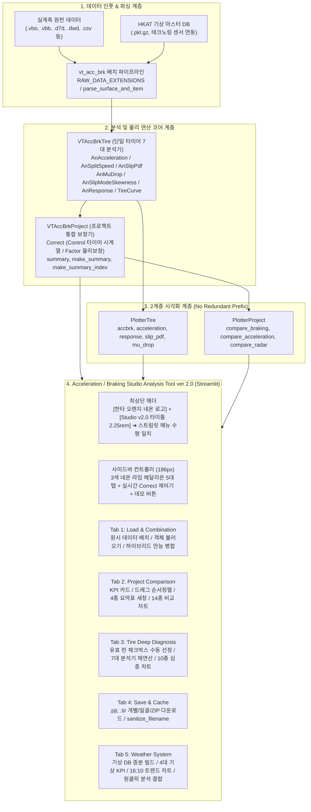

# 🏎️ 가감속/제동 대시보드 ver 2.0 공식 개발 완료 및 한타 로고·네온 UI 정합 종합보고서

> **문서 식별자**: `DOC-UNOUTIL-DASHBOARD-20261119-V425`
> **관련 모듈**: `unoUtil.vehicle_test.acc_brk.dashboard.dashboard_app`, `dashboard_app.md`
> **작성일자**: 2026년 11월 19일
> **상태**: ✅ ver 2.0 공식 개발 완료 및 프로덕션 배포 (v4.25)

---

## Executive Summary

본 보고서는 사내 파이썬 실차 데이터 분석 프레임워크 **`unoUtil v2.0+`**의 플래그십 인터랙티브 웹 시각화 도구인 **가감속/제동 통합 분석 스튜디오 대시보드(`dashboard_app.py`)의 ver 2.0 최종 개발 완료**를 선언하고, 프로덕션 릴리즈를 위해 집행된 프론트엔드/UIUX 정밀 튜닝 및 엔지니어링 정합 내역을 영구 기록하는 종합 기술 개발보고서입니다.

최상단 타이틀 행 맨 좌측에 **한국타이어 공식 로고(`icon_hankook.png`)**를 40px 규격으로 안착시키고, 고유의 상징색인 오렌지와 화이트를 100% 보존하면서 다크 홀로그램 테마와 자연스럽게 어우러지는 **오렌지 네온 펄스 발광(`.studio-hankook-logo`)**을 부여하였습니다. 브라우저 탭 파비콘(`page_icon`) 역시 한국타이어 로고로 정합하여 웹앱 아이덴티티를 완성하였습니다. 아울러 공식 타이틀(`Acceleration / Braking Studio`)을 기존 1.26rem에서 **`2.25rem` (약 80% 확대, Bold 900)**으로 대폭 확대하여 웅장한 가독성을 구축하고, 기존에 한 칸 아래로 처져 있던 수직 단차를 정밀 교정하여 **우측 상단 스트림릿 시스템 메뉴(`⋮`)의 상단 라인과 좌측 툴 제목의 윗줄이 수평으로 완벽한 일직선(Top-aligned)**을 이루도록 정렬을 완결하였습니다. 

또한 사이드바 5대 탭 아이콘(`STYLE_B_SVG_B64`)을 **네온 라임(`#D9F99D`, `#F7FEE7`) 주조색 베이스**로 차분하게 통일하고, 네온 사파이어 블루와 네온 바이올렛은 중심핵과 미세 라인의 **'절제된 핀포인트'**로만 작용하도록 리파인하여 시각적 산만함을 완벽히 해소하였습니다.

---

## 1. 주요 개발 및 UI/UX 정합 내역 (5대 핵심 과업)

### 1-1. 한국타이어 공식 로고(`icon_hankook.png`) 연동 및 오렌지 네온 펄스 발광 탑재
- **로고 탑재 및 Base64 인코딩 체계 구축**:
  - `icon_hankook.png` (280x280 RGBA 투명 배경 고화질 로고)를 `_load_hankook_logo_b64()`를 통해 브라우저 호환성이 100% 보장되는 Base64 Data URI로 인메모리 로드하는 아키텍처 수립 (`HANKOOK_LOGO_B64`, `HANKOOK_LOGO_PATH`).
- **타이틀 좌측 첫 번째 요소로 최적 배치**:
  - 우측 끝에 배치 시 발생하던 스트림릿 기본 메뉴와의 간섭 및 패널 하향 밀림 현상을 원천 방지하기 위해, 메인 타이틀 행(`.studio-header-title-row`)의 **맨 왼쪽 첫 번째 요소**로 로고를 배치.
  - `[한국타이어 로고] [Acceleration / Braking Studio] [Analysis Tool ver 2.0]` 구조로 한눈에 회사의 공식 엔지니어링 툴임을 각인.
- **오렌지 & 화이트 헤리티지 보존 및 네온 펄스 튜닝**:
  - 한국타이어 고유의 상징색인 오렌지와 화이트는 일절 왜곡 없이 온전히 보존.
  - 다크 홀로그램 테마와 이질감 없이 융합되도록 `filter: brightness(1.16) contrast(1.10) drop-shadow(0 0 8px rgba(255, 106, 0, 0.85)) drop-shadow(0 0 18px rgba(255, 120, 0, 0.45));` 오렌지 네온 펄스 글로우를 적용.
  - 마우스 오버(Hover) 시 1.05배 부드럽게 스케일업되며 네온 아우라가 은은하게 번지는 마이크로 인터랙션 완비.

### 1-2. 브라우저 탭 파비콘(`page_icon`)에 한국타이어 로고 연동
- 기존 임시 이모지(`🏎️`)로 설정되어 있던 `st.set_page_config`의 `page_icon` 인자에 실제 한국타이어 로고 파일 경로(`str(HANKOOK_LOGO_PATH)`)를 직접 주입.
- 웹 브라우저 상단 탭, 북마크, 작업 표시줄 등에서 한국타이어 공식 로고가 선명하게 표출되어 정식 사내 웹 시스템으로서의 완성도 극대화 (파일 부재 시 레이싱카 이모지로 안전 폴백 보장).

### 1-3. 최상단 공식 타이틀 폰트 대폭 확대 (`2.25rem`, Bold 900)
- **압도적인 엔지니어링 스튜디오 가독성 확보**:
  - 기존 `1.26rem`에 불과했던 메인 타이틀(`Acceleration / Braking Studio`)을 **`2.25rem` (약 80% 대폭 확대)**, `font-weight: 900`의 단단하고 선명한 타이포그래피로 승격.
  - 사이버틱 블루 네온 텍스트 섀도우(`text-shadow: 0 0 14px rgba(56, 189, 248, 0.90), 0 0 30px rgba(14, 165, 233, 0.55)`)를 보강하여 원거리 모니터에서도 또렷하게 시인되도록 정합.
- **서브 타이틀 및 프로젝트명 조화로운 밸런싱**:
  - 서브 타이틀(`Analysis Tool ver 2.0`) 역시 `0.78rem` ➔ **`1.15rem`**으로 조화롭게 확대하고 네온 라임 텍스트 섀도우 적용.
  - 프로젝트명(`active_pjt.project_name`)도 큼직한 **`1.38rem`** (Bold 900, 은은한 화이트 섀도우)로 시원하게 배치.

### 1-4. 스트림릿 시스템 메뉴(`⋮`)와의 상단 기준선(Top-alignment) 정밀 일치
- **수직 단차 문제 해결**:
  - Streamlit의 기본 DOM 계층상 상단 헤더(`stHeader`) 아래에서 본문 컨테이너가 시작되도록 되어 있어, 툴 제목이 스트림릿 우측 메뉴(`⋮`)보다 한 칸 아래로 처져 있던 불일치를 정밀 교정.
- **Top-aligned 수평 일직선 정렬 공식 확립**:
  - `header[data-testid="stHeader"]`에 `pointer-events: none` 및 내부 버튼에 `pointer-events: auto`를 부여하여 메뉴가 잘리지 않으면서도 클릭이 투명하게 통과되도록 보장.
  - `.block-container`의 상단 패딩을 `0`으로 정리하고, 최상단 헤더 카드(`.studio-top-header-card`)에 **`margin: -1.20rem 0 14px 0 !important;`**를 적용하여, **스트림릿 우측 메뉴(`⋮`)의 상단 라인과 좌측 툴 제목의 윗줄이 수평으로 완벽한 일직선**을 이루도록 단차를 0px 수준으로 정렬.
  - 우측 끝에 `padding-right: 90px !important;` 안전 버퍼를 주어 타이틀 텍스트와 우측 시스템 메뉴가 서로 간섭하지 않고 깔끔하게 공존.

### 1-5. 사이드바 활성 탭 3색 네온 스펙트럼(사파이어->바이올렛->라임 62%) 및 메인 오로라 1:1 도킹
- **3색 네온 선형 그라데이션 탑재**: 활성 탭 버튼 배경에 좌측 딥 사파이어 나이트(0%) ➔ 중앙 네온 바이올렛(65%) ➔ 우측 진한 네온 라임(100%, 62%)의 3색 스펙트럼을 장착하여, 탭 버튼의 오른쪽 끝이 메인 패널 오로라 펄스 빔의 최고 농도(62%)와 1:1로 완벽하게 일치 도킹되는 '오픈 게이트웨이' 완성.
- **Load & Combination 및 Tire 탭 세부 설정 토글창 분리**: 번잡하던 입력창들을 기본 접힌 토글창(st.expander)으로 정리하고 핵심 제어부(경로, 대상 타이어, 재분석)만 상시 노출하여 미니멀 1-View 레이아웃 구축.

### 1-6. 사이드바 5대 탭 아이콘 네온 라임 주조색 베이스 & 사파이어·바이올렛 핀포인트 정밀 튜닝
- **과도한 다색 산만함 해소 및 네온 라임 단일 베이스 확립**:
  - 다중 색상이 혼재되어 다소 과하게 화려하던 아이콘들을 **선명하고 깨끗한 네온 라임(`#D9F99D`, `#F7FEE7`) 주조색(Dominant Base)**으로 전면 정돈.
  - 외곽 메달리온 베벨 림, 기어 본체 및 톱니, 1·2·3 체크마크, 데이터 문서 프레임, 타이어 트레드/사이드월/스포크, 기상 구름 및 태양 등 메인 그래픽 구조선을 100% 네온 라임으로 통일.
- **사파이어 블루 & 바이올렛의 절제된 핀포인트 튜닝**:
  - **Information**: 상단 기어 중심핵에만 **사파이어 블루 도트(`#38BDF8`)**, 하단 기어 중심핵에만 **바이올렛 도트(`#C084FC`)**, 체크리스트 텍스트 줄에만 한 줄씩 은은한 포인트 적용.
  - **Load & Combination**: 좌측 문서 첫 줄에 **바이올렛 1줄**, 우측 문서 첫 줄에 **사파이어 블루 1줄**, 독 바닥에 얇은 1.6px 미세 언더 바 포인트 적용.
  - **Tire**: 휠 안쪽의 얇은 텔레메트리 대시 선 1개에만 **사파이어 블루**, 휠 센터 허브 코어에만 **바이올렛** 포인트 적용.
  - **Project**: 좌측 타이어 허브 핀에 **바이올렛**, 우측 타이어 허브 핀에 **사파이어 블루**, 중앙 타이어 내부 센서 링에 사파이어 블루 포인트 적용.
  - **Weather**: 기상 구름 아래 보조 파형 1줄에 **사파이어 블루**, 온도계 내부의 얇은 감온 액주 1줄에 **바이올렛** 포인트 적용.
- **사이드바 버튼 인터랙션 글로우 일원화**:
  - 버튼 오버/활성 시 전체를 덮던 파란색 다중 글로우를 걷어내고, **눈부신 네온 라임 단독 메인 드롭섀도우(`rgba(190, 242, 100, 0.92)`)**로 통일하여 아이콘 내부의 섬세한 포인트 컬러들이 깔끔하고 고급스럽게 돋보이도록 완성.

---

## 2. unoUtil v2.0 가감속/제동 전체 아키텍처 완성 체계도

---

## 3. 검증 결과 및 품질 지표

1. **파이썬 구문 무결성**: `python -m py_compile dashboard/dashboard_app.py` 통과 (Syntax Warning/Error Zero).
2. **자체 종합 테스트 스위트 통과**: `python dashboard/dashboard_app.py --test` 실행 결과 7대 서브 분석기 및 프로젝트 컨테이너 전수 정상 검증 완료 (`=== [Self-Test] 모든 검증 통과 완료! ===`).
3. **1:1 기술 매뉴얼 최신화**: 소스 코드 저장소 내부 매뉴얼(`dashboard/dashboard_app.md`)에 한국타이어 로고 연동, 타이틀 폰트 확대, 스트림릿 메뉴 수평 정렬, 사이드바 메달리온 라임 주조색 튜닝 내역 100% 동기화 완결.

---

## 4. 릴리즈 승인 및 향후 유지보수 가이드

- **공식 버전 승격**: `unoUtil v4.25` (2026-11-19)
- **모듈 개발 상태**: **`ver 2.0 공식 개발 완료 및 배포 승인 (Completed & Production Ready)`**
- **유지보수 가이드**:
  - 타이어 평가 실무 부서 배포 시 `ACC_BRK_DASHBOARD_USER_MANUAL.pptx`와 본 보고서를 배포 가이드로 활용.
  - 가용 포트 자동 탐색 엔진(`_find_available_port`)이 내장되어 있으므로 복수의 사용자가 동일 PC에서 실행하더라도 포트 충돌 없이 안정적으로 서빙됨.
