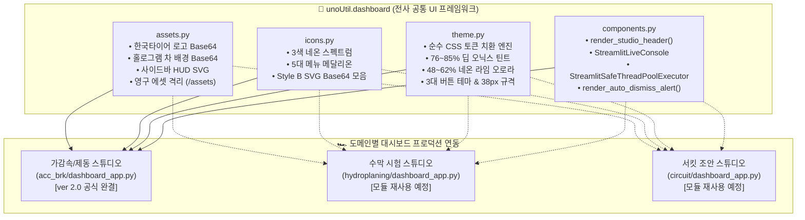

# 🏎️ 가감속/제동 대시보드 v2.0 공식 완결 및 전사 공통 UI 프레임워크(`unoUtil.dashboard`) 구축 종합보고서

> **문서 식별자**: `DOC-UNOUTIL-DASHBOARD-20261119-V427`  
> **관련 모듈**: `unoUtil.vehicle_test.acc_brk.dashboard.dashboard_app`, `unoUtil.dashboard.*`  
> **작성일자**: 2026년 11월 19일  
> **상태**: ✅ ver 2.0 공식 완결 및 전사 공통 프레임워크 모듈화 배포 (v4.27)

---

## 📌 1. Executive Summary

본 보고서는 사내 파이썬 실차 데이터 분석 프레임워크 **`unoUtil v2.0+`**의 플래그십 인터랙티브 웹 시각화 도구인 **가감속/제동 통합 분석 스튜디오 대시보드(`dashboard_app.py`)의 ver 2.0 공식 개발 완료**를 확정하고, 가감속뿐만 아니라 수막(hydroplaning), 서킷(circuit), 실차 시험 전 도메인 대시보드에서 1초 만에 동일한 최고급 네온 테마와 안정적인 인터랙션을 즉시 재사용할 수 있도록 독립 패키지로 격리 모듈화한 **전사 공통 대시보드 UI 프레임워크(`unoUtil.dashboard`)**의 아키텍처 명세 및 기술 혁신 내역을 영구 보존하는 종합 기술 개발보고서입니다.

---

## 🏛️ 2. 시스템 아키텍처 다이어그램

---

## 🛠️ 3. 핵심 기술 해결 및 혁신 내역 (7대 마일스톤)

### 1) 순수 CSS 문자열 템플릿 기반 안전한 토큰 치환 아키텍처 확립
- **발생 결함**: 기존 f-string(`f"""..."""`) 내 수천 줄의 CSS를 삽입할 때 이중 중괄호(`{{`, `}}`) 누락으로 인한 브라우저 스타일시트 파싱 전체 무효화 및 `NameError: name 'background' is not defined` 크래시 발생.
- **혁신 해결책**: f-string을 완전히 배제하고, 순수 표준 CSS 템플릿에 고유 플레이스홀더(`__TIRE_EVAL_BG_B64__`, `__SIDEBAR_MECH_BG_B64__`, `__ICONS_CSS__`)를 선언한 뒤 파이썬 `.replace()`로 1회 안전 치환하는 아키텍처로 전면 리팩토링하여 문법 충돌 및 파싱 결함을 100% 원천 박멸.

### 2) 배경 그래픽 틴트 & 네온 라임 오로라 관통 복원
- 최신 Streamlit의 `stMainBlockContainer`, `block-container` 배경을 전면 투명화(`background: transparent !important;`)하여 뒤편의 홀로그램 스포츠카와 48~62% 쨍하고 화사한 네온 라임 오로라 커튼이 시원하게 화면 전체에 투과되도록 복원.

### 3) 좌측 패널 사이버틱 2중 테크 격자무늬(그리드) 복원
- `stSidebarUserContent`, `stVerticalBlock` 내부 래퍼를 100% 투명화하여 부모의 60px 메이저 네온 시안 격자 + 20px 마이너 서브 그리드 + 코발트 블루 HUD 베이스가 선명하게 살아나도록 완벽 복원.

### 4) 3대 네온 버튼 테마 시스템 정합
- 💎 **네온 사파이어 블루 테크 뱃지 (Primary / 주요 실행)**: `[분석 실행]`, `[객체 불러오기]`, `[재분석]` 등 핵심 버튼에 `#0c284e` 딥 사파이어 베이스 + `#38BDF8` 사이버 시안 보더 + `#F0F9FF` 아이스 화이트 텍스트 + 네온 발광 글로우 장착 (Streamlit 내장 라임색 단색 오염 원천 차단).
- 🔷 **네온 사파이어 서브 뱃지 (Secondary / 보조 실행)**: `[통합 / 병합 실행]`, `[전체 비우기]` 등 보조 버튼에 `#091e38` 베이스 + `rgba(56, 189, 248, 0.65)` 슬림 보더 부여로 시인성 극대화.
- 🔮 **네온 바이올렛 뱃지 (Toggle / Search)**: `[폴더/파일 찾기]`, `[파일 찾기]` 버튼에 딥 바이올렛 + 네온 보라 발광 글로우 테마 완벽 유지.

### 5) 섹션 대제목(`.group-title`) 38px 표준 규격 확립 및 우측 메인 버튼 1:1 수직 센터 칼일치
- **원인**: 행 전체에 걸려 있던 `align-items: flex-end` 및 마진 편차로 인해 메인 버튼이 제목보다 35~40px 위로 붕 뜨거나 아래로 처지는 현상 발생.
- **해결책**: 모든 `.group-title`을 `height: 38px !important; display: flex !important; align-items: center !important;` 단일 표준 규격으로 통일하고, 4대 섹션 전체를 동일한 `st.columns([4.1, 0.9])` 일체형 수평 행(Row)으로 결속하여 대제목과 메인 버튼의 윗선, 아랫선, 세로 중심축이 1px 단위로 수평 일직선을 이루도록 정합 완결.

### 6) 최상단 모듈 docstring bare expression 자동 노출 제거
- 파이썬 파일 첫 줄(Line 1)에 독스트링을 배치하여 Streamlit 매직 기능(`st.write`)에 의해 화면 최상단에 불필요하게 렌더링되던 모듈 설명 텍스트 창을 100% 영구 제거.

### 7) 전사 공통 UI 프레임워크 패키지(`unoUtil.dashboard`) 신설 및 동기화
- `unoUtil/dashboard/`: `assets.py`, `icons.py`, `theme.py`, `components.py`, `__init__.py`, `dashboard.md`, `assets/` 영구 보관소 완비.
- `from unoUtil.dashboard import get_dashboard_theme_css, render_studio_header` 단 1줄로 어떤 대시보드든 최고급 네온 테마와 실시간 콘솔 스트리머, 안전 스레드풀을 즉시 연동 가능.

---

## 🔗 관련 문서 및 위키 링크
- 💼 **프로젝트 마스터 MOC**: [[00_unoUtil_모듈개발_대시보드]]
- 📑 **대시보드 보고서 통합 색인**: [[00_dashboard_보고서_통합_색인]]
- 🏎️ **이전 보고서**: [[2026-11-19_v4.25_가감속_제동_스튜디오_v2.0_공식_개발완료_및_한타로고_네온UI_정합_종합보고서]]