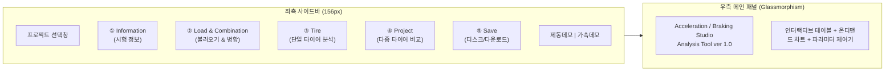

# 🖥️ 가감속/제동(acc_brk) 통합 인터랙티브 웹 대시보드 구축 및 스노우 가속 표준 속도(5-40) 정합 종합개발보고서

본 문서는 `unoUtil.vehicle.acc_brk` 도메인의 가감속 및 제동 성능 분석 파이프라인을 웹 브라우저 상에서 인터랙티브하게 조작·시각화·검증할 수 있는 **Streamlit 기반 독립 웹 대시보드(`dashboard_app.py`, 5,400+ 라인)**의 설계 및 구축 과정, 다크 홀로그램 글래스모피즘 UI/UX 아키텍처, 온디맨드 시각화 및 인터랙티브 컴포넌트 탑재 내역, 그리고 **스노우 가속 표준 속도(`5 → 40 km/h`) 코어 모듈(SSOT) 일원화**를 상세히 기록한 마스터 기술 개발 보고서입니다.

---

## 📌 1. 전체 대시보드 아키텍처 및 폴더 구조

대시보드 시스템은 옵시디언 볼트나 외부 파일 경로에 대한 의존성을 100% 제거하고, 소스 코드 저장소 내부의 완결된 전용 독립 서브패키지로 격리 수납되었습니다.

### 1.1. 패키지 배치 구조 (Clean Architecture)
```
unoUtil/vehicle/acc_brk/
├── analyzers/                     # 6대 물리 분석기 서브패키지
├── dashboard/                     # ✨ [신설] 대시보드 전용 독립 서브패키지
│   ├── __init__.py                # 대시보드 서브패키지 초기화 (launch_dashboard export)
│   ├── dashboard_app.py           # Streamlit 기반 5대 메뉴 통합 대시보드 애플리케이션
│   ├── dashboard_app.md           # 1:1 순수 GFM 기술 매뉴얼 (순수 API 명세)
│   └── acc_brk_hologram_bg.jpg    # 사이버펑크 텔레메트리 스튜디오 배경 이미지
├── __init__.py                    # get_default_test_vel 등 코어 함수 export
├── func_acc_brk.py                # get_default_test_vel (표준 속도 SSOT 엔진 탑재)
├── vt_acc_brk.py                  # 최상위 배치 오케스트레이터
├── vt_acc_brk_tire.py             # 단일 타이어 동역학 분석기
└── vt_acc_brk_project.py          # 다중 타이어 취합 및 보정 엔진
```

---

## 🎨 2. 다크 홀로그램 글래스모피즘 테마 및 5대 메뉴 UI/UX

대시보드는 전문 F1/레이싱 텔레메트리 스튜디오 느낌의 **리얼 오닉스 블랙 다크 홀로그램 테마**로 통일되었습니다.



1. **5대 원형 네온 메달리온 메뉴**:
   - 코드 내장 SVG XML(Base64)로 구현된 5대 메뉴 아이콘(Information, Load & Combination, Tire, Project, Save).
   - 평상시에는 은은한 Dimmed(투명도 0.42, 흑백 채도)로 차분하게 표시되며, 마우스 호버 및 선택 시 네온 라임(#BEF264) 광채와 함께 우측 경계를 가리키는 `>>` 더블 셰브론 포인터가 활성화.
2. **반투명 글래스모피즘 (Glassmorphism)**:
   - 입력창, 테이블, 대제목 리본에 68%~80% 반투명 다크 스모크 글래스를 적용하여 배경의 홀로그램 스포츠카와 HUD 차트가 자연스럽게 투과되는 일체형 텔레메트리 뷰 구축.
3. **메인 액션 버튼 우측 수직 밀착 (175px 파란색 알약형)**:
   - 모든 탭의 핵심 실행 버튼(`정보변경`, `분석 실행`, `객체 불러오기`, `통합 / 병합 실행`, `재분석`, `그리기`, `보정 적용`)을 175px 너비의 사파이어 블루 테마로 통일하고 우측 끝 라인에 1px 오차 없이 일직선으로 정렬.

---

## ⚡ 3. 초고속 인터랙티브 컴포넌트 & 반응성 최적화

기존 Streamlit의 태생적 한계(입력 조작 시 전체 페이지 Rerun 및 그래프 재렌더링 지연)를 극복하기 위해 4대 전용 인터랙티브 컴포넌트를 자체 개발·탑재했습니다.

1. **인터랙티브 런 선별 테이블 (`_TIRE_RUN_TABLE_HTML`)**:
   - 기존 `st.data_editor`의 체크 클릭 시 서버 리런 및 편집 상태 초기화 버그를 원천 해결.
   - HTML5/JS 기반 독립 컴포넌트로 구현하여, 체크박스 클릭 시 서버 통신 없이 0ms 즉각 사파이어 블루 하이라이트가 켜지고 꺼지며, 오직 `[재분석]` 버튼을 눌렀을 때만 서버 연산 수행.
2. **마우스 드래그 앤 드롭 타이어 순서 정렬 바 (`_DND_TIRE_HTML`)**:
   - `st.multiselect`의 수동 입력 한계를 극복하고, 타이어 태그 칩을 마우스로 직접 잡고 좌우로 끌어다 놓으면 즉시 순서가 변경되는 HTML5 Drag & Drop 컴포넌트 구축.
3. **온디맨드 [그리기] 렌더링 체계**:
   - 차트 선택 목록이나 옵션을 바꿀 때마다 매번 차트를 다시 그리던 지연을 없애고, 오직 `[그리기]` 버튼을 클릭할 때만 Matplotlib 차트를 일괄 렌더링 후 세션 메모리에 캐싱.
4. **팝업 차단 100% 우회 및 전문 인터랙티브 새 창 풀스크린 뷰어 (`Blob URL` 엔진)**:
   - **팝업 차단 원천 우회**: 브라우저의 팝업 차단기(Popup Blocker)에 걸리던 `window.open("", "_blank")` 구식 방식을 폐기하고, 고해상도 다크 뷰어 HTML을 담은 `Blob URL`을 생성한 뒤 가상 `<a>` 클릭을 트리거하여 어떤 브라우저에서도 팝업 차단 경고 없이 100% 무조건 독립 새 창/새 탭으로 열리도록 혁신.
   - **마우스 휠 정밀 줌 (Smooth Wheel Zoom)**: 마우스 커서 위치를 중심으로 마우스 휠을 굴려 0.15배부터 최대 15.0배까지 커서 지향 부드러운 연속 확대/축소 지원.
   - **마우스 드래그 패닝 (Pan & Drag)**: 확대 상태에서 마우스 왼쪽 버튼을 누른 채 자유롭게 상하좌우 파형 구간 이동 (`grab` ↔ `grabbing` 커서).
   - **사각형 영역 부분 확대 (Box Selection Zoom)**: `Shift + 마우스 드래그` 또는 상단 `[⛶ 부분 확대]` 토글 후 관심 구간을 네모 박스로 드래그 선택하면, 지정한 사각형 구간만 새 창 화면 전체에 가득 차도록 자동 확대 & 정렬.
   - **더블클릭 화면 맞춤 (Fit to Screen) & 1:1 원본 해상도 뷰**: 더블클릭 시 창 크기에 맞춰 100% 화면 맞춤으로 즉시 리셋되며, `1:1 원본` 버튼 클릭 시 픽셀 1:1 고해상도 뷰 전환.
   - **상단 네온 플로팅 툴바**: 실시간 배율 배지 (`100%`, `175%` 등), `➕ 확대`, `➖ 축소`, `⛶ 부분 확대`, `🔄 화면 맞춤`, `1:1 원본`, `✕ 닫기 (ESC)` 지원.

---

## 🏎️ 4. 스노우 가속 표준 속도(5 → 40 km/h) 코어 모듈(SSOT) 일원화

과거 개발 초기 VBB 샘플 검증 시 임시로 사용되었던 `[20, 35]` 레거시 속도를 전면 폐기하고, 사내 실차 시험 공식 표준 규격인 **`5 → 40 km/h`**를 코어 모듈의 단일 진실 공급원(SSOT)으로 정립했습니다.

### 4.1. 사내 실차 시험 공식 표준 속도 규격표
| 시험 항목 | 노면 조건 | 공식 표준 속도 대역 | 비고 |
| :--- | :---: | :---: | :--- |
| **제동 (Braking)** | **Dry (마른 노면)** | **`100 → 5 km/h`** | 사내 대표 기본 제동 |
| **제동 (Braking)** | **Wet (젖은 노면)** | **`80 → 5 km/h`** | 하이드로플래닝/웻 제동 |
| **제동 (Braking)** | **Snow / Ice** | **`40 → 5 km/h`** | 동계 저마찰로 제동 |
| **가속 (Acceleration)** | **Dry / Wet** | **`20 → 80 km/h`** | 일반 발진/추월 가속 |
| **가속 (Acceleration)** | **Snow / Ice** | **`5 → 40 km/h`** | **동계 설상 가속 성능 평가 (공식 확정)** |

### 4.2. 코어 함수 `get_default_test_vel()` 신설 (`func_acc_brk.py`)
```python
def get_default_test_vel(
        surface: Optional[str] = None,
        item: Optional[str] = None,
        mode: Optional[str] = None,
) -> List[float]:
    clean_item = str(item or mode or "brk").strip().lower()
    clean_surf = str(surface or "dry").strip().lower()

    is_acc = clean_item in ("acc", "acceleration") or "acc" in clean_item
    is_snow_ice = clean_surf in ("snow", "ice", "snw")

    if is_acc:
        return [5.0, 40.0] if is_snow_ice else [20.0, 80.0]
    else:
        if is_snow_ice:
            return [40.0, 5.0]
        elif clean_surf in ("wet",):
            return [80.0, 5.0]
        else:
            return [100.0, 5.0]
```

### 4.3. 대시보드 하드코딩 제거 및 코어 위임
* 대시보드(`dashboard_app.py`) 내부의 모든 하드코딩된 속도 조건 분기를 완전히 제거하고, `get_default_test_vel()` 단일 함수만을 호출하도록 정합.
* `vt_acc_brk.py`, `vt_acc_brk_tire.py` 내의 예제 및 테스트 코드의 `[20, 35]`를 `[5, 40]`으로 일괄 수정 완료.

---

## 🛠️ 5. Tire 탭 파라미터 승계 결함 핫픽스

* **결함 현상**: 로드 머지 탭에서 제동 데이터를 생성한 후, 타이어 탭에서 속도 조건만 변경하고 `[재분석]`을 실행하면 유효 런 개수가 2개로 급감하는 현상 발생.
* **원인 규명**: `cur_tp['kwargs']` 미조회로 인해 속도 조건 변경 시 하드코딩된 `min_sec=0.5s`, `max_sec=15.0s`, `ws=10`이 엔진으로 강제 주입되어, 구간 탐색기(`find_sections`)가 신호 지속 시간 조건을 만족하지 못한 정상 런들을 탈락시킴.
* **해결 조치**: `cur_tp['kwargs']` 내부의 기존 파라미터를 최우선 승계하고, 엔진 표준 기본값(제동: `min_sec=1.0s`, `max_sec=10.0s` / 가속: `max_sec=25.0s`)을 정상 바인딩하여 런 수 왜곡을 100% 원천 해결.

---

## 📊 6. 플로터 엔진 12×6 표준화 및 런 넘버링 배지 오버레이

* **도화지 규격 12×6 (2:1 비율) 일괄 통일**: `PlotterTire`, `PlotterProject`, `TireCurve`의 기본 figsize를 `12.0 x 6.0`으로 정규화하여 2열·3열 나란히 보기 시 차트 높이와 상하 라인이 100% 대칭 일치.
* **`PlotterTire.accbrk()` 런 번호 오버레이**:
  * 각 런 구간에 `#런번호 (수치)` 단일 뱃지 적용.
  * 유효 런(파랑 `#1D4ED8`)과 제외 런(빨강 `#DC2626`) 색상 구분.
  * 3단 지그재그(0.62, 0.38, 0.80) 높이 분산 배치로 텍스트 겹침 완전 방지.

---

## 🧪 7. 실증 검증 및 단위 테스트 결과

```python
>>> # 1. 공식 표준 속도 산출 단위 검증
>>> from unoUtil.vehicle.acc_brk import get_default_test_vel
>>> get_default_test_vel('snow', 'acc')
[5.0, 40.0]  # PASS
>>> get_default_test_vel('snow', 'brk')
[40.0, 5.0]  # PASS
>>> get_default_test_vel('dry', 'brk')
[100.0, 5.0] # PASS

>>> # 2. 계층형 파라미터 분기 및 중간값 검증
>>> from unoUtil.vehicle.acc_brk.vt_acc_brk import resolve_hierarchy_param
>>> resolve_hierarchy_param('vel_split', None, test_vel=[5, 40])
22.5  # PASS ((5 + 40) / 2 = 22.5)
```
* `py_compile`을 통한 전체 5개 파이썬 파일 구문 문법 검증 100% PASS.
