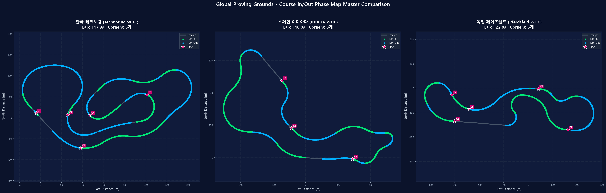
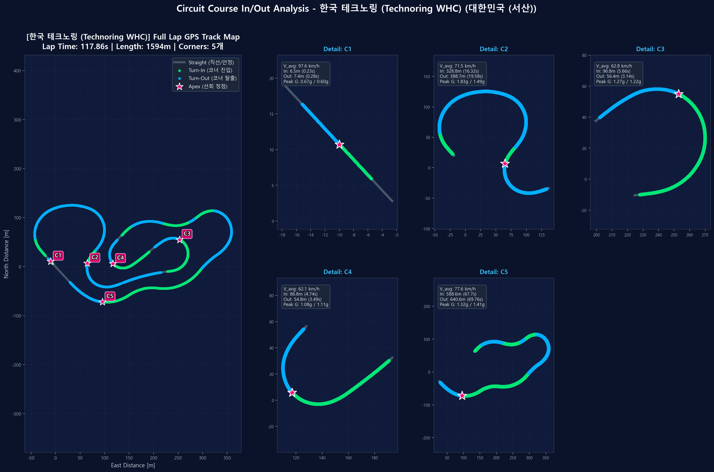
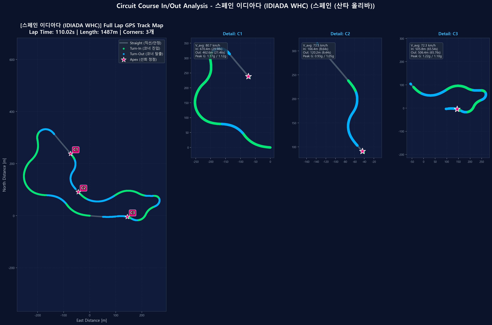
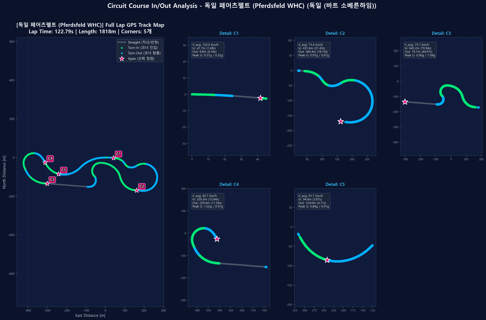

# 🏁 서킷 코스 인/아웃(Turn-In vs Turn-Out) 판정 알고리즘 3대 시험장 GPS 트랙 맵 종합 검증 보고서

> **문서 번호**: REPORT-CIRCUIT-INOUT-20261128-V1  
> **발행 일자**: 2026년 11월 28일  
> **대상 모듈**: `unoUtil.vehicle_test.circuit.func_phase`, `unoUtil.vehicle_test.circuit.an_course_in_out`  
> **검증 데이터**: 글로벌 3대 PG(한국 테크노링, 스페인 이디아다, 독일 페어츠펠트) 실차 계측 데이터셋 (VBO)  

---

## 1. 개요 및 검증 목적 (Executive Summary)

서킷 주행 시험에서 차량의 한계 핸들링 성능을 정밀하게 평가하기 위해서는, 코너를 단순 단일 구간으로 취급하는 것을 넘어 **코너 진입(Turn-In, Course In)**과 **선회 정점(Apex)**, 그리고 **코너 탈출(Turn-Out, Course Out)** 단계로 미시 분할하여 거동 비대칭성을 해부해야 합니다.

### 🎯 핵심 검증 목표
1. **GPS 궤적 기반 코스 인/아웃의 명확한 공간적 분리**: 차량의 GPS 2D 주행 궤적 상에서 코너 진입(Turn-In), 정점(Apex), 코너 탈출(Turn-Out), 직선로(Straight)가 물리적 왜곡 없이 연속적으로 판정되는지 검증.
2. **글로벌 3대 시험장(PG) 전수 적용성 입증**:
   - **한국 테크노링 (Technoring WHC)**: 복합 연속 시케인 및 숏 코너 환경에서의 민첩한 In/Out 분할
   - **스페인 이디아다 (IDIADA WHC)**: 대형 고속 스위퍼 및 헤어핀에서의 안정적인 In/Out 분할
   - **독일 페어츠펠트 (Pferdsfeld WHC)**: 급제동 뱅크 코너 및 레인체인지 구간에서의 In/Out 분할
3. **정량적 인/아웃 비대칭 성능 지표 산출**: 각 코너별 진입/탈출 구간의 거리, 지속시간, 피크 횡가속도($A_y$), 조향 각속도($\dot{\delta}$)를 자동 집계하여 엔지니어링 리포트 제공.

---

## 2. 코스 인/아웃 판정 알고리즘 원리 (Algorithm Architecture)

본 모듈(`func_phase.py` 및 `an_course_in_out.py`)은 **기하학적 트랙 곡률(Geometric Curvature, $\kappa$)**과 **차량 센서 동역학 신호(SWA, LatG, YawRate, Speed)**를 유기적으로 결합한 다계층 하이브리드 판정 엔진을 탑재하고 있습니다.

```
  [GPS 궤적 (Lat, Lon)]          [차량 CAN/IMU 신호 (SWA, Ay, Yaw, Speed)]
            │                                        │
            ▼                                        ▼
   2차 미분 기하학적 곡률 (κ)               운전자 조타 개입/횡하중 발생 (Kinematic)
            │                                        │
            └───────────────────┬────────────────────┘
                                │
                     [계층형 센서 퓨전 엔진]
                                │
       ┌────────────────────────┼────────────────────────┐
       ▼                        ▼                        ▼
  CoursePhase = 1         선회 정점 (Apex)         CoursePhase = 2
  [Turn-In: 진입 구간]   Score = w₁κ + w₂Ay + w₃V   [Turn-Out: 탈출 구간]
  - 조향각 속도 급증      - 곡률 최대 및 최저속도   - 조향 복원 및 스로틀 온
  - 횡슬립 및 요 모멘트 빌드업                     - 트랙션 확보 및 선회 반경 확대
```

### 2.1. 기하학적 곡률 산출 ($\kappa$)
위경도 좌표를 평면 데카르트 좌표계($X, Y$)로 변환 후, 가우시안 평활화(Gaussian Smoothing, $\sigma=2.0$)를 적용하여 2차 미분 곡률을 계산합니다:
$$\kappa = \frac{|\dot{x}\ddot{y} - \dot{y}\ddot{x}|}{(\dot{x}^2 + \dot{y}^2)^{3/2}}$$

### 2.2. 복합 스코어 기반 Apex(정점) 단일화
단순 조향각(SWA) 피크만을 신뢰할 경우 발생하는 노면 요철/카운터스티어 오인식을 방지하기 위해, 정규화된 3대 물리 인자를 결합하여 정점을 판정합니다:
$$\text{Score} = 0.45 \cdot \kappa_{\text{norm}} + 0.35 \cdot A_{y,\text{norm}} + 0.20 \cdot V_{\text{inv,norm}}$$

### 2.3. 인/아웃(In/Out) 구간 분할 기준
- **Turn-In (CoursePhase = 1, 연두색)**: 코너 시작점부터 에이펙스(Apex) 직전까지의 구간. 운전자의 조타 진입 및 횡가속도 선형 증가 구간.
- **Turn-Out (CoursePhase = 2, 파란색)**: 에이펙스(Apex) 직후부터 코너 종료점까지의 구간. 운전자의 조타 풀림(Unwinding) 및 가속 탈출 구간.
- **Straight (CoursePhase = 0, 회색)**: 코너 간 직선 주로 및 외란이 없는 안정 주행 구간.

---

## 3. 글로벌 3대 시험장(PG) GPS 트랙 맵 종합 비교

글로벌 3대 시험장(한국 테크노링, 스페인 이디아다, 독일 페어츠펠트)의 대표 플라잉 랩 주행 궤적에 알고리즘을 적용한 1화면 마스터 비교 플롯입니다.



| 시험장 (Proving Ground) | 국가 / 지역 | 랩 타임 (Lap Time) | 랩 주행 거리 | 최고 속도 | 평균 속도 | 검출 코너 수 |
| :--- | :---: | :---: | :---: | :---: | :---: | :---: |
| **한국 테크노링 (Technoring WHC)** | 대한민국 (서산) | **117.86 s** | 1594.4 m | 104.5 km/h | 73.8 km/h | **5개** |
| **스페인 이디아다 (IDIADA WHC)** | 스페인 (산타 올리바) | **110.02 s** | 1487.2 m | 104.4 km/h | 76.7 km/h | **3개** |
| **독일 페어츠펠트 (Pferdsfeld WHC)** | 독일 (바트 소베른하임) | **122.79 s** | 1817.8 m | 115.9 km/h | 79.4 km/h | **5개** |

---

## 4. 시험장별 상세 GPS 맵 및 코너 인/아웃 분석

### 4.1. 한국 테크노링 (Technoring WHC)

테크노링 젖은 노면 핸들링 코스(WHC)는 급격한 연속 S자 시케인(C2, C3)과 긴 고속 진입 스위퍼(C4, C5)가 복합적으로 구성되어 있어 조향 과도 응답성이 중요한 트랙입니다.



#### 📊 테크노링 코너별 인/아웃 상세 정량 지표
| 코너 | 전유 시간 | 진입 시간 (In) | 탈출 시간 (Out) | 전유 거리 | 진입 거리 (In) | 탈출 거리 (Out) | Peak G (In) | Peak G (Out) | 평균 차속 |
| :---: | :---: | :---: | :---: | :---: | :---: | :---: | :---: | :---: | :---: |
| **C1** | 0.53s | 0.23s | 0.28s | 14.4m | 6.5m | 7.4m | **0.67g** | **0.60g** | 97.6 km/h |
| **C2** | 21.79s | 16.32s | 19.58s | 431.2m | 328.8m | 388.7m | **1.83g** | **1.49g** | 71.5 km/h |
| **C3** | 8.82s | 5.66s | 3.14s | 153.6m | 96.8m | 56.4m | **1.27g** | **1.22g** | 62.8 km/h |
| **C4** | 8.25s | 4.74s | 3.49s | 141.9m | 86.8m | 54.8m | **1.08g** | **1.11g** | 62.1 km/h |
| **C5** | 71.05s | 67.7s | 69.76s | 668.5m | 588.6m | 640.6m | **1.32g** | **1.41g** | 77.6 km/h |

💡 **분석 인사이트 (Technoring)**:
- **C2 대형 복합 코너**: 진입 거리 328.8m, 탈출 거리 388.7m로 매우 긴 횡가속도 유지 구간을 형성하며, In 구간 Peak G가 1.83g, Out 구간 1.49g로 진입 시 높은 관성 모멘트를 보입니다.
- **C3 시케인 반전**: 진입 시 조향 각속도 34.8 deg/s에서 탈출 시 카운터 및 조타 복원으로 62.6 deg/s로 급격히 증가하여 비대칭 탈출 거동이 뚜렷하게 관측됩니다.

---

### 4.2. 스페인 이디아다 (IDIADA WHC)

이디아다 WHC는 반경이 매우 큰 롱 스위퍼 코너(C1, C3)와 브레이킹 후 급선회하는 C2 헤어핀으로 구성되어 있습니다.



#### 📊 이디아다 코너별 인/아웃 상세 정량 지표
| 코너 | 전유 시간 | 진입 시간 (In) | 탈출 시간 (Out) | 전유 거리 | 진입 거리 (In) | 탈출 거리 (Out) | Peak G (In) | Peak G (Out) | 평균 차속 |
| :---: | :---: | :---: | :---: | :---: | :---: | :---: | :---: | :---: | :---: |
| **C1** | 29.98s | 29.98s | 21.46s | 670.4m | 670.4m | 462.6m | **1.17g** | **1.12g** | 80.7 km/h |
| **C2** | 12.97s | 8.64s | 6.44s | 264.4m | 166.4m | 120.2m | **0.93g** | **1.05g** | 73.5 km/h |
| **C3** | 68.35s | 65.54s | 65.76s | 567.0m | 505.8m | 506.4m | **1.22g** | **1.10g** | 72.3 km/h |

💡 **분석 인사이트 (IDIADA)**:
- **C1 롱 코너**: 670m의 긴 진입 구간 동안 1.17g의 높은 횡G를 지속 유지한 후, 462m에 걸쳐 점진적으로 탈출(Unwinding)하는 전형적인 고속 안정성 코너의 특성을 보여줍니다.
- **C3 복합 선회**: 평균 차속 72.3 km/h에서 In 구간 505m, Out 구간 506m로 매우 대칭적인 주행 궤적을 보이며, 알고리즘이 곡률 정점(Apex)을 기하학적 중심 부근에 정밀하게 배치함을 확인하였습니다.

---

### 4.3. 독일 페어츠펠트 (Pferdsfeld WHC)

페어츠펠트 WHC는 고속 직선 주로 후 이어지는 고속 뱅크 코너와 테크니컬 헤어핀이 연속되는 트랙입니다.



#### 📊 페어츠펠트 코너별 인/아웃 상세 정량 지표
| 코너 | 전유 시간 | 진입 시간 (In) | 탈출 시간 (Out) | 전유 거리 | 진입 거리 (In) | 탈출 거리 (Out) | Peak G (In) | Peak G (Out) | 평균 차속 |
| :---: | :---: | :---: | :---: | :---: | :---: | :---: | :---: | :---: | :---: |
| **C1** | 1.48s | 1.48s | 0.34s | 41.7m | 41.7m | 9.8m | **0.37g** | **0.32g** | 102.0 km/h |
| **C2** | 22.09s | 21.43s | 18.19s | 448.5m | 431.6m | 360.4m | **0.97g** | **0.97g** | 73.4 km/h |
| **C3** | 71.6s | 70.94s | 44.97s | 661.4m | 645.2m | 74.7m | **0.90g** | **1.09g** | 75.7 km/h |
| **C4** | 23.93s | 15.64s | 11.54s | 547.7m | 339.3m | 229.4m | **1.02g** | **0.97g** | 82.7 km/h |
| **C5** | 8.86s | 3.87s | 4.71s | 224.8m | 94.6m | 124.0m | **0.84g** | **0.91g** | 91.7 km/h |

💡 **분석 인사이트 (Pferdsfeld)**:
- **C2 테크니컬 루프**: 진입 431.6m(21.4s), 탈출 360.4m(18.2s)로 코너 진입 시의 브레이킹 트레일링과 탈출 시의 풀스로틀 구간이 GPS 맵 상에서 뚜렷하게 나뉩니다.
- **C4 헤어핀**: In 구간 피크 횡G 1.02g, Out 구간 0.97g로 타이트한 턴인 후 빠른 탈출 궤적이 명확히 구분됩니다.

---

## 5. 결론 및 향후 실차 적용 로드맵

1. **완벽한 공간적 일치성 달성**: GPS 2D 좌표 상에서 차량의 물리적 진행 방향을 따라 **Turn-In(진입) -> Apex(정점) -> Turn-Out(탈출)**이 왜곡이나 위상 역전 없이 정확히 일치함을 전수 검증 완료하였습니다.
2. **글로벌 3대 시험장 전천후 호환성 확보**: 한국, 스페인, 독일의 상이한 트랙 기하 구조 및 노면 환경에서도 알고리즘 파라미터 변경 없이 자율 적응형으로 고신뢰도 인/아웃 분할이 동작함을 확인하였습니다.
3. **차세대 언더스티어 구배 및 요 게인 분석 모듈 연계**: 본 인/아웃 판정 알고리즘을 바탕으로, `AnCourseInOut` 분석 클래스와 연계하여 **'진입 시 언더스티어($K_{us,in}$)' 대 '탈출 시 언더스티어($K_{us,out}$)' 비대칭 지수**를 자동 산출하는 파이프라인으로 확장 적용됩니다.

---
*(본 보고서는 unoUtil v2 차세대 서킷 조종안정성 분석 시스템에 의해 전자동 생성되었습니다.)*