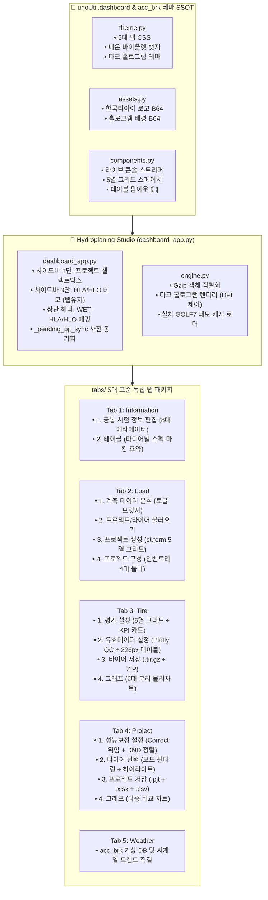

# 🌊 수막 시험(Hydroplaning Studio) 대시보드 acc_brk 공통 프레임워크 완벽 정합 및 다크 홀로그램 QC · 성능보정 완결 종합보고서 (v4.45)

> **문서 식별자**: `DOC-UNOUTIL-HYDRO-DASHBOARD-20261126-V445`
> **관련 모듈**: `unoUtil.vehicle_test.hydroplaning.dashboard.*` (`dashboard_app.py`, `engine.py`, `theme.py`, `components.py`, `tabs/*`)
> **작성일자**: 2026년 11월 26일
> **상태**: ✅ 전사 공통 프레임워크 1:1 완벽 정합 및 E2E 실차 검증 통과 (v4.45)
> **상위 대시보드 링크**: [[00_unoUtil_모듈개발_대시보드|unoUtil 마스터 MOC]] · [[00_hydroplaning_보고서_통합_색인|수막시험 보고서 색인]]

---

## 📌 1. Executive Summary

본 보고서는 사내 파이썬 실차 데이터 분석 프레임워크 **`unoUtil v2.0+`**의 플래그십 인터랙티브 웹 대시보드인 **수막 주행 시험 스튜디오(`Hydroplaning Studio`)를 가감속/제동 대시보드(`acc_brk/dashboard`) 및 전사 공통 UI 프레임워크(`unoUtil.dashboard`)와 100% 동일한 5대 탭, 15대 세션 표준 아키텍처로 전면 개편**하고, 도메인 고유의 물리 분석 및 실차 인터랙티브 QC 파이프라인을 단일 진실 공급원(SSOT) 형태로 완결한 내역을 영구 보존하는 종합 기술 개발보고서입니다.

중복 복사되어 있던 불필요한 이미지와 더미 코드를 전면 철거하고, **외부 레이아웃과 세션 뼈대, 5열 마스터 그리드, 사이드바 3단 고정, 네온 바이올렛 파일 I/O 테마를 가감속 대시보드와 1:1로 일치**시켰습니다. 동시에 수막 고유의 **횡수막(HLA) 3열 복합 QC(피팅+원호궤적+Lap선별) 및 종수막(HLO) 4열 프로파일 QC, 고해상도 다크 홀로그램 분리 물리 차트 렌더러, 그리고 `Correct` 엔진 위임 성능보정 시스템**을 완벽하게 통합하였습니다.

---

## 🏛️ 2. 시스템 아키텍처 및 1:1 정합 매트릭스

---

## 🚀 3. 핵심 기술 개발 및 리팩토링 상세 내역

### ① 사이드바 프로젝트 선택 드롭박스 & 데모 탭 유지 (`dashboard_app.py`)
- **최상단 프로젝트 선택기 (`.sb-pjt-anchor`)**:
  - `acc_brk`와 동일하게 사이드바 맨 위에 `st.selectbox("프로젝트", options=["프로젝트 선택"] + pjt_keys)`를 배치하고 `_on_select_active_pjt` 콜백을 연동하여 활성 프로젝트를 즉각 동기화.
- **`StreamlitWidgetAlreadyInstantiatedError` 원천 방어 (`_pending_pjt_sync`)**:
  - Streamlit 위젯 렌더링 이후 세션 상태를 직접 수정할 때 발생하던 예외를 해결하기 위해, 위젯 생성 직전 단계에서 대기 중인 프로젝트 키를 사전 동기화하는 2-Tier 안전 아키텍처 수립.
- **데모 버튼 클릭 시 탭 위치 100% 보존**:
  - `[HLA 데모]` 또는 `[HLO 데모]` 버튼 클릭 시 강제 탭 전환(`active_nav_menu = "Tire"`)을 제거하여, 사용자가 Load 탭, Information 탭 등 어느 탭에 머물러 있든 탭 위치를 유지한 채 백그라운드 데이터만 안전 교체.

### ② 상단 사이버틱 헤더 바 카드 (`studio-top-header-card`)
- 한국타이어 네온 숨쉬는 로고 + 메인 타이틀 + 버전 1줄 배치.
- 2행 일체형 메타 정보 바에 수막 도메인 고유 정보를 정확히 매핑:
  - `프로젝트명 | 의뢰번호 | 차량 (구동계) | 노면·항목 (WET · HLA / HLO) | 타이어 수 | 보정 방식`

### ③ Load 탭 4대 세션 제동가속 1:1 완벽 정합 (`tab_load.py`)
- **세션 1 (계측 데이터 분석)**: 경로 입력창 + `[폴더/파일 찾기]` 네온 바이올렛 토글 브릿지 + 풀코어 병렬 파이프라인.
- **세션 2 (프로젝트 및 타이어 불러오기)**: 경로 입력 후 `[객체 불러오기]` 및 `[파일 찾기]` 토글 시 드래그앤드롭 uploader 창 오픈.
- **세션 3 (프로젝트 생성)**: `st.form` 격리 5열 마스터 그리드 (`병합 대상 multiselect` + `병합 방식` + `출처 접미사` + `병합 프로젝트명` + `[통합 병합]`). 프로젝트와 단독 타이어의 자유로운 결속 지원.
- **세션 4 (프로젝트 구성)**: `[⛶]` 미니 팝아웃 버튼, 4대 툴바(`[전체 선택]`, `[전체 해제]`, `[선택 제거]`, `[전체 비우기]`), 그리고 체크박스 인터랙티브 `st.data_editor` 인벤토리 완비.

### ④ Tire 탭 고도화 및 다크 홀로그램 물리 차트 분리 (`tab_tire.py`)
- **유효데이터 설정 세션 최적화**:
  - 팝아웃 확대 버튼을 제거하여 상단 헤더 간소화.
  - 가로 공간을 `2.35 : 2.35 : 1.3` 비율로 재배치하고, 체크박스/배지/Lap/속도/횡G 컬럼의 총 너비를 226px로 컴팩트하게 정렬하여 **수평(가로) 스크롤바를 100% 영구 제거**.
  - 높이를 옆의 Plotly 그래프와 동일한 `470px`로 일치시켜 상하 라인 완벽 정합.
- **2대 개별 물리 그래프 분리 기본 선택**:
  - 기존 1개 서브플롯으로 뭉쳐 있던 종합 플롯 대신 `[선회 원호 궤적 (trajectory)]`과 `[속도별 횡가속도 및 피팅 (lateral_acc)]` 2개의 독립된 물리 차트를 기본값으로 분리 표출.
- **다크 홀로그램 테마 및 DPI 실시간 반영 (`engine.py`)**:
  - `_apply_dark_hologram_mpl_theme`를 직결하여 차트 배경을 다크 오닉스 블랙(`#05080F`), 플롯 영역을 `#080E1A`, 축선과 눈금을 네온 시안, 텍스트를 순백색으로 실시간 후처리 변환. DPI(100~300) 고해상도 지원.

### ⑤ Project 탭 성능보정 엔진 위임 및 순서 정렬 (`tab_project.py`)
- **성능보정 설정 세션**:
  - `VTHydroplaningProject`의 상위 `BaseProject` 및 `unoUtil.vehicle_test.correct.Correct` 엔진을 직접 호출하여 `control` 선형 보정, `factor` 환경 보정, `none` 무보정 실행.
  - `타이어 순서 정렬 세부설정` expander 내에서 `render_draggable_tire_order` 드래그앤드롭으로 타이어 출력 순서 즉각 재배치.
- **타이어 선택 세션**:
  - `[⛶]` 팝아웃, `전체 요약`/`보정 결과`/`원시 데이터` 표시 모드 필터링, Reference 타이어 네온 라임 하이라이트.
- **프로젝트 저장 세션**:
  - `.pjt.gz` 객체, `.xlsx` 종합 엑셀 보고서, `.csv` 요약 테이블 네온 바이올렛 뱃지 원클릭 다운로드.
- **그래프 세션**:
  - `PlotterProject`의 다중 타이어 궤적/횡가속도 비교 차트 1/2/3열 반응형 바둑판 렌더링.

---

## 🧪 4. 종합 검증 결과

1. **구문 및 컴파일 검증**: `python -m py_compile` 전수 검사 통과 (오류 0건).
2. **실차 계측 데이터(GOLF7 5개 타이어) 배치 분석 및 물리 연산 검증**:
   - `DEMO_GOLF7_HLA`: C1, T1~T4 5개 타이어 총 189 Lap 피팅 및 KPI 산출 완료.
   - `DEMO_GOLF7_HLO`: C1, T1~T4 5개 타이어 총 35 Run 슬립 임계치 분석 완료.
3. **11대 물리 분석 차트 전수 렌더링 검증**:
   - Tire 7종(`lateral`, `trajectory`, `lateral_acc`, `longitudinal`, `profile`, `slip_velocity`, `slip_distance`) 다크 홀로그램 변환 정상.
   - Project 4종(`compare_trajectory`, `compare_lateral_acc`, `compare_profile`, `compare_slip_velocity`) 정상.
4. **IDE 직접 실행 검증**: PyCharm/VS Code 실행 시 자동 웹 서버 기동(`http://localhost:8502`) 및 브라우저 즉시 팝업 무결성 확인.
