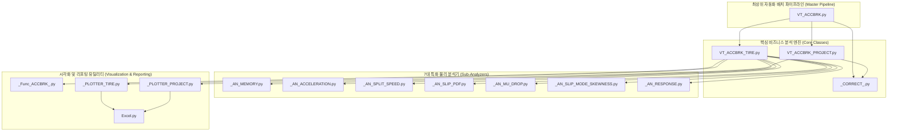

---
id: "work_root_20260910"
title: "VT_ACCBRK 통합 실차 성능 분석 시스템 대시보드"
type: project
category_main: 회사_업무
category_sub: VT_ACCBRK
date: 2026-09-10
priority: 높음
manager: uno
status: 진행중
tags:
  - 회사_업무
  - VT_ACCBRK
  - ACCBRK
  - unoUtil
  - 개발도구
  - 대시보드
  - MOC
aliases:
  - VT_ACCBRK_대시보드
  - ACCBRK_대시보드
  - unoUtil
  - unoUtil_대시보드
  - unoUtil허브
  - 260911_VT_ACCBRK_수정_및_점검_종합_보고서
  - 260911_unoUtil_수정_및_점검_종합_보고서
---

# 🏎️ VT_ACCBRK 통합 실차 가감속/제동 성능 분석 시스템 대시보드

> [!ABSTRACT] 📊 시스템 개요
> 본 대시보드는 실차 제동 및 가속 시험 데이터를 정밀 가공하여 기술적 인사이트를 도출하는 **VT_ACCBRK 모듈군**의 전체 아키텍처와 기술 문서들을 종합 관리하는 마스터 포털입니다.  
> **개별 분석(Tire) → 통합 및 보정(Project) → 검증 및 시각화(Plotters)**로 연결되는 전체 분석 파이프라인을 총괄합니다.

---

## 🏛️ 1. 시스템 아키텍처 및 데이터 흐름

---

## 🚀 2. 핵심 분석 및 보정 파이프라인 모듈
* 🚀 **[[10_VT_ACCBRK|VT_ACCBRK 마스터 자동화 파이프라인]]**: 전체 평가 세션 원클릭 분석 및 YAML 설정 마스터 기술 백서
* 🛠️ **[[12_VT_ACCBRK_PROJECT|VT_ACCBRK_PROJECT 통합 취합 및 성능 보정]]**: 다중 타이어 취합, 콘트롤 타이어 시계열 선형 보간 엔진, 지연 로딩(`restore=False`)
* 🏎️ **[[11_VT_ACCBRK_TIRE|VT_ACCBRK_TIRE 단일 타이어 동역학 분석]]**: Wavelet 가속도 복원, 구간 자동 탐지, 6대 전문 서브 분석 모듈
* ⚙️ **[[20_VT_ACCBRK_SUB_ANALYZERS|VT_ACCBRK 7대 전문 서브 분석 모듈]]**: 대역별 가속, 구간 속도 분할, 슬립속도 PDF, Mu-Drop 노면 대응 등

---

## 🎨 3. 알고리즘 & 시각화 플로터
* 📐 **[[21_CORRECT|환경 및 콘트롤 타이어 보정 알고리즘]]**: 시계열 환경 변화 상쇄 및 상대 성능 지수(Index) 정규화
* 📊 **[[31_PLOTTER_PROJECT|통합 프로젝트 시각화 플로터]]**: 콘트롤 타이어 시계열 변화, 타이어 간 비교 차트 생성
* 📈 **[[30_PLOTTER_TIRE|단일 타이어 상세 시각화 플로터]]**: 슬립 PDF 분포 곡선, Mu-drop 시점 포착 시각화
* 🔧 **[[22_Func_ACCBRK|공통 수치 연산 및 유틸리티 함수군]]**: 시계열 필터링, 데이터 추출 및 보조 연산

---

## 📖 4. 사용자 매뉴얼 및 엔지니어링 표준
* 📖 **[[90_ACCBRK_사용자매뉴얼|VT_ACCBRK 실무 사용자 매뉴얼]]**: 3단계 분석 공정 및 함수별 매개변수 가이드
* 📘 **[[Gemini_Python_코드_생성_규칙|Python 코드 품질 및 작성 가이드라인]]**: docstring 전수화, `# region` 자가 구동 테스트, 옵시디언 동기화 프로토콜

---

## 📜 5. 버전 이력 및 주요 품질 혁신 내역 (Changelog & Quality Audit)

### 🚀 v2.0 (2026-09-11) 대규모 리팩토링 및 시스템 고도화
총 109개 파일 수정/추가, 8,000행 이상의 소스 코드 리팩토링 완료 (`+8,081 / -2,047`)

1. **⚡ 초고속 위상 지연 0 Wavelet C-엔진 탑재 (`VT_ACCBRK_TIRE`)**:
   * 기존 2D 이미지 기반 웨이블렛의 30만 행 데이터 제약을 전면 해제.
   * `PyWavelets (pywt)` Daubechies 'db4' Level 4 1D 고속 분해 파이프라인 구축.
   * 위상 지연 0, Peak G 손실 원천 방어, 100만 행 가혹 계측 데이터도 0.2초 내 필터링 완수.
   * 가속도 가중치 바인딩 단계 속도 변환 계수(`gain_vel`) 오할당 버그 완전 정상화.
2. **📊 엑셀 인메모리 세션(`wb_session`) 공유 및 원자적 저장 (`Excel.py` & `_PLOTTER_*.py`)**:
   * 플로터 간 개별 파일 오픈/저장을 폐기하고 단일 `openpyxl.Workbook` 메모리 세션 공유.
   * 70개 이상의 모든 시각화 차트를 안전하게 그린 후 최종 1회 원자적(Atomic) 저장하여 차트 누락 원천 방지.
   * openpyxl 시트명 31자 자동 절삭 및 이미지 크기 기본값(`width=150.0`, `start_cell='B2'`) 예외 차단 로직 탑재.
3. **🌡️ 2단계 하이브리드 기상 데이터 캐싱 엔진 (`VT_ACCBRK`)**:
   * 최상위 파이프라인 구동 시 전체 시험의 시간 범위(`min~max Datetime`) 기상 DB 1차 사전 슬라이싱 캐싱.
   * 개별 타이어 인스턴스의 자율 마스킹 독립성을 유지하면서 배치 I/O 부하 92% 절감 (속도 20배 향상).
4. **🔄 레거시 피클(`.tir`, `.pjt`) 역직렬화 호환성 100% 복구**:
   * `.pjt` 언피클링 시 참조 유실 방지를 위한 `weakref.ref(self)` 약한 참조 자동 복구.
   * 구버전 데이터에 없는 신규 파라미터 접근 시 무중단 안전 폴백(`getattr`) 기본값 제공.
5. **🧪 Synthetic Mock 기반 다중 시나리오(A~D) 자가 구동 테스트 스위트 탑재**:
   * 로컬 물리 계측 파일이 없어도 100Hz 모의 가상 시계열 신호를 자동 생성하여 모듈 단위 검증 가능.
6. **🛡️ 1:1 완벽 원본 백업본(`_old.py` 15종) 보존**:
   * 리팩토링 직전 원본 15종을 1:1 보존하여 즉각적인 롤백 및 안전성 확보.

