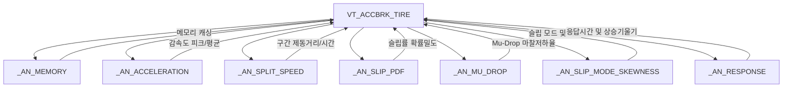

# ACCBRK 기반 유틸리티 및 전용 분석/시각화 모듈 엔지니어링 매뉴얼

**주요 모듈군**:
1. 기반 함수 라이브러리: [`_Func_ACCBRK_.py`](file:///D:/uno/Python/Projects/unoUtil/unoUtil/vehicleTest/ACCBRK/_Func_ACCBRK_.py)
2. 7대 서브 물리 분석기: `_AN_*.py`
3. 시각화 및 리포팅 엔진: [`_PLOTTER_TIRE.py`](file:///D:/uno/Python/Projects/unoUtil/unoUtil/vehicleTest/ACCBRK/_PLOTTER_TIRE.py), [`_PLOTTER_PROJECT.py`](file:///D:/uno/Python/Projects/unoUtil/unoUtil/vehicleTest/ACCBRK/_PLOTTER_PROJECT.py)
**버전**: 2026 Revision (Pandas 2.0+ 호환, 1D Wavelet 가속화 및 모듈별 자율 시뮬레이션 탑재)

---

## 1. 기반 함수 모듈: `_Func_ACCBRK_.py`

`_Func_ACCBRK_.py`는 ACCBRK 모듈 전역에서 사용되는 60개 이상의 물리 계산, 통계 필터링, 동적 프로퍼티 디스크립터, 데이터 구조 변환 함수들을 총괄하는 핵심 기반 라이브러리입니다.

### 1.1 주요 함수군 분류

| 카테고리 | 대표 함수명 | 기능 설명 |
| :--- | :--- | :--- |
| **동적 디스크립터** | `_Descriptor_` | 클래스 인스턴스에 동적 프로퍼티를 바인딩하고 getter/setter 제어 |
| **신호 필터링** | `filter_acc`, `filter_moving_average` | 가속도 및 속도 신호의 이동 평균, 이상치 절사 및 노이즈 필터링 |
| **구간 분할 및 추출**| `cal_split_speed`, `get_valid_trials` | 목표 속도 구간(예: 100~0 km/h) 자동 감지 및 개별 시험 차수(Trial) 슬라이싱 |
| **통계 분석** | `cal_statistics`, `cal_outlier_iqr` | 평균, 표준편차, 변동계수(CV), IQR 기반 이상치 판별 |
| **기상/환경 연계** | `integrate_weather_data` | 타이어 시험 타임스탬프와 기상 관측소 10분 주기 DB 인터폴레이션 결합 |
| **좌표계 변환** | `AN_ACCBRK(local_pos=...)` | GNSS 위경도 좌표를 평면 직교 좌표계(`PosX`, `PosY`)로 투영/회전 변환 ([[10_GPStoXYCord]] 고속 WGS84 연동) |
| **결과 요약 및 병합**| `reorder_columns`, `merge_dataframes` | 통일된 컬럼 명명 규칙 적용 및 요약 테이블 포맷 정렬 |

### 1.2 핵심 개선 사항 (2026 Revision)

- **GPS 0.0 노이즈 방어 및 NaN 격리 (`valid_mask`)**: VBOX 계측 장비 종료 시점의 비정상 좌표(`0.0, 0.0`)가 유입되어 `PosY`가 `-4,000,000m`로 왜곡되던 문제를 방지하기 위해 유효 위경도(`abs > 10.0`) 마스크를 적용하고 비정상 구간은 `NaN`으로 안전 격리.
- **DataFrame 인덱스 100% 보존 결합**: 기존 `pd.concat(axis=1)` 시 인덱스 불일치로 인한 결측치/왜곡을 원천 차단하기 위해 `df_xy = pd.DataFrame(index=df_input.index)` 및 `df_input[col_local] = df_xy` 직접 대입 방식으로 전환.
- **제동 랩 요약표 PosX/PosY 집계 기준 표준화 (`first`)**: 랩 결과 집계 시 이동 구간의 중간 평균값(`mean`, 282m) 대신 운전자가 브레이크를 밟은 **정확한 제동 개시점(`first`, 약 251m)**을 기록하도록 `rule_infor` 개편.
- **WGS84 타원체 정밀 측지 계산 모드 추가**: [[10_GPStoXYCord|GPStoDistance2]]에 WGS84 타원체 정밀 곡률 반경 모델(`method='wgs84'`)을 기본 연동하여 기존 대비 5.9배 고속화(2.5ms) 및 geopy와 0.06mm 수준으로 일치하는 정밀 좌표 변환 제공.
- **Pandas 2.0+ 인덱스 호환성 확보**: `Index.append()` 동작 시 발생하는 Future/Deprecation 경고를 제거하고 `pd.Index(list(col_names) + list(col_local))`로 안정화.
- **로컬 직교 좌표계(`local_pos`) 파이프라인 연계**: `AN_ACCBRK`에서 문자열('technoring', 'technotrack') 및 사용자 정의 딕셔너리를 통한 평면 좌표 변환을 지원하며, `col_local` 사전 정의를 통해 GPS 부재 환경에서도 안전하게 방어.
- **Series/DataFrame 인덱싱 방어 로직 강화**: 단일 행 추출 시 `.iloc[0]` 및 스칼라 형 변환 방어 코드를 적용하여 `TypeError` 원천 차단.
- **독립 실행 테스트 스위트 탑재**: 합성 시뮬레이션 데이터를 기반으로 Scenario A(구간 통계), Scenario B(이상치 필터), Scenario C(동적 디스크립터)를 파일 없이도 자율 검증.

---

## 2. 7대 서브 물리 분석기 (`_AN_*.py`)

각 서브 분석기는 단일 타이어(`VT_ACCBRK_TIRE`) 내부에서 독립된 물리 영역의 정밀 분석을 담당하는 컴포넌트입니다.



### 2.1 모듈별 기능 명세

1. **`_AN_MEMORY.py` (메모리 캐싱 컴포넌트)**:
   - 고주파(100Hz) 대용량 시계열 데이터프레임을 메모리에 안전하게 캐싱하고, 반복 연산 시 중복 I/O를 방지하는 중간 데이터 관리자.
2. **`_AN_ACCELERATION.py` (가속도/감속도 분석기)**:
   - 제동 중 최대 감속도(Peak G), 안정 감속도(Mean G), 감속도 도달 시간(Build-up Time)을 정밀 산출.
3. **`_AN_SPLIT_SPEED.py` (구간 속도 분석기)**:
   - 고속/중속/저속 구간별(예: 100-80, 80-60, 60-40, 40-20, 20-0 km/h) 제동거리 및 통과 시간을 분할 계산하여 ABS 작동 패턴 분석.
4. **`_AN_SLIP_PDF.py` (슬립률 확률밀도 분석기)**:
   - 제동 중 차속과 휠 회전속도로부터 계산된 슬립률(Slip Ratio)의 커널 밀도 추정(KDE) 및 히스토그램을 생성하여 노면-타이어 접지 그립 특성 평가.
5. **`_AN_MU_DROP.py` (마찰 저하율 분석기)**:
   - ABS 제동 중 피크 마찰계수 도달 후 슬립이 증가함에 따라 마찰력이 급격히 떨어지는 현상(Mu-Drop)을 감지하고 마찰 안정성 지수 산출.
6. **`_AN_SLIP_MODE_SKEWNESS.py` (슬립 모드 및 왜도 분석기)**:
   - 슬립률 분포의 최빈값(Mode)과 비대칭도(Skewness)를 계산하여 타이어가 최적 슬립 구간(일반적으로 10~15%)에 얼마나 오래 머무는지 정량화.
7. **`_AN_RESPONSE.py` (응답성 및 과도 특성 분석기)**:
   - 브레이크 페달 조작 시점부터 목표 감속도(예: 0.5G) 도달까지의 반응 지연 시간(Latency) 및 감속도 상승 기울기(Rising Slope) 산출.

---

## 3. 시각화 및 리포팅 모듈

### 3.1 `_PLOTTER_TIRE.py` (단일 타이어 시각화)

- **기능**: 개별 타이어의 10~20회 제동 시험 차수(Trial)별 속도 프로파일, 감속도 곡선, 슬립률 분포, 박스플롯(Boxplot)을 고해상도 Matplotlib 차트로 생성.
- **엑셀 시트 연동**: 생성된 그래프 이미지(`plot_tire.png`)를 OpenPyXL을 통해 지정된 엑셀 셀 좌표(`excel['start_cell']`)에 자동 삽입.

### 3.2 `_PLOTTER_PROJECT.py` (프로젝트 종합 시각화)

- **기능**: 프로젝트 내 모든 타이어(Control, Test 타이어들)의 보정 전/후 성능 비교 막대그래프, 산점도, 오차 막대(Error Bar) 및 시계열 추세선을 종합 렌더링.
- **패치 내역 (2026 Revision)**: Line 1007 부근에서 존재하지 않는 변수 `list_plot_tires`를 참조하던 버그를 `list_tires`로 정규화하여 `NameError` 완벽 해결.

---

## 4. 단위 모듈 검증 방법

모든 서브 분석기 및 유틸리티 모듈은 로컬 파일이 없어도 즉시 동작 가능한 **다중 시나리오 독립 실행 스위트(`if __name__ == "__main__":`)**를 내장하고 있습니다:

```bash
# 서브 분석기 독립 검증 (Windows PowerShell)
python unoUtil/vehicleTest/ACCBRK/_AN_ACCELERATION.py
python unoUtil/vehicleTest/ACCBRK/_AN_SPLIT_SPEED.py
python unoUtil/vehicleTest/ACCBRK/_AN_SLIP_PDF.py
python unoUtil/vehicleTest/ACCBRK/_AN_MU_DROP.py
python unoUtil/vehicleTest/ACCBRK/_AN_SLIP_MODE_SKEWNESS.py
python unoUtil/vehicleTest/ACCBRK/_AN_RESPONSE.py

# 유틸리티 및 보정 엔진 검증
python unoUtil/vehicleTest/ACCBRK/_Func_ACCBRK_.py
python unoUtil/vehicleTest/ACCBRK/_CORRECT_.py
python unoUtil/vehicleTest/ACCBRK/Cal_Control.py
```
