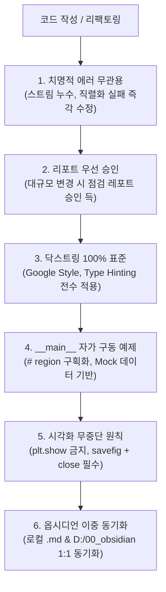

# 🧭 unoUtil Python 코드 품질 및 시각화 무중단 개발 표준 가이드라인

**문서 ID**: `Gemini_Python_코드_생성_규칙`  
**상위 대시보드**: [[00_unoUtil_모듈개발_대시보드]] | [[00_VT_ACCBRK_대시보드]]  
**관련 영구 지식**: [[50_Matplotlib_시각화_무중단_개발_표준]] | [[00_AI_에이전트_시스템_통합_색인]]  
**적용 대상**: `unoUtil` 전 모듈, 관련 사내 데이터 파이프라인 및 AI 에이전트 생성 코드

---

## 1. 🛡️ 핵심 엔지니어링 5대 원칙



### 1.1 치명적 에러 선제 해결 (Zero Fatal Errors)
* 문법 에러, 런타임 예외, 미해제 파일 스트림(파일 락킹), 직렬화/역직렬화 실패는 발견 즉시 수정합니다.

### 1.2 리포트 우선 승인 (Report-First Approval)
* 아키텍처 변경 및 대규모 리팩토링 착수 전, 반드시 **[점검 레포트]**를 작성하여 사용자 승인을 득합니다.

### 1.3 닥스트링 및 타입 힌팅 표준 (Type Hinting & Docstrings)
* 모든 공개 함수/클래스에 Type Hinting과 Google Style Docstring(기능 요약, Args, Keyword Args, Returns, Raises, Examples)을 100% 기술합니다.

### 1.4 `__main__` 자가 구동 예제 (# region 구획)
* 외부 파일이나 DB 의존성 없이 즉시 단독 구동 가능한 Mock/합성 데이터 기반 검증 스위트를 파일 하단에 구성합니다.

---

## 2. 🛑 시각화 무중단(Non-blocking) 원칙 (절대 규칙)

### 2.1 규칙 정의
> [!CAUTION] 🚫 `plt.show()` 및 `show()` GUI 블로킹 함수 사용 절대 금지
> Matplotlib 또는 GUI 플롯 라이브러리 사용 시, **`plt.show()` 또는 GUI 창을 블로킹하는 `show()` 함수는 절대 호출하지 않습니다.**  
> 피규어 팝업 창을 마우스로 닫기 전까지 프로세스가 무한 대기(Hang) 상태에 빠져, 배치 데이터 파이프라인, 백그라운드 태스크, 자동화 테스트 및 AI 서브에이전트 구동이 일제히 정지되는 치명적 병목을 유발합니다.

### 2.2 표준 시각화 아키텍처 패턴

모든 시각화 함수/메서드는 **"파일 저장 (`savefig`) $\rightarrow$ 메모리 해제 (`close`) $\rightarrow$ Figure 객체 반환"** 패턴을 의무화합니다:

```python
import matplotlib.pyplot as plt
from pathlib import Path
from typing import Optional, Union, Tuple, Any

def plot_analysis_result(
        data: pd.DataFrame,
        save_path: Optional[Union[str, Path]] = None,
        close_fig: bool = True
) -> Tuple[plt.Figure, Any]:
    """
    분석 결과를 시각화하고 이미지 파일로 저장합니다.
    ※ 프로세스 블로킹 방지를 위해 내부에서 plt.show()를 호출하지 않습니다.
    """
    fig, ax = plt.subplots(figsize=(10, 6))
    
    # 플롯 렌더링
    ax.plot(data['Time'], data['Value'], label='Signal')
    ax.grid(True, linestyle='--')
    ax.legend()
    
    plt.tight_layout()
    
    # 1. 파일 저장 (지정된 경우)
    if save_path is not None:
        plt.savefig(save_path, dpi=200, bbox_inches='tight')
        
    # 2. 메모리 즉시 해제 (무중단 파이프라인 보장)
    if close_fig:
        plt.close(fig)
        
    # 3. Figure 객체 반환 (상위 파이프라인 연계용)
    return fig, ax
```

### 2.3 `plt.show()` 위반 vs 준수 대조표

| 구분 | ❌ 안티패턴 (`plt.show()`) | ✅ 표준 준수 패턴 (`save_path` & `close_fig`) |
| :--- | :--- | :--- |
| **실행 흐름** | 사용자가 GUI 닫기 버튼을 누를 때까지 전체 프로세스 정지 | 대용량 배치/검증 스크립트가 멈춤 없이 100% 완료 |
| **자동화 파이프라인** | 백그라운드 태스크 무한 대기 (Hang/Timeout) | 무인 배치 실행 및 백그라운드 프로세싱 완벽 지원 |
| **서버/CI 환경** | GUI 디스플레이 서버 부재 시 `TclError` / 크래시 | `$env:MPLBACKEND='Agg'` 환경에서도 무결점 저장 |
| **메모리 관리** | 열린 창들이 닫히지 않아 GDI 핸들 및 메모리 누수 | `plt.close(fig)`를 통한 즉각적 RAM 자원 회수 |

---

## 3. 📚 옵시디언 볼트 이중 동기화 프로토콜 (Dual Sync)

1. **로컬 프로젝트**: `D:\uno\Python\Projects\unoUtil\unoUtil\<서브모듈경로>\*.md`
2. **옵시디언 볼트**: `D:\00_obsidian\02_Projects\회사_업무\20_unoUtil_모듈개발\<서브모듈경로>\*.md`
* 물리적 모듈 구조와 옵시디언 볼트 폴더 구조는 100% 동일하게 1:1 매핑 유지.
* 기술 매뉴얼 생성/수정 시 양쪽 경로에 동시 반영.

---

## 4. 🔗 상호 위키 링크
* [[00_unoUtil_모듈개발_대시보드]]
* [[00_VT_ACCBRK_대시보드]]
* [[GPStoXYCord]]
* [[50_Matplotlib_시각화_무중단_개발_표준]]
