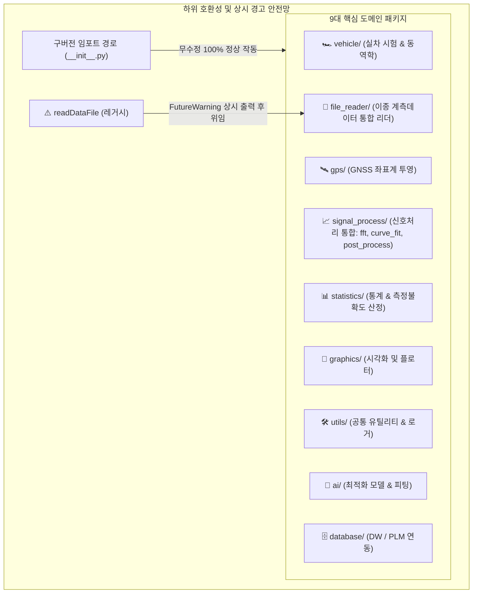

# 🏛️ unoUtil v2.0 패키지 전체 아키텍처 및 구조 명세서

본 문서는 `unoUtil` 프레임워크의 도메인 응집도 극대화, 파이썬 공식 표준(**PEP 8**) 준수, 그리고 기존 실무 코드의 100% 무중단 구동을 보장하는 **하위 호환성(Backward Compatibility) 브릿지** 및 **레거시 상시 경고 시스템**을 총망라한 종합 구조 명세서입니다.

---

## 📌 1. 핵심 아키텍처 원칙 (Core Principles)



1. **도메인 중심 재그룹화 (Domain-Driven Grouping)**:
   * **`signal_process/` 통합**: 흩어져 있던 `fft`(주파수 응답/전달함수), `curve_fit`(곡선 피팅/Magic Formula), `post_process`(필터링/이상치)를 1개 패키지로 결집.
   * **`statistics/` 독립**: `convenienceFunction`에 혼재되어 있던 ISO GUM 기반 측정불확도(`uncertainty`) 및 KOLAS 공인 성적서 서식을 전문 통계 패키지 아래 서브패키지로 독립.
2. **레거시 모듈 단일화 및 상시 경고 (Deprecation Guard)**:
   * 중복 C-DLL 및 바이너리 파서가 존재하던 구형 `readDataFile`을 최신 `file_reader`로 흡수.
   * 구버전 호출 시 **`FutureWarning` 상시 경고를 콘솔에 출력**하고 최신 `FileDataReader`로 자동 위임.
3. **PEP 8 표준 네이밍 준수**:
   * 패키지/모듈: **`snake_case` (소문자 + 언더바)**, 앞뒤 언더바(`_Name_`) 완전 폐지.
   * 클래스: **`CapWords` (언더바 완전 제거, 단어 앞글자 대문자)**, 사내 고유 브랜드 약어(`VT_ACCBRK`)는 별칭(Alias) 병행 지원.
4. **대용량 계측 데이터 격리 (~200MB)**:
   * 패키지 루트 및 모듈 내 방치된 대용량 SDF/TXT 데이터를 각 모듈의 `example/data/`로 격리하여 배포 경량화.

---

## 🌲 2. 전체 디렉토리 및 파일 완성 트리 (Full Tree)

```text
unoUtil/
│
├── 🏎️ vehicle/                         # [실차 시험 및 차량 동역학 분석]
│   ├── __init__.py
│   ├── vehicle_dynamic.py              # 축변환, 슬립각(Beta) 연산 (VehicleDynamic)
│   ├── handling_test.py                # 핸들링 시험 데이터 분석기 (HandlingTest)
│   ├── analysis_test_data.py           # 시험 데이터 기본 분석기 (AnalysisTestData)
│   ├── parsing_pattern.py              # 계측 채널 패턴 매핑 (ParsingPattern, Signal)
│   ├── test_info_res.py                # 시험 정보 및 결과 매핑 (TestInfoRes)
│   ├── brk_test.py                     # [호환 브릿지] 구버전 제동 테스트 호출 위임
│   └── acc_brk/                        # ── 가감속 및 제동 정밀 분석 엔진
│       ├── __init__.py
│       ├── vt_acc_brk.py               # 통합 파이프라인 (VtAccBrk / 구 VT_ACCBRK)
│       ├── vt_acc_brk_tire.py          # 단일 타이어 성능 분석기 (VtAccBrkTire)
│       ├── vt_acc_brk_project.py       # 프로젝트 취합/선형보간 (VtAccBrkProject)
│       ├── correct.py                  # 환경 및 콘트롤 보정 엔진 (Correct)
│       ├── func_acc_brk.py             # 공통 물리/수학 연산 유틸리티
│       ├── plotter_project.py          # 프로젝트 시각화 플로터 (PlotterProject)
│       ├── plotter_tire.py             # 단일 타이어 시각화 플로터 (PlotterTire)
│       └── analyzers/                  # ── 7대 전문 서브 분석기
│           ├── an_acceleration.py      # 가속 성능 분석
│           ├── an_memory.py            # ABS 타이어 메모리 효과 분석
│           ├── an_mu_drop.py           # 마찰계수(Mu) 드롭 특성 분석
│           ├── an_response.py          # 제동 초기 응답성 분석
│           ├── an_skewness.py          # 슬립 모드 왜도 분석
│           ├── an_slip_pdf.py          # 슬립률 확률밀도함수(PDF) 분석
│           └── an_split_speed.py       # 구간별 분할 속도 분석
│
├── 🛰️ gps/                             # [공간 데이터 및 좌표계 투영]
│   ├── __init__.py
│   ├── gps_to_xy.py                    # WGS84 타원체 정밀 벡터 투영 엔진 (GPStoXYCord)
│   └── legacy_gps.py                   # 구버전 호환 좌표 변환 함수
│
├── 🚀 file_reader/                     # [차세대 객체지향 계측 데이터 리더]
│   ├── __init__.py
│   ├── file_data_reader.py             # 통합 리더 파사드 (FileDataReader)
│   ├── base_parser.py                  # 추상 파서 및 컨테이너 (BaseParser, MeasurementData)
│   ├── vbo_parser.py                   # Racelogic VBO 파서 (VBOParser)
│   ├── vbb_parser.py                   # Racelogic VBB 바이너리 파서 (VBBParser)
│   ├── dwd_parser.py                   # Dewesoft D7D 디코더 (DWDParser)
│   ├── text_parser.py                  # CSV / TXT 고속 파서 (TextParser)
│   ├── datetime_helper.py              # 타임존 자동 판별 및 시계열 합성 헬퍼
│   ├── vbb_reader/                     # VBB 저수준 디코더 엔진 (내재화)
│   ├── dw_reader/                      # Dewesoft C-DLL 인터페이스 (내재화)
│   └── legacy/                         # ── 구형 코드 안전 보존
│       ├── read_data_file_legacy.py    # 구형 68KB 모놀리식 원본 보존
│       └── _list_delimiter_legacy.py
│
├── 📈 signal_process/                  # ⭐ [신규: 신호 처리 통합 패키지]
│   ├── __init__.py
│   ├── fft/                            # ── 주파수 응답 및 전달함수 (구 unoFFT)
│   │   ├── __init__.py
│   │   ├── tf_estimate.py              # Pwelch 기반 전달함수 추정기 (tf_estimate)
│   │   ├── fft_utils.py                # 2의 거듭제곱(nextpow2) 등 FFT 연산 보조
│   │   ├── single_track.py             # 단일 트랙 동역학 모델
│   │   ├── find_fft.py                 # 주파수 피크 탐색
│   │   ├── archive/                    # 임시/실험 스크립트 안전 격리
│   │   └── example/data/               # 대용량 계측 데이터 SDF/TXT 격리
│   ├── curve_fit/                      # ── 특성 곡선 피팅 (구 curveFit)
│   │   ├── __init__.py
│   │   ├── curve_combiner.py           # 타이어 복합 곡선 합성기 (CurveCombiner)
│   │   ├── magic_formula.py            # Pacejka Magic Formula 피팅 모델
│   │   ├── trend_line_odr.py           # RANSAC / ODR 트렌드 라인 생성기
│   │   ├── detect_initial_rect.py      # 초기 구형파 검출
│   │   └── example/data/               # 피팅 예제 SDF 데이터 격리
│   └── post_process/                   # ── 신호 후처리/필터링 (구 unoPostProcessing)
│       ├── __init__.py
│       ├── signal_filter.py            # 이동평균, 이상치 필터, 정규화 엔진
│       └── isolation_forest.py         # 다차원 이상치 탐지 (ExtendedIsolationForest)
│
├── 📊 statistics/                      # ⭐ [신규: 통계 및 측정불확도 패키지]
│   ├── __init__.py
│   └── uncertainty/                    # ── 측정불확도 전용 서브패키지
│       ├── __init__.py
│       ├── uncertainty.py              # ISO GUM 기반 측정불확도 산정 엔진 (Uncertainty)
│       ├── uncertainty_plot.py         # 파레토 차트, 피시본 시각화 (UncertaintyPlot)
│       ├── uncertainty.md              # 불확도 모듈 매뉴얼
│       ├── cert_templates/             # KOLAS 공인 성적서 HTML/PNG 서식
│       └── docs/                       # 불확도 수학 이론 레퍼런스
│
├── 🎨 graphics/                        # [시각화 및 플롯 UI 도구 (구 graphicTools)]
│   ├── __init__.py
│   ├── plotter.py                      # 다채널 서브플롯 생성 및 포맷터
│   ├── cursor_mode.py                  # 십자선 마우스 커서 제어
│   ├── range_click.py                  # 2점 클릭 구간 선택기 (SelRangeMouseClick)
│   ├── text_offset.py                  # 텍스트 주석 겹침 방지 오프셋
│   └── plotly_tools.py                 # Plotly 대화형 웹 플롯 연동
│
├── 🛠️ utils/                           # [사내 공통 유틸리티 (구 convenienceFunction)]
│   ├── __init__.py
│   ├── excel.py                        # 엑셀 시트 생성 및 차트 삽입
│   ├── files.py                        # 경로 검증, 폴더 자동 생성, 파일 탐색
│   ├── window_msg.py                   # GUI 팝업 메시지 박스
│   ├── dataframe_utils.py              # DataFrame 보조 연산
│   ├── math_utils.py                   # 기하/수학 연산 유틸
│   ├── console_style.py                # 터미널 컬러/스타일링
│   ├── weather_tring.py                # 기상대 데이터 동기화 리포터
│   └── logger/                         # ── 싱글톤 멀티 스트림 로거
│       ├── logger.py                   # LOGGER 싱글톤 엔진
│       ├── progress_bar.py             # 진행도 표시 바
│       ├── styles.py                   # 컬러 포맷터
│       └── window_handler.py           # GUI 텍스트 위젯 연동
│
├── 🤖 ai/                              # [머신러닝 & 최적화 (구 unoAI)]
│   ├── __init__.py
│   ├── fit_minimize.py                 # 베이지안/그리드 최적화 추정기 (MinimizeEstimator)
│   ├── fit_mf_ax.py                    # 타이어 제동 마찰계수 최적화
│   ├── fit_nn.py                       # 신경망 피팅
│   ├── dynamic_model.py                # 동역학 모델 수식 정의
│   ├── archive/                        # 실험 스크립트 보존
│   └── example/data/                   # 검증 데이터 (brkData.csv)
│
├── 🗄️ database/                        # [사내 DW / PLM 시스템 연동 (구 unoDB)]
│   ├── __init__.py
│   ├── auth_conn.py                    # 사내 DB 인증 및 연결 세션
│   ├── plm_loader.py                   # PLM 타이어 규격 및 스펙 로더
│   └── queries/                        # 도메인별 SQL 쿼리 모듈
│       ├── req_master.py               # 시험의뢰 마스터 정보
│       ├── result_order.py             # 시험결과 차수 조건
│       ├── req_items.py                # 시험 의뢰 항목
│       └── tire_spec.py                # 타이어 상세 규격 매핑
│
├── ⚠️ readDataFile/                    # [레거시 호환 & 상시 경고 래퍼]
│   └── __init__.py                     # 호출 시 FutureWarning 상시 출력 후 file_reader로 위임
│
└── 💡 example/                         # [통합 종합 예제]
    └── comprehensive_example.py        # unoUtil 전체 모듈 종합 시연 스크립트
```

---

## 🗺️ 3. 패키지별 상세 Before & After 명세서

### 🏎️ 3.1 `vehicle/` (실차 시험 및 동역학 분석)
* **기존 위치**: `unoUtil/vehicleTest/`
* **주요 변경**: 폴더명 소문자화, 앞뒤 언더바(`_Name_`) 제거, 7대 서브 분석기 `analyzers/` 서브폴더 격리

| 기존 파일명 (Before) | 최종 파일명 (After) | 주요 클래스/함수 | 구버전 별칭 (Alias) |
| :--- | :--- | :--- | :--- |
| `VehicleDynamic.py` | `vehicle_dynamic.py` | `class VehicleDynamic:` | - |
| `_AnalysisTestData_.py` | `analysis_test_data.py` | `class AnalysisTestData:` | - |
| `_HndlTest_.py` | `handling_test.py` | `class HandlingTest:` | - |
| `_ParsingPattern_.py` | `parsing_pattern.py` | `class ParsingPattern:`, `class Signal:` | `par.Signal` |
| `_TEST_INFOR_RES_.py` | `test_info_res.py` | `class TestInfoRes:` | - |
| `_BRKTest_.py` | `brk_test.py` | 구버전 호출 위임 브릿지 | - |
| `ACCBRK/VT_ACCBRK.py` | `acc_brk/vt_acc_brk.py` | `class VtAccBrk:` | `VT_ACCBRK = VtAccBrk` |
| `ACCBRK/VT_ACCBRK_TIRE.py` | `acc_brk/vt_acc_brk_tire.py` | `class VtAccBrkTire:` | `VT_ACCBRK_TIRE` |
| `ACCBRK/VT_ACCBRK_PROJECT.py` | `acc_brk/vt_acc_brk_project.py`| `class VtAccBrkProject:` | `VT_ACCBRK_PROJECT` |
| `ACCBRK/_CORRECT_.py` | `acc_brk/correct.py` | `class Correct:` | `_CORRECT_` |
| `ACCBRK/_Func_ACCBRK_.py` | `acc_brk/func_acc_brk.py` | 물리/수학 연산 유틸 | `_Func_ACCBRK_` |
| `ACCBRK/_PLOTTER_PROJECT.py` | `acc_brk/plotter_project.py` | `class PlotterProject:` | `_PLOTTER_PROJECT` |
| `ACCBRK/_PLOTTER_TIRE.py` | `acc_brk/plotter_tire.py` | `class PlotterTire:` | `_PLOTTER_TIRE` |
| `ACCBRK/_AN_*.py` (7개) | `acc_brk/analyzers/an_*.py` | 각 세부 분석기 클래스 | `_AN_*` |

---

### 📈 3.2 `signal_process/` (신호 처리 통합 허브)
* **기존 위치**: `unoFFT/`, `curveFit/`, `unoPostProcessing/`
* **주요 변경**: 3대 신호 처리 도메인을 1개 상위 패키지 아래 서브패키지로 결집

| 서브패키지 | 기존 위치 (Before) | 최종 파일명 (After) | 주요 기능 |
| :--- | :--- | :--- | :--- |
| **`fft/`** | `unoFFT/TFEstimate.py` | `fft/tf_estimate.py` | Pwelch 기반 전달함수 추정 (`tf_estimate`) |
| | `unoFFT/_FunctionalFunction_.py` | `fft/fft_utils.py` | 2의 거듭제곱 (`nextpow2`) 등 보조 연산 |
| | `unoFFT/SingleTrack.py` | `fft/single_track.py` | 단일 트랙 주파수 응답 모델 |
| | `unoFFT/find_fft.py` | `fft/find_fft.py` | FFT 피크 주파수 탐색 |
| **`curve_fit/`** | `curveFit/CurveCombiner.py` | `curve_fit/curve_combiner.py` | 타이어 복합 곡선 합성 (`class CurveCombiner:`) |
| | `curveFit/_MagicFormula_.py` | `curve_fit/magic_formula.py` | Pacejka Magic Formula 피팅 수식 |
| | `curveFit/_Make_Trend_Line_*.py` | `curve_fit/trend_line_odr.py` | RANSAC / ODR 트렌드 라인 추정 |
| | `curveFit/_Detect_Initial_*.py` | `curve_fit/detect_initial_rect.py` | 초기 구형파 검출 |
| **`post_process/`** | `unoPostProcessing/_UnoPP_.py` | `post_process/signal_filter.py` | 이동평균, 이상치 필터, 정규화 엔진 |
| | `unoPostProcessing/Extended*.py` | `post_process/isolation_forest.py` | 다차원 이상치 탐지 (`ExtendedIsolationForest`) |

---

### 📊 3.3 `statistics/` (통계 및 측정불확도 패키지)
* **기존 위치**: `convenienceFunction/UNCERTAINTY/`
* **주요 변경**: `statistics/uncertainty/` 서브패키지로 완전 독립

| 기존 파일명 (Before) | 최종 파일명 (After) | 설명 |
| :--- | :--- | :--- |
| `UNCERTAINTY/UNCERTAINTY.py` | `uncertainty/uncertainty.py` | ISO GUM 기반 측정불확도 산정 엔진 (`class Uncertainty:`) |
| `UNCERTAINTY/PLOT.py` | `uncertainty/uncertainty_plot.py` | 파레토 차트, 피시본 다이어그램 시각화 (`class UncertaintyPlot:`) |
| `UNCERTAINTY/Certificate_*.html` | `uncertainty/cert_templates/*.html` | KOLAS 공인 성적서 서식 (제동거리, 수막현상, 횡슬립각) |
| `UNCERTAINTY/Uncertainty_theory.md`| `uncertainty/docs/uncertainty_theory.md` | 합성 표준불확도 및 유효 자유도 수학 이론 레퍼런스 |

---

### 🚀 3.4 `file_reader/` (데이터 리더) & `readDataFile/` (경고 래퍼)
* **기존 위치**: `fileDataReader/` & `readDataFile/`
* **주요 변경**: `file_reader/`로 단일화, 구형 `readDataFile`은 `FutureWarning` 상시 경고 래퍼로 전환

```python
# [구형 readDataFile 호출 시 콘솔에 상시 출력되는 경고 메시지]
================================================================================
[DEPRECATION WARNING] 'unoUtil.readDataFile'은 폐기 예정(Deprecated) 모듈입니다.
-> 차세대 객체지향 리더인 'from unoUtil.file_reader import FileDataReader'를 사용해 주세요.
-> 현재 호출은 최신 'FileDataReader' 엔진으로 자동 위임 처리되었습니다.
================================================================================
```

---

### 🛰️ 3.5 `gps/`, `graphics/`, `utils/`, `ai/`, `database/`

* **`gps/`**: `gps_to_xy.py` (`class GPStoXYCord:`), `legacy_gps.py`
* **`graphics/`**: `plotter.py`, `cursor_mode.py`, `range_click.py` (복원된 `SelRangeMouseClick`), `text_offset.py`, `plotly_tools.py`
* **`utils/`**: `excel.py`, `files.py`, `window_msg.py`, `dataframe_utils.py`, `math_utils.py`, `console_style.py`, `weather_tring.py`, `logger/`
* **`ai/`**: `fit_minimize.py` (`class MinimizeEstimator:`), `fit_mf_ax.py`, `fit_nn.py`, `dynamic_model.py`
* **`database/`**: `auth_conn.py`, `plm_loader.py`, `queries/`

---

## 🛡️ 4. 하위 호환성 (Backward Compatibility) 마스터 브릿지

패키지 구조가 전면 표준화되더라도, 기존 사내 분석 스크립트가 단 한 줄의 수정 없이 그대로 구동되도록 최상위 `unoUtil/__init__.py`에 아래 브릿지를 배치합니다:

```python
# [unoUtil/__init__.py 마스터 브릿지 구성]

# 1. 신규 9대 표준 패키지 노출
from . import vehicle
from . import gps
from . import file_reader
from . import signal_process
from . import statistics
from . import graphics
from . import utils
from . import ai
from . import database

# 2. 구버전 서브패키지명 Alias 브릿지 (기존 코드 100% 무중단 호환)
vehicleTest         = vehicle
gpsProcessing       = gps
fileDataReader      = file_reader
readDataFile        = file_reader          # 상시 경고와 함께 투명 위임
unoFFT              = signal_process.fft
curveFit            = signal_process.curve_fit
unoPostProcessing   = signal_process.post_process
convenienceFunction = utils
graphicTools        = graphics
unoAI               = ai
unoDB               = database

# 3. 신규 직관적 바로가기 지원
fft         = signal_process.fft
curve_fit   = signal_process.curve_fit
post_process= signal_process.post_process
uncertainty = statistics.uncertainty

# 4. 핵심 대표 클래스 바로가기 지원
FileDataReader  = file_reader.FileDataReader
VT_ACCBRK       = vehicle.acc_brk.VtAccBrk
GPStoXYCord     = gps.GPStoXYCord
Uncertainty     = statistics.uncertainty.Uncertainty
LOGGER          = utils.logger.LOGGER
```

---

## 📋 5. 사용자 검토 가이드

이 문서는 사용자의 요청에 따라 에디터 또는 마크다운 뷰어에서 편안하게 검토하실 수 있도록 프로젝트 루트 디렉토리에 생성되었습니다.

* **파일 경로**: `D:\uno\Python\Projects\unoUtil\UNOUTIL_ARCHITECTURE.md`
* **검토 포인트**:
  1. 각 패키지/서브패키지의 폴더 명칭이 마음에 드시는지
  2. 파일이 적절한 도메인 패키지 아래로 잘 분류되었는지
  3. 구버전 호환 방식 및 경고 시스템이 사내 업무 프로세스에 적합한지

검토 후 수정하고 싶으신 부분이나 추가 요청 사항을 편하게 말씀해 주세요!
