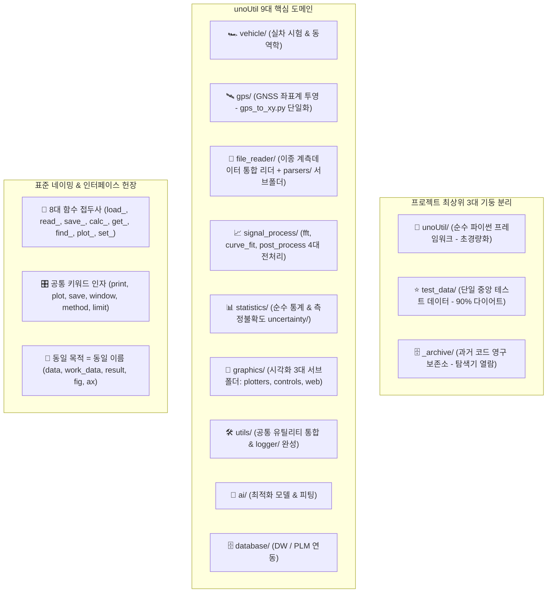

# 🏛️ unoUtil v2.0 패키지 전체 아키텍처 및 구조 명세서

본 문서는 `unoUtil` 프레임워크의 도메인 응집도 극대화, 파이썬 공식 표준(**PEP 8**) 준수, 대용량 데이터의 **`test_data/` 중앙 통합 경량화(90% 다이어트)**, 구형 코드의 **루트 `_archive/` 영구 보존**, **8대 함수 접두사 및 공통 변수명 사전** 제정, 그리고 기존 실무 코드의 100% 무중단 구동을 보장하는 **하위 호환성 브릿지**를 총망라한 종합 구조 명세서입니다.

> [!IMPORTANT]
> **진행 원칙**: 모든 세부 수정 계획이 최종 확정될 때까지 실제 코드/파일 수정은 **보류(Hold)**되며, 사용자 검토를 거쳐 최종적으로 "실행 해줘" 단계에서 일괄 적용됩니다.

---

## 📌 1. 핵심 아키텍처 원칙 (Core Principles)



---

## 🌲 2. 전체 디렉토리 및 파일 완성 트리 (Full Tree)

```text
D:\uno\Python\Projects\unoUtil\             # 🏠 프로젝트 최상위 루트
│
├── 🚀 unoUtil/                             # [순수 파이썬 패키지 프레임워크]
│   │
│   ├── 🏎️ vehicle/                         # [실차 시험 및 차량 동역학 분석]
│   │   ├── __init__.py
│   │   ├── vehicle_dynamic.py              # 축변환, 슬립각(Beta) 연산 (VehicleDynamic)
│   │   ├── handling_test.py                # 핸들링 시험 데이터 분석기 (HandlingTest)
│   │   ├── analysis_test_data.py           # 시험 데이터 기본 분석기 (AnalysisTestData)
│   │   ├── parsing_pattern.py              # 계측 채널 패턴 매핑 (ParsingPattern, Signal)
│   │   ├── test_info_res.py                # 시험 정보 및 결과 매핑 (TestInfoRes)
│   │   ├── brk_test.py                     # [호환 브릿지] 구버전 제동 테스트 호출 위임
│   │   └── acc_brk/                        # ── 가감속 및 제동 정밀 분석 엔진
│   │       ├── __init__.py
│   │       ├── vt_acc_brk.py               # ⭐ 통합 파이프라인 (VTAccBrk / 구 VT_ACCBRK)
│   │       ├── vt_acc_brk_tire.py          # ⭐ 단일 타이어 성능 분석기 (VTAccBrkTire)
│   │       ├── vt_acc_brk_project.py       # ⭐ 프로젝트 취합/선형보간 (VTAccBrkProject)
│   │       ├── correct.py                  # 환경 및 콘트롤 보정 엔진 (Correct)
│   │       ├── func_acc_brk.py             # 공통 물리/수학 연산 유틸리티
│   │       ├── plotter_project.py          # 프로젝트 시각화 플로터 (PlotterProject)
│   │       ├── plotter_tire.py             # 단일 타이어 시각화 플로터 (PlotterTire)
│   │       ├── base_memory.py              # ⭐ [기반 클래스] RAM 캐시 관리 (BaseMemory / 구 AN_MEMORY)
│   │       └── analyzers/                  # ── 순수 6대 물리 전문 분석기
│   │           ├── an_acceleration.py      # 가속 성능 분석 (AnAcceleration)
│   │           ├── an_mu_drop.py           # 마찰계수(Mu) 드롭 특성 분석 (AnMuDrop)
│   │           ├── an_response.py          # 제동 초기 응답성 분석 (AnResponse)
│   │           ├── an_skewness.py          # 슬립 모드 왜도 분석 (AnSlipModeSkewness)
│   │           ├── an_slip_pdf.py          # 슬립률 확률밀도함수 분석 (AnSlipPdf)
│   │           └── an_split_speed.py       # 구간별 분할 속도 분석 (AnSplitSpeed)
│   │
│   ├── 🛰️ gps/                             # ⭐ [공간 데이터 및 좌표계 투영 (단일화)]
│   │   ├── __init__.py                     # GPStoXYCord, transform_gps 노출
│   │   └── gps_to_xy.py                    # WGS84 타원체 정밀 벡터 투영 엔진 (GPStoXYCord)
│   │
│   ├── 🚀 file_reader/                     # [차세대 객체지향 계측 데이터 리더]
│   │   ├── __init__.py                     # FileDataReader 단일 진입점 노출
│   │   ├── file_data_reader.py             # ⭐ 통합 컨트롤 타워 파사드 (FileDataReader)
│   │   ├── datetime_helper.py              # 타임존 자동 판별 및 시계열 합성 헬퍼
│   │   ├── parsers/                        # ⭐ [파서 전용 서브폴더]
│   │   │   ├── __init__.py
│   │   │   ├── base_parser.py              # 추상 파서 및 컨테이너 (BaseParser, MeasurementData)
│   │   │   ├── vbo_parser.py               # Racelogic VBO 파서 (VBOParser)
│   │   │   ├── vbb_parser.py               # Racelogic VBB 바이너리 파서 (VBBParser)
│   │   │   ├── dwd_parser.py               # Dewesoft D7D 디코더 (DWDParser)
│   │   │   └── text_parser.py              # CSV / TXT 고속 파서 (TextParser)
│   │   ├── vbb_reader/                     # VBB 저수준 디코더 엔진 (내재화)
│   │   └── dw_reader/                      # Dewesoft C-DLL 인터페이스 (내재화)
│   │
│   ├── 📈 signal_process/                  # [신호 처리 통합 허브 패키지]
│   │   ├── __init__.py
│   │   ├── fft/                            # ── 주파수 응답 및 전달함수 (구 unoFFT)
│   │   │   ├── __init__.py
│   │   │   ├── tf_estimate.py              # Pwelch 기반 전달함수 추정기 (tf_estimate)
│   │   │   ├── fft_utils.py                # 2의 거듭제곱(nextpow2) 등 FFT 연산 보조
│   │   │   ├── single_track.py             # 단일 Track 동역학 모델
│   │   │   └── find_fft.py                 # 주파수 피크 탐색
│   │   ├── curve_fit/                      # ── 특성 곡선 피팅 (구 curveFit)
│   │   │   ├── __init__.py
│   │   │   ├── curve_combiner.py           # 타이어 복합 곡선 합성기 (CurveCombiner)
│   │   │   ├── magic_formula.py            # Pacejka Magic Formula 피팅 모델
│   │   │   ├── trend_line_odr.py           # RANSAC / ODR 트렌드 라인 생성기
│   │   │   └── detect_initial_rect.py      # 초기 구형파 검출
│   │   └── post_process/                   # ⭐ ── 데이터 전처리/정제 4대 전문 모듈
│   │       ├── __init__.py
│   │       ├── filters.py                  # 이동평균, SOS 고속 필터, 스무딩 병합
│   │       ├── resample.py                 # 시계열 보간(Interpolation) 및 리샘플링
│   │       ├── outliers.py                 # 이상치 제거(Z-score, IQR, EIF) 및 연속구간 탐색
│   │       └── scaler.py                   # ⭐ 데이터 정규화 및 스케일링 (SP_Normal)
│   │
│   ├── 📊 statistics/                      # ⭐ [순수 통계 및 측정불확도 패키지]
│   │   ├── __init__.py
│   │   ├── summary.py                      # ⭐ 10대 통계 요약 (get_statistics_df / 구 _DataFrame_.py)
│   │   └── uncertainty/                    # ── 측정불확도 전용 서브패키지
│   │       ├── __init__.py
│   │       ├── uncertainty.py              # ISO GUM 기반 측정불확도 산정 엔진 (Uncertainty)
│   │       ├── uncertainty_plot.py         # 파레토 차트, 피시본 시각화 (UncertaintyPlot)
│   │       ├── uncertainty.md              # 불확도 모듈 매뉴얼
│   │       ├── cert_templates/             # KOLAS 공인 성적서 HTML/PNG 서식
│   │       └── docs/                       # 불확도 수학 이론 레퍼런스
│   │
│   ├── 🎨 graphics/                        # ⭐ [시각화 & 화면제어 3대 서브폴더 패키지]
│   │   ├── __init__.py                     # Plotter, set_cursor_mode, format_fig 노출
│   │   ├── plotters/                       # ── 🎨 그래프를 그리는 도구
│   │   │   ├── __init__.py
│   │   │   ├── plotter.py                  # 차트 드로잉 엔진 (Plotter: scatter, box, pdf 등)
│   │   │   ├── formatter.py                # 레이아웃, 스타일, 한글폰트, 엑셀삽입 (format_fig)
│   │   │   └── text_offset.py              # 포인트 오프셋 기반 텍스트/화살표 주석 배치
│   │   ├── controls/                       # ── 🖱️ 마우스/이벤트를 제어하는 도구
│   │   │   ├── __init__.py
│   │   │   ├── cursor_mode.py              # 실시간 십자선 커서 및 수치 팝업 제어 (set_cursor_mode)
│   │   │   └── range_selector.py           # 마우스 2점 클릭 구간 선택기 (RangeSelector)
│   │   └── web/                            # ── 🌐 웹 연동 및 인터랙티브 변환
│   │       ├── __init__.py
│   │       └── plotly_tools.py             # Plotly 컬러맵 생성 및 HTML 변환
│   │
│   ├── 🛠️ utils/                           # ⭐ [사내 공통 유틸리티 통합 (구 convenienceFunction)]
│   │   ├── __init__.py                     # check_path, LOGGER, Excel 등 노출
│   │   ├── excel.py                        # 엑셀 시트 생성 및 차트 삽입 (Excel)
│   │   ├── files.py                        # 경로 검증, 폴더 자동 생성, 파일 탐색 (Files)
│   │   ├── dataframe_utils.py              # ⭐ DF 보조 연산 통합 (astype_float, agg_mean, calc_ratio)
│   │   ├── console_style.py                # 터미널 컬러/스타일링
│   │   ├── weather_tring.py                # 기상대 데이터 동기화 리포터 (MakeDFWeatherTring)
│   │   └── logger/                         # ── ⭐ 싱글톤 멀티 스트림 로거 완성
│   │       ├── __init__.py                 # LOGGER, show_window_error 노출 (구 WindowMsg 흡수)
│   │       ├── logger.py                   # LOGGER 싱글톤 엔진
│   │       ├── progress_bar.py             # 진행도 표시 바
│   │       ├── styles.py                   # 컬러 포맷터
│   │       └── window_handler.py           # GUI 텍스트 위젯 연동 및 팝업 에러
│   │
│   ├── 🤖 ai/                              # [머신러닝 & 최적화 (구 unoAI)]
│   │   ├── __init__.py
│   │   ├── fit_minimize.py                 # 베이지안/그리드 최적화 추정기 (MinimizeEstimator)
│   │   ├── fit_mf_ax.py                    # 타이어 제동 마찰계수 최적화
│   │   ├── fit_nn.py                       # 신경망 피팅
│   │   └── dynamic_model.py                # 동역학 모델 수식 정의
│   │
│   ├── 🗄️ database/                        # [사내 DW / PLM 시스템 연동 (구 unoDB)]
│   │   ├── __init__.py
│   │   ├── auth_conn.py                    # 사내 DB 인증 및 연결 세션
│   │   ├── plm_loader.py                   # PLM 타이어 규격 및 스펙 로더
│   │   └── queries/                        # 도메인별 SQL 쿼리 모듈
│   │       ├── req_master.py               # 시험의뢰 마스터 정보
│   │       ├── result_order.py             # 시험결과 차수 조건
│   │       ├── req_items.py                # 시험 의뢰 항목
│   │       └── tire_spec.py                # 타이어 상세 규격 매핑
│   │
│   ├── ⚠️ readDataFile/                    # [레거시 호환 & 상시 경고 래퍼]
│   │   └── __init__.py                     # 호출 시 FutureWarning 상시 출력 후 file_reader로 위임
│   │
│   └── 💡 example/                         # [통합 종합 예제 코드]
│       └── comprehensive_example.py        # unoUtil 전체 모듈 종합 시연 스크립트
│
├── ⭐ test_data/                           # [중앙 통합 테스트 데이터] (기존 1GB -> 100MB 90% 다이어트)
│   ├── raw_readers/                        # 포맷별 최소 단위 파싱 샘플 (sample.vbo, vbb, d7d, txt)
│   ├── acc_brk/                            # 래퍼 함수(VTAccBrk, PJT_load) 폴더 트리 검증 세트
│   │   ├── single_run/                     # 슬립 유/무 단일 런 샘플
│   │   └── pjt_bmw320_mock/                # Con, Dry 노면 최소 필수 VBO(C1, T1, C2) 트리
│   ├── handling/                           # 조안성 및 WGS84 좌표 연산 샘플
│   ├── signal_process/                     # FFT 및 CurveFit 대표 SDF 샘플
│   └── ai/                                 # 파라미터 최적화 데이터 (brk_data.csv)
│
└── 🗄️ _archive/                           # [과거 코드 영구 보존소] (탐색기에서 언제든 더블클릭 열람)
    ├── readDataFile_backup/               # 구형 파일 원본 일체 보관 (DLL, vbb, 원본 py)
    ├── gps_legacy_backup/                 # 구형 함수형 GPS 원본 보관 (_GPStoXYCord_.py, .md)
    ├── graphics_legacy_backup/            # 구형 플로터 원본 보관 (_PairPlotCorr..., _plotter_raw)
    └── utils_legacy_backup/               # 구형 유틸 원본 보관 (MakeDFWeatherTring_raw.py 등)
```

---

## 📖 3. 공식 표준 네이밍 및 인터페이스 규격

### 3.1 8대 함수 접두사 (Action Verb)
| 접두사 | 대상 및 동작 목적 | 대표 함수 예시 |
| :--- | :--- | :--- |
| **`load_`** | 파일/DB에서 메모리로 통째 적재 | `load_project()`, `load_plm_spec()` |
| **`read_`** | 계측기 원시 파일(VBO, CSV 등) 파싱 | `read_file()`, `read_vbo()` |
| **`save_`** | 메모리 데이터/이미지를 디스크에 저장 | `save_figure()`, `save_excel()` |
| **`calc_`** | 물리 공식, 수치, 통계량 계산 | `calc_performance()`, `calc_ratio()` |
| **`get_`** | 내부 정보/속성/결과 추출 | `get_statistics_df()`, `get_color_generator()` |
| **`find_`** | 조건에 맞는 구간/인덱스 탐색 | `find_continuous_interval()`, `find_peaks()` |
| **`plot_`** | 차트 및 도화지 시각화 드로잉 | `plot_scatter()`, `plot_3d_surface()` |
| **`set_`** | 환경, 모드, 스타일 설정 | `set_cursor_mode()`, `set_korean_font()` |

### 3.2 공통 키워드 인자 사전 (Common Kwargs)
* **`print`** (`bool`) : 콘솔 로그 출력 여부 (기본값 `False`)
* **`plot`** (`bool`) : 시각화 그래프 생성 여부 (기본값 `True`)
* **`save`** (`str` / `bool`) : 파일 저장 경로 (또는 저장 플래그)
* **`close`** (`bool`) : 시각화 무중단 원칙을 위한 창 닫기 (`plt.close(fig)`)
* **`layout`** (`str`) : Matplotlib 레이아웃 방식 (`'constrained'`, `'tight'`, `None`)
* **`pretty`** (`bool`) : 고품질 폰트/스타일링 적용 여부
* **`window`** (`int`) : 이동평균/롤링 윈도우 크기
* **`method`** (`str`) : 알고리즘 방식 (`'linear'`, `'eif'` 등)
* **`order`** (`int`) : 필터/다항식 연산 차수
* **`limit`** (`int`) : DB 쿼리 조회 건수 제한

### 3.3 동일 목적 = 동일 이름 (공통 변수명 사전)
* **`data`** : 원본 입력 데이터 (`data: pd.DataFrame`)
* **`work_data`** : 함수 내부에서 가공/연산하는 복사본 데이터
* **`result`** : 최종 반환 결과 객체
* **`columns`** : 연산 대상 컬럼명 목록 (`list[str]`)
* **`target_path`** : 분석/파싱 대상 경로 (`Path` / `str`)
* **`save_path`** : 저장될 결과물 파일 경로
* **`fig`**, **`ax`** (복수 시 **`axes`**) : Matplotlib 시각화 객체
* **`threshold`** : 임계값/기준치 수치

---

## 🛡️ 4. 하위 호환성 (Backward Compatibility) 마스터 브릿지

```python
# [unoUtil/__init__.py 마스터 브릿지 구성]

# 1. 신규 9대 표준 패키지 노출
from . import vehicle, gps, file_reader, signal_process, statistics, graphics, utils, ai, database

# 2. 구버전 서브패키지명 Alias 브릿지 (기존 코드 100% 무중단 호환)
vehicleTest         = vehicle
gpsProcessing       = gps
fileDataReader      = file_reader
readDataFile        = file_reader          # 상시 경고와 함께 투명 위임
unoFFT              = signal_process.fft
curveFit            = signal_process.curve_fit
unoPostProcessing   = signal_process.post_process
convenienceFunction = utils
graphicTools        = graphics
unoAI               = ai
unoDB               = database

# 3. 신규 직관적 바로가기 지원
fft         = signal_process.fft
curve_fit   = signal_process.curve_fit
post_process= signal_process.post_process
uncertainty = statistics.uncertainty

# 4. 핵심 대표 클래스 바로가기 지원
FileDataReader  = file_reader.FileDataReader
VTAccBrk        = vehicle.acc_brk.VTAccBrk
VT_ACCBRK       = vehicle.acc_brk.VTAccBrk     # 구버전 대문자 별칭
GPStoXYCord     = gps.GPStoXYCord
Uncertainty     = statistics.uncertainty.Uncertainty
Plotter         = graphics.plotters.Plotter
SetCursorMode   = graphics.controls.set_cursor_mode
LOGGER          = utils.logger.LOGGER
```
