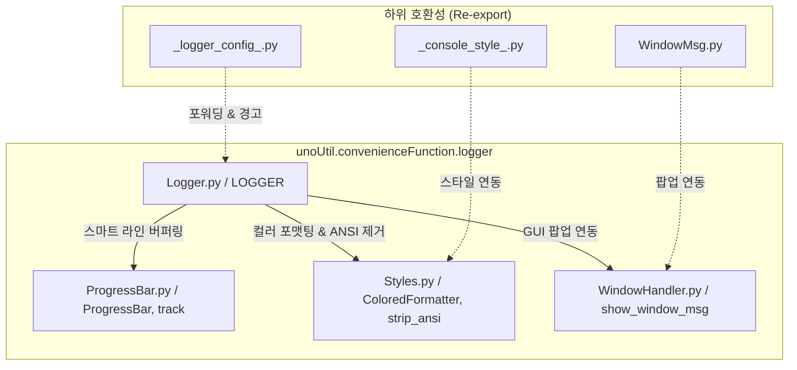

# 🧭 unoUtil 통합 로깅 및 콘솔 모니터링 모듈 (LOGGER)

> **관련 영구 지식 문서 및 모듈**: [[_logger_config_]], [[_console_style_]], [[WindowMsg]], [[FileDataReader]], [[VT_ACCBRK]]

---

## 1. 📌 개요 및 개발 배경

차량 시험 데이터 분석(`vehicleTest`), 대용량 바이너리/로그 파싱(`fileDataReader`), GPS 좌표 보정(`gpsProcessing`) 등 엔지니어링 파이프라인 전반에서 다음과 같은 콘솔 UI 및 로깅 요구사항이 존재했습니다:

1. **로그 포맷의 다변화 요구**:
   - 실시간 시각(%H:%M:%S) 기반의 이벤트 기록
   - 직전 작업 대비 소요 시간(`[+0.123s]`)을 추적하는 성능 프로파일링
   - 특정 코드 블록의 시작/종료 소요 시간을 일일이 `time.time()` 하지 않고 자동 측정하는 타이머(`with logger.measure()`)
2. **반복 루프 진행률 가시화 (Progress Bar)**:
   - 수십~수백 개 파일 일괄 로딩(`scan_dir`)이나 수십만 행 데이터 보간 시 진행 상황(%, ETA, 처리속도) 파악 필요
   - 무거운 외부 라이브러리(`tqdm` 등) 없이 순수 파이썬 표준 라이브러리로 동작하는 초경량 프로그레스 바 구현
3. **로거와 프로그레스 바의 충돌 방지**:
   - 프로그레스 바가 화면에 떠 있는 동안 `logger.info()`가 출력되어도 게이지 바가 여러 줄로 복사되거나 화면이 깨지지 않는 스마트 버퍼링
4. **ANSI 탈색 파일 저장 및 GUI 팝업 알림**:
   - 콘솔에는 선명한 ANSI 컬러 및 이모지로 출력하고, 파일(`.log`)에는 색상 코드를 자동 제거(`strip_ansi`)하여 순수 텍스트로 보존
   - 치명적 오류(`ERROR`, `CRITICAL`) 발생 시 연구원이 즉각 인지할 수 있도록 선택적 PyQt5 팝업 메시지 박스 연동

이 모든 요구사항을 해결하기 위해 `unoUtil.convenienceFunction.logger` 패키지와 최상위 **`LOGGER` 클래스**가 구축되었습니다.

---

## 2. 🏗️ 아키텍처 및 모듈 구성

`unoUtil.convenienceFunction.logger`는 4개의 전담 모듈이 결합된 고성능 올인원 엔진입니다:



| 모듈 파일명 | 핵심 클래스 / 함수 | 주요 역할 |
| :--- | :--- | :--- |
| `Logger.py` | `LOGGER`, `get_core_logger`, `set_global_log_level` | 메인 통합 로거, 타이머 컨텍스트, 프로그레스 바 래퍼, 파일 저장 관리 |
| `ProgressBar.py` | `ProgressBar`, `track`, `get_active_progressbar` | 캐리지 리턴(`\r`) 기반 경량 진행률 바, 스피너 모드, 라인 클리어(`\033[K`) |
| `Styles.py` | `ColoredFormatter`, `strip_ansi`, `check_supports_color` | ANSI 컬러 코드, 레벨별 이모지, 터미널 환경 감지 및 파일용 탈색 |
| `WindowHandler.py` | `show_window_msg`, `WindowMsgHandler` | PyQt5 메시지 박스 팝업 및 헤드리스 콘솔 fallback 처리 |

---

## 3. 🚀 핵심 기능 및 사용법

### 3.1. 어디서든 1줄 임포트
최상위 패키지 및 바로가기를 모두 지원하므로 원하는 경로로 자유롭게 임포트할 수 있습니다:

```python
from unoUtil import LOGGER, track
# 또는
from unoUtil.logger import LOGGER, track
# 또는
from unoUtil.convenienceFunction.logger import LOGGER, track
```

---

### 3.2. 다양한 출력 포맷 (Format Presets)

`format_type` 인자 또는 개별 불리언 플래그를 통해 콘솔 출력 형태를 자유롭게 지정할 수 있습니다:

```python
# 1. 기본형 (Default: 현재 시각 + 레벨 + 모듈명)
# 출력: 15:30:00 [ℹ️ INFO   ] [unoUtil.Core] 파일 로딩 시작
logger = LOGGER("Core", format_type="default")

# 2. 직전 로그 대비 소요 시간 (Delta: [+0.xxx s]) -> 성능 튜닝에 최적
# 출력: [+0.125s] [ℹ️ INFO   ] [unoUtil.Signal] 헤더 파싱 완료
logger_delta = LOGGER("Signal", format_type="delta")

# 3. 누적 경과 시간 (Elapsed: [Total xx.xx s]) -> 장시간 배치 테스트에 최적
# 출력: [Total  12.45s] [ℹ️ INFO   ] [unoUtil.Batch] 10번째 세트 완료
logger_elapsed = LOGGER("Batch", format_type="elapsed")

# 4. 상세 모드 (Detailed: 시각 + 누적시간 + 직전소요시간 모두 표시)
logger_full = LOGGER("Full", format_type="detailed")
```

---

### 3.3. 스마트 구간 소요 시간 측정 (`measure`)

`start_time`을 재고 뺄셈을 할 필요 없이, `with logger.measure("작업명"):` 블록으로 감싸기만 하면 작업 완료 또는 실패 시 걸린 시간을 자동으로 로깅합니다:

```python
with logger.measure("VBO 파일 헤더 분석"):
    # 복잡한 계산이나 파일 I/O
    time.sleep(0.15)

# 콘솔 출력:
# 15:30:00 [ℹ️ INFO   ] [unoUtil.Core] ✔ VBO 파일 헤더 분석 완료 (0.150s)
```

만약 블록 내부에서 예외가 발생하면 실패 소요 시간과 에러 내용을 자동으로 로깅한 후 예외를 안전하게 re-raise합니다.

---

### 3.4. 경량 프로그레스 바 (`track` & `progress_bar`)

외부 패키지 설치 없이 `track()`으로 루프를 감싸면 실시간 진행률, 남은 시간(ETA), 처리 속도가 한 줄에서 부드럽게 갱신됩니다:

```python
# 리스트 순회 (total 자동 감지)
file_list = ["test1.vbo", "test2.vbo", "test3.vbo"]
for file in logger.track(file_list, desc="파일 일괄 로딩"):
    process(file)

# 출력 결과:
# 파일 일괄 로딩: 100.0% |█████████████████████████| 3/3 [00:01<00:00, 2.5file/s]
```

#### 🛡️ 로거-프로그레스 바 충돌 방지 메커니즘
프로그레스 바 실행 도중 `logger.info(...)` 로그가 발생하면, 내부의 `ProgressBarAwareStreamHandler`가 현재 진행 바 라인을 순간적으로 지우고(`\r\033[K`) 로그를 윗줄에 출력한 뒤 진행 바를 다음 줄에 복원합니다. 이로 인해 콘솔이 지저분해지는 현상이 100% 방지됩니다.

---

### 3.5. 영구 파일 저장 (`add_file_handler`)

```python
logger = LOGGER("FileDataReader", log_file="output/run.log")
# 또는 나중에 추가
logger.add_file_handler("output/batch_test.log")
```
* 콘솔에는 알록달록한 ANSI 컬러로 출력됩니다.
* 파일에는 `strip_ansi()`를 통해 **색상 이스케이프 코드가 완벽히 제거된 순수 텍스트**로 기록되어 텍스트 뷰어나 메모장에서 깨짐 없이 열립니다.

---

### 3.6. GUI 에러 팝업 연동

```python
# 심각한 에러 발생 시 콘솔 로그 + 윈도우 팝업 동시 호출
logger.error("필수 계측 채널(VehSpd)이 누락되었습니다!", popup=True)

# 또는 로거 생성 시 전역 팝업 활성화
logger = LOGGER("Project", gui_popup_on_error=True)
logger.critical("라이선스가 만료되었습니다!")  # 자동으로 팝업 창 생성
```

---

### 3.7. 🛡️ Windows 콘솔(cp949) 이모지 및 다국어 인코딩 안전성

Windows 기본 콘솔 인코딩(`cp949`) 환경에서 눈꽃(❄️), 로켓(🚀) 등의 이모지나 특수 유니코드 문자가 출력될 때 발생하는 `UnicodeEncodeError`를 원천 차단합니다:
* `ColoredConsoleHandler.emit()` 내부에서 인코딩 예외를 감지하여 현재 스트림 인코딩에 맞게 안전한 대체 문자(`errors='replace'`)로 자동 변환 출력합니다.
* 개발자나 사용자의 터미널 인코딩 설정과 무관하게 프로그램이 비정상 종료(Crash)되거나 `handleError` 경고가 발생하는 현상을 100% 방지합니다.

---

### 3.8. 🌲 프로젝트별 계층형 로거 트리 (`root_name`)

복잡한 대규모 패키지에서는 `root_name`을 지정하여 일관된 네임스페이스 트리를 구성할 수 있습니다:

```python
# 마스터 컨트롤러
logger_master = LOGGER("Master", root_name="SnowBraking")
# 서브 엔진
logger_engine = LOGGER("Engine", root_name="SnowBraking")
logger_twin = LOGGER("Twin", root_name="SnowBraking")

# 콘솔 출력:
# 17:11:30 [INFO   ] [SnowBraking.Master] 파이프라인 시작
# 17:11:30 [INFO   ] [SnowBraking.Twin  ] 3D 격자 맵 구축 완료
# 17:11:30 [DEBUG  ] [SnowBraking.Engine] Random Forest 모델 학습 완료
```
부모 로거(`SnowBraking`)의 레벨을 변경하면 모든 자식 로거(`Master`, `Engine`, `Twin`)의 출력 레벨이 동시에 제어됩니다.

---

## 4. 🔄 레거시 코드 하위 호환성 (Zero Breaking Change)

기존에 `_logger_config_.py`를 사용하던 코드들은 단 1줄도 수정할 필요가 없습니다:

```python
# 기존 코드 그대로 동작 (내부적으로 신규 LOGGER로 포워딩 및 안내 경고 출력)
from unoUtil.convenienceFunction._logger_config_ import get_core_logger, set_global_log_level

logger = get_core_logger("Project", root_logger_name="VT_ACCBRK")
set_global_log_level("VT_ACCBRK", logging.DEBUG)
```

---

## 5. 📊 활용 가이드: 언제 무엇을 쓰는가?

| 상황 / 요구사항 | 추천 도구 / 문법 | 비고 |
| :--- | :--- | :--- |
| 단순 상태 알림, 파라미터 확인 | `logger.info("...")`, `logger.debug("...")` | 실시간 시각 기록 |
| 작업 완료, 검증 통과 | `logger.success("...")` | 볼드 녹색 + 체크 이모지(✔) |
| 특정 연산의 소요 시간 측정 | `with logger.measure("연산명"):` | 타이머 코드 작성 불필요 |
| 대량 파일 / 데이터 순회 루프 | `for item in logger.track(items, desc="..."):` | %, ETA, 속도 렌더링 |
| 야간 배치 / 장시간 분석 로그 보존 | `LOGGER(..., log_file="analysis.log")` | 파일 자동 ANSI 탈색 |
| 사용자 주의가 필수적인 치명적 에러 | `logger.error("...", popup=True)` | PyQt5 윈도우 팝업 연동 |

---

## 6. 🏛️ 전사 패키지 적용 현황

`LOGGER` 클래스는 현재 사내 핵심 실차 데이터 분석 패키지에 전면 도입되어 무중단 검증을 완료했습니다:

### 1) `VT_ACCBRK` (실차 가감속 평가 패키지)
* `VT_ACCBRK.py` (`VT_ACCBRK.Core`)
* `VT_ACCBRK_PROJECT.py` (`VT_ACCBRK.Project`)
* `VT_ACCBRK_TIRE.py` (`VT_ACCBRK.Tire`)
* `_CORRECT_.py` (`VT_ACCBRK.Correct`)
* `_AN_MEMORY.py` (`VT_ACCBRK.Memory`)

### 2) `Snow_braking_relate_condition` (스노우 노면 특성 및 제동 보정 패키지)
* `Snow_Braking_Performance.py` (`SnowBraking.Master`)
* `surface_condition_twin.py` (`SnowBraking.Twin`)
* `correction_engine.py` (`SnowBraking.Engine`)
* `spec_analyzer.py` (`SnowBraking.Spec`)
* `snow_physics_utils.py` (`SnowBraking.Physics`)
* `surface_dashboard.py` (`SnowBraking.Dashboard`)

---

## 7. 🔗 연관 영구 지식 문서
* 🧠 **[[24_파이썬_로깅_엔진_원리와_실시간_성능_프로파일링_설계|파이썬 로깅 엔진 원리와 실시간 성능 프로파일링 설계 (포매터/핸들러/인코딩 해부)]]**
* 📘 **[[10_VT_ACCBRK|VT_ACCBRK 실차 가감속 평가 모듈 매뉴얼]]**
* ❄️ **[[20_SnowBrakingPerformance_통합모듈_매뉴얼|SnowBrakingPerformance 통합 모듈 매뉴얼]]**
