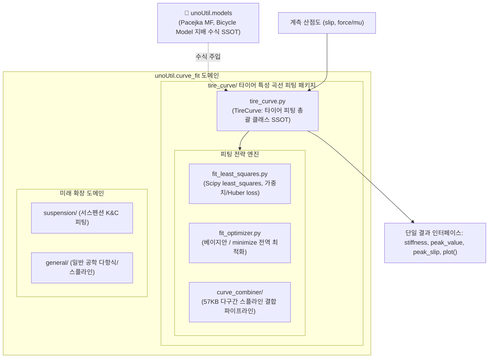

# 🎯 unoUtil 커브 피팅 (curve_fit) 대시보드 (MOC)

> **상위 허브**: [[00_unoUtil_모듈개발_대시보드|unoUtil 모듈개발 마스터 허브]]  
> **패키지 경로**: `unoUtil.curve_fit`  
> **역할**: 타이어 특성 곡선(`TireCurve`)을 비롯하여 향후 서스펜션, 파워트레인 등의 공학 계측 데이터 비선형 피팅을 총괄하는 전담 도메인

---

## 🏛️ 커브 피팅 아키텍처 및 도메인 분리



---

## 📜 버전 이력 및 주요 개발 현황 (Changelog)

| 버전 | 일자 | 작업자 | 주요 변경 및 승격 내역 | 상태 |
| :--- :| :---: | :---: | :--- | :---: |
| **v3.4** | 2026-09-29 | uno & Gemini | **curve_fit 최상위 도메인 승격 및 tire_curve 패키지 완전 일원화**<br>- `curve_fit` 최상위 도메인 신설 및 `tire_curve/` 전용 패키지 구축<br>- 과거 파편화되어 있던 모든 MF 피팅(`CurveCombiner`, `fit_mf_ax`, `estimatorMF`, `MinimizeEstimator`)을 **`TireCurve` 단 하나의 타이어 피팅 모듈**로 완전 흡수 통합<br>- 57KB 복합 스플라인 결합 파이프라인(`curve_combiner/`) 온전 수납 및 내부 캡슐화 완료<br>- 향후 서스펜션/일반 피팅 확장을 위한 OCP 기반 도메인 격리 완료<br>- 12대 도메인 임포트 및 36개 레거시 경로 100% 무결성 검증 통과 | ✅ 배포 완료 |

---

## 📂 서브패키지 구성 및 1:1 기술 매뉴얼

### 🛞 타이어 커브 피팅 (`tire_curve/`)
* [[tire_curve|🛞 tire_curve: 타이어 종/횡방향 비선형 특성 곡선 피팅 총괄 클래스 (TireCurve)]]
* [[fit_least_squares|🎯 fit_least_squares: Scipy 비선형 최소자승 가중치/Huber 추정기]]
* [[curve_combiner|📈 curve_combiner: 다구간 스플라인 결합 및 국소 트렌드 라인 추정기]]

---

## 💡 Quick Start

```python
from unoUtil.curve_fit import TireCurve

# 1. 단 하나의 모듈로 모든 피팅 제어
tire = TireCurve(direction='longitudinal')

# 2. Scipy 최소자승법 피팅
tire.fit(slip, force, method='least_squares')

# 3. 다구간 스플라인 결합 피팅 (CurveCombiner)
tire.fit(slip, force, method='combiner')

# 4. 특성치 도출
print(f"제동 강성: {tire.stiffness:.2f}, 피크 마찰: {tire.peak_value:.2f}")
tire.plot()
```
