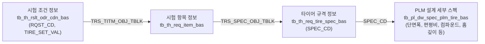

# 🔗 connect_spec_with_req_set (의뢰번호/타이어세트 기반 PLM 세부 스펙 추출 모듈)

> [!ABSTRACT] 📌 개요
> 실차 시험 의뢰번호(`RQST_CD`)와 타이어 세트 식별자(`TIRE_SET_VAL`, 예: `T1`, `T2`)만으로, 별도의 내부 시스템 키(`PLM_SPEC_OBJ_TBLK`) 없이도 매핑된 규격 코드(`SPEC_CD`)를 자동 역추적하고, PLM 마스터 테이블(`tb_pl_dw_spec_plm_tire_bas`)에 정의된 세부 설계 스펙 속성들만 슬림하게 고속 추출하는 데이터베이스 전용 인터페이스 모듈입니다.
>
> * **소스 파일**: `_func_connect_spec_with_req_set.py`
> * **상위 대시보드**: [[00_unoUtil_모듈개발_대시보드]]

---

## 1. ⚙️ 데이터 흐름 및 조인 아키텍처

실무 데이터에서는 의뢰 시스템 내의 `PLM_SPEC_OBJ_TBLK` 키가 `NULL`이거나 누락되는 케이스가 빈번히 발생합니다. 본 모듈은 스펙키의 유무에 의존하지 않고, 의뢰-스펙 매핑 관계에서 도출된 **`SPEC_CD`를 직접 매개체로 하여 PLM 테이블과 결합**합니다.



### 조인 경로 요약
1. `hkt_rnd_dw.test.tb_th_rslt_odr_cdn_bas` (의뢰번호, 타이어세트 필터링)
2. `hkt_rnd_dw.test.tb_th_req_item_bas` (`TRS_TITM_OBJ_TBLK` 키 조인)
3. `hkt_rnd_dw.test.tb_th_req_tire_spec_bas` (`TRS_SPEC_OBJ_TBLK` 키 조인)
4. `hkt_rnd_dw.specification.tb_pl_dw_spec_plm_tire_bas` (`SPEC_CD` 매핑 LEFT JOIN)

---

## 2. 📋 함수 시그니처 및 주요 파라미터

```python
def connect_spec_with_req_set(
    req: Union[str, List[str]],
    tire_set: Optional[Union[str, List[str]]] = None,
    target: str = tb_pl_dw_spec_plm_tire_bas,
    cur=None,
    **kwargs
) -> Optional[pd.DataFrame]:
```

| 파라미터 | 타입 | 기본값 | 설명 |
| :--- | :---: | :---: | :--- |
| `req` | `str \| list` | **필수** | 의뢰 코드 (예: `'26RE040025KF'` 또는 `['26RE040025KF', ...]`) |
| `tire_set` | `str \| list` | `None` | 타이어 세트 값 (예: `'T1'`, `['T1', 'T2']`). `set` 키워드로도 호환 입력 가능 |
| `target` | `str` | `tb_pl_dw_spec_plm_tire_bas` | 조회할 PLM 세부 스펙 프로젝션 컬럼 문자열 (`q4` 모듈 정의 컬럼) |
| `cur` | `Cursor` | `None` | 외부에서 전달받은 Databricks 커서 객체. `None`일 시 함수 내 자동 생성/종료 |
| `**kwargs` | `dict` | - | `limit`(최대 조회 행), `save`(파일 저장 옵션: `True` 또는 `'경로.pkl.gzip'`) |

---

## 3. 💡 실무 사용 예제

```python
from _authconn_ import make_conn, close_conn
from _func_connect_spec_with_req_set import connect_spec_with_req_set

# 1. DB 커서 생성
conn = make_conn()

try:
    # 2. 의뢰번호와 세트(T1)만으로 세부 PLM 스펙 조회
    df = connect_spec_with_req_set(
        req="26RE040025KF",
        tire_set="T1",      # 단일 'T1' 또는 ['T1', 'T2']
        cur=conn,
        save="db_spec_t1.pkl.gzip"  # 즉시 압축 캐싱
    )

    print(df.head())

finally:
    # 3. 연결 안전 종료
    close_conn(conn)
```
