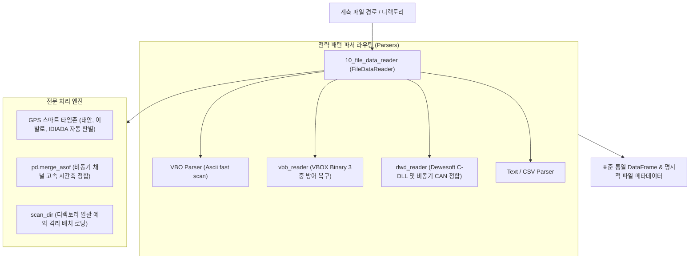

# 🚀 00_file_reader 차세대 이종 계측 데이터 통합 리더 프레임워크 대시보드

> [!ABSTRACT] 📊 시스템 개요
> 본 대시보드는 실차 시험(VBOX `.vbo`, `.vbb`, Dewesoft `.d7d`, 텍스트/CSV)에서 발생하는 극도로 다양한 계측 데이터를 단일 통합 인터페이스로 고속 파싱하는 **`file_reader` 패키지**의 마스터 포털입니다.  
> 레거시 `readDataFile`의 모놀리식 구조를 완전히 탈피하여 전략 패턴(Strategy Pattern) 기반 플루언트 파이프라인을 제공합니다.

---

## 🏛️ 1. 아키텍처 및 파서 라우팅

---

## 📦 2. 세부 모듈 및 기술 문서

* 🚀 **[[10_file_data_reader|10_file_data_reader 이종 계측 데이터 객체지향 통합 리더]]**:
  * 플루언트 API 메서드 체이닝(`set_channels()`, `set_time_resample()`, `read()`)
  * GPS 위경도 바운딩 박스 기반 동적 서머타임(DST) 및 현지 시계열 자동 보정
  * 사내 24개 핵심 모듈 무중단 전면 전환 완료 백서
* 🔬 **[[dwd_reader|dwd_reader Dewesoft D7D C-DLL 연동 및 비동기 정합 엔진]]**:
  * `DWDataReaderLib64.dll` 네이티브 바인딩 및 고속 동기/비동기 채널 격자화
  * 15만 행 비동기 채널 정합 2.05초 초고속 처리
* 📖 **[[vbb_reader|vbb_reader VBOX 바이너리(VBB) 고속 파싱 및 전원 차단 복구 엔진]]**:
  * `.vbo` 대비 60% 용량 절감 바이너리 스트림 파서
  * 실차 전원 급차단(Power-cut) 시 `NoneType` 비교 예외 원천 차단 및 EOF 선제 복구

---

## 📚 3. 영구 도메인 지식 연계 (2계층 지식화)

* 🛰️ **[[20_VBOX_계측_데이터_규격_및_GPS좌표계]]**: VBO vs VBB 구조, 음수 경도 거울상 방어 및 WGS84 타원체
* 💾 **[[21_바이너리_파일_IO_및_VBB_데이터_포맷_구조]]**: 바이너리 헤더, 레코드 블록 및 전원 차단 복구 수학
* 🌐 **[[22_GPS_좌표_기반_타임존_자동_판별_및_시계열_합성_이론]]**: 전 세계 주요 시험장 지리공간 폴리곤 및 DST 보정
* 🚀 **[[23_이종_계측_데이터_통합_파이프라인_및_대규모_마이그레이션_엔지니어링]]**: 사내 전사 패키지 마이그레이션 전략
