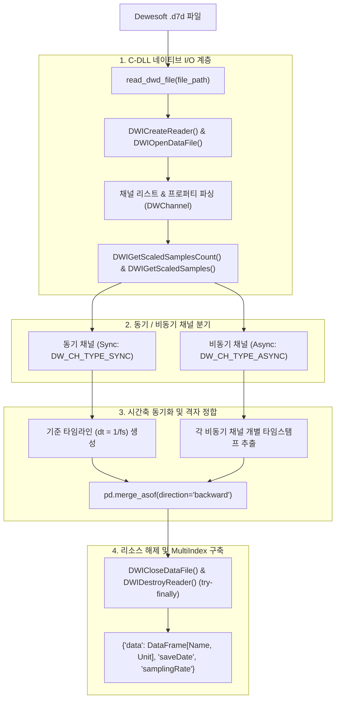

# 🔬 Dewesoft D7D C-DLL 연동 및 비동기 정합 엔진: `dwdReader`

본 문서는 Dewesoft 사의 고속 계측 포맷인 `.d7d` 바이너리 파일을 순수 Python 환경에서 네이티브 C-DLL(`DWDataReaderLib64.dll`)을 통해 초고속으로 디코딩하고, 동기(Sync)/비동기(Async CAN/GPS) 채널 간 시간축을 정밀하게 격자화(Grid-Alignment)하는 `dwdReader` 엔진의 내부 아키텍처 및 상세 API 레퍼런스입니다.

> **소속 모듈**: `unoUtil.file_reader.DWDataReader_v5_0_8.dwdReader`  
> **상위 인터페이스**: [[FileDataReader]] (`DWDParser`)  
> **관련 영구 지식**: [[23_이종_계측_데이터_통합_파이프라인_및_대규모_마이그레이션_엔지니어링]], [[20_VBOX_계측_데이터_규격_및_GPS좌표계]]

---

## 1. 🏛️ 시스템 아키텍처 및 동작 원리

Dewesoft `.d7d` 파일은 아날로그 가속도/하중 센서와 같은 **고속 동기 채널(Sync Channel, 통상 100~2000Hz)**과 차량 CAN 버스 또는 외장 GPS와 같은 **저속/가변 비동기 채널(Async Channel, 통상 10~100Hz)**이 하나의 파일에 혼합 저장됩니다.



---

## 2. 🌟 핵심 기능 및 엔지니어링 특징

### 2.1. 네이티브 C-DLL 래퍼 및 메모리 누수 원천 차단
- ctypes 기반으로 `DWDataReaderLib64.dll`(Windows) / `.so`(Linux) / `.dylib`(macOS) 라이브러리를 동적 링크합니다.
- `try...finally` 블록을 통해 파싱 도중 예외가 발생하더라도 C 핸들러(`DWICloseDataFile`, `DWIDestroyReader`)가 100% 정상 해제되어 **프로세스 메모리 릭(Memory Leak) 및 파일 스트림 잠금 현상을 완벽히 방지**합니다.

### 2.2. CAN/GPS 비동기 채널의 지능형 시간축 정합 (`merge_asof`)
- 동기 채널과 비동기 채널은 샘플 주기와 타임스탬프가 서로 다릅니다.
- `dwdReader`는 주 동기 채널의 시간 그리드를 기준으로, 비동기 CAN/GPS 채널의 타임스탬프를 **시간축 보간(`pd.merge_asof(direction='backward')`)**하여 왜곡 없이 단일 정사각 2차원 매트릭스로 결합합니다.

### 2.3. CAN 디코더 제한 경고 멍키 패칭 (Monkey Patching)
- 라이선스 제약으로 인해 C-DLL에서 발생하는 반복적인 CAN 디코더 경고 스팸을 감지하여, 세션당 최초 1회만 정보성 안내 후 자동으로 차단하여 콘솔 가독성을 보장합니다.

---

## 3. 🛠️ API 레퍼런스

### 3.1. `read_dwd_file(file_path: Union[str, Path], **kwargs) -> dict`
.d7d 파일의 전 채널을 로드하여 MultiIndex 데이터프레임과 메타데이터를 반환하는 8대 표준 동사 핵심 함수입니다. (구버전 별칭 `dwdRead` 100% 호환 제공)

```python
from unoUtil.file_reader.DWDataReader_v5_0_8.dwdReader import read_dwd_file

result = read_dwd_file("test_data/raw_readers/sample.d7d")

df = result['data']          # MultiIndex (Name, Unit) 형태의 DataFrame
save_date = result['saveDate']      # datetime.datetime (기록 시작 일시)
fs = result['samplingRate']         # float (주 샘플링 주파수, 예: 100.0 Hz)
```

- **반환 딕셔너리 구조**:
  - `'data'`: `pd.DataFrame` — 1열 `time`(초 단위)을 포함하며, 2계층 컬럼 인덱스(`Name`, `Unit`)를 보유.
  - `'saveDate'`: `datetime.datetime` — Dewesoft 헤더에 기록된 로컬 측정 일시.
  - `'samplingRate'`: `float` — 주 동기 채널의 샘플링 레이트.

---

### 3.2. `diagnose_dwd(file_path: Union[str, Path]) -> pd.DataFrame`
.d7d 파일 내부의 채널 구성, 단위, 데이터 타입, 동기/비동기 여부 및 수집된 샘플 개수를 요약 진단합니다. (구버전 별칭 `diagnoseDWD` 100% 호환 제공)

```python
from unoUtil.file_reader.DWDataReader_v5_0_8.dwdReader import diagnose_dwd

df_diag = diagnose_dwd("test_data/raw_readers/sample.d7d")
print(df_diag.head())
```

- **진단 데이터프레임 컬럼**:
  - `Index`: C-DLL 채널 고유 인덱스
  - `Channel_Name`: 채널명 (예: `ACC_X`, `GPS_Speed`, `CAN_RPM`)
  - `Unit`: 엔지니어링 단위 (예: `g`, `km/h`, `rpm`)
  - `Data_Type`: 수치 데이터 형식 (예: `DW_DATA_TYPE_FLOAT`, `DW_DATA_TYPE_INT`)
  - `Channel_Type`: 채널 성격 (`DW_CH_TYPE_SYNC`, `DW_CH_TYPE_ASYNC`)
  - `Sample_Count`: 수집된 총 샘플 수 (손상된 채널의 경우 -1)
  - `Array_Size`: 배열 크기 (단일 스칼라 채널은 1)

---

## 4. 🛡️ 하위 호환성 (Single Baseline Law)

| 최신 v2 표준 식별자 | v1 오리지널 레거시 별칭 | 비고 |
| :--- | :--- | :--- |
| `read_dwd_file(path)` | `dwdRead(path)` | 8대 표준 동사 규칙 적용 |
| `diagnose_dwd(path)` | `diagnoseDWD(path)` | 표준 snake_case 적용 |
