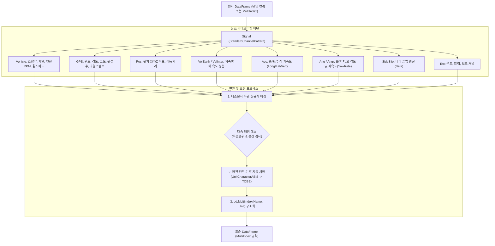

# 🏷️ StandardChannelPattern 기술 매뉴얼 및 사용자 가이드

> **소속 모듈**: `unoUtil.file_reader.standard_channel_pattern`  
> **표준 클래스**: `Signal`, `StandardChannelPattern`  
> **상태**: 릴리즈 완료 (Active)  
> **관련 영구 지식 문서**: [[20_VBOX_계측_데이터_규격_및_GPS좌표계]], [[23_이종_계측_데이터_통합_파이프라인_및_대규모_마이그레이션_엔지니어링]], [[FileDataReader]]

---

## 1. 📌 개요 및 도입 배경

실차 주행 시험에서는 Racelogic VBOX, Dewesoft, Oxford RT, 조향 로봇, CAN 로거 등 다양한 이기종 계측 장비가 사용됩니다. 각 장비와 계측 소프트웨어는 동일한 물리량을 서로 다른 채널 명칭이나 깨진 단위 기호로 기록합니다:

- **속도 채널 명칭 불일치**: `velocity`, `Velocity`, `V_Veh`, `GPS_Speed`, `Speed_ms`, `WHL_SpdFLV` 등
- **조향각 명칭 불일치**: `swa`, `Steering_Angle`, `MDPS_EstSt`, `StrAng` 등
- **인코딩 깨짐 단위**: `¡Æ` (deg), `¡Æ/s` (deg/s), `¡Æ/sec©÷` (deg/ss), `m/sec©÷` (m/ss) 등

**`StandardChannelPattern` (`Signal`)**은 정규표현식(Regex) 기반의 패턴 매칭을 통해 수백 종의 비표준 채널명을 사내 표준 규격(예: `Velocity`, `Time`, `VehSWA`, `Lat_accel` 등)으로 자동 변환하고, MultiIndex 컬럼 레벨에서 비표준 단위를 ISO/사내 표준 단위로 교정하는 전담 모듈입니다.

---

## 2. 🏛️ 시스템 아키텍처



---

## 3. 🌟 핵심 기능 및 API 레퍼런스

### 3.1. 표준 채널 변환 (`to_standard_channels`)

원시 데이터프레임의 비표준 컬럼명 및 단위를 사내 표준 규격으로 일괄 변환합니다.

```python
from unoUtil.file_reader import StandardChannelPattern

engine = StandardChannelPattern()

# 단일 컬럼 또는 MultiIndex 데이터프레임 변환
df_standard = engine.to_standard_channels(df_raw)
```

- **메서드 시그니처**:
  ```python
  def to_standard_channels(self, data: Optional[pd.DataFrame] = None, **kwargs: Any) -> pd.DataFrame
  ```
- **별칭 지원**: `change_signal_names`, `funcChangeSignalName` (구버전 100% 하위 호환)
- **반환값**: 최상단 컬럼이 `('Name', 'Unit')` 계층으로 구성된 `pd.MultiIndex` 데이터프레임.

### 3.2. 등록된 표준 신호 목록 조회 (`get_default_signals`)

현재 시스템에 등록되어 자동 매핑 가능한 모든 표준 신호 채널명의 목록을 반환합니다.

```python
signals = engine.get_default_signals()
print(signals[:5])
# ['VehSWA', 'VehSWV', 'VehSWT', 'VehLongAcc', 'VehLatAcc', ...]
```

### 3.3. 비표준 단위 자동 교정 테이블

| 원시 단위 (ASIS) | 교정 단위 (TOBE) | 대상 물리량 | 비고 |
| :---: | :---: | :---: | :--- |
| `¡Æ` | `deg` | 각도 | CP949/Latin-1 깨짐 |
| `¡Æ/s`, `?s` | `deg/s` | 각속도 | YawRate, RollRate |
| `¡Æ/sec©÷`, `?s?` | `deg/ss` | 각가속도 | Roll/Pitch 가속도 |
| `m/sec©÷`, `m/s?`, `m/s^2` | `m/ss` | 가속도 | Ax, Ay, Az |
| `?=Z€TEdit` | `deg` | 조향각 | 로봇 컨트롤러 출력 |
| ` `, `''` | `-` | 무차원/단위 미지정 | 일반 수치 |

---

## 4. 💡 실전 사용 예제

### 예제 1: FileDataReader 내부 자동 연동

`FileDataReader`의 메서드 체이닝(`apply_standard_channels()`)을 호출하면 내부적으로 `StandardChannelPattern`이 자동 구동됩니다:

```python
from unoUtil.file_reader import FileDataReader

reader = FileDataReader("test_data/sample.vbo")
reader.load()
reader.apply_standard_channels()  # 표준 채널 및 단위 자동 교정

print(reader.channels[:5])
print(reader.units)
```

### 예제 2: 독립 인스턴스로 수동 데이터프레임 변환

```python
import pandas as pd
from unoUtil.file_reader import StandardChannelPattern

df = pd.DataFrame({
    "time": [0.0, 0.01, 0.02],
    "velocity": [60.0, 59.8, 59.5],
    "lat_accel": [0.01, 0.02, 0.01],
    "MDPS_EstSt": [12.5, 12.6, 12.4]
})

engine = StandardChannelPattern()
df_std = engine.to_standard_channels(df)

# 변환 결과 확인
print(df_std.columns)
# MultiIndex([('Time', nan), ('Velocity', nan), ('Lat_accel', nan), ('VehSWA', nan)], names=['Name', 'Unit'])
```

---

## 5. 🛡️ 하위 호환성 가이드 (Single Baseline Law)

1. **레거시 함수명 호환**:
   - 구버전 코드에서 사용하던 `funcChangeSignalName(RawDF)` 메서드 호출은 신규 `to_standard_channels(data)`로 100% 매핑됩니다.
   - 키워드 인자 `RawDF`도 자동으로 `data`로 흡수되므로 기존 스크립트 수정 없이 동작합니다.
2. **레거시 클래스명 및 심볼 호환**:
   - `from unoUtil.file_reader import Signal, StandardChannelPattern, Infor_Vehicle, Infor_SensorPosition, GPS` 등 과거 네이밍 전수 제공.
