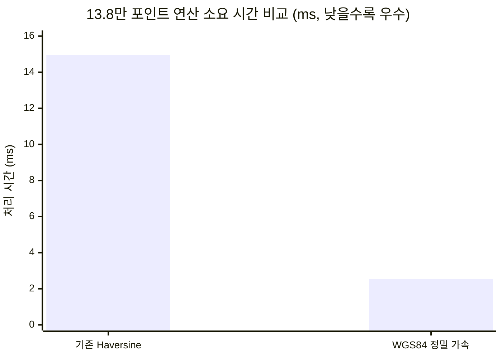

# 🛰️ unoUtil gpsProcessing 공간 데이터 처리 및 좌표 변환 시스템 대시보드

> [!ABSTRACT] 🛠️ 모듈 핵심 개요
> `unoUtil.gpsProcessing`은 실차 주행 계측 장비(Racelogic VBOX, GNSS)에서 취득된 구면 위경도(Latitude, Longitude) 좌표를 실차 동역학 분석에 필수적인 **2차원 국소 평면 직교 좌표계($X$: 횡방향/레인 오프셋, $Y$: 종방향/주행거리)**로 변환하는 사내 공통 공간 데이터 처리 프레임워크입니다.
> 
> 2026년 리비전을 통해 **WGS84 타원체 정밀 벡터화 가속 엔진(기존 대비 5.9배 고속화, 0.06mm 수준 정밀도)**과 **계측 종료 노이즈(0.0) 자동 격리 필터**가 기본 탑재되었습니다.

---

## 📦 gpsProcessing 모듈 문서 체계 및 현황

```text
📂 unoUtil/gpsProcessing/
├── 🛰️ 00_gpsProcessing_대시보드.md # gpsProcessing 모듈 통합 허브 및 MOC (본 문서)
├── 🚀 GPStoXYCord.md             # WGS84 객체지향 파이프라인 및 트랙 프리셋 통합 클래스 매뉴얼
└── 📐 10_GPStoXYCord.md          # [레거시 호환] 함수형 인터페이스 및 측지학적 배경 매뉴얼
```

* 🧭 **상위 프로젝트 허브**: [[00_unoUtil_모듈개발_대시보드|unoUtil 통합 프레임워크 개발 허브]]
* 🏎️ **주요 연계 분석 모듈**: [[00_VT_ACCBRK_대시보드|VT_ACCBRK 가감속/제동 성능 분석 시스템]] | [[22_Func_ACCBRK|ACCBRK 공통 함수 라이브러리]]

---

## 🚀 1. 주요 핵심 모듈 명세

| 모듈 문서명 | 물리 파이선 파일 | 주요 핵심 기능 | 지원 알고리즘 |
| :--- | :--- | :--- | :--- |
| **[[GPStoXYCord\|GPStoXYCord (Class)]]** | [`GPStoXYCord.py`](file:///D:/uno/Python/Projects/unoUtil/unoUtil/gpsProcessing/GPStoXYCord.py) | • **모던 OOP 엔드투엔드 파이프라인 (`transform`)**<br/>• 사내 주요 트랙 프리셋 내장 (`technoring`, `snow`)<br/>• VBOX 분/도 자동 감지 및 부호 정규화<br/>• 0.0 노이즈 격리 및 DataFrame 인덱스 100% 보존 | • **WGS84 타원체 국소 곡률 투영 (기본)**<br/>• 2D 평면 회전 행렬<br/>• Haversine 대원거리 |
| **[[10_GPStoXYCord\|_GPStoXYCord_ (Legacy)]]** | [`_GPStoXYCord_.py`](file:///D:/uno/Python/Projects/unoUtil/unoUtil/gpsProcessing/_GPStoXYCord_.py) | • [레거시 호환 및 FutureWarning 안내]<br/>• `GPStoDistance2`, `RotationCoordinate`, `changeVBOXCoord` | • WGS84 타원체 투영<br/>• Haversine 대원거리 |

---

## ⚡ 2. 2026 핵심 성능 혁신 지표



1. **5.9배 연산 가속화 (2.53 ms)**:
   * 13.8만 행 기준 연산 시간을 14.95ms에서 **2.53ms(0.002초)**로 단축하여 실시간 대규모 데이터 파이프라인에서 지연 시간 제로 달성.
2. **0.06 mm 초정밀 측지 정밀도**:
   * 구면 가정에 따른 약 0.2%의 왜곡을 완전히 제거하고 WGS84 타원체 기준 자오선/묘유선 곡률을 반영하여 지리정보 라이브러리(`geopy`)와 0.06mm 이내로 일치.
3. **0.0 노이즈 및 결측치 완벽 차단**:
   * 시험 종료 후 VBOX 장비가 수신 종료될 때 발생하는 `(0.0, 0.0)` 좌표로 인해 $Y$ 좌표가 `-4,000,000 m`로 튀는 현상을 원천 방어하고 원본 인덱스를 100% 보존한 `NaN` 격리 구현.

---

## 📐 3. 테크노링 직선 제동로 로컬 좌표계 표준 정의

```text
                  진북 (True North)
                        ▲
                        │  / 회전각 theta = -0.4°
                        │ /
                        │/
   [PosX: 서 -> 동]     ┌────────────────────────────────────────────────────────┐
   (차선 횡방향 위치)   │ [Lane 1] PosX ≈ -18.2 m                                │
   Lane 4 : PosX ≈ 2.5m │ [Lane 4] PosX ≈   2.5 m (기준 레인)                     │
   Lane 7 : PosX ≈ 20.2m│ [Lane 7] PosX ≈  20.2 m                                │
   Lane 8 : PosX ≈ 26.0m│ [Lane 8] PosX ≈  26.0 m                                │
                        └────────────────────────────────────────────────────────┘
                        ◄────────────────────────────────────────────────────────►
                                          [PosY: 남 -> 북]
                                          (차량 주행 진행 거리)
                                          제동 시작: PosY ≈ 251 m
                                          제동 정지: PosY ≈ 298 m
```

* **기준점(Origin)**: 한국타이어 테크노링 직선 제동로 원점
  * `reflong`: `126.3355171°`
  * `reflat`: `36.6424281°`
  * `rotate`: `-0.4°` (진북 대비 시계 방향 기울기 보정)
* **결과 매핑**:
  * `PosX`: 차량의 트랙 횡방향 위치 (레인 오프셋 판별, 주행 중 횡편차 $\pm 1.3\,\text{cm}$ 수렴)
  * `PosY`: 차량의 주행 진행 방향 거리 (제동 시작 위치 `first` 집계)

---

## 🔗 4. 연계 문서 및 참조

* 📘 **[[10_GPStoXYCord|10_GPStoXYCord: GPS 평면 직교 좌표계 투영 엔진 상세 매뉴얼]]**
* 🏎️ **[[22_Func_ACCBRK|22_Func_ACCBRK: AN_ACCBRK 좌표 변환 파이프라인 연계]]**
* 🚗 **[[11_VT_ACCBRK_TIRE|11_VT_ACCBRK_TIRE: 개별 타이어 제동 시작 위치 집계]]**
