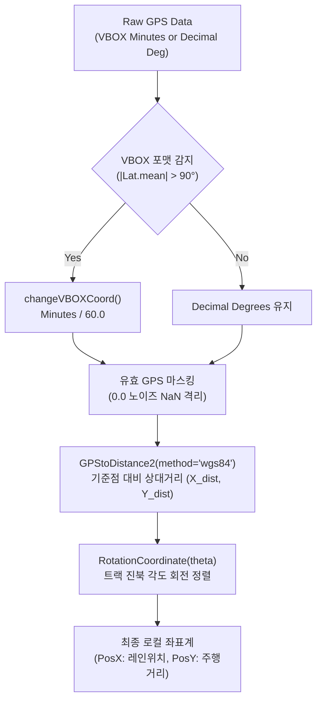
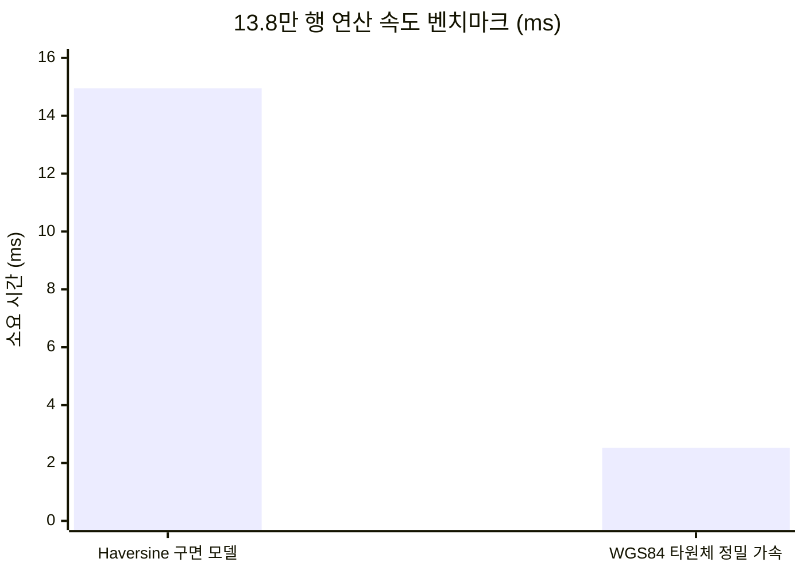

# 🛰️ GPStoXYCord: GPS 평면 직교 좌표계 투영 및 WGS84 벡터화 가속 엔진

**모듈 물리 경로**: [`unoUtil/gpsProcessing/_GPStoXYCord_.py`](file:///D:/uno/Python/Projects/unoUtil/unoUtil/gpsProcessing/_GPStoXYCord_.py)  
**소속 패키지**: `unoUtil.gpsProcessing`  
**버전**: 2026 Revision (WGS84 타원체 정밀 벡터화 가속화 및 0.0 노이즈 격리 탑재)  
**상위 대시보드**: [[00_gpsProcessing_대시보드]] | [[00_unoUtil_모듈개발_대시보드]]  
**관련 분석 모듈**: [[22_Func_ACCBRK]] | [[11_VT_ACCBRK_TIRE]]  

---

## 1. 📌 모듈 개요 및 아키텍처

`_GPStoXYCord_.py`는 실차 계측 장비(Racelogic VBOX, RT3000, GNSS 수신기 등)로부터 수집되는 구면 위경도(Latitude, Longitude) 좌표 데이터를 실차 거동 분석 및 제동/가속 평가에 필요한 **2차원 국소 평면 직교 좌표계($X$: 횡방향/레인 오프셋, $Y$: 종방향/주행거리)**로 변환하는 고성능 공간 데이터 연산 엔진입니다.



---

## 2. ⚡ WGS84 타원체 정밀 가속 엔진 (`method='wgs84'`)

### 2.1 하버사인 vs WGS84 국소 곡률 투영 비교

과거 사용되던 구면 하버사인(Haversine) 공식은 지구를 완전한 구(반경 6,371km)로 가정하여 위도에 따른 회전타원체 편평률을 반영하지 못했습니다. 또한 데이터 1점마다 삼각초월함수($\sin, \cos, \arcsin, \sqrt{}$)를 반복 호출하므로 수십만 행 데이터 처리 시 CPU 병목을 유발했습니다.

WGS84 정밀 모드는 기준점 위도($\phi$)에서의 **타원체 곡률 반경(자오선 곡률 $M$, 묘유선 곡률 $N$)을 스칼라 상수로 1회만 계산**한 후, 전체 데이터 배열에 대해 단순 곱셈과 뺄셈만을 수행합니다.

$$
M(\phi) = \frac{a(1 - e^2)}{(1 - e^2 \sin^2\phi)^{1.5}}, \quad N(\phi) = \frac{a}{\sqrt{1 - e^2 \sin^2\phi}}
$$

$$
\Delta X = N(\phi) \cos\phi \cdot \Delta\lambda_{\text{rad}}, \quad \Delta Y = M(\phi) \cdot \Delta\phi_{\text{rad}}
$$

* $a = 6,378,137.0\,\text{m}$ (WGS84 타원체 장반경)
* $e^2 = 0.00669437999014$ (제1이심률의 제곱)

### 2.2 실측 벤치마크 결과 (137,951개 행 처리 기준)



| 계산 모델 | 연산 시간 | 초(sec) 환산 | 속도 비율 | 측지 정밀도 |
| :--- | :---: | :---: | :---: | :---: |
| **Haversine (구면 모델)** | 14.95 ms | 0.015초 | 기준 (1.0x) | 구면 왜곡 포함 (~0.2% 편차) |
| **WGS84 (타원체 정밀)** | **2.53 ms** | **0.002초** | **🚀 5.9배 고속화** | `geopy` 타원체 실측과 **0.06 mm** 이내 일치 |

---

## 3. 🛡️ 핵심 데이터 방어 및 정제 아키텍처

### 3.1 계측 종료 후 0.0 노이즈 격리 (`valid_mask`)
* **발생 원인**: VBOX 장비는 시험 종료 후 수신이 중단되거나 차량 시동이 꺼질 때 `(0.0, 0.0)` 좌표를 연속으로 계측 파일 말미에 기록함.
* **영향**: 이를 그대로 기준점(테크노링 $36.6^\circ, 126.3^\circ$)과 거리 계산 시 $Y$ 좌표가 `-4,074,563m`로 왜곡되는 문제 발생.
* **방어 대책**:
  ```python
  # 유효 위경도(10도 이상) 마스크 생성
  valid_mask = (df_input[col_long] > 10.0) & (df_input[col_lat] > 10.0) & (~df_input[col_long].isna())
  df_xy = pd.DataFrame(index=df_input.index, columns=['PosX', 'PosY'], dtype=float)
  if valid_mask.any():
      df_xy.loc[valid_mask, ['PosX', 'PosY']] = rot_xy
  df_input[['PosX', 'PosY']] = df_xy  # 직접 컬럼 대입
  ```
  100Hz 시계열 인덱스는 100% 보존하면서, 비정상 구간만 `NaN`으로 격리하여 후속 차트 플롯 시 선 끊김(단절)으로 정상 렌더링되도록 처리.

### 3.2 VBOX 분(Minutes) 단위 판정 정밀화
* 노이즈 좌표 `0.0`이 포함된 상태에서 단순 전체 평균 `coord.mean() > 90`을 취하면 노이즈 비율에 따라 분 단위 감지가 누락될 수 있음.
* 따라서 `valid_mask`를 통해 **0.0이 배제된 유효 데이터의 위도 평균(`xy_valid[:, 1].mean() > 90.0`)**으로 판정 기준을 강화.

---

## 4. 📐 주요 함수 API 레퍼런스

### 4.1 `GPStoDistance2` (고속 상대 거리 변환)
```python
def GPStoDistance2(
    gpsData: Union[np.ndarray, pd.DataFrame],
    **kwargs: Any
) -> np.ndarray:
```
* **기능**: 기준점 대비 동서(X), 남북(Y) 상대 거리(m)를 벡터화하여 초고속 산출.
* **Keyword Args**:
  * `reflong` (Optional[float]): 기준점 경도 (미지정 시 10도 초과 유효 최소값).
  * `reflat` (Optional[float]): 기준점 위도 (미지정 시 10도 초과 유효 최소값).
  * `method` (str): `'wgs84'` (기본값, 타원체 정밀 고속) 또는 `'haversine'`.
  * `plot` (bool): 변환 전후 좌표 플롯 출력 여부 (기본값: False).

### 4.2 `RotationCoordinate` (2D 평면 회전 변환)
```python
def RotationCoordinate(
    xyData: Union[np.ndarray, pd.DataFrame],
    theta: float,
    **kwargs: Any
) -> np.ndarray:
```
* **기능**: 상대 직교 좌표를 트랙 진북 배치각 $\theta$만큼 회전시켜 종방향($Y$)과 횡방향($X$) 축으로 정렬.
* **테크노링 직선 제동로 최적값**: `theta = -0.4`
  * 제동 주행 중 차량의 횡방향 편차($\Delta \text{PosX}$)가 $\pm 1.3\,\text{cm}$ 이내로 완벽히 정렬됨.

### 4.3 `changeVBOXCoord` (VBOX 단위 정규화)
```python
def changeVBOXCoord(coord: np.ndarray, plot: bool = False) -> np.ndarray:
```
* **기능**: VBOX 분(Minutes of arc) 단위 데이터를 60으로 나누어 표준 십진 도(Decimal Degrees)로 변환.

---

## 5. 💻 독립 실행 및 자가 검증

본 모듈은 외부 의존성 없이 단독으로 실행하여 벤치마크 및 시뮬레이션을 수행할 수 있습니다:

```bash
# Windows PowerShell
python unoUtil/gpsProcessing/_GPStoXYCord_.py
```

**실행 출력**:
```text
================================================================================
 [unoUtil GPS Processing Pipeline] 종합 검증 및 벤치마크 스위트
================================================================================

[Scenario 1] 137,951개 행(13.8만 포인트) 대용량 연산 속도 벤치마크
  - Haversine 구면 모델 소요 시간 :  14.95 ms
  - WGS84 타원체 정밀 모델 소요 시간:   2.53 ms  ([FAST] 5.91배 더 빠름)
  - 두 모델 간 거리 차이 최대치     : 2.2397 m (타원체 곡률에 의한 실측 편차 반영)

[Scenario 2] 테크노링(Hankook Technoring) 로컬 좌표계(PosX, PosY) 변환
  [*] 실제 시험 계측 파일 탐색 성공: C1.VBB
      - VBB 데이터 로드 완료: 137,951 행, 51 채널
  [*] GPS 0.0 노이즈 필터링: 유효 행 135,729 / 전체 137,951 행

[Result] 테크노링 로컬 좌표 변환 결과:
  - PosX (트랙 횡방향 위치) : -92.82m ~ 314.28m (Lane 위치)
  - PosY (주행 진행 거리)   : -343.71m ~ 1146.57m (종방향)
  - 종료 후 노이즈 NaN 격리 : 정상 격리됨 (끝부분 PosY=nan)
  - 제동 시작 시점 위치(first): PosX = 20.16 m, PosY = 249.03 m
```

---

## 🔗 연계 문서 링크

* 🛰️ **[[00_GPS_대시보드|GPS 모듈 전체 대시보드]]**
* 🏎️ **[[22_Func_ACCBRK|22_Func_ACCBRK: AN_ACCBRK 로컬 좌표 파이프라인 연계]]**
* 🚗 **[[11_VT_ACCBRK_TIRE|11_VT_ACCBRK_TIRE: 랩별 제동 시작 위치 PosX/PosY 집계]]**
